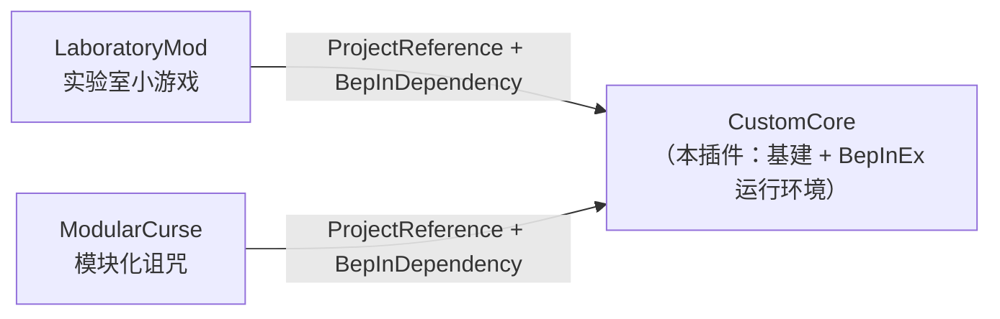

# MVZ2 Custom Core（前置核心）

> 《我的世界僵尸 2》（Minecraft VS Zombies 2）0.7.0 的 BepInEx 6 前置插件。
> 为同工作区的其它 mod（LaboratoryMod / ModularCurse）提供 IL2CPP 注入与资源注入的公共基建。

- 插件 GUID：`qoznos.mvz2.core`
- 当前版本：**0.1.0**
- 适配：MVZ2 **0.7.0 test-4**（Windows **x86** / IL2CPP / Unity 2022.3.62f3）

> ⚠️ 这是社区制作的**非官方**插件，与游戏原作者无关。
> ⚠️ **本 mod 不添加任何游戏内容**，它只是其它 mod 的前置依赖。

---

## 它解决什么问题

0.7.0 提供了官方的外部 Mod 扩展点，但在 IL2CPP + 注入类（`ClassInjector`）组合下有几个硬坑。
本插件把这些坑集中修好一次，后续 mod 直接复用。

| 源文件 | 作用 |
| ---- | ---- |
| `ClassInjectorFix.cs` | 修 `ClassInjector` 的两个缺陷：① 基类含泛型虚方法时 vtable 槽解析失败；② `System.String` 被重写为 `Il2CppSystem.String` 导致托管 override 匹配不上（抽象槽保留 → `EntryPointNotFoundException`） |
| `VTableRebind.cs` | 对注入的 `Mod` 子类重建并重新绑定原生 vtable 槽（`Class::Init` 会重置，需兜底） |
| `LoadModsPatch.cs` | 在游戏 `ModManager.LoadMods` 之前，对所有已注册注入类型执行一次 `VTableRebind.Ensure` |
| `MetaInjection.cs` | 接管 `ResourceManager.LoadMetaLists`：直接从磁盘读 `StreamingAssets/Mods/<nsp>/Content/metas/*.xml` 并用游戏的 `MetaXMLParser` 解析进 `ModResource` —— **完全绕过 Addressables provider 链路**，无需重打包 bundle |
| `SaveManagerPatch.cs` | 存档读写兜底：`SaveManager` 对注入 `Mod.Logic` 做虚调用前确保抽象槽已绑定 |
| `ArcadeIndexFix.cs` | `ModManager.LoadMods` 之后平移外部 mod 的 `ArcadeMeta.Index`，避免与 vanilla 的 `0/1/2` 撞车导致街机条目被顶掉 |
| `CoreModInfo.cs` | `ModInfo` 构造辅助：提供一个非 null 的空 `ResourceLocator`（meta 已由 `MetaInjection` 直读磁盘，资源查询返回空集是安全的） |
| `CoreRegistry.cs`（在 `Plugin.cs` 内） | 跨插件注册表：依赖本核心的 mod 在此登记 `命名空间 / LogicType / XmlDefaultNamespace`，上述补丁按 nsp 生效 |

---

## 构建

```powershell
cd CustomCore
.\build.ps1                 # 构建（游戏目录存在时自动部署到 BepInEx\plugins\）
.\build.ps1 -Clean          # 先清 bin/obj 再构建
.\build.ps1 -Pack           # 额外打包 dist\CustomCore_v0.1.0_0.7.0.zip
.\build.ps1 -Pack -Launch   # 打包后启动游戏冒烟
```

| 参数 | 作用 |
| ---- | ---- |
| `-GameDir <dir>` | 部署目标。默认 `E:\Game\PVZ\MVZ2\MVZ2 0.7.0 test-4`；目录不存在则**只构建不部署** |
| `-SkipBuild` | 跳过 `dotnet build`，直接用已有产物 |
| `-Clean` | 先删除 `bin/` `obj/` |
| `-KeepGame` | 不结束正在运行的游戏进程（**游戏会锁住插件 DLL**，一般不要用） |
| `-Pack` | 打包可分发 zip 到 `dist\` |
| `-Launch` | 构建/打包后启动游戏 |

### 打包特点

**只有本核心的包体包含 BepInEx 运行环境**（`winhttp.dll` / `doorstop_config.ini` / `.doorstop_version` / `dotnet/` / `BepInEx\core|interop|unity-libs|patchers|config`），
所以安装包是「解压到游戏根目录即可」的完整独立安装包。其它 mod 的包体只含插件 + 资源，需要先装本核心。

---

## 依赖关系



---

## 开发须知（IL2CPP 注入要点）

这些是踩坑后总结的硬约束，写其它 mod 时同样适用：

1. **托管 `new` 出来的 il2cpp 对象，存进注入类实例的字段后会被 GC 回收。**
   注入类字段不被 il2cpp GC 追踪 → 几秒后字段变悬垂指针（读字符串会触发
   `Fatal error. Internal CLR error (0x80131506)`；值比较静默失败）。
   必须用 GC 句柄钉住：见 `LaboratoryMod/Il2CppPin.cs`。
2. **编译引用必须与游戏二进制同批生成。** 游戏重建后 `BepInEx/interop` 里的类型代理
   会因 metadata token 重排而失配，表现为**随机 `0xC0000005` AV**（崩点漂移、无托管栈）。
   本工作区用 BepInEx **be.788**（Cpp2IL 支持 IL2CPP metadata **31.1** + Il2CppInterop 1.5.3），
   并把 `BepInEx.cfg` 的 `UpdateInteropAssemblies` 保持为 `true` 以便游戏更新后自动重生成。
3. **不要在 `PostInit` / `PostReloadMods` 里调用 `DefinitionGroup.GetDefinitions()`** 等官方
   LINQ 链路 —— 注入 def 参与原生 LINQ 枚举时会非确定性失败。
4. **崩溃要看 `BepInEx/ErrorLog.log`**：`LogOutput.log` 里**没有**原生 fatal error 的托管栈。

---

## 目录结构

```
CustomCore/
├─ build.ps1              构建 / 部署 / 打包脚本
├─ README.md              本文件
├─ CustomCore.csproj      工程文件（引用 ../runtime/ 的 BepInEx 与 interop）
├─ Plugin.cs              入口：应用各补丁 + CoreRegistry 定义
├─ ClassInjectorFix.cs    ClassInjector 泛型/String 缺陷修复
├─ VTableRebind.cs        注入类 vtable 槽重绑
├─ LoadModsPatch.cs       游戏 LoadMods 前统一重绑 vtable
├─ MetaInjection.cs       磁盘 XML metas 注入
├─ SaveManagerPatch.cs    存档读写兜底
├─ ArcadeIndexFix.cs      街机条目 Index 平移
└─ CoreModInfo.cs         ModInfo 构造辅助
```

---

## 许可证

[GPL-3.0](../LICENSE)。BepInEx 及其组件遵循各自原许可证。
