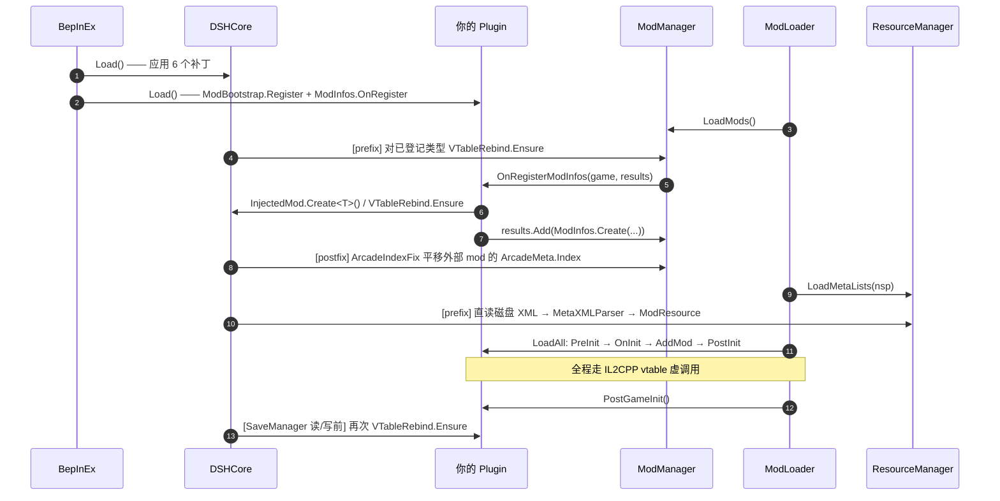

# DSHCore 开发参考 —— 写给 AI 与后来者

> **读者**：用 AI 辅助开发 MVZ2 mod 的人，以及被调用的 AI。
> **目标**：让一次对话就能写出**能跑起来**的注入类 mod，而不是靠反复崩溃试出来。
>
> 本文档记录的是「必须踩过一遍才知道」的东西。凡是写在这里的结论，都是在
> **MVZ2 0.7.0 / Windows x86 / IL2CPP metadata v31.1** 上实测过的，
> 不是推测。遇到与本文冲突的直觉，信本文。

---

## 0. 先读这一页


| 项        | 值                                                                       |
| --------- | ------------------------------------------------------------------------ |
| 游戏      | Minecraft vs Zombies 2（MVZ2）**0.7.0**，Windows **x86**                  |
| 运行时    | Unity 2022.3.62f3 / IL2CPP**metadata v31.1**                             |
| BepInEx   | **be.788**（x86 IL2CPP），内含 Il2CppInterop **1.5.3**                   |
| 编译      | .NET 6 SDK（`net6.0`），`LangVersion 9.0`                                |
| 编译引用  | `runtime\`、游戏目录、或 `MVZ2_RUNTIME_DIR`（见 §3「前置与环境从哪来」） |
| 本库 GUID | `qoznos.mvz2.core`                                                       |

> ⚠️ 本库为社区作品，与游戏原作者无关。

**要写 UI 的，先读 [`UI_GUIDE.md`](UI_GUIDE.md)。**
原版 UI 是 prefab 驱动、控件靠私有 `[SerializeField]`，对外**没有**任何控件级 API；
`UI_GUIDE.md` 是动手时唯一需要读的东西（决策树 + 三套可拷示例 + 七条硬约定 + 验收方法），
背后的论证与完整坑清单在 [`UI_RESEARCH.md`](UI_RESEARCH.md)。
**大多数 UI 需求在它的 L1（`ShowDialog` / `ShowAdvice`）就结束了，不需要碰控件层**；
L2（设置项定义）的元数据通道已通，但**定义注入尚未跑通 PoC**，暂时别依赖。

---

## 1. AI 协作工作流（建议节奏）

mod 开发失败的原因大多不是"代码写错了"，而是**语义假设错了**：
以为某个类能继承、以为某个接口能实现、以为某个 API 在 IL2CPP 下能用。
这类错误在编译期看不出来，只在运行期以崩溃或静默失效的形式出现。
所以流程要把"验证假设"提到"写代码"之前。

```
① 用户提出设想
      ↓
② AI 调研并复述实现路径（读 interop 里的真实签名，不靠猜）
      ↓
③ AI 明确列出「语义风险」与「不可行点」← 这一步是整个流程的价值所在
      ↓
④ 用户确认/修正
      ↓
⑤ 开发（本文第 2/3 节的 API 与骨架）
      ↓
⑥ 自检日志验收（本文第 6 节）
```

### ① 设想

用户会说"我想加一个能 XX 的关卡 / 诅咒 / 道具"。**不要**立刻写代码。

### ② 调研：以 interop 里的真实签名为准

游戏源码不在仓库里，但**类型代理程序集在** `runtime/BepInEx/interop/`。
这是唯一可信的 API 事实来源 —— 它能告诉你某个方法是 `virtual` 还是
`final`、某个字段是 `public` 还是 `private`、抽象方法有几个。

用 Mono.Cecil 直接读（不加载程序集，无副作用）：

```powershell
Add-Type -Path "runtime\BepInEx\core\Mono.Cecil.dll"
$a = [Mono.Cecil.AssemblyDefinition]::ReadAssembly("runtime\BepInEx\interop\MVZ2.Logic.dll")
foreach ($t in $a.MainModule.Types) {
  if ($t.FullName -eq 'MVZ2Logic.Modding.Mod') {
    foreach ($m in $t.Methods) {
      if ($m.IsPublic -and $m.IsVirtual) { $m.ReturnType.FullName + ' ' + $m.Name }
    }
  }
}
```

> 别用 `Assembly.LoadFrom` 去反射 interop —— 那些程序集依赖 IL2CPP 运行时，
> 在游戏进程外加载会抛异常。Cecil 是静态读取，安全。

### ③ 语义风险清单（每次都要过一遍）

调研完，**必须**主动向用户报告下面这些点是否命中：


| 要检查的问题                                                       | 为什么                                                                      |
| ------------------------------------------------------------------ | --------------------------------------------------------------------------- |
| 需要继承的类，它的构造函数签名是什么？`(IntPtr)` 还是 `(string)`？ | 注入类必须提供`(IntPtr)` ctor                                               |
| `sealed` / `final` 吗？                                            | 是就不能继承（interop 里显示为`IsFinal`）                                   |
| 要实现接口吗？                                                     | **注入类实现接口在 metadata v31 下会抛 `MethodAccessException`**，见 §5-⑤ |
| 要重写的基类方法是泛型虚方法吗？                                   | `ClassInjector` 解析不了泛型参数，vtable 槽绑不上                           |
| 参数/返回值里有`T`、数组、或是非代理类型吗？                       | interop 会因"不支持的返回类型"跳过该方法                                    |
| 需要读 XML / 图片 / 音频吗？                                       | 走磁盘直读（§5-⑦），不要指望 Addressables                                 |
| 需要存盘吗？                                                       | `ModInfo.LevelDataVersion` 必须 = 4，否则存档被丢弃                         |
| 对象是"托管 new 出来"再存进注入类字段吗？                          | 必须`Il2CppPin.Pin`，否则被 GC 回收（§5-①）                               |

### ④⑤⑥

确认后按 §2 的 API 开发，按 §3 的骨架起步，按 §6 的日志验收。

---

## 2. 公共 API 速查

全部在 `namespace DSHCore`，`using DSHCore;` 即可。


| 类型           | 成员                                                                                              | 什么时候用                                             |
| -------------- | ------------------------------------------------------------------------------------------------- | ------------------------------------------------------ |
| `Il2CppPin`    | `T Pin<T>(T obj)`、`int Count`                                                                    | 托管`new` 出来的 il2cpp 对象要存进注入类字段时         |
| `InjectedMod`  | `T Create<T>(string nsp)`、`T Initialize<T>(T inst, string nsp)`                                  | 创建注入的`Mod` 实例                                   |
| `ModBootstrap` | `Register(nsp, logicType, xmlDefaultNamespace, params Type[] extraInjectedTypes)`                 | 插件`Load()` 里一次登记 + 注册注入类                   |
| `ModInfos`     | `Create(nsp, logic, displayName)`、`OnRegister(handler)`、`EmptyLocator(nsp)`、`LevelDataVersion` | 构造 ModInfo、订阅官方注册点                           |
| `CoreRegistry` | `Register(RegisteredMod)`、`Get(nsp)`、`GetAll()`、`FormatAll()`                                  | 登记表（一般由`ModBootstrap` 代劳）                    |
| `VTableRebind` | `Ensure(Type logicType)`                                                                          | 手动兜底重绑 vtable 槽                                 |
| `LogViewer`    | `Url`、`OpenInBrowser()`、`CapturedCount`、`DroppedCount`、`Report(src,level,msg)`、`HideConsole()`/`ShowConsole()`、`Shutdown()` | 看实时日志、藏控制台窗口                               |
| `Plugin`       | `GUID`、`NAME`、`VERSION`、`Log`                                                                  | `[BepInDependency(DSHCore.Plugin.GUID)]`、共用日志通道 |

### `Il2CppPin.Pin`

```csharp
stage.id            = Il2CppPin.Pin(new NamespaceID(nsp, "my_stage"));
stage.propertyDict  = Il2CppPin.Pin(new PropertyDictionary());
stage.triggers      = Il2CppPin.Pin(new List<ITrigger>());
stage.behaviours    = Il2CppPin.Pin(new List<StageBehaviour>());
```

幂等、可重复调用；返回原对象，所以能直接写在赋值右侧。
自检时用 `Il2CppPin.Count` 核对条数。

**什么时候需要**：只要满足「托管代码 `new` + 存进**注入类实例的字段**」两个条件就要。
典型的被钉对象：`NamespaceID`、`PropertyDictionary`、`List<ITrigger>`、
`List<Behaviour>`、`DefinitionGroup`、各种 Meta、自己 `new` 的 Behaviour/BuffDefinition。
**不需要**：字段里存的是原生对象，或者对象由游戏创建。

### `InjectedMod.Create`

```csharp
var logic = InjectedMod.Create<MyMod>(MyMod.spaceName);
```

等价于原来每个 mod 手写的：

```csharp
var m = new MyMod(ClassInjector.DerivedConstructorPointer<MyMod>());
ClassInjector.DerivedConstructorBody(m);
m._Namespace_k__BackingField = nsp;
m.definitionGroup = Il2CppPin.Pin(new DefinitionGroup());
m.triggers        = Il2CppPin.Pin(new List<ITrigger>());
```

不想用反射就自己 `new` 再调 `InjectedMod.Initialize(instance, nsp)`。

### `ModBootstrap.Register`

```csharp
ModBootstrap.Register(
    spaceName: MyMod.spaceName,
    logicType: typeof(MyMod),
    xmlDefaultNamespace: "mvz2",
    extraInjectedTypes: new[] { typeof(MyStage), typeof(MyBuff) });
```

做了三件事：`CoreRegistry.Register`、`ClassInjector.RegisterTypeInIl2Cpp(logicType)`、
再逐个注册 `extraInjectedTypes`（自带去重）。`logicType` 会自动注册，不用重复列。

### `ModInfos.OnRegister` / `Create`

```csharp
ModInfos.OnRegister(OnRegisterModInfos);

private static Il2CppSystem.Threading.Tasks.Task OnRegisterModInfos(
    IGlobalGame game, Il2CppSystem.Collections.Generic.List<ModInfo> results)
{
    try
    {
        var logic = InjectedMod.Create<MyMod>(MyMod.spaceName);
        VTableRebind.Ensure(typeof(MyMod));
        results.Add(ModInfos.Create(MyMod.spaceName, logic, "My Mod"));
    }
    catch (System.Exception e)
    {
        Plugin.Log.LogError("OnRegisterModInfos error: " + e);   // 必须自己兜住
    }
    return Il2CppSystem.Threading.Tasks.Task.CompletedTask;
}
```

`OnRegister` 内部完成 `System.Func` → `Il2CppSystem.Func` 的委托转换 + 事件订阅。

### `LogViewer` —— 本地网页日志查看器

把所有插件的 BepInEx 日志实时推到浏览器（只监听 `127.0.0.1`），
于是不需要再盯着那个挡在游戏前面的控制台窗口。

**默认不开**：日志从游戏启动就捕获进内存环形缓冲（不监听端口、不弹浏览器），
需要时在游戏里输入：

```
/dshlog        开启（已开启则显示状态）
/dshlog off    关闭并释放端口      /dshlog open   用浏览器打开
/dshlog url    只打印地址          /dshlog status 显示状态
/dshlog console 显示/隐藏控制台     /dshlog clear  清空内存历史
```

指令名与子指令**支持 Tab 补全**：`/ds` + Tab → `/dshlog`、`/dshtrans`；`/dshlog o` + Tab → `off`/`open`。

> 另一条指令 `/dshtrans`（模组译文的外部文件：`keys` / `write <语言码>` / `reload`）
> 与 `/dshlog` 共用同一条分派链：`DebugCommands` 依次问两个 `Execute`，都返回 `null` 才放行。
实现见下面的「想加自己的游戏内指令」第 3 条。

> ⚠️ 写外部译文文件时，**游戏内容名（关卡名 / 诅咒名 / 实体名）那一行必须带上下文前缀**：
> `[levelname] 原文 = 译文`。`write <语言码>` 生成的模板已经带好了 `[上下文] ` 前缀；
> 只写 `原文 = 译文` 的条目只会命中界面文字，不会命中游戏内容名。见 `UI_GUIDE.md` §11.6。

> 为什么要拆成「一直捕获 + 按需开网页」：**调试时你要的是游戏启动到出问题那一段**。
> 捕获只是一个环形缓冲 + 一个后台线程；等出问题了再 `/dshlog`，打开就是完整历史。

配置在 `BepInEx/config/qoznos.mvz2.core.cfg` 的 `[LogViewer]` 段：

```ini
Enabled             = false     # true = 游戏启动时就自动开好网页
Port                = 18742     # 被占用会往后顺延
PortFallbackCount   = 10        # 顺延几个
AutoOpen            = true      # 开网页服务时自动开浏览器
LanAccess           = false     # 只监听回环；同网段机器要看得开它
RingBufferCapacity  = 5000      # 内存里留多少条历史（始终在记）
QueueCapacity       = 20000     # 队列上限，超出丢弃并计数（不会拖慢游戏）
AccessToken         = ...       # 自动生成；/api/* 都要它
HideConsoleWindow   = false     # 插件加载后自动藏起控制台窗口
AllowConsoleToggle  = true      # 允许网页里显示/隐藏控制台
```

| 路径 | 作用 |
| ---- | ---- |
| `GET /` | 查看器页面（内嵌在 DLL 里，**不需要令牌**） |
| `GET /api/status` | 会话 / 进程 / 缓冲 / 队列 / 客户端计数 |
| `GET /api/history?limit=N` | 最近 N 条历史 |
| `GET /api/events` | SSE 实时流 |
| `GET /api/console?action=show\|hide\|toggle` | 显示 / 隐藏控制台窗口 |
| `GET /api/clear` | 清空内存历史（磁盘日志不受影响） |

前端是单文件 `Diagnostics/logviewer.html`（内嵌进 DLL，可用
`<config>/DSHCore/logviewer.html` 覆盖而不重编译）。界面为**三栏**：左筛选 / 中日志 / 右详情，
两条分隔条可拖动调宽（双击分隔条或「重置分栏宽度」恢复默认），宽度记在 `localStorage`。
没选中行时 `#main` 带 `.no-detail`，右栏连同右分隔条一起 `display:none`。

> 布局只用两个 CSS 变量 `--w-left` / `--w-right`（拖动时改变量，不碰元素 `style.width`）。
> 窗口变窄时 `applyWidths()` 会临时压缩**显示**宽度，但 `wLeft`/`wRight` 记的仍是你想要的宽度，
> 拉回来就恢复；拖动起点取的是 CSS 变量当前值（不是记忆值），否则会出现一次跳变。

其它 mod 也可以直接用，不需要自己起服务：

```csharp
DSHCore.LogViewer.StartServer(out var msg);       // 开启（游戏内 /dshlog 调的就是它）
DSHCore.LogViewer.StopServer(out var msg);        // 关闭
DSHCore.LogViewer.Url;                            // 带令牌的地址
DSHCore.LogViewer.Report("MyMod", LogLevel.Warning, "自定义诊断"); // 不想建 ManualLogSource 时
DSHCore.LogViewer.DroppedCount;                   // 日志是否被丢弃
```

不想开浏览器时，用命令行也能取：

```powershell
# 带令牌的完整 URL 用 /dshlog url 打出来，直接抄即可
$u = 'http://127.0.0.1:18742/api/history?limit=20&token=<粘贴令牌>'
(Invoke-WebRequest $u).Content | ConvertFrom-Json | Select-Object time,level,source,message
```

关于日志窗口：本仓库自带的 `runtime/BepInEx/config/BepInEx.cfg` 已经把
`[Logging.Console] Enabled` 设成 `false`（黑窗根本不创建）。想要它回来：改回 `true`，
或游戏内 `/dshlog console` 临时显示；配置 `HideConsoleWindow = true` 也能自动藏。

#### 想加自己的游戏内指令？

照 `Diagnostics/DebugCommands.cs` 抄，或看 `ModularCurse/CurseCommand.cs` 的 `/curse`。
两个关键约定：

1. **不能用 `CommandUtility.SplitCommand` 之外的东西去猜参数**，也别指望官方
   `CommandDefinition` —— 它要求定义注册在 mod 自己的命名空间下，而裸命令名解析用的
   默认命名空间是 `mvz2`，拿不到 `/你的命令`。
2. **prefix 可以多个共存**：Harmony 会跑完所有 prefix，只有全部返回 `true` 才交给原方法。
   所以 DSHCore 的 `/dshlog` 与其它 mod 的指令互不干扰。
3. **想进 Tab 补全列表就得自己补**：官方 `FillSuggestions` 只遍历已注册的
   `CommandDefinition`，不走那条路（见第 1 条）就不会出现在补全里。
   做法是再挂一条 prefix：

   ```csharp
   // 签名取自 interop（C# 里的 string[] / List<string> 到 interop 就是这两个类型）
   AccessTools.Method(typeof(DebugManager), "FillSuggestions",
       new[] { typeof(Il2CppStringArray), typeof(Il2CppSystem.Collections.Generic.List<string>) })
   ```

   三个必须记住的点：
   - prefix 必须是 **void**（只追加不拦截）。返回 `false` 会把官方补全全弄没。
   - **建议项是整个「当前词」**：`DebugConsoleController.AutoComplete()` 把
     `currentSuggestions[i]` 当最后一个 token 直接拼回去（前面用 `SkipLast(1)`）。
     所以要返回 `dshlog` / `off` 这种**裸词**，不能带 `/` 或前面的部分。
   - `parts[0]` **已去掉开头 `/`**（`FillSuggestions` 内部拿它当指令名做 `NamespaceID.TryParse`），
     所以匹配规则对齐官方 `FillNameSuggestions` 的 `StartsWith(..., OrdinalIgnoreCase)` 即可。

   写完的东西放在纯托管的 `LogViewerCommand.Suggest()` 里（进的是 `string[]`、出的也是
   `string[]`），游戏胶水（读 `Il2CppStringArray`、写 interop `List`）只留在 `DebugCommands.cs`。
   这样补全规则能离线测，而碰 interop 的那几行全部包在 try/catch 里 —— 补全只需吞异常，
   绝不把整个输入框的刷新弄断。

---

### 快速启动（`[QuickStart] SkipIntro`，默认关闭）

跳过开场的**健康警告页**（约 11.5 s）与**报幕页**（约 2.5 s）。

做法很短：`MainSceneController.DisplayPage(MainScenePageType)` 的前置补丁里
**把参数改写成 `Titlescreen`**，然后让原方法照常执行 —— 只改参数、不跳过原方法，
所以页面切换、`currentPage`、标题页上的资源加载进度条全部还是官方的。

```csharp
[HarmonyPrefix]
private static void DisplayPagePrefix(ref MainScenePageType __0)
{
    if (__0 != MainScenePageType.HealthWarning && __0 != MainScenePageType.Splash) return;
    PlayMenuMusic();                       // 原版在「警告退场 -> Splash」那步播，跳过了就得自己补
    __0 = MainScenePageType.Titlescreen;   // 返回 void = 不跳过原方法
}
```

**几个必须记住的点：**

- **收益只有约 6 s**：开场动画和资源加载本来就是**并行**的，省下的是「开场时长 − 剩余加载时长」
  （本机 14.07 − 7.78 ≈ 6.3 s，38.0 s → 31.7 s），不是 14 s。机器越好省得越多。
- **`MainManager.IsFastMode()` 不能用**。它是最正统的入口（`GameEntrance.StartGame` 用它决定
  显示健康警告还是 `await GetInitTask(); DisplayMainmenu();`），但发行版里被 `#if UNITY_EDITOR`
  写死成 `false`，而实测（0.7.0）把它改成 `true` 之后**游戏会卡死**：窗口 `Responding = false`、
  `MainSceneController.Update` 不再有任何一帧、到不了主菜单（一次运行里还弹了「初始化失败」框）。
  游戏确实进了 fast 分支（只有那条分支会调 `GetInitTask()`），所以是**游戏自己的 fast 路径坏了**，
  不是补丁没装上。
- **验证这类东西别只用进程内探针**。本轮的探针给出过自相矛盾的结果（同一个 DLL，
  两次运行里 `IsFastMode` 一次有命中一次没有）。最后是靠**外部观察**定论的：
  `Get-Process ... | Select Responding` + `SetForegroundWindow` + `CopyFromScreen` 截图对比。
  +30 s 时 `SkipIntro=false` 是健康警告页、`SkipIntro=true` 已经在标题页。外部观察不会因为内联而说谎。

---

### `DSHCore.Ui` —— 用原版零件做界面

**完整论证 + 坑清单在 [`UI_RESEARCH.md`](UI_RESEARCH.md)，可运行范例在 `UiGallery/`。**
这里只给最少够用的一段。

先记住结论：**原版 UI 是 prefab 驱动的**。控件依赖私有 `[SerializeField]` 引用（字体、
Sprite、点击音效），所以 `AddComponent` 造出来的控件必崩或必无效；UI prefab 也不在
Addressables 条目里，mod 加载不到。**唯一可行路径是「克隆场景里已有的原版节点」。**

而且**先看是不是根本不需要碰控件**：

| 需求 | 该用什么 |
| --- | --- |
| 给玩家看一条信息 / 问一个问题 | `level.ShowDialog(...)` 或 `Global.GUI.ShowDialog(...)` —— 零 UI 代码 |
| 顶部提示条 | `level.ShowAdvice(...)`（`timeout` 单位是 tick，30 tps） |
| 一个设置开关 / 滑条 / 下拉 | `options.xml` + `OptionWidgetDefinition` —— 零 UI 代码，外观 100% 原生 |
| HUD 显隐 / 震屏 / 提示箭头 | `LogicLevelExt` 的扩展方法 |
| **往原版面板里插东西 / 要一个自定义面板** | ✅ 才需要往下看 |

```csharp
using DSHCore.Ui;

// ① 一个"标题 + 正文 + 若干按钮"的面板（整壳克隆自官方 CustomDialog）
var shell = UiSkin.Clone(UiSkinPart.Dialog, UiHost.Resolve(UiLayer.DialogLayer), "MyPanel");
var dlg   = shell.GetComponent<MVZ2.UI.CustomDialog>();   // 克隆体上带可用的 CustomDialog

// ② 往内容区插一行（位置在官方按钮区之前；布局由官方 VerticalLayoutGroup 负责）
var buttons = dlg.buttonRowList._listRoot;                 // Root/Buttons
var root    = buttons.parent.TryCast<RectTransform>();     // Root

// 控件行整行克隆自官方 OptionWidgets（四合一：复选框/滑条/下拉框/按钮）
var row = UiOptionRow.Create(null, "Row", UiOptionKind.Toggle);
row.Root.transform.SetParent(root, false);
row.Root.transform.SetSiblingIndex(buttons.GetSiblingIndex());
row.SetStretch()                                          // 铺满内容宽度
   .SetToggle("我的开关", true, v => { /* v = 新值 */ })
   .SetTooltip("标题", "悬停说明");                           // 原版同一套提示（锚点在行上方）

// 同一个行还能换成其它类型（换类型会关掉其它三个控件）：
// row.SetSlider("音量", 0f, 1f, false, 0.5f, v => { });   // 标签自动变「音量：0.5」并实时刷新
// row.SetButton("重置", () => { });
//
// ⚠️ 四个控件里的**下拉框那一支不可用**（展开列表不画，射线却生效）：
//    碍于技术问题，该组件无法正常工作，请自行寻找替代方案，如果你对修复该组件有任何建议，
//    请联系 QoZnoS[https://github.com/QoZnoS]。本库**不提供替代实现**。

// ③ 普通按钮的点击
UiClone.OnClick(buttonNode, () => { /* … */ });            // 内部处理委托转换 + 防 GC
```

| 类型 | 干什么 |
| --- | --- |
| `UiGame` | 官方 UI 引用链：`Main` / `Scene` / `SceneUi` / `Dialog` / `InputDialog` / `MainCanvas` |
| `UiFinder` | 按组件找**未激活**的 UI 节点（`FindObjectOfType` 找不到它们） |
| `UiSkin` | 素材：`Dialog` / `InputDialog` / `Title` / `Text` / `Button` / `ButtonRow` / `OptionRow` / `InputField` / `ScrollView`；`Clone` / `Template` / `Prepare` / `MeasureFont`（量素材出厂字号）/ `DumpScrollViewGraphics`（查"多了个白块"）/ `Report` |
| `UiHost` | `Resolve(layer)` / `DialogLayer()` / `InsertAfter` / `CreateStretched` / `MarkOwn` |
| `UiClone` | `Normalize` / `Activate` / `SetLabel` / `SetFontSize` / `DescribeFont` / `OnClick` / `KeepAlive` / `ForceGraphicsVisible` |
| `UiOptionRow` | **控件行的唯一入口**：`Create` / `SetKind` / `SetLabel` / `SetStretch` / `SetTooltip` / `SetToggle` / `SetSlider`（标签自动带值）/ `SetSliderValueFormat` / `SetButton` / `SetDropdown`（⚠️ 不可用）/ `Describe` / `LabelText` |
| `UiList` | **纯代码可滚动列表**：`Create` / `Add` / `AddButton` / `AddOptionRow` / `Clear` / `SetFlexible` / `SetViewportHeight` / `SuggestHeight` / **`SetRowFit`** / `ScrollToTop` / `ScrollToBottom` / `Describe` / **`DescribeStructure`** |
| `UiOptions` | **设置项注册**：默认进「模组设置」页（零注入）：`DeclareToggle` / `DeclareSlider` / `DeclareChoice` / **`DeclareMod(space, 名, 说明, 作者, 中文?)`** / `GetModEntry` / `SetModDisplayName(space, 源串, 中文?)`；`scope: VanillaMenu` 时才需要 `Attach(mod)`（LoadStages）→ `ApplyProperties()`（PostInit） |
| `UiLocale` | **模组文本本地化**：`Add(源串, 译文, 语言?, 上下文?)` / `Get(源串, 上下文?)` / `In` / `GetAll` / `Report` —— 把自己的小表挂进游戏的**两条**文本查找链（普通链 = 界面文字；`Particular` 链 = **关卡名 / 诅咒名 / 实体名等游戏内容名**）；**玩家可编辑的外部译文文件**（`ExternalDirectory` / `ReloadExternal` / `WriteTemplate` / `KnownKeys`，指令 `/dshtrans`；`UI_GUIDE.md` §11） |
| `UiLocaleTable` | **子 mod 的批量登记表**：`UiLocale.Table("命名空间")` → `En` / `Zh` / `Both` / `EnAll` / **`EnAllWith(上下文, …)`**，可链式；见 `UI_GUIDE.md` §11.2.1 |
| `UiTagRow` | **档案样式条目行**（Toggle + 文字，勾选 = 选中）：`Template` / `Create` / `Set` / `IsOn` / `Describe` —— 要「像对话档案那样的一行」就用它 |
| `AddonPage` | **插件页子页面**（入口按钮 + 页面壳 + 生命周期全自动）：override `Id` / `EntryLabel` / `Title` / `BuildContent(shell)`，构造里 `Register()`；两栏版式另有 `TwoColumnWidthRatio` / **`TopHeight`** |
| `AddonPages` | 子页面登记表 + 心跳 + 状态：`Get` / `All` / `IsAddonsPage` / `Report` |
| `ModSettingsPage` | 内建的「模组设置（DSHCore）」页（左栏 mod / 右栏详细信息 + 设置项） |
| `InjectedDefinitions` | **注入定义的通用设施**：`Apply` / `Register(nsp)` / `Bind(nsp, mod)` / `Track(def)` / `ListFor(nsp)` / `Create<T>(nsp, name)`（补原生 ctor 初始化 + 钉 GC 根） / `NamespaceOf(mod)` |
| `UiDropdown` | TMP 弹窗的**诊断**用（`Describe` / `DumpCanvases` / `Show` / `Hide`）—— 写新代码不需要它 |
| `UiTooltip` | `Attach(target, title, text)` / `AttachExisting(node, …)` / `SetText` / `Describe` / `Hide()` |
| `UiKit` | 克隆小工具：`HContainer` / `VContainer` / `Label` / `Paragraph` / `AutoHeight` / `TextButton` / `SetBold` / `Separator` / `Fit` / `ReplaceMask` / `ClearEmptySpriteAlpha` / `StripTextTranslators` / `MakeVertical` / `Path` / `SetTwoColumnWidth` / `Describe` |

八条硬约定：

> 下面这份清单与 [`UI_GUIDE.md`](UI_GUIDE.md) §6 同源；**写真实 UI 代码请直接读 `UI_GUIDE.md`**
> （那里有决策树、可拷示例和验收方法）。
1. **绝不算坐标、绝不定尺寸、绝不定义全局缩放。** 插进原版已有的 `LayoutGroup` 里，
   排版交给原版。（`GraphicConsole` 就是从"自定设计尺寸 + 全局 scale"开始失控的。）
2. **对话框的按钮别超过一行。** 框体高度是 `ContentSizeFitter` 撑的，按钮每多一行整体就长高一行；
   长正文折行也会把它顶出屏幕。**内容多的场合用可滚动容器**：`UiList.Create(...)`
   （底层是官方设置界面那个 `ScrollRect`，见 `UiSkinPart.ScrollView`）。
   要加的是"设置项"而不是自己的面板？→ 用 `UiOptions`（进原版设置界面，零 UI 代码，见 `UI_GUIDE.md` §3）。
3. **素材缺失是正常情况**（`Clone` 返回 null、只记一次警告）。标题界面早期拿不到
   `OptionWidgets`，进主菜单后自动就绪；**不要**把"拿不到"当成致命错误。
4. **控件行只能用 `UiOptionRow` 造**（它克隆的是官方 `OptionWidgets`）。不要单独克隆
   `LabeledToggle` / `TextSlider` / `LabeledDropdown`：它们的尺寸契约与提示锚点都长在父容器上，
   单拎出来就会出现“复选框过大 / 滑条看不见 / 下拉框不显示”。
5. **不要把标题素材当通用文本用**。`Title` 是 36pt + 自动缩放、容器 `TitleArea` 固定 40px 高，
   也就是它天生只能占一行（长标题靠自动缩小而不是换行）。正文用 `Text`（原版 **24pt** / 自动换行）。
   **本库不改任何素材的字号**，字号由使用者自己选：`UiClone.SetFontSize(node, size)`；
   先想知道某个素材出厂多大就 `UiSkin.MeasureFont(part)`。
   也**不要**为了避免“字号太大”而关掉 `enableAutoSizing` —— 那正是标题溢出框体的原因。
6. **只加 `TooltipAnchor` + `TooltipHandler` 不够** —— 还必须订阅 `OnPointerEnter` 并调
   `ShowTooltip`，否则鼠标悬停毫无反应且不报错。用 `UiTooltip.Attach` 别自己拼；
   锚点必须是**目标顶边中点**的独立子节点（`pivot = (0.5, 0)`、`LayoutElement.ignoreLayout = 1`），
   挂在目标自己身上会让提示正中压在控件上（`UiOptionRow` 的行自带正确锚点）。
7. **下拉框组件不可用，且本库不提供替代实现。**
   碍于技术问题，该组件无法正常工作，请自行寻找替代方案，如果你对修复该组件有任何建议，
   请联系 QoZnoS[https://github.com/QoZnoS]。
   行本身能显示、能改值，但 TMP 展开出来的选项列表在本游戏的 `GlobalUICanvas`
   （Screen Space - Camera）下**一个像素都不画**，而它的射线照常生效 ——
   用户看到的是“点开没反应、乱点却能改值”。六种画布/层级修法（不干预 / 对齐宿主 /
   强制 Overlay / 挪出面板 / 搬根画布 / 删画布）全部测不到像素，详见 `UI_RESEARCH.md` §6.4-17。
   需要“多选一”交互请**自己设计**（比如一排复选框行）。
8. **模态 vs 非模态**：沿用**原版**的语义层出口，不要自己拼模态。
   `level.ShowDialog(...)` / `Global.GUI.ShowDialog(...)` = 模态；`level.ShowAdvice(...)` = 顶部提示条；
   要让玩家先选一个再来 = 先弹对话框再去改。自己拼模态很容易忘了暂停游戏、
   或者漏掉点击拦截，最后表现成“背景还能点”。

想看效果：游戏内 `/dshui` 打开 **UiGallery** 组件画廊（可用 `/dshui page <名>` 跳页）。

---

## 3. 从零写一个 mod（最小骨架）

三个文件，直接拷走改名字即可。

### `MyMod.cs` —— 注入的 Mod 逻辑主体

```csharp
using System;
using DSHCore;
using MVZ2Logic.Games;
using MVZ2Logic.Modding;
using MVZ2Logic.Saves;

namespace MyMod
{
    public class MyMod : Mod
    {
        public const string spaceName = "my_mod";

        /// <summary>注入类的标准 ctor（Il2CppInterop 要求）。</summary>
        public MyMod(IntPtr ptr) : base(ptr) { }

        // ⚠️ 下面所有 override 里都**绝不能**调 base.Xxx()：代理虚调用会回到
        //    本方法 trampoline，无限递归直到 native 栈溢出。原生实现都是空的。

        public override void PreInit(IModLoader modLoader) { }
        public override void OnInit(IGlobalGame game) { }
        public override void PostInit(IGlobalGame game) { }

        public override void PostGameInit() { }

        // 这两个是**抽象方法，必须实现**（不实现编译不过）。
        public override ModSaveData CreateSaveData() { return null; }
        public override void LoadSaveData(ModSaveData data) { }
    }
}
```

### `Plugin.cs` —— 入口

```csharp
using BepInEx;
using BepInEx.Logging;
using BepInEx.Unity.IL2CPP;
using DSHCore;
using MVZ2.Modding;
using MVZ2Logic.Games;

namespace MyMod
{
    [BepInPlugin(GUID, NAME, VERSION)]
    [BepInDependency(DSHCore.Plugin.GUID)]
    public class Plugin : BasePlugin
    {
        public const string GUID = "yourname.mvz2.mymod";
        public const string NAME = "My Mod";
        public const string VERSION = "0.1.0";

        internal static new ManualLogSource Log;

        public override void Load()
        {
            Log = base.Log;

            ModBootstrap.Register(
                spaceName: MyMod.spaceName,
                logicType: typeof(MyMod),
                xmlDefaultNamespace: "mvz2",
                extraInjectedTypes: new[] { typeof(MyStage) });   // 按需

            ModInfos.OnRegister(OnRegisterModInfos);

            // 自己的 Harmony 补丁在这里 Apply()。
            Log.LogInfo(NAME + " v" + VERSION + " loaded");
        }

        private static Il2CppSystem.Threading.Tasks.Task OnRegisterModInfos(
            IGlobalGame game, Il2CppSystem.Collections.Generic.List<ModInfo> results)
        {
            try
            {
                var logic = InjectedMod.Create<MyMod>(MyMod.spaceName);
                VTableRebind.Ensure(typeof(MyMod));
                results.Add(ModInfos.Create(MyMod.spaceName, logic, "My Mod"));
            }
            catch (System.Exception e) { Log.LogError("OnRegisterModInfos: " + e); }
            return Il2CppSystem.Threading.Tasks.Task.CompletedTask;
        }
    }
}
```

### 前置与环境从哪来（先看这一小节）

新工程需要**两个文件**，职责不同：

| 文件 | 职责 |
| ---- | ---- |
| `MyMod/Directory.Build.props` | 声明「本工程属于 MVZ2 mod 家族」，并把仓库根的共享配置导入进来 |
| `MyMod.csproj` | 只描述工程自己（TFM / LangVersion / 引用哪些 BepInEx / 部署目标） |

**为什么必须两份？** MSBuild 只自动导入**离工程最近的那一个**
`Directory.Build.props`；而它又是在 csproj 正文**之前**求值的，
所以在 csproj 里写 `<Mvz2Mod>true</Mvz2Mod>` 根本来不及生效。

仓库根的 `Directory.Build.props` 统一决定三件事：

| 项 | 解析顺序 |
| ---- | ---- |
| `RuntimeDir` | `-p:` / `MVZ2_RUNTIME_DIR` / `local.props` / 仓库 `runtime\` / 工作区根就是 BepInEx 安装 / `GameDir` |
| `GameDir` | `-p:` / `MVZ2_GAME_DIR` / `local.props`（没给则只构建不部署） |
| DSHCore 引用 | 有 `DSHCore\DSHCore.csproj` → `ProjectReference`；否则 → `_refs\DSHCore\DSHCore.dll` |

所以写代码时**不需要**关心 runtime 在哪、DSHCore 是不是源码。

### `MyMod/Directory.Build.props`

拷贝仓库里任意一个 mod 目录下的同名文件即可，内容就这几行：

```xml
<Project>
  <PropertyGroup>
    <Mvz2Mod>true</Mvz2Mod>
    <Mvz2RootProps>$([MSBuild]::GetPathOfFileAbove('Directory.Build.props', '$(MSBuildThisFileDirectory)../'))</Mvz2RootProps>
  </PropertyGroup>
  <Import Project="$(Mvz2RootProps)" Condition="'$(Mvz2RootProps)' != ''" />
</Project>
```

### `MyMod.csproj`

```xml
<Project Sdk="Microsoft.NET.Sdk">
  <PropertyGroup>
    <TargetFramework>net6.0</TargetFramework>
    <AssemblyName>MyMod</AssemblyName>
    <RootNamespace>MyMod</RootNamespace>
    <LangVersion>9.0</LangVersion>
    <Nullable>disable</Nullable>
    <AllowUnsafeBlocks>true</AllowUnsafeBlocks>
    <AppendTargetFrameworkToOutputPath>false</AppendTargetFrameworkToOutputPath>
    <DebugType>portable</DebugType>
    <!-- RuntimeDir / RuntimeCoreDir / RuntimeInteropDir / GameDir，
         以及 DSHCore 前置的引用方式，均来自同目录的 Directory.Build.props -->
  </PropertyGroup>

  <ItemGroup>
    <Reference Include="BepInEx.Core"><HintPath>$(RuntimeCoreDir)BepInEx.Core.dll</HintPath><Private>false</Private></Reference>
    <Reference Include="BepInEx.Unity.IL2CPP"><HintPath>$(RuntimeCoreDir)BepInEx.Unity.IL2CPP.dll</HintPath><Private>false</Private></Reference>
    <Reference Include="Il2CppInterop.Runtime"><HintPath>$(RuntimeCoreDir)Il2CppInterop.Runtime.dll</HintPath><Private>false</Private></Reference>
    <Reference Include="0Harmony"><HintPath>$(RuntimeCoreDir)0Harmony.dll</HintPath><Private>false</Private></Reference>
    <Reference Include="$(RuntimeInteropDir)*.dll"><Private>false</Private></Reference>
  </ItemGroup>

  <Target Name="CopyToPlugins" AfterTargets="Build"
          Condition="'$(GameDir)' != '' And Exists('$(GameDir)MinecraftVSZombies2.exe')">
    <Copy SourceFiles="$(TargetPath)" DestinationFolder="$(GameDir)BepInEx\plugins\" />
  </Target>
</Project>
```

> 插件入口里 `using DSHCore;` 能直接用 —— 因为 `Plugin.cs` 的
> `[BepInDependency(DSHCore.Plugin.GUID)]` 与这句 using 依赖的引用，
> 都是上面那份共享配置提供的（源码模式 or `_refs` 里的二进制）。

想加磁盘资源（XML metas 等）就再拷一个 `DeployModAssets` 目标，
把 `assets\**\*` 映射到
`$(GameDir)MinecraftVSZombies2_Data\StreamingAssets\Mods\<nsp>\`。
可直接抄 `LaboratoryMod/LaboratoryMod.csproj`。

### 需要 XML metas 时

把 `assets/Content/metas/*.xml` 放到 mod 自己的 `assets/` 下（会部署到
`StreamingAssets/Mods/<nsp>/Content/metas/`），`MetaInjection` 会在
`ResourceManager.LoadMetaLists` 时直读磁盘并用游戏的 `MetaXMLParser` 解析进
`ModResource`。**两条硬约束**：

1. XML 里**不要写注释** —— `XmlDocument.LoadXml` 会把 Comment 节点放进子节点
   遍历，`BuffMetaList.FromXmlNode` 之类会 NRE（官方走 `XmlReaderSettings.IgnoreComments`，行为不同）。
2. 不要用官方的 `XMLHelper.ReadXmlDocument(string)` 重载 —— 它内部 StreamWriter
   未 Flush 就读流，必然抛 `Root element is missing`。

---

## 4. 0.7 官方集成链



**关键点**：`ModInfo.Logic` 在 0.7 里**不会**被重建，你在
`OnRegisterModInfos` 里 `InjectedMod.Create` 出来的那个实例，就是最终实例。

---

## 5. 陷阱清单

### ① 注入类字段不参与 il2cpp GC 追踪 → 对象被回收

**症状**（很反直觉，容易误判成"逻辑写错了"）

- `definition.GetID()` 的值比较**恒为 false** → 游戏查不到你的 Definition
  （街机列表里没有、`gotolevel <nsp>:<id>` 找不到关卡）
- 读该字段的 `string` 直接抛 `Fatal error. Internal CLR error. (0x80131506)`

**根因**：写入不经 write barrier，且注入类的 GC 描述符不含继承来的引用字段。

**对策**：`Il2CppPin.Pin(obj)`。见 §2。

---

### ② ClassInjector 的两处缺陷（DSHCore 已自动修）

1. 基类 vtable 含**泛型虚方法**时（如 `Definition.TryGetProperty<T>`），
   `SystemTypeFromIl2CppType` 无法把泛型参数 `T` 解析成 `System.Type`，
   于是 `GetMethod` 找不到重写而保留基类实现。
2. `RewriteType` 会把 `System.String` 重写成 `Il2CppSystem.String`，
   而托管 override 的签名是 `System.String`（与代理基类一致）→ `GetMethod` 匹配失败
   → **抽象方法槽**（如 `Mod.LoadSaveData`）保留抽象 stub，调用即抛
   `EntryPointNotFoundException`。

`ClassInjectorFix` 让 `string` 保持 `System.String`，其余无法解析的类型用
`object` 占位。**不需要你做什么** —— 但要知道为什么"抽象方法明明实现了却报找不到入口点"。

日志里会看到：

```
[ClassInjectorFix] string 保持 System.String (System.String)
[ClassInjectorFix] 无法解析 T, PVZEngine.Base → object 占位
```

---

### ③ `Class::Init` 会重置注入类的 vtable 槽

**症状**：抽象槽被重置为 thunk（`EntryPointNotFoundException`）；
virtual 槽被重置则 override **静默失效**（不报错，就是没生效）。

**对策**：`VTableRebind.Ensure(typeof(MyMod))`。DSHCore 已经自动在两个时机兜底：
`ModManager.LoadMods` 之前、以及 `SaveManager` 读写存档之前。
自己创建实例后**立刻**再调一次更稳（见骨架）。

---

### ④ 绝不要调 `base.PreInit()` 之类的基类实现

代理虚调用会回到**本方法自己的 trampoline** → 无限递归 → native 栈溢出。
原生 `PreInit` / `OnInit` / `PostInit` / `PostGameInit` 都是空实现，跳过无影响。

---

### ⑤ 不要用官方 LINQ 链路遍历注入的 Definition

**症状**：定义列表为空 / 关卡消失 / `ChangeStage missing`，
或抛 `MethodAccessException`。**非确定性**，时好时坏。

**根因**：metadata v31 注入环境下，`DefinitionGroup.GetDefinitions()` 里的
`SelectMany` / `OfType` 等接口枚举会失败。作者本人也在移除这类 LINQ 印证了此坑。

**对策**：自己维护一个 `List<Definition>` 追踪刚创建的 def（两个 mod 都是这么做的）。

---

### ⑥ 不要用 `is XxxType` 判断注入代理对象的运行时类型

代理对象是按**声明类型**包装的，`is` 判断**恒为假**。
需要判类型时比较 `GetType()` 或用你自己的标记。

---

### ⑦ 不要给注入类加接口实现

`ModLoader.LoadAll` 会对 `stageProviders.OrderBy(Priority)` 做原生 LINQ 接口分派，
注入类实现 `IStageDefinitionProvider` 在 metadata v31 下会抛 `MethodAccessException`
（与 ⑤ 同源）。**对策**：不用 provider，改在官方 `LoadStages` 时机直接创建定义
（见 `LaboratoryMod/LoadStagesPatch.cs`）。

同理：方法签名里带数组或非代理类型会被 interop 跳过：

```
[Warning:Il2CppInterop] Method ... GetWaveTypes(...) on type ... has unsupported return type PVZEngine.NamespaceID[]
```

---

### ⑧ `ArcadeMeta.Index` 会与 vanilla 撞车

`Index` 是"文件内同类条目序号"，外部 mod 从 0 开始，与 vanilla 的 0/1/2 撞车，
`ArcadeController.GetIDListByArcadeOrder` 按 Index 建数组 + `FirstOrDefault`
一槽留一个 → **你的条目会顶掉原版条目**。

**对策**：`ArcadeIndexFix` 自动把外部 mod 的 Index 平移 `vanillaMax + 1`。
验证：日志里 `index=16/17/18`（而不是 0/1/2）。

---

### ⑨ `BepInEx/interop` 必须与游戏二进制同批生成

**症状**：**随机** `0xC0000005` 访问违例 —— 崩点漂移、**没有托管栈**。

**根因**：类型代理按 metadata token 解析，游戏一重排 token 就失配。

**对策**：游戏更新后删掉 `BepInEx/interop`，把
`BepInEx/config/BepInEx.cfg` 的 `UpdateInteropAssemblies` 置 `true`，
启动一次让它重新生成，然后跑 `tools/sync-runtime.ps1` 把运行时刷回仓库 `runtime/`。

> ⚠️ 必须用 **be.788**。旧版（≤ be.697）自带的 Cpp2IL 只支持 metadata 23–29，
> 对本游戏的 v31.1 会直接报
> `Unsupported metadata version found! We support 23-29, got 31`。

---

### ⑩ 崩溃查 `ErrorLog.log`，不是 `LogOutput.log`

原生 fatal error 的托管栈**只在** `BepInEx/ErrorLog.log` 里。
`LogOutput.log` 里什么都没有，会让人以为"没报错"。

---

### ⑪ 存档版本号（`ModInfo.LevelDataVersion`）要**稳定**，而不是「等于某个数」

游戏存关卡时会把「所有 mod 的 (命名空间, 版本号)」写进存档头，读档时
**按命名空间逐个比对**（`LevelDataIdentifierList.Compare`）。所以真正的要求只有一条：
**本 mod 的关卡存档格式没变，就不要动这个值**；动了它（或改了命名空间）会让玩家已有的
本 mod 关卡存档被判「版本不匹配」而读不进去。

它**不需要**等于 `LevelManager.CURRENT_DATA_VERSION`（vanilla 自己用的那个值；
0.7.0（正式版与各内测版）均为 **5**）。`ModInfos.Create` 已经给了一个稳定常量（4），
两者并存没有问题，一般不用管。

---

### ⑫ 原生回调里必须自己 try/catch

`OnRegisterModInfos` 之类的回调抛异常到原生侧会**直接崩游戏**，
而且没有可读的托管栈。全部包 try/catch + 打日志。

---

### ⑬ `ResourceLocator` 不能为 `null`

`ResourceManager` 会对每个 Mod 调 `Locate`。用
`ModInfos.EmptyLocator(nsp)`（`ModInfos.Create` 已内含）。
meta 既然由 `MetaInjection` 直读磁盘，空 locator 返回空集是安全的 ——
但如果你要走 Addressables 加载 sprite/audio，就得换成真实 locator。

---

### ⑭ `RegisterTypeInIl2Cpp` 必须在任何实例化之前

包括 `new XxxBehaviour(...)` 这类隐式实例化。
所以注册都放在插件 `Load()` 里（`ModBootstrap.Register` 就是干这个的）。

---

### ⑮ 后台线程绝不能碰 IL2CPP / 游戏类型

托管线程没有 attach 到 IL2CPP 域时调用游戏 API **会直接崩，而且不产生任何托管栈**
（只留在 `ErrorLog.log`，看起来就像随机 AV）。

这条直接影响日志查看器的写法：它的队列消费线程与所有 HTTP 线程都是**纯托管**的 ——
只碰 `ConcurrentQueue`、`TcpListener`、`NetworkStream`，从不读游戏字段、不调游戏方法、
不看 `UnityEngine.*`。往 `DSHCore/Diagnostics/` 里加功能时请维持这个边界。

同理，日志回调（`ILogListener.LogEvent`）跑在**发起日志的那个线程**上，可能是 Unity
主线程 —— 所以那里只能入队，**绝不能**做 I/O 或加锁等待。

### ⑯ 控制台窗口只能藏「自己进程」的那个

游戏如果是从已有终端（cmd / PowerShell / Windows Terminal）启动的，BepInEx 不会新建
控制台，而是**附着**到父窗口；此时 `GetConsoleWindow()` 返回的是那个终端的窗口 ——
把它藏起来等于把用户自己的终端弄没了。

所以 `ConsoleWindow.Hide()` 会先用 `GetWindowThreadProcessId` 比对窗口的所属进程，
只有确实属于本进程时才动手（否则返回 `false` 且什么都不做）。从网页点「控制台」
得到 `not-our-window` 就是这个保护生效了，不是 bug。

### ⑰ 「只追加」的 prefix 必须返回 void

想往官方列表里塞东西（典型例子：把自家指令塞进 Tab 补全的
`DebugManager.FillSuggestions`），prefix 必须声明成 `void`。
如果写成 `bool` 并返回了 `false`，你会把那个方法**整个跳过** —— 官方的建议全没，
而且不报错，只表现为「补全面板少了点东西」，很难联想到是前一个 mod 干的。

两个配套细节：

- `AccessTools.Method(typeof(X), "Y", new[] { ... })` 是按**精确类型**匹配的。
  interop 方法面对应的是 `Il2CppInterop.Runtime.InteropTypes.Arrays.Il2CppStringArray`、
  `Il2CppSystem.Collections.Generic.List<string>` 这类类型，写 `string[]` / `List<string>`
  是找不到的（找不到就静默失效）。用 Cecil 把签名打出来确认，别猜。
- il2cpp 集合的索引器返回的就是 `System.String`，但**元素写入必须走 `List.Add`**；
  别试图拿 `IList<T>` 去强转（它是 il2cpp 代理，不是 BCL 集合）。

### ⑱ 克隆原版 UI 是唯一的控件用法，`AddComponent` 造不出来

原版控件依赖私有 `[SerializeField]` 引用（字体 / Sprite / 点击音效），
`AddComponent` 后这些引用全是 `null`；而 UI prefab 不在 Addressables 条目里，也加载不到。
**唯一的例外是两个"零序列化字段"的组件**：`TooltipAnchor` 与 `TooltipHandler`
（后者字段全 public），这两个可以安全 `AddComponent`。

→ 用 `DSHCore.Ui` 的 `UiSkin.Clone` / `UiHost`，别自己拼。完整论证见 `UI_RESEARCH.md`。

### ⑲ `FindObjectOfType` 找不到你要复用的 UI 素材

素材（控件模板、列表模板、对话框）平时**全是 `SetActive(false)` 的** ——
`ElementList.Awake` 会主动把模板子节点关掉。用官方 API 找，结果永远是"找不到"，
然后就会误以为"只能自绘"（`GraphicConsole` 的前半程就是这么走偏的）。

→ 用 `UiFinder.FindAll<T>`（自己从 `scene.GetRootGameObjects()` 递归，含未激活对象）。

### ⑳ 克隆体必须"规范化"，否则节点都在、尺寸也对，就是不显示

`UiClone.Normalize` 负责三件事：`SetActive(true)`、改名、打己方标记
（必要时再用 `ForceGraphicsVisible` 兜住 `Image.enabled == 0`）。

| 现象 | 原因 |
| --- | --- |
| 挂上去整片空白、子节点全在 `100×100 @ 0,0` | 模板架/父节点被 `SetActive(false)`，`LayoutGroup` 一次都没跑 |
| 面板“没有背景” | 克隆体的 `Image.enabled == 0`（原版那份也是 0，靠别的东西显形） |
| 点你的按钮却触发了原版的逻辑 | `Instantiate` 会复制持久化 `onClick` 监听器，闭包指向**原对象** |

⚠️ **规范化里不包括“关掉 TMP 自动缩放”** —— 早期版本关过，那是错的：`Title` 素材正是靠
`enableAutoSizing` 把长标题缩进 40px 高的 `TitleArea`；关掉它，标题会换成两行往上溢出框体。
字号“统一”的正确做法是**换素材**（标题用 `Title`、正文用 `Text`、控件行用 `UiOptionRow`），
而不是关自动缩放。

**素材字号是出厂值，不是规范值**：库不会替任何人改它（早期版本把 `Text` 规范成 12pt，
已删除）。要钉死字号就用 `UiClone.SetFontSize(node, size)`（只改字号、不动文本，
并关掉自动缩放）；想先问一句"原版这个素材多大"用 `UiSkin.MeasureFont(part)`，
想读现有节点用 `UiClone.DescribeFont(node)`。

⚠️ **还有一个只看节点看不出来的坑**：对话框高度是内容撑的、**而且不能滚**。
内容总高超过屏幕时整个框会顶出屏幕（连标题都跑到屏幕外），而所有节点的
`activeInHierarchy` 仍然全是 1。塞内容时量一下 `框体` 矩形：`y >= 0 && y + h <= Screen.height`。

### ㉑ 只加 `TooltipAnchor` + `TooltipHandler` 不够

鼠标悬停会**毫无反应，且不报错**。原版的链路是"宿主订阅 handler 的
`OnPointerEnter/OnPointerExit` → 造 `SimpleTooltipSource` → 调
`MainSceneController.ShowTooltip`"。少了宿主那一步，组件就只是个摆设。

→ 用 `UiTooltip.Attach(target, title, text)`。

**锚点在哪、`pivot` 是什么，同样是契约。** `Tooltip.SetPosition` 直接做
`rectTransform.pivot = viewData.pivot; rectTransform.position = viewData.position;`，
所以锚点决定了提示贴在哪里、贴在哪一侧：

| 锚点做法 | 结果 |
| --- | --- |
| 官方 `OptionTooltipAnchor.prefab`：**行的顶边中点**的独立子节点，`pivot = (0.5, 0)`、`LayoutElement.ignoreLayout = 1` | 提示出现在行的**上方** |
| 用 `AddComponent` 加在目标自己身上（`pivot` 默认 `(0.5, 0.5)`、位置 = 目标中心） | 提示**正中压住控件**（`GraphicConsole` 与画廊第一版都是这个毛病） |

→ `UiTooltip.Attach` 会自动建一个“独立子节点”锚点；`OptionWidgets` 这种自带已接好锚点的
行要用 `UiTooltip.AttachExisting`（`UiOptionRow.SetTooltip` 内部已经调了）。

### ㉒ 对话框的框体高度由 `ContentSizeFitter` 决定，**没有滚动能力**

按钮每多一行整体就长高一行；长正文折行也会把它顶出屏幕。
实测：9 个导航按钮 = 305px，一份 11 行带完整节点路径的报告折到 2156px，
而窗口只有 725px 高 —— 内容直接跑出屏幕。

→ ① 对话框按钮**别超过一行**；② 长内容用**一个**正文节点 + 换行；
③ 真要长内容就用可滚动容器 `UiList`（底层是官方设置界面那个 `ScrollRect`，
见 `UiSkinPart.ScrollView` 与 `UI_GUIDE.md` §6 例 3）。

### ㉓ 中文字符串里混进 ASCII 双引号会截断字符串

`"...这正是"和原版一致"的做法。"` 会被解析成两个字符串拼接失败，
报一堆 `CS1003 语法错误，应输入","`，**而且报错行号常常指在别处**，非常难查。

→ 中文引号一律用 `「」`。提交前扫一遍：
```powershell
Get-ChildItem . -Recurse -Filter *.cs | Select-String -Pattern '[\u4e00-\u9fff]"|"[\u4e00-\u9fff]'
```

### ㉔ 视觉问题必须用"矩形 / 截图差分"判定，不能靠日志

**「节点存在 + 尺寸正确」≠「看得见」。** 本仓库已经踩过好几次
"日志里一切正常、屏幕上什么都没有"。

→ 取节点的**屏幕矩形**（`GetWorldCorners` → `RectTransformUtility.WorldToScreenPoint`），
看它是否落在 `[0, Screen.width] × [0, Screen.height]` 内、行与行 y 是否重叠。
截图可作辅助，但 `ScreenCapture.CaptureScreenshot` 是**异步**的（帧末写盘），
早期拍到的往往是加载画面。范例：`UiGallery/GalleryPanel.LayoutDump()`。

**但矩形对了也不等于显示对**：字号（`fontSize` / `enableAutoSizing`）、激活态、以及
"这一行里到底是哪个子控件开着"都会单独出问题。dump 里请把这几项一并打出来
（`GalleryPanel.DescribeRow` 就是干这个的），否则只能靠猜。

### ㉕ 控件行 = `OptionWidgets`，不要单独克隆里面的控件

原版的"四合一"行容器 `OptionWidgets` 一个节点里同时挂着
复选框 / 滑条 / 下拉框 / 按钮，运行时**只激活其中一个**。
**这四个控件的尺寸契约与提示锚点都长在容器上，不在自己身上：**

| 事实 | 后果 |
| --- | --- |
| 容器自身 `LayoutGroup`：`childControlWidth/Height = 1`、`forceExpand = 0`（子节点按各自 preferred 尺寸）；外层对话框 `Root` 的 `childControlHeight = 1`，会来问**本行**的 preferred 高度 | 把单个控件直接塞进对话框 `Root`，就没人提供这层契约了 |
| `LabeledToggle` **完全没有自己的 `LayoutElement`** | 行高不可控、复选框过大 |
| `TextSlider` / `LabeledDropdown` 的 preferred 高只对各自父容器有意义 | 滑条看不见 / 下拉框不显示 |
| 行上自带接好的 `TooltipHandler` + `OptionTooltipAnchor`（见 ㉑） | 自己拼会得到"提示压住控件" |

→ 一律用 `UiOptionRow.Create(...)`（素材是 `UiSkinPart.OptionRow`），由它 `SetKind` 关掉其余三个；
行要铺满内容宽度用 `SetStretch()`（只设 `LayoutElement.flexibleWidth = 1`，不碰高度）。

### ㉖ 每个 `OptionWidgets` 克隆里都藏着一个**关着的 `TMP_Dropdown`**

`OptionWidgets` 是四合一容器，所以任何一行（哪怕是复选框行、按钮行）的子树里都有一个
`TMP_Dropdown` 组件，只是它所在节点被 `SetKind` 关掉了。

**后果：**工具/探针如果“取第一个 `TMP_Dropdown`”，拿到的就是那个空壳。
对它调 `Show()` 会在 `!IsActive()` 上**直接返回且不报错** —— 很容易得出
“下拉框弹窗画不出来”这种假结论（本仓库就花了半天）。

→ 要挑 `activeInHierarchy` 为真的那个；找不到就别测。反过来，自己写 UI 时也别去
“遍历子节点找下拉框”，直接用 `UiOptionRow.Dropdown`。

### ㉗ `Canvas.isRootCanvas` 通过 interop 读**恒为 `true`**

连 `.../Dialogs/MyPanel/Root/Row/LabeledDropdown/Dropdown/Template` 这种深层嵌套画布也是 `true`。

→ 判断画布只能看 `renderMode` / `worldCamera` / `planeDistance` / `overrideSorting` / `sortingOrder`。
写 dump 时别把 `isRootCanvas` 当成层级判据。

### ㉘ 0.7.0 把存档接口**改名**了，而且不能自己拼 BSON

`Mod.LoadSaveData(string)` 在 0.7.0 被**删掉**，换成一对称的：

```csharp
public abstract string SerializeSaveData(ModSaveData saveData);
public abstract ModSaveData DeserializeSaveData(string json);
```

继续 override 老名字是 `CS0115`（编译期就能发现，属于好运的那一类）。真正的坑在后面：

1. **要用官方那套序列化**。照抄 `Vanilla/VanillaMod.cs`：
   `saveData.ToSerializable()` → `seri.version = SAVE_DATA_VERSION` → `seri.ToBson()`；
   读回来用 `Mod` 基类的受保护泛型 helper `Deserialize<SerializableLogicSaveData>(json)`
   再 `LogicSaveData.DeserializeFrom(seri)`。
   自己调 `BsonSerializer`/`SerializeHelper.ToBson(new Il2CppSystem.Object(...))` 的话，
   **写出来的字段会丢**（名义类型成了 `object`，派生字段全没），读回来还会
   `Unknown discriminator value 'SerializableLogicSaveData'` ——
   两边都不报编译错，只在日志里留一行。实测旧写法写出的存档只有基类字段。
2. **必须 `RegisterSerializableType<SerializableLogicSaveData>()`**（放 `OnInit` 里）。
   `SerializeHelper.init()` 只注册了引擎自己那批类型；没登记就没类映射，读档直接抛。
3. **读档失败 = 存档完全不写**。`SaveManager.WriteSaveData` 的顺序是
   「SerializeSaveData → 写临时文件 → **DeserializeSaveData 读回来验证** → 才替换正式文件」，
   验证抛异常就 `File.Delete(temp)` 直接 return，只留一行
   `保存用户N的ModX的存档文件时发生错误，存档文件验证失败`（在 Unity 的 Player.log 里）。
   所以「存档没写进去」未必是写的问题，先看读。

### ㉙ release 构建下，私有 async 薄壳会被内联 —— 补丁装得上，却永远不命中

`ResourceManager.LoadMetaLists(string)` 是私有 `async` 方法，真正的工作在
`<LoadMetaLists>d__11.MoveNext` 里；外层只是个十几行的状态机启动壳。

- **win32_debug（早期内测版）**：壳和实体都在，Harmony 补丁正常命中。
- **release（0.7.0）**：`LoadMetaLists` 与它的调用者 `LoadModResourcesInit` **都被内联**了
  （`ResourceManager.Init()` 里直接展开）—— 元数据里方法还在、`RVA` 也不是 -1、
  Harmony 也能装上，但**运行时一次都不会走到**，两个补丁体都是零日志。
  实测日志里只有 `GetModResource 命中` / `LoadMods 命中`（后者是 `LoadMods` 前缀兜底），
  这就是「多挂几个入口」的实战价值。
  （旁证：`LoadModResourcesInit` **内部**那个 `GetModResource` 调用仍然作为**真调用**
  被 interop 拦到了，所以「内联的是薄壳、不是里面每一步」。）

→ 给「薄壳方法」挂补丁时，别只看「补丁装上没报错」，**一定要在补丁体里留一行入口日志**，
并在改游戏版本后复查这行日志还在不在。宁可多挂几个入口（DSHCore 的 `MetaInjection`
就同时挂了 `LoadModResourcesInit` / `LoadMetaLists` / `GetModResource` / `ModManager.LoadMods`，
幂等，谁先到算谁的）。

### ㉚ 别在 `MainSceneController.Update` 的补丁体里同步发起关卡场景切换

**实测（0.7.0）：在 `MainSceneController.Update` 的后缀补丁里同步调**
关卡场景切换入口（`IGlobalScene.GotoLevelCoroutine()` / `LevelManager.GotoLevelSceneAsync()`，
甚至反射写法 `MainSceneController.GotoLevelSceneAsync().Invoke`），
会在 `SceneLoadingManager.LoadSceneAsync` 里直接 `Fatal error. 0xC0000005`（进程死）。

已经排除的：

- **不是 invoker thunk 缺失** —— 读原生 `MethodInfo` 确认这几个方法的 `invokerMethod` 都非 0。
- **不是本仓库的其它 mod** —— 把 LaboratoryMod / ModularCurse / Loadout / UiGallery 全部移走、
  DSHCore 的 meta 注入补丁全关，同一位置同样崩。
- 游戏自己走 `/gotolevel`（→ `Global.Game.StartCoroutine` → `scene.GotoLevelCoroutine()`）
  在**同一次会话、同一个主菜单状态**下是成功的。

**正确做法（Replay 已按此改好）**：

1. 切场景**不要自己调**，改成发游戏自己的指令（关卡外 `/gotolevel`、关卡内 `/load`），
   整条场景加载链路留在 il2cpp 原生侧，由游戏自己的协程驱动。
   切完由自己的轮询器发现新控制器，再 `LoadGame(关键帧)`。
2. **别在切场景这段时间里碰存档**：只要「拦存档写入」这类补丁在场景加载期间被调到，
   同样必崩（对照实验：关掉护栏、别的都不变 → 正常）。要拦就等关卡就绪之后再装/启用。
3. 还有第三层：`/load` 那条链里 `await UnloadSceneAsync(旧场景)` 的续体**恢复得很晚**，
   恢复后会绕过 `LevelManager.InitLevel` 的托管桩、直奔
   `LevelController.InitLevel` + `StartLevelIntro` 把关卡整个重建。
   接管期间给这两个方法各挂一道前缀（接管中就先载关键帧 / 已接管就直接 `return false`），
   否则刚载好的关键帧会被冲掉。

详细证据与复现步骤见 `Replay/docs/DESIGN.md`（§4.4.15 起）。

---

## 6. 自检与验收

改完东西，**先看日志再下结论**。

**首选方式是网页日志查看器** —— 它就在游戏旁边实时滚动，不用切窗口、不用重开日志文件：

- 游戏内按 `/` 打开调试控制台，输入 `/dshlog` 开启（会自动开浏览器）
- 左侧点等级过滤，左栏可以搜关键词 / 选来源，点某一行看完整内容与异常堆栈
- 两条分隔条能拖（双击恢复默认），没选中行时右栏自动收起
- 「复制可见」把当前筛选结果拷成纯文本，直接贴进 issue
- 日志是从游戏启动就开始记的，所以一开就能看到之前的完整历史

落盘的两个文件仍然要看，尤其是崩溃：
游戏目录的 `BepInEx/LogOutput.log`（普通日志）与 `BepInEx/ErrorLog.log`（原生崩溃）。

### 启动顺序上必须出现的行

```
[Info   :   BepInEx] 3 plugins to load
[Info   :   BepInEx] Loading [DSHCore 0.4.0]
[Info   :DSHCore ...] 日志查看器待命（捕获已开启，共 5000 条环形缓冲）。游戏内输入 /dshlog 开启网页。
[Info   :DSHCore ...] 游戏内指令已就绪：/dshlog、/dshtrans（含 Tab 补全）
[Info   :DSHCore ...] ClassInjector generic vtable patch applied
[Info   :DSHCore ...] MetaInjection patches applied（LoadMetaLists=True LoadModResourcesInit=True GetModResource=True）
[Info   :DSHCore ...] SaveManager.LoadModData patch applied
[Info   :DSHCore ...] SaveManager.WriteSaveData patch applied
[Info   :DSHCore ...] ModManager.LoadMods patch applied
[Info   :DSHCore ...] ArcadeIndexFix patch applied
[Info   :DSHCore ...] DSHCore v0.4.0 loaded (infrastructure ready)
[Info   :DSHCore ...] [CoreRegistry] registered nsp=mvz2_lab logic=LaboratoryMod.LabMod xmlDefault=mvz2
[Info   :DSHCore ...] [ModBootstrap] mvz2_lab ready  logic=LabMod  injected=[LabMod, RealPrologueStage, ...]
[Info   :DSHCore ...] [ModInfos] OnRegisterModInfos 订阅完成
[Info   :DSHCore ...] [MetaInjection] GetModResource 命中 "mvz2_lab"  已注册=True
[Info   :DSHCore ...] [MetaInjection] mvz2_lab 注入完成：3 个 meta 文件（入口 GetModResource）
[Info   :DSHCore ...] [VTableRebind] 基类 Mod.SerializeSaveData -> slot 22   ← 槽号从**基类元数据**读，不写死
[Info   :DSHCore ...] [VTableRebind] 基类 Mod.LoadSaveData -> slot -1        ← 该游戏版本没有这个方法
```

### 验收标准（这是"真的成功了"的判据）


| 检查                                                                | 期望                                                                    |
| ------------------------------------------------------------------- | ----------------------------------------------------------------------- |
| `BepInEx/ErrorLog.log`                                              | **为空**（或不存在）                                                    |
| 插件数量                                                            | 等于你安装的 mod 数；**不应有**改名前的旧 DLL                           |
| `[ModBootstrap] ... injected=[...]`                                 | 列出你全部注入类，一个不少                                              |
| `BepInEx/plugins/`                                                  | 每个 mod 一个 DLL，`DSHCore.dll` 在                                     |
| 关卡类 mod →`[Diag] GetDefinition(stage, <id>) = FOUND name='...'` | `FOUND` 且名字正确                                                      |
| 关卡类 mod → arcade                                                | `index=` 是**平移后**的大数（如 16/17/18），不是 0/1/2                  |
| 关卡类 mod →`GetAllArcadeItems=N (nsp=K)`                          | `K` = 你的条目数                                                        |
| 诅咒类 mod →`[Diag] 诅咒定义 a/b，已解锁 a/b`                      | 两个数相等；`buff 解析失败 0`、`修饰符缺失 0/x`、`CURSE_COUNT 键失效 0` |
| `[Diag] 解锁列表前 5 项`                                            | 必须是`mvz2:*` 而不是空                                                 |

**任何一项不达标就不要宣布完成** —— 上面每一条都对应一个已知的静默失效模式。

---

## 7. 排错入口


| 现象                                  | 先看哪里                                                                                                              |
| ------------------------------------- | --------------------------------------------------------------------------------------------------------------------- |
| 游戏起不来 / 随机 AV                  | `BepInEx/ErrorLog.log`；本文件 §5-⑨                                                                                 |
| 关卡不在列表 /`gotolevel` 找不到      | §5-①（Pin 漏了）、§5-⑤（LINQ）、§5-⑧（Index 撞车）                                                              |
| `EntryPointNotFoundException`         | §5-②③（vtable 槽 / ClassInjector 缺陷）                                                                            |
| `MethodAccessException`               | §5-⑤⑦（注入类参与原生 LINQ / 实现接口）                                                                            |
| 定义创建了但属性是空的                | 官方`LoadDefinitionProperties` 可能没套上 meta → 在 `PostInit` 里用稳定 ID 反查 meta 手动补（见 `StageMetaApplier`） |
| XML 读了但报`Root element is missing` | §3-需要 XML metas 时（别用官方 string 重载）                                                                         |
| 报 NRE 且与 meta 子节点有关           | XML 里写了注释 → §3                                                                                                 |
| 改了 GUID 后别人装不上                | GUID 是稳定契约，见 §0                                                                                               |
| 网页查看器打不开                      | 端口被占（看日志里实际用的端口）；或 `[LogViewer] Enabled = false`；或防火墙拦了回环（少见） |
| 网页里没有某条日志                    | `DroppedCount` 在涨？→ 调大 `QueueCapacity`。否则是 BepInEx 自己的 `[Logging.Disk] LogLevels` 把它过滤了 |
| 网页点「控制台」报 `not-our-window`   | §5-⑯：你是从终端启动的游戏，藏了会连你自己的终端一起没 |
| Tab 补不出 `/dshlog`                  | 启动日志里有没有 `游戏内指令已就绪：/dshlog（含 Tab 补全）`？如果只看到「找不到 `DebugManager.FillSuggestions`」的警告，就是 interop 签名对不上 → §5-⑰ |
| 补丁「装上了却没生效」（日志里 `patch applied` 有、补丁体一行没有） | §5-㉙：release 构建会把私有 async 薄壳内联。**在补丁体里留入口日志**，别只看 patch 成功 |
| 读档报 `Unknown discriminator value '...'` | §5-㉘：漏了 `RegisterSerializableType<T>()`，或者自己拼了 BSON（名义类型写成 `object`） |
| 存档看着"写不进去"                  | §5-㉘-3：`SaveManager.WriteSaveData` 写完会**读回来验证**，读失败就删临时文件、整份不写；去 Unity 的 `Player.log` 搜「存档文件验证失败」 |

---

## 8. 参考实现


| 文件                                        | 看什么                                           |
| ------------------------------------------- | ------------------------------------------------ |
| `DSHCore/ClassInjectorFix.cs`               | 用 Harmony 修 interop 内部方法（含完整原理注释） |
| `DSHCore/VTableRebind.cs`                   | 直接操作原生 vtable 槽（含槽号表）               |
| `DSHCore/MetaInjection.cs`                  | 接管官方 meta 加载、直读磁盘 XML                 |
| `LaboratoryMod/Stages/RealPrologueStage.cs` | 注入 StageDefinition 并逐字段 Pin 的完整写法     |
| `LaboratoryMod/LoadStagesPatch.cs`          | 在官方时机创建定义（替代 provider 的方案）       |
| `ModularCurse/CurseBuffs/CurseBuffs.cs`     | 批量创建 BuffDefinition + 修饰符                 |
| `ModularCurse/CURSES.md`                    | 接入原版诅咒系统的完整设计与踩坑记录             |
| `DSHCore/Diagnostics/LogPipeline.cs`        | 日志捕获的线程模型与背压取舍（**加功能前先读**） |
| `DSHCore/Diagnostics/LogViewerServer.cs`    | 手写 HTTP/1.1 + SSE 的完整实现（含为何不用 `HttpListener`） |
| `DSHCore/Diagnostics/ConsoleWindow.cs`      | 安全地藏控制台窗口（含「父进程终端」防护） |
| `DSHCore/Diagnostics/LogViewerCommand.cs`   | 游戏内指令的解析与输出（**纯托管、可离线测试**） |
| `DSHCore/Diagnostics/DebugCommands.cs`      | Harmony 拦 `DebugManager.ExecuteCommand` 的写法 |
| `ModularCurse/CurseCommand.cs`              | 另一条游戏内指令（`/curse`），与本库同样思路 |
| `DSHCore/Diagnostics/logviewer.html`        | 查看器前端（单文件，内嵌进 DLL） |

---

## 9. 三个"不要"

1. **不要在没看 interop 真实签名前写代码** —— 猜出来的 `virtual`/`sealed` 是 mod 崩溃的头号来源。
2. **不要把「编译通过」当成「能跑」** —— §5 里绝大多数坑编译期完全看不出来。
3. **不要跳过 §6 的日志验收** —— 静默失效不会自己报错。
