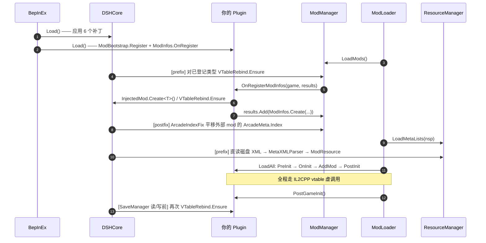

# DSHCore 开发参考 —— 写给 AI 与后来者

> **读者**：用 AI 辅助开发 MVZ2 mod 的人，以及被调用的 AI。
> **目标**：让一次对话就能写出**能跑起来**的注入类 mod，而不是靠反复崩溃试出来。
>
> 本文档记录的是「必须踩过一遍才知道」的东西。凡是写在这里的结论，都是在
> **MVZ2 0.7.0 test-4 / Windows x86 / IL2CPP metadata v31.1** 上实测过的，
> 不是推测。遇到与本文冲突的直觉，信本文。

---

## 0. 先读这一页

| 项 | 值 |
| ---- | ---- |
| 游戏 | 我的世界僵尸 2（MVZ2）**0.7.0 test-4**，Windows **x86** |
| 运行时 | Unity 2022.3.62f3 / IL2CPP **metadata v31.1** |
| BepInEx | **be.788**（x86 IL2CPP），内含 Il2CppInterop **1.5.3** |
| 编译 | .NET 6 SDK（`net6.0`），`LangVersion 9.0` |
| 编译引用 | 仓库自包含的 `runtime/`（`BepInEx/core/*.dll` + `BepInEx/interop/*.dll`） |
| 本库 GUID | `qoznos.mvz2.core` —— **历史值，别改**（改了所有 mod 的 `BepInDependency` 会失效） |

> ⚠️ 本库为社区作品，与游戏原作者无关。

---

## 1. AI 协作工作流（建议节奏）

mod 开发失败的原因大多不是"代码写错了"，而是**语义假设错了**：
以为某个类能继承、以为某个接口能实现、以为某个 API 在 IL2CPP 下能用。
这类错误在编译期看不出来，只在运行期以崩溃或静默失效的形式出现。
所以流程要把"验证假设"提到"写代码"之前。

```
① 用户提出设想
      ↓
② AI 调研并复述实现路径（读 interop 里的真实签名，不靠猜）
      ↓
③ AI 明确列出「语义风险」与「不可行点」← 这一步是整个流程的价值所在
      ↓
④ 用户确认/修正
      ↓
⑤ 开发（本文第 2/3 节的 API 与骨架）
      ↓
⑥ 自检日志验收（本文第 6 节）
```

### ① 设想

用户会说"我想加一个能 XX 的关卡 / 诅咒 / 道具"。**不要**立刻写代码。

### ② 调研：以 interop 里的真实签名为准

游戏源码不在仓库里，但**类型代理程序集在** `runtime/BepInEx/interop/`。
这是唯一可信的 API 事实来源 —— 它能告诉你某个方法是 `virtual` 还是
`final`、某个字段是 `public` 还是 `private`、抽象方法有几个。

用 Mono.Cecil 直接读（不加载程序集，无副作用）：

```powershell
Add-Type -Path "runtime\BepInEx\core\Mono.Cecil.dll"
$a = [Mono.Cecil.AssemblyDefinition]::ReadAssembly("runtime\BepInEx\interop\MVZ2.Logic.dll")
foreach ($t in $a.MainModule.Types) {
  if ($t.FullName -eq 'MVZ2Logic.Modding.Mod') {
    foreach ($m in $t.Methods) {
      if ($m.IsPublic -and $m.IsVirtual) { $m.ReturnType.FullName + ' ' + $m.Name }
    }
  }
}
```

> 别用 `Assembly.LoadFrom` 去反射 interop —— 那些程序集依赖 IL2CPP 运行时，
> 在游戏进程外加载会抛异常。Cecil 是静态读取，安全。

### ③ 语义风险清单（每次都要过一遍）

调研完，**必须**主动向用户报告下面这些点是否命中：

| 要检查的问题 | 为什么 |
| ---- | ---- |
| 需要继承的类，它的构造函数签名是什么？`(IntPtr)` 还是 `(string)`？ | 注入类必须提供 `(IntPtr)` ctor |
| `sealed` / `final` 吗？ | 是就不能继承（interop 里显示为 `IsFinal`） |
| 要实现接口吗？ | **注入类实现接口在 metadata v31 下会抛 `MethodAccessException`**，见 §5-⑤ |
| 要重写的基类方法是泛型虚方法吗？ | `ClassInjector` 解析不了泛型参数，vtable 槽绑不上 |
| 参数/返回值里有 `T`、数组、或是非代理类型吗？ | interop 会因"不支持的返回类型"跳过该方法 |
| 需要读 XML / 图片 / 音频吗？ | 走磁盘直读（§5-⑦），不要指望 Addressables |
| 需要存盘吗？ | `ModInfo.LevelDataVersion` 必须 = 4，否则存档被丢弃 |
| 对象是"托管 new 出来"再存进注入类字段吗？ | 必须 `Il2CppPin.Pin`，否则被 GC 回收（§5-①） |

### ④⑤⑥

确认后按 §2 的 API 开发，按 §3 的骨架起步，按 §6 的日志验收。

---

## 2. 公共 API 速查

全部在 `namespace DSHCore`，`using DSHCore;` 即可。

| 类型 | 成员 | 什么时候用 |
| ---- | ---- | ---- |
| `Il2CppPin` | `T Pin<T>(T obj)`、`int Count` | 托管 `new` 出来的 il2cpp 对象要存进注入类字段时 |
| `InjectedMod` | `T Create<T>(string nsp)`、`T Initialize<T>(T inst, string nsp)` | 创建注入的 `Mod` 实例 |
| `ModBootstrap` | `Register(nsp, logicType, xmlDefaultNamespace, params Type[] extraInjectedTypes)` | 插件 `Load()` 里一次登记 + 注册注入类 |
| `ModInfos` | `Create(nsp, logic, displayName)`、`OnRegister(handler)`、`EmptyLocator(nsp)`、`LevelDataVersion` | 构造 ModInfo、订阅官方注册点 |
| `CoreRegistry` | `Register(RegisteredMod)`、`Get(nsp)`、`GetAll()`、`FormatAll()` | 登记表（一般由 `ModBootstrap` 代劳） |
| `VTableRebind` | `Ensure(Type logicType)` | 手动兜底重绑 vtable 槽 |
| `Plugin` | `GUID`、`NAME`、`VERSION`、`Log` | `[BepInDependency(DSHCore.Plugin.GUID)]`、共用日志通道 |

### `Il2CppPin.Pin`

```csharp
stage.id            = Il2CppPin.Pin(new NamespaceID(nsp, "my_stage"));
stage.propertyDict  = Il2CppPin.Pin(new PropertyDictionary());
stage.triggers      = Il2CppPin.Pin(new List<ITrigger>());
stage.behaviours    = Il2CppPin.Pin(new List<StageBehaviour>());
```

幂等、可重复调用；返回原对象，所以能直接写在赋值右侧。
自检时用 `Il2CppPin.Count` 核对条数。

**什么时候需要**：只要满足「托管代码 `new` + 存进**注入类实例的字段**」两个条件就要。
典型的被钉对象：`NamespaceID`、`PropertyDictionary`、`List<ITrigger>`、
`List<Behaviour>`、`DefinitionGroup`、各种 Meta、自己 `new` 的 Behaviour/BuffDefinition。
**不需要**：字段里存的是原生对象，或者对象由游戏创建。

### `InjectedMod.Create`

```csharp
var logic = InjectedMod.Create<MyMod>(MyMod.spaceName);
```

等价于原来每个 mod 手写的：

```csharp
var m = new MyMod(ClassInjector.DerivedConstructorPointer<MyMod>());
ClassInjector.DerivedConstructorBody(m);
m._Namespace_k__BackingField = nsp;
m.definitionGroup = Il2CppPin.Pin(new DefinitionGroup());
m.triggers        = Il2CppPin.Pin(new List<ITrigger>());
```

不想用反射就自己 `new` 再调 `InjectedMod.Initialize(instance, nsp)`。

### `ModBootstrap.Register`

```csharp
ModBootstrap.Register(
    spaceName: MyMod.spaceName,
    logicType: typeof(MyMod),
    xmlDefaultNamespace: "mvz2",
    extraInjectedTypes: new[] { typeof(MyStage), typeof(MyBuff) });
```

做了三件事：`CoreRegistry.Register`、`ClassInjector.RegisterTypeInIl2Cpp(logicType)`、
再逐个注册 `extraInjectedTypes`（自带去重）。`logicType` 会自动注册，不用重复列。

### `ModInfos.OnRegister` / `Create`

```csharp
ModInfos.OnRegister(OnRegisterModInfos);

private static Il2CppSystem.Threading.Tasks.Task OnRegisterModInfos(
    IGlobalGame game, Il2CppSystem.Collections.Generic.List<ModInfo> results)
{
    try
    {
        var logic = InjectedMod.Create<MyMod>(MyMod.spaceName);
        VTableRebind.Ensure(typeof(MyMod));
        results.Add(ModInfos.Create(MyMod.spaceName, logic, "My Mod"));
    }
    catch (System.Exception e)
    {
        Plugin.Log.LogError("OnRegisterModInfos error: " + e);   // 必须自己兜住
    }
    return Il2CppSystem.Threading.Tasks.Task.CompletedTask;
}
```

`OnRegister` 内部完成 `System.Func` → `Il2CppSystem.Func` 的委托转换 + 事件订阅。

---

## 3. 从零写一个 mod（最小骨架）

三个文件，直接拷走改名字即可。

### `MyMod.cs` —— 注入的 Mod 逻辑主体

```csharp
using System;
using DSHCore;
using MVZ2Logic.Games;
using MVZ2Logic.Modding;
using MVZ2Logic.Saves;

namespace MyMod
{
    public class MyMod : Mod
    {
        public const string spaceName = "my_mod";

        /// <summary>注入类的标准 ctor（Il2CppInterop 要求）。</summary>
        public MyMod(IntPtr ptr) : base(ptr) { }

        // ⚠️ 下面所有 override 里都**绝不能**调 base.Xxx()：代理虚调用会回到
        //    本方法 trampoline，无限递归直到 native 栈溢出。原生实现都是空的。

        public override void PreInit(IModLoader modLoader) { }
        public override void OnInit(IGlobalGame game) { }
        public override void PostInit(IGlobalGame game) { }

        public override void PostGameInit() { }

        // 这两个是**抽象方法，必须实现**（不实现编译不过）。
        public override ModSaveData CreateSaveData() { return null; }
        public override void LoadSaveData(ModSaveData data) { }
    }
}
```

### `Plugin.cs` —— 入口

```csharp
using BepInEx;
using BepInEx.Logging;
using BepInEx.Unity.IL2CPP;
using DSHCore;
using MVZ2.Modding;
using MVZ2Logic.Games;

namespace MyMod
{
    [BepInPlugin(GUID, NAME, VERSION)]
    [BepInDependency(DSHCore.Plugin.GUID)]
    public class Plugin : BasePlugin
    {
        public const string GUID = "yourname.mvz2.mymod";
        public const string NAME = "My Mod";
        public const string VERSION = "0.1.0";

        internal static new ManualLogSource Log;

        public override void Load()
        {
            Log = base.Log;

            ModBootstrap.Register(
                spaceName: MyMod.spaceName,
                logicType: typeof(MyMod),
                xmlDefaultNamespace: "mvz2",
                extraInjectedTypes: new[] { typeof(MyStage) });   // 按需

            ModInfos.OnRegister(OnRegisterModInfos);

            // 自己的 Harmony 补丁在这里 Apply()。
            Log.LogInfo(NAME + " v" + VERSION + " loaded");
        }

        private static Il2CppSystem.Threading.Tasks.Task OnRegisterModInfos(
            IGlobalGame game, Il2CppSystem.Collections.Generic.List<ModInfo> results)
        {
            try
            {
                var logic = InjectedMod.Create<MyMod>(MyMod.spaceName);
                VTableRebind.Ensure(typeof(MyMod));
                results.Add(ModInfos.Create(MyMod.spaceName, logic, "My Mod"));
            }
            catch (System.Exception e) { Log.LogError("OnRegisterModInfos: " + e); }
            return Il2CppSystem.Threading.Tasks.Task.CompletedTask;
        }
    }
}
```

### `MyMod.csproj`

```xml
<Project Sdk="Microsoft.NET.Sdk">
  <PropertyGroup>
    <TargetFramework>net6.0</TargetFramework>
    <AssemblyName>MyMod</AssemblyName>
    <LangVersion>9.0</LangVersion>
    <AllowUnsafeBlocks>true</AllowUnsafeBlocks>
    <RuntimeDir>$(MSBuildThisFileDirectory)..\runtime\</RuntimeDir>
    <RuntimeCoreDir>$(RuntimeDir)BepInEx\core\</RuntimeCoreDir>
    <RuntimeInteropDir>$(RuntimeDir)BepInEx\interop\</RuntimeInteropDir>
    <GameDir Condition="'$(GameDir)' == ''">E:\Game\PVZ\MVZ2\MVZ2 0.7.0 test-4\</GameDir>
    <AppendTargetFrameworkToOutputPath>false</AppendTargetFrameworkToOutputPath>
  </PropertyGroup>

  <ItemGroup>
    <ProjectReference Include="..\DSHCore\DSHCore.csproj" />
  </ItemGroup>

  <ItemGroup>
    <Reference Include="BepInEx.Core"><HintPath>$(RuntimeCoreDir)BepInEx.Core.dll</HintPath><Private>false</Private></Reference>
    <Reference Include="BepInEx.Unity.IL2CPP"><HintPath>$(RuntimeCoreDir)BepInEx.Unity.IL2CPP.dll</HintPath><Private>false</Private></Reference>
    <Reference Include="Il2CppInterop.Runtime"><HintPath>$(RuntimeCoreDir)Il2CppInterop.Runtime.dll</HintPath><Private>false</Private></Reference>
    <Reference Include="0Harmony"><HintPath>$(RuntimeCoreDir)0Harmony.dll</HintPath><Private>false</Private></Reference>
    <Reference Include="$(RuntimeInteropDir)*.dll"><Private>false</Private></Reference>
  </ItemGroup>

  <Target Name="CopyToPlugins" AfterTargets="Build"
          Condition="Exists('$(GameDir)MinecraftVSZombies2.exe')">
    <Copy SourceFiles="$(TargetPath)" DestinationFolder="$(GameDir)BepInEx\plugins\" />
  </Target>
</Project>
```

想加磁盘资源（XML metas 等）就再拷一个 `DeployModAssets` 目标，
把 `assets\**\*` 映射到
`$(GameDir)MinecraftVSZombies2_Data\StreamingAssets\Mods\<nsp>\`。
可直接抄 `LaboratoryMod/LaboratoryMod.csproj`。

### 需要 XML metas 时

把 `assets/Content/metas/*.xml` 放到 mod 自己的 `assets/` 下（会部署到
`StreamingAssets/Mods/<nsp>/Content/metas/`），`MetaInjection` 会在
`ResourceManager.LoadMetaLists` 时直读磁盘并用游戏的 `MetaXMLParser` 解析进
`ModResource`。**两条硬约束**：

1. XML 里**不要写注释** —— `XmlDocument.LoadXml` 会把 Comment 节点放进子节点
   遍历，`BuffMetaList.FromXmlNode` 之类会 NRE（官方走 `XmlReaderSettings.IgnoreComments`，行为不同）。
2. 不要用官方的 `XMLHelper.ReadXmlDocument(string)` 重载 —— 它内部 StreamWriter
   未 Flush 就读流，必然抛 `Root element is missing`。

---

## 4. 0.7 官方集成链



**关键点**：`ModInfo.Logic` 在 0.7 里**不会**被重建，你在
`OnRegisterModInfos` 里 `InjectedMod.Create` 出来的那个实例，就是最终实例。

---

## 5. 陷阱清单

### ① 注入类字段不参与 il2cpp GC 追踪 → 对象被回收

**症状**（很反直觉，容易误判成"逻辑写错了"）
- `definition.GetID()` 的值比较**恒为 false** → 游戏查不到你的 Definition
  （街机列表里没有、`gotolevel <nsp>:<id>` 找不到关卡）
- 读该字段的 `string` 直接抛 `Fatal error. Internal CLR error. (0x80131506)`

**根因**：写入不经 write barrier，且注入类的 GC 描述符不含继承来的引用字段。

**对策**：`Il2CppPin.Pin(obj)`。见 §2。

---

### ② ClassInjector 的两处缺陷（DSHCore 已自动修）

1. 基类 vtable 含**泛型虚方法**时（如 `Definition.TryGetProperty<T>`），
   `SystemTypeFromIl2CppType` 无法把泛型参数 `T` 解析成 `System.Type`，
   于是 `GetMethod` 找不到重写而保留基类实现。
2. `RewriteType` 会把 `System.String` 重写成 `Il2CppSystem.String`，
   而托管 override 的签名是 `System.String`（与代理基类一致）→ `GetMethod` 匹配失败
   → **抽象方法槽**（如 `Mod.LoadSaveData`）保留抽象 stub，调用即抛
   `EntryPointNotFoundException`。

`ClassInjectorFix` 让 `string` 保持 `System.String`，其余无法解析的类型用
`object` 占位。**不需要你做什么** —— 但要知道为什么"抽象方法明明实现了却报找不到入口点"。

日志里会看到：
```
[ClassInjectorFix] string 保持 System.String (System.String)
[ClassInjectorFix] 无法解析 T, PVZEngine.Base → object 占位
```

---

### ③ `Class::Init` 会重置注入类的 vtable 槽

**症状**：抽象槽被重置为 thunk（`EntryPointNotFoundException`）；
virtual 槽被重置则 override **静默失效**（不报错，就是没生效）。

**对策**：`VTableRebind.Ensure(typeof(MyMod))`。DSHCore 已经自动在两个时机兜底：
`ModManager.LoadMods` 之前、以及 `SaveManager` 读写存档之前。
自己创建实例后**立刻**再调一次更稳（见骨架）。

---

### ④ 绝不要调 `base.PreInit()` 之类的基类实现

代理虚调用会回到**本方法自己的 trampoline** → 无限递归 → native 栈溢出。
原生 `PreInit` / `OnInit` / `PostInit` / `PostGameInit` 都是空实现，跳过无影响。

---

### ⑤ 不要用官方 LINQ 链路遍历注入的 Definition

**症状**：定义列表为空 / 关卡消失 / `ChangeStage missing`，
或抛 `MethodAccessException`。**非确定性**，时好时坏。

**根因**：metadata v31 注入环境下，`DefinitionGroup.GetDefinitions()` 里的
`SelectMany` / `OfType` 等接口枚举会失败。作者本人也在移除这类 LINQ 印证了此坑。

**对策**：自己维护一个 `List<Definition>` 追踪刚创建的 def（两个 mod 都是这么做的）。

---

### ⑥ 不要用 `is XxxType` 判断注入代理对象的运行时类型

代理对象是按**声明类型**包装的，`is` 判断**恒为假**。
需要判类型时比较 `GetType()` 或用你自己的标记。

---

### ⑦ 不要给注入类加接口实现

`ModLoader.LoadAll` 会对 `stageProviders.OrderBy(Priority)` 做原生 LINQ 接口分派，
注入类实现 `IStageDefinitionProvider` 在 metadata v31 下会抛 `MethodAccessException`
（与 ⑤ 同源）。**对策**：不用 provider，改在官方 `LoadStages` 时机直接创建定义
（见 `LaboratoryMod/LoadStagesPatch.cs`）。

同理：方法签名里带数组或非代理类型会被 interop 跳过：
```
[Warning:Il2CppInterop] Method ... GetWaveTypes(...) on type ... has unsupported return type PVZEngine.NamespaceID[]
```

---

### ⑧ `ArcadeMeta.Index` 会与 vanilla 撞车

`Index` 是"文件内同类条目序号"，外部 mod 从 0 开始，与 vanilla 的 0/1/2 撞车，
`ArcadeController.GetIDListByArcadeOrder` 按 Index 建数组 + `FirstOrDefault`
一槽留一个 → **你的条目会顶掉原版条目**。

**对策**：`ArcadeIndexFix` 自动把外部 mod 的 Index 平移 `vanillaMax + 1`。
验证：日志里 `index=16/17/18`（而不是 0/1/2）。

---

### ⑨ `BepInEx/interop` 必须与游戏二进制同批生成

**症状**：**随机** `0xC0000005` 访问违例 —— 崩点漂移、**没有托管栈**。

**根因**：类型代理按 metadata token 解析，游戏一重排 token 就失配。

**对策**：游戏更新后删掉 `BepInEx/interop`，把
`BepInEx/config/BepInEx.cfg` 的 `UpdateInteropAssemblies` 置 `true`，
启动一次让它重新生成，然后跑 `tools/sync-runtime.ps1` 把运行时刷回仓库 `runtime/`。

> ⚠️ 必须用 **be.788**。旧版（≤ be.697）自带的 Cpp2IL 只支持 metadata 23–29，
> 对本游戏的 v31.1 会直接报
> `Unsupported metadata version found! We support 23-29, got 31`。

---

### ⑩ 崩溃查 `ErrorLog.log`，不是 `LogOutput.log`

原生 fatal error 的托管栈**只在** `BepInEx/ErrorLog.log` 里。
`LogOutput.log` 里什么都没有，会让人以为"没报错"。

---

### ⑪ 存档版本号必须是 4

`ModInfo.LevelDataVersion` 必须 = `LevelManager.CURRENT_DATA_VERSION`
（0.7.0 test-4 为 **4**），否则你的 mod 存档数据会被判定为旧版本而丢弃。
`ModInfos.Create` 已经填好，一般不用管。

---

### ⑫ 原生回调里必须自己 try/catch

`OnRegisterModInfos` 之类的回调抛异常到原生侧会**直接崩游戏**，
而且没有可读的托管栈。全部包 try/catch + 打日志。

---

### ⑬ `ResourceLocator` 不能为 `null`

`ResourceManager` 会对每个 Mod 调 `Locate`。用
`ModInfos.EmptyLocator(nsp)`（`ModInfos.Create` 已内含）。
meta 既然由 `MetaInjection` 直读磁盘，空 locator 返回空集是安全的 ——
但如果你要走 Addressables 加载 sprite/audio，就得换成真实 locator。

---

### ⑭ `RegisterTypeInIl2Cpp` 必须在任何实例化之前

包括 `new XxxBehaviour(...)` 这类隐式实例化。
所以注册都放在插件 `Load()` 里（`ModBootstrap.Register` 就是干这个的）。

---

## 6. 自检与验收

改完东西，**先看日志再下结论**。游戏目录的
`BepInEx/LogOutput.log`（普通日志）与 `BepInEx/ErrorLog.log`（原生崩溃）。

### 启动顺序上必须出现的行

```
[Info   :   BepInEx] 3 plugins to load
[Info   :   BepInEx] Loading [DSHCore (大肥鱼核心) 0.2.0]
[Info   :DSHCore ...] ClassInjector generic vtable patch applied
[Info   :DSHCore ...] MetaInjection patches applied
[Info   :DSHCore ...] SaveManager.LoadModData patch applied
[Info   :DSHCore ...] SaveManager.WriteSaveData patch applied
[Info   :DSHCore ...] ModManager.LoadMods patch applied
[Info   :DSHCore ...] ArcadeIndexFix patch applied
[Info   :DSHCore ...] DSHCore (大肥鱼核心) v0.2.0 loaded (infrastructure ready)
[Info   :DSHCore ...] [CoreRegistry] registered nsp=mvz2_lab logic=LaboratoryMod.LabMod xmlDefault=mvz2
[Info   :DSHCore ...] [ModBootstrap] mvz2_lab ready  logic=LabMod  injected=[LabMod, RealPrologueStage, ...]
[Info   :DSHCore ...] [ModInfos] OnRegisterModInfos 订阅完成
```

### 验收标准（这是"真的成功了"的判据）

| 检查 | 期望 |
| ---- | ---- |
| `BepInEx/ErrorLog.log` | **为空**（或不存在） |
| 插件数量 | 等于你安装的 mod 数；**不应有**改名前的旧 DLL |
| `[ModBootstrap] ... injected=[...]` | 列出你全部注入类，一个不少 |
| `BepInEx/plugins/` | 每个 mod 一个 DLL，`DSHCore.dll` 在 |
| 关卡类 mod → `[Diag] GetDefinition(stage, <id>) = FOUND name='...'` | `FOUND` 且名字正确 |
| 关卡类 mod → arcade | `index=` 是**平移后**的大数（如 16/17/18），不是 0/1/2 |
| 关卡类 mod → `GetAllArcadeItems=N (nsp=K)` | `K` = 你的条目数 |
| 诅咒类 mod → `[Diag] 诅咒定义 a/b，已解锁 a/b` | 两个数相等；`buff 解析失败 0`、`修饰符缺失 0/x`、`CURSE_COUNT 键失效 0` |
| `[Diag] 解锁列表前 5 项` | 必须是 `mvz2:*` 而不是空 |

**任何一项不达标就不要宣布完成** —— 上面每一条都对应一个已知的静默失效模式。

---

## 7. 排错入口

| 现象 | 先看哪里 |
| ---- | ---- |
| 游戏起不来 / 随机 AV | `BepInEx/ErrorLog.log`；本文件 §5-⑨ |
| 关卡不在列表 / `gotolevel` 找不到 | §5-①（Pin 漏了）、§5-⑤（LINQ）、§5-⑧（Index 撞车） |
| `EntryPointNotFoundException` | §5-②③（vtable 槽 / ClassInjector 缺陷） |
| `MethodAccessException` | §5-⑤⑦（注入类参与原生 LINQ / 实现接口） |
| 定义创建了但属性是空的 | 官方 `LoadDefinitionProperties` 可能没套上 meta → 在 `PostInit` 里用稳定 ID 反查 meta 手动补（见 `StageMetaApplier`） |
| XML 读了但报 `Root element is missing` | §3-需要 XML metas 时（别用官方 string 重载） |
| 报 NRE 且与 meta 子节点有关 | XML 里写了注释 → §3 |
| 改了 GUID 后别人装不上 | GUID 是稳定契约，见 §0 |

---

## 8. 参考实现

| 文件 | 看什么 |
| ---- | ---- |
| `DSHCore/ClassInjectorFix.cs` | 用 Harmony 修 interop 内部方法（含完整原理注释） |
| `DSHCore/VTableRebind.cs` | 直接操作原生 vtable 槽（含槽号表） |
| `DSHCore/MetaInjection.cs` | 接管官方 meta 加载、直读磁盘 XML |
| `LaboratoryMod/Stages/RealPrologueStage.cs` | 注入 StageDefinition 并逐字段 Pin 的完整写法 |
| `LaboratoryMod/LoadStagesPatch.cs` | 在官方时机创建定义（替代 provider 的方案） |
| `ModularCurse/CurseBuffs/CurseBuffs.cs` | 批量创建 BuffDefinition + 修饰符 |
| `ModularCurse/CURSES.md` | 接入原版诅咒系统的完整设计与踩坑记录 |

---

## 9. 三个"不要"

1. **不要在没看 interop 真实签名前写代码** —— 猜出来的 `virtual`/`sealed` 是 mod 崩溃的头号来源。
2. **不要把「编译通过」当成「能跑」** —— §5 里绝大多数坑编译期完全看不出来。
3. **不要跳过 §6 的日志验收** —— 静默失效不会自己报错。
