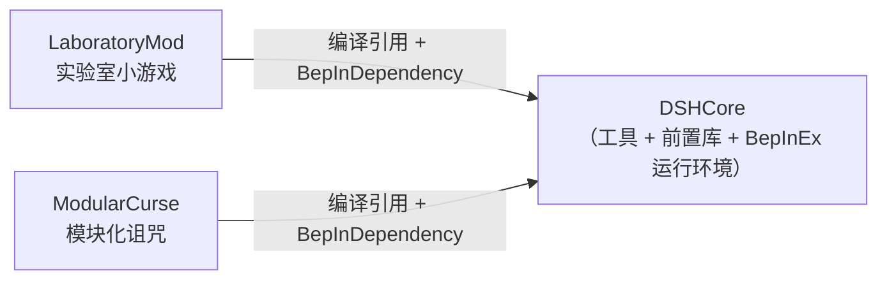

# DSHCore

> MVZ2 模组开发**工具 + 前置库**。为「AI 辅助开发」而设计：
> 把 IL2CPP 注入环境里那些必须踩过一遍才知道的坑一次性修好，
> 把每个 mod 都要手写一遍的注册样板收敛成公共 API，
> 并留下可查证的开发参考。

- 插件 GUID：`qoznos.mvz2.core`
- 显示名：`DSHCore`
- 当前版本：**0.4.0**
- 适配：MVZ2 **0.7.0 test-11**（Windows **x86** / IL2CPP metadata v31.1 / Unity 2022.3.62f3）
- 运行时要求：BepInEx **be.788**（x86 IL2CPP）

> ⚠️ 社区制作的**非官方**作品，与游戏原作者无关。
> ⚠️ **本库不添加任何游戏内容**，它只是其它 mod 的前置依赖。

---

## 📖 想写 mod？先看 [`AI_GUIDE.md`](AI_GUIDE.md)

`AI_GUIDE.md` 是本项目**最重要的文档**：面向 AI 与后来者的开发参考，
包含 AI 协作工作流、公共 API 速查、最小 mod 骨架、0.7 官方集成链时序图，
以及一份「症状 → 根因 → 对策」的陷阱清单（17 条，全部实测）。

如果你是被调用的 AI，**动手前请完整读一遍 `AI_GUIDE.md`**。

## 🎨 要写 UI？读 [`UI_GUIDE.md`](UI_GUIDE.md)（动手）、查 [`UI_RESEARCH.md`](UI_RESEARCH.md)（为什么）

> `UI_GUIDE.md` 是**子 mod 写 UI 时唯一需要读的东西**：决策树 + L1/L2/L3 三套可拷示例 +
> 七条硬约定 + 坑清单速查 + 验收方法。`UI_RESEARCH.md` 是背后的调研与完整坑表。

原版 UI 是 **prefab 驱动**的：控件依赖私有 `[SerializeField]` 引用（字体、Sprite、点击音效），
所以 `AddComponent` 造出来的控件必崩或必无效；而 UI prefab 又不在 Addressables 条目里，
mod 侧加载不到。**原版对 mod 开放的是「语义层」（`ShowDialog` / `ShowAdvice` / HUD 显隐）
与「数据层」（设置项定义），控件层完全没有开放 —— 唯一的用法是「克隆场景里的原版节点」。**

`DSHCore.Ui` 把这件事固化成了可调用的 API：

```csharp
var shell = UiSkin.Clone(UiSkinPart.Dialog, UiHost.Resolve(UiLayer.DialogLayer), "MyPanel");
var row   = UiOptionRow.Create(null, "Row", UiOptionKind.Toggle);
row.SetStretch().SetToggle("开关", true, v => { }).SetTooltip("标题", "悬停说明");

// 内容多的时候用可滚动列表（底层是官方设置界面那个 ScrollRect）
var list = UiList.Create(null, "MyList");
list.SetViewportHeight(UiList.SuggestHeight());
list.AddButton("第一项", () => { });

UiClone.OnClick(button, () => { /* … */ });
```

| 类型 | 一句话 |
| --- | --- |
| `UiGame` | 官方 UI 引用链（`MainManager.Instance → Scene → ui → dialog`） |
| `UiFinder` | 按组件找**未激活**的 UI 节点（`FindObjectOfType` 找不到它们） |
| `UiSkin` | 原版素材的克隆源（对话框壳 / 标题 / 正文 / 按钮行 / **控件行** / 输入框 / **可滚动容器**）；**不改素材字号**，想知道出厂值用 `MeasureFont(part)`，排查“多了个白块”用 `DumpScrollViewGraphics` |
| `UiHost` | 挂哪里（层解析）+ 己方节点标记 + 插入/新建容器 |
| `UiClone` | 克隆规范化（`SetActive` 次序、按钮监听器、委托保活）；字号：`SetFontSize` / `DescribeFont` |
| `UiOptionRow` | **控件行的唯一入口**（复选/滑条/按钮）—— 直接克隆子控件会丢尺寸契约与提示锚点；下拉框那一支**已知不可用** |
| `UiList` | **纯代码可滚动列表**（底层克隆官方设置界面的 `ScrollRect`）：`Add` / `AddButton` / `AddOptionRow` / `Clear` / `SetFlexible` / **`SetRowFit`**（紧凑 + 铺满框体）/ `DescribeStructure` |
| `UiOptions` | **设置项注册**：默认进本库的「模组设置（DSHCore）」页（零注入、不需要 ModInfo/XML）：`DeclareToggle` / `DeclareSlider` / `DeclareChoice`；`DeclareMod(space, 名, 说明, 作者, 中文?)`（声明过的 mod **无条件出现在左栏**，没设置项也会出现）；`scope: VanillaMenu` 时才走 `Attach(mod)` + `ApplyProperties()` 进原版设置界面 |
| `UiLocale` | **模组文本本地化**：`Add` / `Get` / **`Get(source, context)`** + 把 mod 的译文表挂进游戏的**两条**文本查找链（普通链 = 界面文字；`Particular` 链 = **关卡名 / 诅咒名 / 实体名等游戏内容名**），不用打包语言包 .mo 也有译文；**玩家可在 `BepInEx/config/DSHCore/lang/` 里放外部译文文件**，不用改 mod 就能加语言（详见 `UI_GUIDE.md` §11、指令 `/dshtrans`） |
| `UiLocaleTable` | **子 mod 的批量登记表**：`UiLocale.Table("命名空间")` → `En` / `Zh` / `Both` / `EnAll` / **`EnAllWith(上下文, …)`**（内容名必须用它），全部可链式 |
| `UiTagRow` | **档案样式条目行**（`Toggle` + 文字，勾选 = 选中）：从「对话档案」的条目模板克隆 |
| `AddonPage` | **插件页子页面**：入口按钮 + 页面壳 + 生命周期全自动（`Replay` / `ModSettingsPage` 已用它） |
| `AddonPages` | 子页面登记表 + 心跳（挂在 `MainSceneController.Update`）+ `Report` |
| `ModSettingsPage` | 内建的「模组设置（DSHCore）」页面（左栏已加载的 mod / 右栏说明·作者·来源·逻辑体·命名空间 + 设置项；两栏合计宽 = 0.94 画布宽） |
| `UiKit` | 克隆小工具：行容器 / 文本（`Label` / `Paragraph` / `AutoHeight`）/ 按钮 / **`SetBold`** / **`Separator`**（原版分割线）/ 尺寸契约 / 克隆体修补（遮罩·空图·翻译器）/ 两栏宽度 / 布局描述 |
| `ModNamespacePin` | 钉住注入 `Mod` 实例的 `Namespace` 字段（不钉会被 GC 回收 → `mod.Namespace` 间歇性读到空，官方按命名空间找不到本 mod 内容） |
| `UiTooltip` | 原版悬停提示全链（只加组件是不够的，还要做宿主订阅 + 增一个正确的锚点子节点） |

完整论证、坑清单、子 mod 决策树都在 `UI_RESEARCH.md`；
**可运行范例 + 视觉验收**见独立 mod **`UiGallery`**（`/dshui` 打开组件画廊）。

---

## 它解决什么问题

0.7.0 提供了官方的外部 Mod 扩展点，但在 IL2CPP + 注入类（`ClassInjector`）
组合下有一批硬坑。本库把它们集中修好一次，后续 mod 直接复用。

### 自动修复（无需 mod 作者关心）


| 源文件                | 作用                                                                                                                                                                                                  |
| --------------------- | ----------------------------------------------------------------------------------------------------------------------------------------------------------------------------------------------------- |
| `ClassInjectorFix.cs` | 修`ClassInjector` 两处缺陷：① 基类含**泛型虚方法**时 vtable 槽解析失败；② `System.String` 被重写成 `Il2CppSystem.String`，导致托管 override 匹配不上（抽象槽保留 → `EntryPointNotFoundException`） |
| `VTableRebind.cs`     | 重建并重绑注入类的原生 vtable 槽（`Class::Init` 会重置它们）                                                                                                                                          |
| `LoadModsPatch.cs`    | 游戏`ModManager.LoadMods` **之前**，对所有已登记注入类型执行 `VTableRebind.Ensure`                                                                                                                    |
| `SaveManagerPatch.cs` | 存档读写**之前**再次兜底重绑（否则 `LoadSaveData`/`CreateSaveData` 抛找不到入口点）                                                                                                                   |
| `MetaInjection.cs`    | 接管`ResourceManager.LoadMetaLists`：直接读 `StreamingAssets/Mods/<nsp>/Content/metas/*.xml` 并用游戏的 `MetaXMLParser` 解析进 `ModResource` —— **完全绕过 Addressables provider 链路**             |
| `ArcadeIndexFix.cs`   | `LoadMods` **之后**平移外部 mod 的 `ArcadeMeta.Index`，避免与 vanilla 的 `0/1/2` 撞车导致街机条目被顶掉                                                                                               |
| `LevelUiAnimatorGuard.cs` | 补原版漏洞的**安全网**：`LevelUIPreset.ShowHugeWaveText / ShowFinalWaveText / ShowReadySetBuild` 直接 `animator.SetTrigger` 而**没有** `activeInHierarchy` 守卫（同类其它地方都有）。那个 Animator 在 prefab 里就是 disabled、只靠游戏每帧手动 `Update` 养着 —— 一旦 HUD 的每帧驱动链断掉（例如克隆 UI 打爆了共享材质，见 `UI_RESEARCH.md` §6.4 第 22 条），这三处会把 `NullReferenceException` 抛进关卡行为里（玩家侧看到「关卡行为 `WaveStageBehaviour` 在执行 `Update` 时出现错误」）。本补丁按原版别处的纪律判一次可用性，可用就自己 `SetTrigger`、不可用就跳过 + WarnOnce。**只挡报错，不修根因** |

### 公共 API（供 mod 调用）


| 类型                                       | 用途                                                                                                                                            |
| ------------------------------------------ | ----------------------------------------------------------------------------------------------------------------------------------------------- |
| `Il2CppPin.Pin<T>(obj)`                    | 把「托管 new 出来的 il2cpp 对象」钉成 GC 根。**不钉就会被回收**，症状是 `GetID()` 值比较恒为 false（关卡不出现在列表）或读字符串抛 `0x80131506` |
| `InjectedMod.Create<T>(nsp)`               | 创建注入类`Mod` 实例，并补做原生 `Mod(string)` ctor 的初始化（`Namespace` / `definitionGroup` / `triggers` + Pin）                              |
| `ModBootstrap.Register(...)`               | 一步完成「登记命名空间 + 注册全部注入类」                                                                                                       |
| `ModInfos.Create(...)` / `OnRegister(...)` | 构造`ModInfo`（空 locator / 存档版本 / 空 `Assemblies`）并订阅官方 `OnRegisterModInfos`（含 Il2Cpp 委托转换）                                   |
| `CoreRegistry`                             | 跨插件登记表，上述补丁按命名空间生效                                                                                                            |
| `VTableRebind.Ensure(Type)`                | 手动触发 vtable 槽重绑                                                                                                                          |
| `LogViewer`                                | 本地网页日志查看器：`Url` / `OpenInBrowser()` / `CapturedCount` / `DroppedCount` / `Report(src,level,msg)` / `HideConsole()` / `ShowConsole()` |
| `UiLocale`（外部文件）                     | 玩家可编辑的译文：`ExternalDirectory` / `ReloadExternal()` / `WriteTemplate(lang)` / `DescribeExternal(lang)` / `KnownKeys` / `DumpKeys()`；**内容名那一行写成 `[上下文] 原文 = 译文`**（上下文如 `levelname` / `curse.name`），只写 `原文 = 译文` 只能翻界面文字 |

---

### 游戏内指令 `/dshlog`

默认**不自动开启**：日志从游戏启动就捕获进内存环形缓冲（不监听端口、不弹浏览器），
需要时在游戏里当场开：

```
/dshlog            开启（已开启则显示状态）
/dshlog off        关闭并释放端口（内存历史保留）
/dshlog open       用默认浏览器打开
/dshlog url        只打印带令牌的地址
/dshlog status     显示状态
/dshlog console    显示 / 隐藏 BepInEx 控制台窗口
/dshlog clear      清空内存里的历史
/dshlog help       帮助
```

### 游戏内指令 `/dshtrans`

模组译文的外部文件（给玩家用的，不需要源码）：

```
/dshtrans                    状态：外部目录、当前语言读到了几条、见过多少源串
/dshtrans keys               列出全部已知源串与它们当前的取值
/dshtrans write en-US        把键表写成 lang/en-US.txt 模板（已存在则不覆盖；加 overwrite 强制）
/dshtrans reload             重新读盘（改完文件不用重启游戏）
/dshtrans help               帮助
```

> 两条指令共用同一条分派链（`DebugCommands`）：依次问 `LogViewerCommand.Execute`
> 与 `TransCommand.Execute`，都返回 `null` 才放行给原版。补全同理，两边都追加。

> 为什么要分成「一直捕获 + 按需开网页」而不是整体按需：**调试时你要的是游戏启动
> 到出问题那一段的日志**。捕获只有一个环形缓冲 + 一个后台线程的成本，很便宜；
> 等出问题了再 `/dshlog`，打开就是从头开始的完整历史。

> 指令走的是 Harmony 拦 `DebugManager.ExecuteCommand`（与 `ModularCurse` 的 `/curse`
> 同一套做法），而不是官方 `CommandDefinition` —— 后者要 metaXML + 程序集登记 +
> 参数类型限制，而且往 `GlobalGame.definitionGroup` 塞注入 def 有 metadata v31 的
> LINQ 崩溃风险。两条 prefix 可以共存，互不干扰。

**Tab 补全**：因为没走官方 `CommandDefinition`，自动补全也得自己塞 ——
另有一条 prefix 追加到 `DebugManager.FillSuggestions`。输入 `/ds` 按 Tab 会补出
`/dshlog`；已经写完指令名后，`/dshlog o` 会补出 `off` / `open`。
子指令表（`LogViewerCommand.Subcommands`）是帮助文本与补全的**唯一真源** ——
两处不会各写一份然后慢慢跑偏。

补全 prefix 是 void（只追加、不拦截原方法），而且整个包在 try/catch 里：
补全失败只会少几条建议，绝不会打断输入框刷新。

### 网页界面

| 键 | 默认 | 说明 |
| ---- | ---- | ---- |
| `Enabled` | `false` | 改成 `true` 则在游戏启动时就自动开好网页 |
| `Port` | `18742` | 被占用会自动往后顺延 |
| `AutoOpen` | `true` | 开网页服务时自动开浏览器（含指令开启） |
| `LanAccess` | `false` | 只在回环监听；同网段机器要看得开它 |
| `RingBufferCapacity` | `5000` | 内存里留多少条历史（**始终在记**） |
| `QueueCapacity` | `20000` | 队列上限，超出丢弃并计数（**不会拖慢游戏**） |
| `HideConsoleWindow` | `false` | 插件加载后自动藏起控制台窗口 |

网页里可以按等级 / 来源 / 关键词（支持正则）过滤，点行看完整内容与异常堆栈，
「控制台」按钮可以即时显示 / 隐藏 BepInEx 控制台窗口，
「复制可见」把当前筛选结果拷成纯文本以便贴进 issue。

界面是**三栏**：左边筛选、中间日志、右边详情。两条分隔条都可以拖动来调宽度
（双击分隔条，或点左下的「重置分栏宽度」恢复默认），宽度记在浏览器 `localStorage` ——
下次打开还是你调的样子。没选中任何行时右栏会整体收起，中间日志区自动变宽。

> 布局只用两个 CSS 变量 `--w-left` / `--w-right`，拖动时改的是变量而不是元素宽度，
> 所以布局信息不会散到 JS 里。窗口被压窄时会把显示宽度临时压缩，但**记忆的仍是你想要的宽度**
> —— 窗口拉回来就恢复。

### 日志窗口

本仓库自带的 `runtime/BepInEx/config/BepInEx.cfg` 已经把
`[Logging.Console] Enabled` 设为 **false** —— 黑窗口不会再出现（日志照旧写磁盘、
照旧进网页）。想要它回来：改回 `true`，或游戏内 `/dshlog console` 临时显示。

> 如果游戏是从已有终端启动的，BepInEx 不会新建控制台而是附着到父窗口 ——
> 此时隐藏操作会被**主动拒绝**（藏了会连你自己的终端一起没）。
> 网页里表现为 `not-our-window`。

### 实现上的两个硬约定

1. **HTTP 服务手写，不用 `System.Net.HttpListener`**：后者走 Windows HTTP.sys，
   非管理员进程监听一个 URL 前缀需要先 `netsh http add urlacl` ——
   一个 mod 不可能要求玩家做这件事。裸 `TcpListener` 监听回环零特权。
2. **后台线程与 HTTP 线程绝不碰 IL2CPP 类型**：只碰 `ConcurrentQueue` /
   `TcpListener` / `NetworkStream`。托管线程未 attach 到 IL2CPP 域时调游戏 API
   会直接崩且无托管栈。详见 `AI_GUIDE.md` §5-⑮。
   （指令回调是唯一例外，它跑在游戏主线程 —— 所以 `LogViewerCommand` 与
   `DebugCommands` 被刻意拆成两个文件：前者纯托管、可离线测试。）

---

## 构建

```powershell
cd DSHCore
.\build.ps1                 # 构建（游戏目录存在时自动部署到 BepInEx\plugins\）
.\build.ps1 -Clean          # 先清 bin/obj 再构建
.\build.ps1 -Pack           # 额外打包 dist\DSHCore_v0.4.0_0.7.0.zip（含 BepInEx 运行环境）
.\build.ps1 -PackDevKit     # 额外打 dist\DSHCore-DevKit_v0.4.0_0.7.0.zip（便携开发环境）
.\build.ps1 -Pack -Launch   # 打包后启动游戏冒烟
```


| 参数              | 作用                                                                                                       |
| ----------------- | ---------------------------------------------------------------------------------------------------------- |
| `-GameDir <dir>`  | 部署目标。默认取 `MVZ2_GAME_DIR` 环境变量或 `Directory.Build.local.props`；都没给则**只构建不部署** |
| `-SkipBuild`      | 跳过 `dotnet build`，直接用已有产物                                                                      |
| `-Clean`          | 先删除 `bin/` `obj/`                                                                                       |
| `-KeepGame`       | 不结束正在运行的游戏进程（**游戏会锁住插件 DLL**，一般不要用）                                          |
| `-Pack`           | 打包可分发 zip 到 `dist\`（默认**含** BepInEx 运行环境）                                             |
| `-PackDevKit`     | 额外打「不含 DSHCore 源码」的便携开发环境包（见下）                                                    |
| `-NoRuntime`      | 打包时不带 BepInEx 运行环境（包体从 ~44MB 降到几十 KB）                                               |
| `-Launch`         | 构建/打包后启动游戏                                                                                        |

> 也可以在仓库根目录用 `.\build.ps1 -Mod dsh` 或一次性 `.\build.ps1 -Pack`。

### 打包特点

**所有包体默认都带 BepInEx 运行环境**
（`winhttp.dll` / `doorstop_config.ini` / `.doorstop_version` / `dotnet/` /
`BepInEx\core|interop|unity-libs|patchers|config`），
所以每个包都是「解压到游戏根目录即可」的完整独立安装包 —— 玩家不需要先单独装前置。
代价是每个包 ~44MB；只要插件本体（比如给已装好的游戏换 DLL）时加 `-NoRuntime`。

构建脚本还会自动删除**改名前的遗留插件** `BepInEx\plugins\CustomCore.dll`
（本库 0.1.0 时叫 CustomCore，GUID 未变 —— 两个同时存在会被判为重复 GUID）。

### 每次构建都会刷新 `_refs\DSHCore\`

`SyncDshCoreRefs` 目标会把刚建好的 `DSHCore.dll`（+ `pdb`）同步到仓库根的
`_refs\DSHCore\`。那是**没有 DSHCore 源码的环境**（单个 mod 工程、DevKit 包）
使用的编译引用，所以必须每次刷新，否则会出现「引用的是旧 DSHCore」这种难查的问题。

`.gitignore` 里只排除 `_refs/DSHCore/*.pdb`（含本机源码路径），**dll 是入库的**。

### `-PackDevKit`：不含本库源码的便携开发环境

给「不想碰 DSHCore 源码、只想写自己的 mod」的人。产物解压后就是一个自洽的工作区：
根配置 + `.vscode` + `tools` + `_refs\DSHCore` + `runtime\`（可 `-NoRuntime`）
+ 两个范例 mod 的源码 + `DSHCore\`（**只有 `*.md` / `*.txt` 文档，没有源码**）。

其中的 mod 工程会因为找不到 `DSHCore.csproj` 而自动降级为引用
`_refs\DSHCore\DSHCore.dll`（见仓库根的 `Directory.Build.props`）。

---

## 依赖关系



编译引用有两路（由仓库根的 `Directory.Build.props` 自动选）：
仓库里有本库源码时是 `ProjectReference`，没有时（单个 mod 工程 / DevKit 包）
是 `_refs\DSHCore\DSHCore.dll`。运行期始终靠 `[BepInDependency]` 找到本插件。

---

## 目录结构

```
DSHCore/
├─ AI_GUIDE.md             ★ 面向 AI 与后来者的开发参考（先读这个）
├─ UI_GUIDE.md             ★ 子 mod 写 UI 的唯一入口：决策树 + 可拷示例 + 硬约定
├─ UI_RESEARCH.md          MVZ2 原版 UI 体系调研 + DSHCore UI 支持设计（要写 UI 先看它）
├─ README.md               本文件
├─ build.ps1               构建 / 部署 / 打包 / 打 DevKit
├─ install-readme.txt      分发包内的安装说明（打包时注入版本号）
├─ devkit-readme.txt       DevKit 包内的上手说明（打包时注入版本号）
├─ Directory.Build.props   把本工程接入共享编译环境解析（转发到仓库根）
├─ DSHCore.csproj          工程文件（编译引用由共享配置解析）
│
├─ Plugin.cs               入口：启动日志捕获 + 应用 6 个补丁；GUID / NAME / VERSION / Log
├─ LogViewer.cs            网页日志查看器的对外门面（其它 mod 可直接用）
├─ CoreRegistry.cs         跨插件登记表
├─ InjectedDefinitions.cs  注入定义的通用设施（托管定义列表 + 官方链路拦截 + 钉 GC 根 + `NamespaceOf` 归属判定）
├─ ModNamespacePin.cs      钉住注入 Mod 的 Namespace 字段（否则被 GC 回收后 mod.Namespace 读到空）
│
├─ Diagnostics/            本地网页日志查看器
│   ├─ LogPipeline.cs        日志捕获、背压、后台消费线程、服务启停
│   ├─ LogViewerServer.cs    手写 HTTP/1.1 + SSE 的服务端（纯托管）
│   ├─ LogRingBuffer.cs      内存历史环形缓冲
│   ├─ LogRecord.cs          记录模型 + 手写 JSON 转义
│   ├─ LogViewerConfig.cs    [LogViewer] 段配置绑定
│   ├─ ConsoleWindow.cs      安全地藏 / 显示控制台窗口
│   ├─ LogViewerCommand.cs   /dshlog 的解析与处理（**纯托管，可离线测试**）
│   ├─ TransCommand.cs       /dshtrans 的解析与处理（外部译文文件：keys / write / reload）
│   ├─ DebugCommands.cs      Harmony 拦 DebugManager.ExecuteCommand + FillSuggestions（游戏胶水，两条指令共用）
│   └─ logviewer.html        查看器前端（单文件，内嵌进 DLL）
│
├─ Ui/                     原版 UI 基建（子 mod 直接调用；论证见 UI_RESEARCH.md）
│   ├─ UiGame.cs             官方 UI 引用链（MainManager → Scene → ui → dialog）
│   ├─ UiFinder.cs           按组件找**未激活**的 UI 节点
│   ├─ UiSkin.cs             10 种原版素材的克隆源 + 隐藏模板架 + 解析报告（含 MeasureFont / DumpScrollViewGraphics）
│   ├─ UiHost.cs             层解析 / 己方节点标记 / 插入与新建容器
│   ├─ UiClone.cs            克隆规范化 + 委托保活 + 字号读写（SetFontSize / DescribeFont）
│   ├─ UiOptionRow.cs        **控件行的唯一入口**（复选框 / 滑条 / 按钮 / 下拉框占位）
│   ├─ UiList.cs             **纯代码可滚动列表**（官方 ScrollRect + 官方按钮行）
│   ├─ UiKit.cs              克隆小工具（行容器 / 文本 / 按钮 / 尺寸契约 / 克隆体修补 / 布局描述）
│   ├─ UiTagRow.cs           **档案样式条目行**（Toggle + 文字；勾选 = 选中）
│   ├─ UiLocale.cs           **模组文本本地化**（代码译文表 + **玩家可编辑的外部文件** + 挂进游戏查找链）
│   ├─ UiOptions.cs          **设置项注册**（默认进模组设置页；scope=VanillaMenu 时才进原版设置界面）
│   ├─ AddonPage.cs          **插件页子页面**设施（AddonPage / AddonPages / AddonShell + 心跳）
│   ├─ ModSettingsPage.cs    内建的「模组设置（DSHCore）」页（左栏 mod / 右栏设置项）
│   ├─ UiDropdown.cs         TMP 弹窗的**诊断**用（下拉框本体不可用）
│   ├─ UiTooltip.cs          原版悬停提示全链
│   └─ UiLog.cs              内部日志（同一条警告只打一次）
│
├─ ClassInjectorFix.cs     ClassInjector 缺陷修复
├─ VTableRebind.cs         注入类 vtable 槽重绑
├─ LoadModsPatch.cs        LoadMods 前统一重绑
├─ SaveManagerPatch.cs     存档读写兜底
├─ MetaInjection.cs        磁盘 XML metas 注入
├─ ArcadeIndexFix.cs       街机条目 Index 平移
├─ LevelUiAnimatorGuard.cs 关卡 HUD 提示的 Animator 守卫（补原版漏判）
│
├─ Il2CppPin.cs            GC 根驻留
├─ InjectedMod.cs          注入类 Mod 实例创建
├─ ModBootstrap.cs         一次完成登记 + 注入类注册
└─ ModInfos.cs             ModInfo 构造 + 官方注册点订阅
```

---

## 环境准备

`runtime/` 是**编译引用与打包源的唯一来源**，但它不入库
（里面的 `BepInEx/interop` 由游戏二进制生成，属游戏派生内容）。
新克隆仓库后需要先重建：

```powershell
.\tools\sync-runtime.ps1 -GameDir "<游戏目录>"
```

若游戏目录里还没有可用的 BepInEx 环境：装 **be.788** x86 IL2CPP，
把 `BepInEx.cfg` 的 `UpdateInteropAssemblies` 置 `true`，启动一次游戏让它生成
`BepInEx/interop`，再跑上面的同步脚本。
（**必须 be.788**：旧版 Cpp2IL 不支持本游戏的 metadata v31.1。）

---

## 许可证

[GPL-3.0](../LICENSE)。BepInEx 及其组件遵循各自原许可证。
