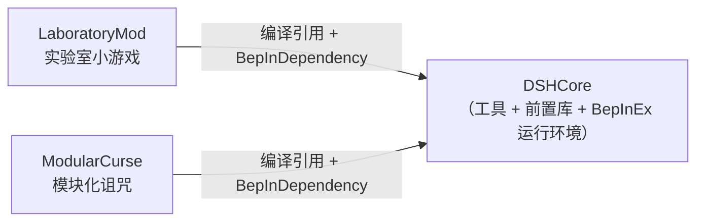

# DSHCore

> MVZ2 模组开发**工具 + 前置库**。为「AI 辅助开发」而设计：
> 把 IL2CPP 注入环境里那些必须踩过一遍才知道的坑一次性修好，
> 把每个 mod 都要手写一遍的注册样板收敛成公共 API，
> 并留下可查证的开发参考。

- 插件 GUID：`qoznos.mvz2.core`
- 显示名：`DSHCore`
- 当前版本：**0.2.0**
- 适配：MVZ2 **0.7.0 test-4**（Windows **x86** / IL2CPP metadata v31.1 / Unity 2022.3.62f3）
- 运行时要求：BepInEx **be.788**（x86 IL2CPP）

> ⚠️ 社区制作的**非官方**作品，与游戏原作者无关。
> ⚠️ **本库不添加任何游戏内容**，它只是其它 mod 的前置依赖。

---

## 📖 想写 mod？先看 [`AI_GUIDE.md`](AI_GUIDE.md)

`AI_GUIDE.md` 是本项目**最重要的文档**：面向 AI 与后来者的开发参考，
包含 AI 协作工作流、公共 API 速查、最小 mod 骨架、0.7 官方集成链时序图，
以及一份「症状 → 根因 → 对策」的陷阱清单（14 条，全部实测）。

如果你是被调用的 AI，**动手前请完整读一遍 `AI_GUIDE.md`**。

---

## 它解决什么问题

0.7.0 提供了官方的外部 Mod 扩展点，但在 IL2CPP + 注入类（`ClassInjector`）
组合下有一批硬坑。本库把它们集中修好一次，后续 mod 直接复用。

### 自动修复（无需 mod 作者关心）


| 源文件                | 作用                                                                                                                                                                                                  |
| --------------------- | ----------------------------------------------------------------------------------------------------------------------------------------------------------------------------------------------------- |
| `ClassInjectorFix.cs` | 修`ClassInjector` 两处缺陷：① 基类含**泛型虚方法**时 vtable 槽解析失败；② `System.String` 被重写成 `Il2CppSystem.String`，导致托管 override 匹配不上（抽象槽保留 → `EntryPointNotFoundException`） |
| `VTableRebind.cs`     | 重建并重绑注入类的原生 vtable 槽（`Class::Init` 会重置它们）                                                                                                                                          |
| `LoadModsPatch.cs`    | 游戏`ModManager.LoadMods` **之前**，对所有已登记注入类型执行 `VTableRebind.Ensure`                                                                                                                    |
| `SaveManagerPatch.cs` | 存档读写**之前**再次兜底重绑（否则 `LoadSaveData`/`CreateSaveData` 抛找不到入口点）                                                                                                                   |
| `MetaInjection.cs`    | 接管`ResourceManager.LoadMetaLists`：直接读 `StreamingAssets/Mods/<nsp>/Content/metas/*.xml` 并用游戏的 `MetaXMLParser` 解析进 `ModResource` —— **完全绕过 Addressables provider 链路**             |
| `ArcadeIndexFix.cs`   | `LoadMods` **之后**平移外部 mod 的 `ArcadeMeta.Index`，避免与 vanilla 的 `0/1/2` 撞车导致街机条目被顶掉                                                                                               |

### 公共 API（供 mod 调用）


| 类型                                       | 用途                                                                                                                                            |
| ------------------------------------------ | ----------------------------------------------------------------------------------------------------------------------------------------------- |
| `Il2CppPin.Pin<T>(obj)`                    | 把「托管 new 出来的 il2cpp 对象」钉成 GC 根。**不钉就会被回收**，症状是 `GetID()` 值比较恒为 false（关卡不出现在列表）或读字符串抛 `0x80131506` |
| `InjectedMod.Create<T>(nsp)`               | 创建注入类`Mod` 实例，并补做原生 `Mod(string)` ctor 的初始化（`Namespace` / `definitionGroup` / `triggers` + Pin）                              |
| `ModBootstrap.Register(...)`               | 一步完成「登记命名空间 + 注册全部注入类」                                                                                                       |
| `ModInfos.Create(...)` / `OnRegister(...)` | 构造`ModInfo`（空 locator / 存档版本 / 空 `Assemblies`）并订阅官方 `OnRegisterModInfos`（含 Il2Cpp 委托转换）                                   |
| `CoreRegistry`                             | 跨插件登记表，上述补丁按命名空间生效                                                                                                            |
| `VTableRebind.Ensure(Type)`                | 手动触发 vtable 槽重绑                                                                                                                          |

---

## 构建

```powershell
cd DSHCore
.\build.ps1                 # 构建（游戏目录存在时自动部署到 BepInEx\plugins\）
.\build.ps1 -Clean          # 先清 bin/obj 再构建
.\build.ps1 -Pack           # 额外打包 dist\DSHCore_v0.2.0_0.7.0.zip
.\build.ps1 -PackDevKit     # 额外打 dist\DSHCore-DevKit_v0.2.0_0.7.0.zip（便携开发环境）
.\build.ps1 -Pack -Launch   # 打包后启动游戏冒烟
```


| 参数              | 作用                                                                                                       |
| ----------------- | ---------------------------------------------------------------------------------------------------------- |
| `-GameDir <dir>`  | 部署目标。默认取 `MVZ2_GAME_DIR` 环境变量或 `Directory.Build.local.props`；都没给则**只构建不部署** |
| `-SkipBuild`      | 跳过 `dotnet build`，直接用已有产物                                                                      |
| `-Clean`          | 先删除 `bin/` `obj/`                                                                                       |
| `-KeepGame`       | 不结束正在运行的游戏进程（**游戏会锁住插件 DLL**，一般不要用）                                          |
| `-Pack`           | 打包可分发 zip 到 `dist\`                                                                                  |
| `-PackDevKit`     | 额外打「不含 DSHCore 源码」的便携开发环境包（见下）                                                    |
| `-NoRuntime`      | DevKit 里不带 `runtime\`（使用者靠自己的游戏目录编译）                                                |
| `-Launch`         | 构建/打包后启动游戏                                                                                        |

> 也可以在仓库根目录用 `.\build.ps1 -Mod dsh` 或一次性 `.\build.ps1 -Pack`。

### 打包特点

**只有本库的包体包含 BepInEx 运行环境**
（`winhttp.dll` / `doorstop_config.ini` / `.doorstop_version` / `dotnet/` /
`BepInEx\core|interop|unity-libs|patchers|config`），
所以它是「解压到游戏根目录即可」的完整独立安装包。
其它 mod 的包体只含插件 + 资源，需要先装本库。

构建脚本还会自动删除**改名前的遗留插件** `BepInEx\plugins\CustomCore.dll`
（本库 0.1.0 时叫 CustomCore，GUID 未变 —— 两个同时存在会被判为重复 GUID）。

### 每次构建都会刷新 `_refs\DSHCore\`

`SyncDshCoreRefs` 目标会把刚建好的 `DSHCore.dll`（+ `pdb`）同步到仓库根的
`_refs\DSHCore\`。那是**没有 DSHCore 源码的环境**（单个 mod 工程、DevKit 包）
使用的编译引用，所以必须每次刷新，否则会出现「引用的是旧 DSHCore」这种难查的问题。

`.gitignore` 里只排除 `_refs/DSHCore/*.pdb`（含本机源码路径），**dll 是入库的**。

### `-PackDevKit`：不含本库源码的便携开发环境

给「不想碰 DSHCore 源码、只想写自己的 mod」的人。产物解压后就是一个自洽的工作区：
根配置 + `.vscode` + `tools` + `_refs\DSHCore` + `runtime\`（可 `-NoRuntime`）
+ 两个范例 mod 的源码 + `DSHCore\`（**只有 `*.md` / `*.txt` 文档，没有源码**）。

其中的 mod 工程会因为找不到 `DSHCore.csproj` 而自动降级为引用
`_refs\DSHCore\DSHCore.dll`（见仓库根的 `Directory.Build.props`）。

---

## 依赖关系



编译引用有两路（由仓库根的 `Directory.Build.props` 自动选）：
仓库里有本库源码时是 `ProjectReference`，没有时（单个 mod 工程 / DevKit 包）
是 `_refs\DSHCore\DSHCore.dll`。运行期始终靠 `[BepInDependency]` 找到本插件。

---

## 目录结构

```
DSHCore/
├─ AI_GUIDE.md             ★ 面向 AI 与后来者的开发参考（先读这个）
├─ README.md               本文件
├─ build.ps1               构建 / 部署 / 打包 / 打 DevKit
├─ install-readme.txt      分发包内的安装说明（打包时注入版本号）
├─ devkit-readme.txt       DevKit 包内的上手说明（打包时注入版本号）
├─ Directory.Build.props   把本工程接入共享编译环境解析（转发到仓库根）
├─ DSHCore.csproj          工程文件（编译引用由共享配置解析）
│
├─ Plugin.cs               入口：应用 6 个补丁；GUID / NAME / VERSION / Log
├─ CoreRegistry.cs         跨插件登记表
│
├─ ClassInjectorFix.cs     ClassInjector 缺陷修复
├─ VTableRebind.cs         注入类 vtable 槽重绑
├─ LoadModsPatch.cs        LoadMods 前统一重绑
├─ SaveManagerPatch.cs     存档读写兜底
├─ MetaInjection.cs        磁盘 XML metas 注入
├─ ArcadeIndexFix.cs       街机条目 Index 平移
│
├─ Il2CppPin.cs            GC 根驻留
├─ InjectedMod.cs          注入类 Mod 实例创建
├─ ModBootstrap.cs         一次完成登记 + 注入类注册
└─ ModInfos.cs             ModInfo 构造 + 官方注册点订阅
```

---

## 环境准备

`runtime/` 是**编译引用与打包源的唯一来源**，但它不入库
（里面的 `BepInEx/interop` 由游戏二进制生成，属游戏派生内容）。
新克隆仓库后需要先重建：

```powershell
.\tools\sync-runtime.ps1 -GameDir "<游戏目录>"
```

若游戏目录里还没有可用的 BepInEx 环境：装 **be.788** x86 IL2CPP，
把 `BepInEx.cfg` 的 `UpdateInteropAssemblies` 置 `true`，启动一次游戏让它生成
`BepInEx/interop`，再跑上面的同步脚本。
（**必须 be.788**：旧版 Cpp2IL 不支持本游戏的 metadata v31.1。）

---

## 许可证

[GPL-3.0](../LICENSE)。BepInEx 及其组件遵循各自原许可证。
