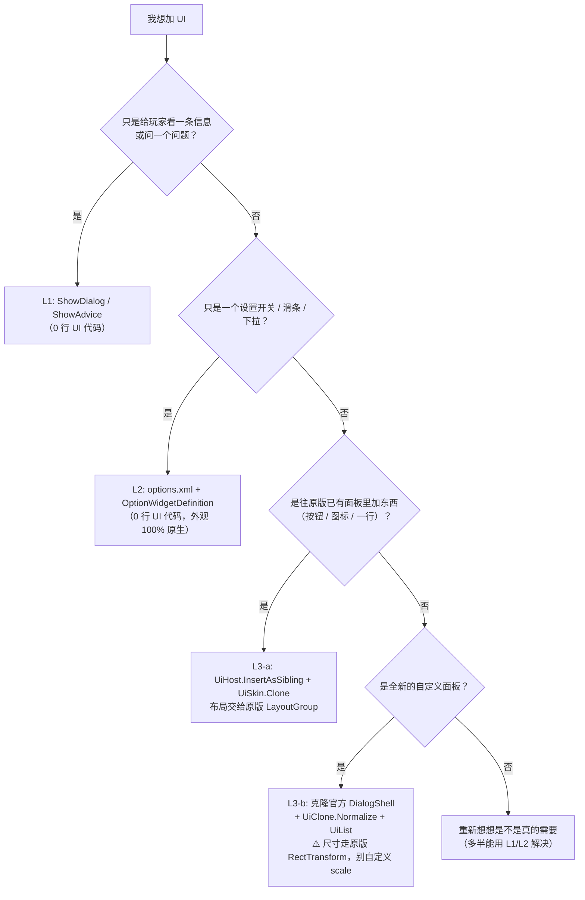

# MVZ2 原版 UI 体系调研 · 与 DSHCore 的 UI 支持设计

> **状态**：调研 + 设计稿（尚未实现）。本文是后续实现 `DSHCore.Ui` 与《子 mod UI 开发指南》的依据。
> **适配**：MVZ2 0.7.0 / Windows x86 / IL2CPP metadata v31.1 / BepInEx be.788
> **源码基准**：仓库内 `_Scripts/0.7.0 in developing/`（下文简写为 `_Scripts/`）。
> 凡标注「**实测**」的条目来自本仓库已跑通并记录的运行时验证，不是源码推断。

---

## 0. 结论速览

原版 UI 对 mod 的「开放程度」是分层的，**绝大部分痛点来自子 mod 越过了自己该待的那一层**：

| 层 | 是什么 | 原版是否给 mod 用 | 子 mod 应该怎么办 |
| --- | --- | --- | --- |
| **L1 语义层** | `ShowDialog` / `ShowAdvice` / HUD 显隐 / 震屏 / 提示箭头 | ✅ **一等入口**，`MVZ2.Logic.dll` 里全是 public static 扩展方法 | **默认走这层。** 绝大多数"要个提示/要个确认框"的需求到此为止 |
| **L2 数据层** | `options.xml` + `OptionWidgetDefinition` | ✅ 可行，但要自己写 Definition + meta | **要"设置项"就走这层。** 零 UI 代码，外观 100% 原生 |
| **L3 控件层** | `TextButton` / `LabeledToggle` / `ElementList` / `Tooltip` / 各种面板 | ❌ **完全没有对外开放**。控件靠私有 `[SerializeField]`，`AddComponent` 必崩或必无效，prefab 也加载不到 | **只有做"自定义面板/HUD 元素"才需要。** 唯一可行做法是**克隆场景里的活节点**——这正是 DSHCore 该补的基础设施 |

一句话：**原版没有给 mod 的 UI 控件 API；有的只是语义级出口和数据驱动出口。**
所以 DSHCore 不该做「UI 框架」，而该做 **L3 的薄基础设施**（找到克隆源、挂对位置、克隆后规范化），
把「用原版零件」这件事从"每个 mod 自己摸一遍"变成"调两个方法"。

---

## 1. 原版 UI 体系事实

### 1.1 技术栈：uGUI（不是 UI Toolkit）

全仓库（约 4700 个 .cs）搜 `UIDocument` / `VisualElement` / `UxmlFactory` / `UQuery` **零命中**；
`UnityEngine.UI` 出现在 30+ 个 UI 文件里。
基元类型全是 `Canvas` / `GraphicRaycaster` / `Button` / `LayoutGroup` / `TextMeshProUGUI`。

### 1.2 场景与画布结构

**两级结构：一个常驻的 `Main` 场景 + 一个按需加载的 `Level` 场景。**

```csharp
// _Scripts/Loader/LandingSceneController.cs:20-24
void Start()
{
    OldSaveDataManager.SetSaveDataImporter(new OldSaveDataImporter());
    ModManager.OnRegisterModInfos += OnRegisterModInfos;
    Addressables.LoadSceneAsync("Main", LoadSceneMode.Single);
}
```

- **`Main` 场景常驻、永不被卸载**（全仓库 `UnloadSceneAsync` 只作用于 `"Level"`）：

  ```csharp
  // _Scripts/MVZ2/Level/LevelManager.cs:226-232
  public async Task ExitLevelSceneAsync()
  {
      var sceneName = "Level";
      if (!Scene.IsSceneLoaded(sceneName)) return;
      await Scene.UnloadSceneAsync(sceneName);
      SetLevelController(null);
  }
  ```

- 主菜单 / 图鉴 / 音乐室 / 存档 / 商店 **全部是 `Main` 场景里的"页面"**，靠 `SetActive` 切换，不换场景：

  ```csharp
  // _Scripts/MVZ2/Scene/MainSceneController.cs:479-495
  private void Awake()
  {
      pages.Add(MainScenePageType.Splash, splash);
      pages.Add(MainScenePageType.Titlescreen, titlescreen);
      pages.Add(MainScenePageType.Mainmenu, mainmenu);
      ... // 共 12 个页
      ui.OnDebugIconClick += (icon) => main.Scene.DisplayConsole();
  }
  ```
  ```csharp
  // _Scripts/MVZ2/Scene/ScenePage.cs:7-16
  public class ScenePage : MonoBehaviour
  {
      public virtual void Display() { gameObject.SetActive(true); }
      public virtual void Hide()    { gameObject.SetActive(false); }
  }
  ```

- **关卡**走 `Level` 场景（Additive），UI 根是 `LevelUI`，内部 Standalone / Mobile 两份预设二选一：

  ```csharp
  // _Scripts/MVZ2/Level/UI/LevelUI.cs:56-64
  public LevelUIPreset GetUIPreset() { return isMobile ? mobileUI : standaloneUI; }
  ```

- 运行时画布（**实测**）：

  ```text
  MainGame
  └ MainScene                        ← MainSceneController + MainSceneUI
    └ GlobalUICanvas                 ← Canvas(Screen Space - Camera, cam=UICamera, planeDistance=100)
      ├ ConsoleIcon / Image          ← MainSceneUI.debugConsoleIcon
      └ …（对话框、面板都在这层或它下面）
  ```

  > ⚠️ **`UIPreset` / `UIPresetStandalone` / `UIPresetMobile` 不是类名，是 prefab 资源名。**
  > 三者在 0.7.0 源码与 `MVZ2.dll` interop 里都搜不到。真正存在的类叫 **`LevelUIPreset`**（关卡侧）。

### 1.3 UI 是「怎么被造出来的」：prefab 驱动，**克隆是唯一路**

这是整份调研里最关键的一条。

- **原版从不 `new GameObject` 搭 UI**。全仓库 `new GameObject(` 只有 2 处命中和 UI 无关
  （`DebugConsoleInputField.cs:1046` 是 Unity TMP 源码副本的 Caret；另一处在模型侧）；
  `AddComponent<Canvas>` **零命中**；`Resources.Load` **零命中**。

- 所有动态 UI 都走「**克隆 prefab 上的模板节点**」。官方列表底座 `ElementList` 就是模板：

  ```csharp
  // _Scripts/Engine/Tools/Unity/ElementCollection/ElementList.cs:84-89
  public GameObject CreateItem()
  {
      var item = Instantiate(_template, _listRoot);
      item.SetActive(true);
      return item;
  }
  // :162-166
  [SerializeField] private Transform _listRoot = null!;
  [SerializeField] private GameObject _template = null!;
  ```

- **UI prefab 不在 Addressables 条目里，mod 侧加载不到。** 官方给资源打标签的白名单里
  没有 UI 这一项（只有 `metas` / `lang` / `music` / `sounds` / `models` / `spritemanifests` /
  `sprites` / `mapmodels` / `areamodels` / `customize_pages`），而 UI prefab 是**场景/预制体里的嵌套实例**，
  靠 `[SerializeField]` 直接引用：

  ```csharp
  // _Scripts/MVZ2/Scene/MainSceneController.cs:553-558
  [SerializeField] private Camera uiCamera = null!;
  [SerializeField] private CameraLimiter uiCameraLimiter = null!;
  [SerializeField] private MainSceneUI ui = null!;
  ```

  → **`[SerializeField] private` 字段 mod 无法在运行时新增，控件也拿不到字体/Sprite/音效的序列化引用。**

- **结论（实测，已写死在本仓库）**：
  > 「UI prefab 在 Addressables bundle 里，mod 侧没有可靠的按名加载入口。
  > 而『克隆现场已有节点』是已验证可行、且能连序列化引用（字体 / sprite / 点击音效 / 事件订阅）
  > 一起继承的做法。」 —— `GraphicConsole/Ui/UiSources.cs:11-17`

### 1.4 布局体系：`LayoutGroup` + `LayoutElement` 为主

LayoutGroup 类名在业务代码里几乎不出现（都挂在 prefab 上），但列表工具会主动刷新祖先布局，
这是决定性证据：

```csharp
// _Scripts/Engine/Tools/Unity/ElementCollection/ElementListUI.cs:78-95
foreach (var layoutGroup in _listRoot.GetComponentsInParent<LayoutGroup>())
{
    if (layoutGroup.transform == _listRoot) continue;
    LayoutRebuilder.ForceRebuildLayoutImmediate(layoutGroup.transform as RectTransform);
}
```

手写坐标（`anchoredPosition`）全仓库只有 **8 处**，且都是零星微调
（`Dialog.ResetPosition`、`FPSDisplayer`、`ProgressBar` 等）。

> **实测**：诅咒面板入口按钮的父节点 `Right` 上挂的是 `VerticalLayoutGroup`（`m_Spacing=20`，宽仅 80）
> —— 所以「插一个兄弟节点」就能自动排到下方，**完全不需要算坐标**。这就是 ModularCurse 那条路的物理基础。

### 1.5 生命周期与「可插入点」

- **没有 `UIManager` / `PanelManager` / 屏幕栈**（全仓库零命中）。只有三张不对外开放的私有登记表：
  1. `MainSceneController.pages`（`Dictionary<MainScenePageType, ScenePage>`，`Awake` 里硬编码）
  2. `LevelController.parts`（`ILevelControllerPart[]`，`Awake` 里硬编码）
  3. `PanelFlags`（关卡内"哪个面板开着"的私有 `[Flags]` 记账）

- **官方自己也会动态往 UI 里加东西**，全部走 `ElementList.updateList`：

  ```csharp
  // _Scripts/MVZ2/UI/Dialogs/CustomDialog.cs:18-39（节选）
  var rowCount = Mathf.CeilToInt(options.Length / (float)countPerRow);
  buttonRowList.updateList(rowCount, (i, rect) => { ... },
      rect => { /* 订阅 */ }, rect => { /* 退订 */ });
  ```
  ```csharp
  // _Scripts/MVZ2/Level/UI/LevelUIPreset.cs:320-334（节选）
  public void SetArtifactCount(int count)
  {
      artifactList.updateList(count, null,
          obj => { var a = obj.GetComponent<ArtifactItemUI>(); a.OnPointerEnter += ...; },
          obj => { var a = obj.GetComponent<ArtifactItemUI>(); a.OnPointerEnter -= ...; });
  }
  ```

- `ElementList.updateList` 会把克隆体 `SetParent` 到 `_listRoot` —— **挂进现有布局的方式就是这一条**：

  ```csharp
  // _Scripts/Engine/Tools/Unity/ElementCollection/ElementList.cs:71-79
  public void Add(GameObject item) { Insert(Count, item); }
  public void Insert(int index, GameObject item)
  {
      item.transform.SetParent(_listRoot, true);
      itemList.Insert(index, item);
      SortItems();
  }
  ```

- 关卡侧面板的开关**全是 `SetActive`**，且方法多为 `private`（靠 interop 才能从 mod 调到）：

  ```csharp
  // _Scripts/MVZ2/Level/Blueprints/LevelUIBlueprintChoose.cs:214-223
  public void ShowCurseChoosePanel(CurseSelectItemViewData[] viewDatas)
  {
      curseChoosingDialog.gameObject.SetActive(true);
      curseChoosingDialog.UpdateCurses(viewDatas);
  }
  public void HideCurseChoosePanel() { curseChoosingDialog.gameObject.SetActive(false); }
  ```

### 1.6 原版对 mod 开放了什么

#### L1 — 语义级出口（✅ 推荐，零 UI 代码）

| 能力 | 入口 | interop 校验 |
| --- | --- | --- |
| 弹一个「标题+正文+若干按钮」对话框（关卡内） | `level.ShowDialog(title, desc, options, onSelect)` | ✅ `MVZ2Logic.Level.LogicLevelExt.ShowDialog(LevelEngine, String, String, Il2CppStringArray, Il2CppSystem.Action<int>)` |
| 同上，**关卡外**（主菜单/地图/图鉴） | `Global.GUI.ShowDialog(...)` | ✅ `MVZ2Logic.Games.IGlobalGUI`（接口只有这一个方法） |
| 顶部提示条 | `level.ShowAdvice(context, textKey, priority, timeout, args)` | ✅ 另有两个 `ShowAdvicePlural` 重载 |
| HUD 五项显隐（能量/蓝图/铁镐/星碎片/驱动） | `level.SetEnergyActive/SetBlueprintsActive/SetPickaxeActive/SetStarshardActive/SetTriggerActive` + 对应 `IsXxxActive` **Getter** | ✅ 成对存在 |
| 震屏 | `level.ShakeScreen(startAmp, endAmp, time)` | ✅（`time` 单位是 **tick**） |
| 提示箭头 | `level.SetHintArrowPointToBlueprint/Pickaxe/Trigger/Starshard/Entity` + `HideHintArrow` | ✅（**无 Getter**） |
| 暂停/恢复 | `level.PauseGame/ResumeGame/ResumeGameDelayed(int pauseLevel)` | ✅ |
| 金币显示 | `level.SetMoneyFade(bool)` / `ShowMoney()` / `SetMoney/AddMoney/GetMoney` | ✅ |

要点：
- 这些方法底层改的是 **`LevelController` 的缓存字段**（`EnergyActive` / `BlueprintsActive` / …），
  再由 setter 同步到 UI —— 所以走它们是「改意图值」，比直接改 `LevelUIPreset.SetActive` 稳。
- **但开局与读档官方仍会覆写**：
  - `StartGame_Tools()` → `UpdateToolUIUnlockedActive()`（按存档解锁状态重算 `StarshardActive` / `TriggerActive`）
  - `ReadFromSerializable_Tools` 直接覆写五个字段
  - `RefreshUIAtLevelStart()` 重刷关卡名/进度条/金钱/难度
  → **要"持续隐藏"还是得在关键时刻重压**（`GraphicConsole/Game/LevelHud.cs` 就是每帧重压的实证）。
- **进度条 / 菜单按钮 / 加速按钮 / 金币淡入原版没有给 `LogicLevelExt` 接口**，只能自己改 `LevelUIPreset`
  与 `level.LevelProgressVisible`，且会被刷回去。
- `ShowAdvice` 的 `timeout` 是 **tick**（30 tps），`priority` 低的新提示会被高优先级挡掉；
  文本走 i18n，但**找不到键时会 `string.Format(text, args)` 原样返回**，所以直接传中文字面量也能显示。

#### L2 — 数据驱动的设置项（✅ 零 UI 代码，外观完全原生）

官方「更多选项」页 **是从定义表动态生成的**：

```csharp
// _Scripts/MVZ2/Options/Dialog/OptionsDialogController.cs:443-464（节选）
OptionWidgetDefinition[] definitions = Main.Game.GetAllOptionWidgetDefinitions();
Array.Sort(definitions, (d1, d2) => d1.GetOrder().CompareTo(d2.GetOrder()));
foreach (var definition in definitions)
{
    if (!definition.ShouldEnable(context)) continue;
    var categoryID = definition.GetCategoryID();
    if (!NamespaceID.IsValid(categoryID)) continue;
    ... // 按 category 分组
    var categoryMeta = Main.ResourceManager.GetOptionCategoryMeta(pair.Key);
    if (categoryMeta == null) continue;              // ⚠️ 分类 meta 缺失 → 整组静默消失
```

而 `GetDefinitions` 是**汇总所有 mod** 的：

```csharp
// _Scripts/MVZ2/Global/GlobalGame.cs:49-57
public void AddMod(Mod mod)
{
    foreach (var def in mod.GetDefinitions()) { definitionGroup.Add(def); }
    ...
}
```

- interop 校验（本节全部已确认存在于 `runtime/BepInEx/interop/MVZ2.Logic.dll`）：
  `MVZ2Logic.Options.OptionWidgetDefinition` / `OptionToggleDefinition` / `OptionButtonDefinition` /
  `OptionSliderDefinition` / `OptionDropdownDefinition` / `MVZ2Logic.Definitions.AutoOptionWidgetDefinitionAttribute`
- 只有四种形态：`Button` / `Toggle` / `Dropdown` / `Slider`；**控件外观 100% 免费**（模板 `Instantiate` 自原版 `OptionWidgets` prefab）
- XML 骨架（由解析器反推）：

  ```xml
  <options>
    <categories><category id="my_mod" label="我的模组" /></categories>
    <items><bool id="toggle_xxx" defaultValue="false" /></items>
    <widgets>
      <toggle id="toggle_xxx" category="modular_curse:my_mod" label="开关">
        <tooltip><p>悬停说明。</p></tooltip>
      </toggle>
    </widgets>
  </options>
  ```
  - key / 根元素名 = `options`（`_Scripts/MVZ2/Metas/MetaXMLParser.cs:108` → `OptionMetaList.FromXmlNode(document["options"], ...)`）
  - 元素名决定类型（`OptionWidgetMeta.cs:71-76` 的 `typeDict`）
  - 属性：`id`（必填）/ `category`（必填，`NamespaceID`）/ `label` / `minValue` / `maxValue` / `wholeNumber`
- **选项值持久化免费**：`Global.Options.SetOptionBool(自己的 NamespaceID, v)` + `SaveOptions()`，
  不需要自己造 `ModSaveData`。
- **同一个控件会自动出现在主菜单 / 地图 / 关卡三处**的设置界面里（`OptionsDialogController.Open` 被三处调用），
  可用 `ShouldEnable(IOptionContext)` 按场景过滤。
- ⚠️ 五个前置条件（缺一不可）：注册 ModInfo / meta 进库 / 定义进 `definitionGroup` /
  **`<category>` meta 必须存在** / 注册时机必须早于 `ModLoader.LoadDefinitionProperties`。

#### L3 — 控件层（❌ 未开放，只能克隆）

- 原版**没有**任何控件工厂 / 注册表 / prefab 地址常量 / `CreateXxx` 入口。
- `IOptionsDialogElement` 是**空标记接口**，源码里无任何使用点 —— **不是**注册接口。
- 控件全部依赖私有 `[SerializeField]` 引用，`AddComponent` 后引用为 `null` → 必崩或必无效：

| 类别 | 控件 |
| --- | --- |
| 组合控件（❌ 不可 `AddComponent`） | `TextButton`、`ButtonRow`、`LabeledToggle`、`LabeledDropdown`、`TextSlider`、`OptionWidgets` |
| 对话框（❌） | `Dialog`(abstract)、`CustomDialog`、`InputNameDialog`、`LanguageDialog`、`OptionsDialog`(+2 Page + `MoreOptionsCategory`) |
| 列表底座（❌） | `ElementList`、`ElementListUI`、`ElementArray` |
| 关卡 HUD / 面板（❌） | `LevelUI`、`LevelUIPreset`、`LevelUIBlueprintChoose`、`CurseChoosingDialog`、`ArtifactChoosingDialog`、`ProgressBar`、`EnergyPanel` … |
| **可以 `AddComponent`**（零字段或有 null 保护 / public 字段） | ✅ `TooltipAnchor`、✅ `TooltipHandler`(字段全 public)、✅ `SliderEndHandler`、✅ `Deselector`、✅ `CursorHandler`、✅ `FloatFader`/`ColorFader`、✅ `HintArrow`、✅ `PanZoomController`、✅ `LevelUIUnit` |
| 纯 prefab 组件（源码零调用点，靠 prefab 上的 UnityEvent 持久监听） | `Deselector`、`DragMover`、`LayoutSizeLimiter`、`OptionsDialogElement` |

> 最后一行值得注意：**原版确实存在"只在 prefab 里配置、C# 不引用"的组件** ——
> 想复现它们只能克隆带那些配置的节点。

---

## 2. 归因：GraphicConsole 的 UI 为什么「丑」

`GraphicConsole` 在 L3 上**自建了一套 UI 框架**（素材解析 + 自绘布局 + 浮层 + 轮询 + 屏幕空间数学），
而 L3 的前提条件（prefab 序列化引用）mod 拿不到，于是每个细节都要自己补偿。
它踩的坑**全都记在** `/memories/repo/mvz2-graphicconsole-ui-traps.md` 里，这里按根因归类：

### 2.1 根因 A：没有布局宿主，只能自己造坐标体系

- 自定「设计尺寸 1000×660 + 全局 `Scale = 0.55`」（`GraphicConsole/Ui/GcLayout.cs`），
  于是所有尺寸、减法关系、拖动换算都要自己算，且**与原版的 `CanvasScaler` / `LayoutGroup` 体系脱节**。
- `new GameObject` 造的容器默认 `100×100` 锚在中心 → 必须手动 `Stretch`（traps §6）。
- 面板挂在自己的宿主下、带 0.55 缩放 → 屏幕空间换算要算祖先 `localScale`（traps §7、§11），
  失败一次就"看起来超出屏幕"/"拖动不跟手"。

**对照**：ModularCurse 把节点插进原版 `VerticalLayoutGroup` 当兄弟，**零坐标计算**。

### 2.2 根因 B：克隆源不精确，克隆出「四合一」和「改不动」的东西

- 克隆 `OptionWidgets` 的 **parent** → 每个格子都冒出原版设置界面的「语言」下拉框（traps §4）
  —— 因为 `OptionWidgets` 是"一个克隆体含四种控件，靠 `UpdateWidgets` 只激活一个"。
- 克隆体的 `Image.enabled == 0` → **面板没有背景**（traps §8）。
- 克隆体的 TMP `enableAutoSizing` 还在 → 同一批标签字号 8px ~ 36px（traps §5）。
- 克隆体的 active 状态继承模板（模板平时 `SetActive(false)`）→ `Awake` 时机错位（`mvz2-graphicconsole.md`）。
- 克隆带点击的按钮后必须 `onClick.RemoveAllListeners()`（Instantiate 会复制持久监听器）。

### 2.3 根因 C：把「找不到克隆源」的问题用「自绘」绕过 → 质量崩

- 模板架挂在 `SetActive(false)` 的节点下 → 整支 inactive → **`LayoutGroup` 一次都不跑**，
  子节点全停在 `100×100 @ 0,0`，屏幕上什么都没有（traps §2）。
- `TMP_Dropdown` 的弹出列表在本环境**一个像素都画不出来**（节点 active、`Image.enabled=1`、
  矩形完全正确，但截图差分为 0，而 `GraphicRaycaster` 照常生效）→ 只能自绘浮层
  `Ui/PickerOverlay.cs`（traps §9）。**自绘浮层意味着美术、分页、命中、滚动全部自己负责。**
- `AddComponent<Button>()` 在原版 UI 类型上**返回 null（不抛异常）** → 下拉格只能轮询鼠标位置
  （`UiFactory.TickDropdowns`）。

### 2.4 根因 D：控件同步用轮询而不是事件

`PanelPageBase.SyncToggle/SyncDropdown/SyncNumber` 用 `lastWritten` 记录"上次写进去的值"
来区分「UI 变了」和「游戏状态变了」（`mvz2-graphicconsole.md`）。
这是**不得不**的做法（因为控件的事件链在 `Awake` 里才挂好、且 interop 委托要手工转换），
但它带来了"首次刷新必须强制读一次"这类边界 bug（traps §13）。

### 2.5 教训（可以直接写进给子 mod 的文档）

> **「节点存在 + 尺寸对」≠「看得见」。** 视觉问题必须用截图差分判定。
> —— traps §10

> 不要试图在 L3 上「重造 UI」。L3 的正确用法是**插入到原版已有的布局与美术体系里**；
> 一旦开始自定义尺寸体系、自绘浮层、手写命中判定，就等于把原版的 UI 全部重写一遍，
> 观感必然不如原版。

---

## 3. 归因：ModularCurse 为什么「效果好」

对比 `GraphicConsole/CursePoolIcons.cs` / `CursePoolRow.cs`（已实测有效的做法）：

| 做法 | 效果 |
| --- | --- |
| 克隆**独立 prefab** 的活性实例（`CurseEntranceButton`），而不是从零搭 | 连序列化的 `Button.m_OnClick`（点击音效 `Play2D` + `Deselector.Deselect`）、`LayoutElement(64x64)`、`CursorAnchor`、TMP 引用一起继承 |
| 插到 `Right` 节点的 `VerticalLayoutGroup` 里当**兄弟节点** | 布局由原版负责，**零坐标计算**；宽 80 自然纵向排列 |
| 幂等：先 `parent.Find(名字)` 复用，再记静态引用 + 检查 `Pointer != IntPtr.Zero` | 反复调用不会堆节点 |
| 复用原版美术 + 音效 + 悬停提示（`TooltipAnchor` + `TooltipHandler`） | 观感与设置界面/图鉴同源 |

**本质**：它只做「**往原版的布局体系里插一个原版节点**」，**不承担任何布局/美术责任**。
这正是 DSHCore 应该固化成 API 的东西。

---

## 4. DSHCore 的 UI 支持设计

### 4.1 设计原则

1. **不做 UI 框架，只做 L3 的薄基础设施。**
   目标是"让子 mod 能用原版零件"，不是"给子 mod 一套新控件"。
   DSHCore 自身**绝不新增任何视觉元素**（不自绘、不定义美术、不拥有布局常量）。
2. **每一层都要有"官方优先"的引导。**
   API 命名与文档必须让子 mod 先撞上 `ShowDialog` 与设置项定义这两条官方路，
   而不是一上来就用克隆。
3. **把已知坑在实现里堵死，而不是在文档里提醒。**
   克隆后自动开 `Image.enabled`、关 `enableAutoSizing`、清监听器、跳过自身节点……
   子 mod 不应该需要知道这些。

### 4.2 实际落地的 API（已实现并实测，见 §7）

命名空间 `DSHCore.Ui`。**这就是子 mod 该用的全部东西。**

| 类型 | 职责 | 关键成员 |
| --- | --- | --- |
| `UiGame` | 官方 UI 入口链 | `IsReady` / `Main` / `Scene` / `SceneUi` / `Dialog` / `InputDialog` / `MainCanvas` |
| `UiFinder` | 场景查找（含未激活对象） | `FindAll<T>` / `FindOne<T>` / `FindChild` / `FindByPath` / `FindChildComponent<T>` / `IsAlive` / `IsChainActive` / `PathOf` |
| `UiSkin` | 素材克隆源 | `UiSkinPart` 枚举 / `IsReady` / `CanProvide` / `Prepare(force)` / `Template(part)` / `Clone(part, parent, name)` / **`MeasureFont(part)`**（克隆一份并读出它的字号，回答"原版这个素材多大"）/ **`SourceScrollView(out …)`** / **`FindVanillaScrollView()`** / **`DumpScrollViewGraphics(label, root)`**（逐个列出 ScrollView 里的 `Image`：开关/精灵/alpha/射线，排查"多了个白块"的惯用手段）/ `Report` / `ReportCompact` |
| `UiHost` | 宿主与挂载 | `OwnPrefix` / `RegisterOwnName` / `IsOwn` / `MarkOwn` / `Resolve(layer)` / `DialogLayer()` / `CreateNode` / `CreateStretched` / `InsertAfter` / `Attach` |
| `UiClone` | 克隆规范化 | `Instantiate`（`activate: false` 时不会触发 `Awake`）/ `Activate` / `Normalize` / `DisableAutoSizing` / **`SetFontSize(node, size, wrap?)`**（只改字号、不动文本）/ **`DescribeFont(node)`** → `FontInfo`（`Size/AutoSizing/Min/Max/Wrapping/Text`）/ `ForceGraphicsVisible` / `Stretch` / `FindText` / `SetLabel` / `FindButton` / `ClearButtonListeners` / `OnClick` / `KeepAlive` / `PruneKeepAlive` |
| `UiOptionRow` | **控件行（唯一入口）** | `Create` / `Root` / `Widgets` / `Slider` / `Dropdown` / `SetKind` / `SetLabel` / `SetStretch` / `SetTooltip` / `SetToggle` / `SetSlider`（标签自动带值并实时刷新）/ `SetSliderValueFormat` / `SetSliderValue` / `SetDropdown`（⚠️ 不可用）/ `SetButton` / `Describe` / `LabelText` |
| `UiList` | **纯代码可滚动列表** | `Create` / `Root` / `Scroll` / `Content` / `Count` / `Add` / `AddButton` / `AddOptionRow` / `Clear` / `Rebuild` / `SetFlexible` / `SetViewportHeight` / `SuggestHeight` / **`SetRowFit(stretch, spacing)`** / `ScrollToTop` / `ScrollToBottom` / `SetVerticalPosition` / `Describe` / **`DescribeStructure`** |
| `UiDropdown` | TMP 弹窗的**诊断**（不属于功能 API） | `Of` / `Show` / `Hide` / `FindList` / `Describe` / `DumpCanvases` / `DumpScrollViews` / `PreparePopup` / `SetPopupCanvasMode` / `MoveListTo` / `MoveListToRoot` / `StripListCanvas` |
| `UiTooltip` | 原版悬停提示全链 | `Attach(target, title, text)` / `AttachExisting(node, …)` / `SetText` / `AnchorPivot` / `Describe` / `Hide()` |
| `UiOptions` | **设置项注册**：默认进「模组设置」页（零注入）；`scope: VanillaMenu` 时才进原版设置界面 | `DeclareToggle` / `DeclareSlider` / **`DeclareChoice`** / `DeclareDropdown` / **`DeclareMod(space, 名, 说明, 作者, 中文?)`** / `SetModDisplayName(space, 源串, 中文?)` / `GetModEntry` / `GetModDisplayName` / **`GetModDisplayNameSource`** / `GetModDescription` / `GetModAuthor` / **`DeclaredSpaces`** / `For` / **`ForPage`** / **`SpacesWithSettings`** / `Report`；原版路径另有 `Attach(mod)` / `ApplyProperties()` |
| `UiLocale` | **模组文本本地化**（把 mod 的小表挂进游戏的**两条**查找链；**支持带上下文的游戏内容名**；**支持玩家可编辑的外部文件**） | `Add(源串, 译文, 语言?, 上下文?)` / `AddAll` / **`Table(owner)` → `UiLocaleTable`** / `Get(源串)` / **`Get(源串, 上下文)`** / `In(源串, 语言)` / **`In(源串, 语言, 上下文)`** / `Format` / **`GetAll(texts)`** / `CurrentLanguage` / `Apply` / `Languages` / `CountOf` / **`ContextCountOf`** / `Report` / **`ExternalDirectory`** / **`ReloadExternal`** / **`DescribeExternal(lang)`** / **`WriteTemplate(lang, overwrite?)`** / **`KnownKeys`** / **`SplitKey`** / **`DescribeKey`** / **`DumpKeys`** / **`RegisteredTables`**；语言码常量 `Chinese`(`zh-Hans`) / `English`(`en-US`) / `SourceLanguage`；取词顺序 **外部文件 → 代码表 → 游戏内容链（普通 + 带上下文）→ 源串** |
| **`UiLocaleTable`** | **mod 侧写多语言的入口**（一个 mod 一张表，诊断里能看出归属者与条数） | `Add` / **`Both(源串, 英文, 中文?, 上下文?)`** / **`En(中文, 英文, 上下文?)`** / **`Zh(源串, 中文, 上下文?)`** / **`EnAll(…)`** / **`EnAllWith(上下文, …)`** / `Owner` / `Count` |
| `UiTagRow` | **档案样式条目行**（`Toggle` + 文字；勾选 = 选中） | `Template(searchRoot?)` / `Create(parent, name, label, isOn, onChanged)` / `Set(row, label, isOn)` / `IsOn` / `TextOf` / `Describe` / `Forget` |
| `UiKit` | 克隆小工具（行容器 / 文本 / 按钮 / 尺寸契约 / 克隆体修补 / 布局 dump） | `RowHeight` / `ButtonWidth` / `HContainer` / `VContainer` / `Fit` / `Label` / `Paragraph` / **`AutoHeight`** / **`SetBold`** / **`IsBold`** / `TextButton` / **`Separator`** / **`ImageAlpha`** / `ReplaceMask` / `ClearEmptySpriteAlpha` / `StripTextTranslators` / `NormalizeSubtree` / `MakeVertical` / `Path` / `SetWidthRatio` / **`SetTwoColumnWidth(left, right, totalRatio)`** / `Describe` / `DescribeTexts` |
| `AddonPage` | **插件页子页面**（入口按钮 + 页面壳 + 生命周期全自动） | 抽象：`Id` / `EntryLabel` / `Title` / `ShellSource` / `WidthRatio` / **`TwoColumnWidthRatio`** / **`LeftColumnPath`** / `RightColumnPath` / **`TopHeight`** / **`EntryLabelText`** / **`TitleText`** / `BuildContent(shell)` / `Suspended()` / `OnBuildFailed`；运行：`Register` / `Open` / `Close` / `RequestOpen` / `PumpNow` / `SetReturnTo` / `Root` / `EntryInstalled` / `LastError` |
| `AddonPages` | 子页面登记表 + 心跳 + 共用查找 | `Register` / `Get` / `All` / `IsAddonsPage` / `FindShellSource` / `FindEntryTemplate` / `Apply`（挂心跳）/ `Report` |
| `ModSettingsPage` | **内建的「模组设置（DSHCore）」页**（左栏 mod、右栏详细信息 + 设置项） | `SelectNamespace` / `SelectedNamespace` / `DumpLayout` |
| `InjectedDefinitions` | 注入定义 → 官方定义表 | `Register` / `Bind` / `ListFor` / `All` / `Count` / `Track` / `Create<T>` / `Apply` / **`NamespaceOf(mod)`**（判定"这个 `Mod` 是不是我的"只用它） / `Report` |
| `ModNamespacePin` | 钉住注入 `Mod` 的 `Namespace` 字段 | `Ensure(mod, spaceName)` / `IsPinned`（不钉会发生什么见 §6 坑清单） |

`UiSkinPart` 的取值与实际来源（实测路径见 §7.2）：

```
Dialog       CustomDialog 整壳（Blocker + Root[VerticalLayoutGroup+ContentSizeFitter] + Background
             + TitleArea/Title + Desc + Buttons）
InputDialog  InputNameDialog 整壳（+ 输入框 + 错误行 + 两个按钮）
Title        CustomDialog/Root/TitleArea/Title   ← 36pt + 自动缩放（min 18），容器固定 40px，只能一行
Text         CustomDialog/Root/Desc              ← 原版 24pt / 
             开自动换行；**本库不改它的字号**（要改就 UiClone.SetFontSize）
Button       CustomDialog/Root/Buttons/ButtonRow/TextButton
ButtonRow    CustomDialog/Root/Buttons/ButtonRow（自带横向 LayoutGroup，UpdateButtons(string[]) 铺满）
OptionRow    …/OptionsDialog/…/OptionWidgets      ← 四合一控件行；用 UiOptionRow 指定类型
InputField   InputNameDialog/Dialog/InputField
ScrollView   OptionsDialog/Dialog/MoreElements/Scroll View
             （ScrollRect + Background + Viewport[Image+Mask] + Content + Scrollbar Vertical）
```

⚠️ **早期版本额外开放过 `Label` / `Desc` / `Toggle` / `Slider` / `Dropdown`，现已删除。**
原因：

- `Label` / `Desc` 把「标题字体」当通用文本用 → 字号过大、标题换行溢出框体；现在拆成
  `Title`（就是标题本身，**不要拿它写正文**）与 `Text`（正文）。
- `Toggle` / `Slider` / `Dropdown` 单独克隆是把控件从其尺寸契约（`OptionWidgets` 容器）里
  抽出来 → 复选框过大 / 滑条看不见 / 下拉框不显示，且丢掉行上已接好的提示锚点。
  现在统一走 `UiSkinPart.OptionRow` + `UiOptionRow`。

**最小用法**（这就是「做一个面板 + 一行开关」的全部成本）：

```csharp
var shell = UiSkin.Clone(UiSkinPart.Dialog, UiHost.Resolve(UiLayer.DialogLayer), "MyPanel");
var nav   = shell.GetComponent<MVZ2.UI.CustomDialog>();
nav.SetDialog("标题", "正文", options, onSelect);      // 标题保持短：它只能占一行

// 往内容区插一行（位置在官方按钮区之前）：
var host  = nav.buttonRowList._listRoot;              // Root/Buttons
var root  = host.parent.TryCast<RectTransform>();     // Root（带 VerticalLayoutGroup）
var row   = UiOptionRow.Create(null, "Row", UiOptionKind.Toggle);
row.Root.transform.SetParent(root, false);
row.Root.transform.SetSiblingIndex(host.GetSiblingIndex());
row.SetStretch().SetToggle("开关", true, v => { }).SetTooltip("标题", "悬停说明");
```

> **没有一行坐标、尺寸或缩放常量。** —— 这是验收标准。
> 完整可运行版本见 `UiGallery/GalleryPanel.cs` / `GalleryPages.cs`。

### 4.3 当初的草案（保留用于对照）

> 下面是调研阶段写的草案，字段名与实际落地有出入（例如 `ToggleRow` → `Toggle`、
> `DialogShell`+`Panel` → `Dialog`，并新增了 `UiGame` / `UiFinder` / `UiTooltip`）。
> 保留它的价值是看清「为什么最终是这些类型」：`UiGame` 是发现官方引用链之后才加的
> （原草案打算全靠场景遍历），`UiTooltip` 是因为发现只加组件不够才独立出来的。

命名空间 `DSHCore.Ui`（纯 UI 基础设施，不依赖任何具体业务）。

#### ① `UiSkin` —— 克隆源解析（最核心）

解决「我要的控件在哪个活节点上？」。**必须跳过自身节点**，并把模板复制到自己的模板架上
（脱离原对象的场景生命周期，且避免"把自己的克隆体当模板"）。

```csharp
namespace DSHCore.Ui
{
    public enum UiSkinPart
    {
        DialogShell,    // 官方对话框壳（Blocker + 框体 + 背景 + LayoutGroup）
        Panel,          // 通用面板（同 DialogShell，语义别名）
        Button,         // TextButton
        ToggleRow,      // LabeledToggle（⚠️ 只取它本身，不取父节点的 OptionWidgets）
        SliderRow,      // TextSlider
        DropdownSkin,   // LabeledDropdown 的"外观"节点（不含 TMP 弹窗）
        InputField,     // TMP_InputField
        Label,          // 带字体资产的 TextMeshProUGUI
        ListRoot,       // 空列表根（用作 UiList 的容器模板）
    }

    public static class UiSkin
    {
        /// <summary>素材是否已就绪（跨场景会失效，会自动重建）。</summary>
        public static bool IsReady { get; }

        /// <summary>解析/重建素材。force=true 强制重来（换场景后或排障用）。</summary>
        public static bool Prepare(bool force = false);

        /// <summary>取一个素材的克隆体。父节点为 null 时只创建不挂载。</summary>
        public static GameObject Clone(UiSkinPart part, Transform parent);

        /// <summary>取素材本体（只读，用来读 LayoutElement / 尺寸参考；不要改它）。</summary>
        public static GameObject Template(UiSkinPart part);

        /// <summary>诊断用：人类可读的解析报告（哪个素材从哪个节点来的）。</summary>
        public static string Report { get; }
    }
}
```

行为约定：
- 素材从**活动场景**递归查找（不能用 `FindObjectOfType` —— 素材平时都是 `SetActive(false)`）。
- 收集到多个候选时**优先选"父链可见"的那一份**（同场景可能有 Standalone / Mobile 两份预设）。
- 必须**跳过标记为自己的节点**（否则下次会把自己的克隆体当模板 → "第二次打开文案变回原版"）。
- 查不到某个素材时：`IsReady` 为 false，`Clone` 返回 null 并**只记 warning**，绝不抛异常。

#### ② `UiHost` —— 宿主解析

解决「挂哪里才可见 / 才不被覆盖 / 才被布局接管？」

```csharp
public enum UiLayer
{
    MainCanvas,     // 主场景常驻画布（最稳，跨关卡不销毁）
    DialogLayer,    // 与官方对话框同层同缩放（能盖住其它 UI）
    LevelHud,       // 关卡 HUD（仅关卡内有效）
}

public static class UiHost
{
    /// <summary>取一个可安全挂载的父节点；找不到返回 null。</summary>
    public static Transform Resolve(UiLayer layer);

    /// <summary>
    /// 插到 target 的父节点里、紧跟在 target 之后（ModularCurse 模式）。
    /// 这是**最推荐的挂载方式**：布局完全交给原版的 LayoutGroup。
    /// </summary>
    public static GameObject InsertAsSibling(GameObject original, string name);

    /// <summary>
    /// 挂到 layer 下并撑满父节点（用于自定义面板/整块内容区）。
    /// 内部会设好 anchor/pivot/offsetMin/offsetMax，避免"100×100 锚在中心"。
    /// </summary>
    public static GameObject CreateStretched(string name, UiLayer layer);

    /// <summary>把节点标记为己方（供 UiSkin 查找时跳过；也供幂等复用）。</summary>
    public static void MarkOwn(GameObject go);
    public static bool IsOwn(Transform t);
}
```

#### ③ `UiClone` —— 克隆规范化

解决「克隆出来的东西为什么不对？」把 §2.2 的全部坑一次性堵掉。

```csharp
public static class UiClone
{
    /// <summary>
    /// 规范化一个刚克隆出来的节点（原地处理，返回同一个对象便于链式）：
    ///   · 递归把 Image.enabled 置回 true 并记录警告（克隆体可能是 0 → 看起来"没背景"）
    ///   · 关闭 TextMeshProUGUI.enableAutoSizing（否则字号会被容器尺寸重算成 8px~36px）
    ///   · 清掉 Button.onClick 的持久化监听器（Instantiate 会复制它们）
    ///   · 强制 SetActive(true)（模板平时是关的，Awake/onClick 绑定依赖这一步）
    ///   · 打上己方标记 + 名字前缀
    /// </summary>
    public static GameObject Normalize(GameObject go, string name = null);

    /// <summary>只处理文本：设置内容并关掉 autoSizing（可选设字号；<=0 表示保留模板字号）。</summary>
    public static void SetText(GameObject node, string text, float fontSize = 0f,
                               TextAlignmentOptions? align = null, bool wrap = false);

    /// <summary>绑定按钮回调（内部处理 interop 委托转换与防 GC）；会先清理既有监听器。</summary>
    public static void OnClick(GameObject buttonNode, Action handler);
}
```

#### ④ `UiList` —— 列表（替代不可用的 `ElementList`）

`ElementList` 依赖 `[SerializeField]` 的 `_template` / `_listRoot`，mod 不能 `AddComponent`。
DSHCore 提供一个**行为对齐 `ElementListUI`** 的纯代码版本：

```csharp
public sealed class UiList
{
    public UiList(GameObject template, Transform container);

    public int Count { get; }
    /// <summary>按需增删行并更新数据。update 回调里填充该行内容。传入 null item 表示该行不可用。</summary>
    public void Update(int count, Action<int, GameObject> onUpdate,
                       Action<GameObject> onCreate = null,
                       Action<GameObject> onDestroy = null);
}
```

#### ⑤ `UiOption<T>` —— L2 的封装（可选，但性价比最高）

把「`options.xml` + 定义 + 注册」这条 100% 原生、零 UI 代码的路包成基类。

```csharp
public static class UiOptions
{
    /// <summary>声明一个 mod 的设置项分类（对应 XML 的 &lt;category&gt;）。</summary>
    public static void DeclareCategory(string nsp, string id, string labelKey);

    /// <summary>注册一个开关型设置项（外观 = 原版 LabeledToggle 行）。</summary>
    public static void RegisterToggle(string nsp, string id, string categoryId, string labelKey,
                                      Func<bool> get, Action<bool> set, string tooltipKey = null);

    public static void RegisterSlider(...);
    public static void RegisterDropdown(...);
    public static void RegisterButton(string nsp, string id, string categoryId, string labelKey, Action onClick, ...);
}
```

> ⚠️ 这一项需要验证「注入一个 `MVZ2Logic.Options.OptionWidgetDefinition` 子类」在 metadata v31 下能否稳定工作
> （跨程序集抽象类 + 手工补字段）。**建议作为独立一期先做 PoC。**

#### ⑥ 语义层直通封装（价值低，但能提升发现性）

```csharp
public static class UiMessage
{
    /// <summary>关卡内/外通用的对话框（内部自动选 LevelEngine.ShowDialog 或 Global.GUI.ShowDialog）。</summary>
    public static void Dialog(string title, string desc, string[] options, Action<int> onSelect = null);
    /// <summary>顶部提示条（仅关卡内有效）。timeout 单位为 tick（30 tps）。</summary>
    public static void Advice(string textKey, int priority = 0, int timeout = 150, params string[] args);
}
```

### 4.4 明确**不**做的

| 不做 | 原因 |
| --- | --- |
| 自绘控件 / 自绘浮层 | 美术与命中都要自己负责，必然比原版差。`TMP_Dropdown` 弹窗画不出来是渲染层限制，正确解法是**换用 `Slider`/`Toggle` 形态**或**用 `LabeledDropdown` 的外观 + 原版列表**，而不是自绘 |
| 自定义尺寸体系 / 全局缩放常量 | 只会与 `CanvasScaler` 和 `LayoutGroup` 脱节（GraphicConsole 的 `GcLayout.Scale` 就是反面教材） |
| 手写屏幕空间坐标换算 | 应该让 `LayoutElement` + 原版 `LayoutGroup` 负责 |
| 一套"DSHCore 风格"的控件皮肤 | 会与游戏版本演进脱节；且一旦原版美术变化，mod 立刻显旧 |
| 试图加载 UI prefab | 已证实无可靠入口；不要在这上面浪费时间 |

---

## 5. 子 mod 的 UI 决策树



**给文档的一句话**：
> 绝大多数 mod 的 UI 需求，在 L1 和 L2 就结束了。**只有"要塞进原版面板"或"要一个全新常驻面板"
> 才需要碰 L3** —— 而 L3 的正确姿势是"克隆 + 插进原版布局"，不是"自己画"。

---

## 6. 必读坑清单（子 mod UI 文档的核心章节）

### 6.1 查找与克隆

| # | 坑 | 正确做法 |
| --- | --- | --- |
| 1 | `FindObjectOfType` **跳过未激活对象**，而 UI 素材平时全是 `SetActive(false)` | 自己从 `scene.GetRootGameObjects()` 递归遍历（DSHCore 内部做） |
| 2 | 同一份 UI 预设在同一场景可能有**多个实例**（Standalone / Mobile） | 优先选「父链可见」的那一份 |
| 3 | 不跳过自身节点 → 会把自己的克隆体当模板，表现为"第二次打开文案变回原版" | 打己方标记 + 查找时跳过整条祖先链 |
| 4 | 直接从活的原版节点克隆 → 原对象被销毁/切场景后模板悬垂 | 先复制到**自己的模板架**，之后一律从模板架克隆 |
| 5 | 模板架挂在 `SetActive(false)` 的节点下 → 整支 inactive → `LayoutGroup` 不跑，子节点停在 `100×100 @ 0,0` | 面板挂到**模板架的父节点**，不要挂进模板架 |
| 6 | ⚠️ **本条已被实测推翻（早期版本写反了）**：克隆 `OptionWidgets` 本身并不会“四种控件一起显形” —— 只要用 `UiOptionRow.SetKind` 把其余三个关掉就行。反过来，**单独克隆 `LabeledToggle` / `TextSlider` / `LabeledDropdown` 才是坑**：它们的尺寸契约与提示锚点都长在 `OptionWidgets` 上（`LabeledToggle` 甚至没有任何 `LayoutElement`），单拎出来就会出现复选框过大 / 滑条看不见 / 下拉框不显示 | **克隆 `OptionWidgets`**（`UiSkinPart.OptionRow`）+ `UiOptionRow`，别克隆里面的子控件 |
| 7 | 克隆体的 `Image.enabled` 可能是 `0` → 面板"没有背景" | 克隆后强制 `enabled = true` |
| 8 | `Instantiate` 会复制持久化的 `onClick` 监听器（点击音效、`Deselector.Deselect`） | 若要替换行为，先 `RemoveAllListeners()`；若想保留原版手感，就别清 |
| 9 | 克隆体的 active 状态继承模板 | **先 `SetActive(true)` 再设内容**（`Awake` 里的绑定依赖这一步） |

### 6.2 布局

| # | 坑 | 正确做法 |
| --- | --- | --- |
| 10 | `new GameObject` + `AddComponent<RectTransform>` 默认 `100×100` 锚在中心 | 要么 `Stretch` 撑满父节点，要么插到 `LayoutGroup` 里当兄弟 |
| 11 | 自己定义"设计尺寸 × 全局缩放"会与原版 `CanvasScaler` / `LayoutGroup` 脱节 | 插进**原版已有的 `LayoutGroup`**，尺寸由原版决定 |
| 12 | 动态增删子节点后布局不刷新 | `LayoutRebuilder.ForceRebuildLayoutImmediate(root as RectTransform)` |
| 13 | 列表根在 `LayoutGroup` 之下是常态 | 用 `UiList` 时容器应处在 `LayoutGroup` 内 |

### 6.3 文本

| # | 坑 | 正确做法 |
| --- | --- | --- |
| 14 | ⚠️ **本条已被实测推翻（早期版本写反了）**：TMP 的 `enableAutoSizing` 开着确实会让字号被容器重算，但**不能一律关掉** —— 对话框标题素材（`Title`）就是靠它把长标题缩进 40px 高的 `TitleArea`，关掉会换行并向上溢出框体 | 字号“统一”靠**换素材**（标题 `Title` / 正文 `Text` / 控件行 `UiOptionRow`），不是关自动缩放；要钉死一个字号就用 `UiClone.SetFontSize(node, size)` |
| 14b | 对话框标题节点是 **36pt**，拿它写正文/长标题就会冒出框体（`TitleArea` 的 `preferredHeight` 固定 40） | 正文用 `UiSkinPart.Text`；标题保持短。**库不再替使用者改素材字号**（早先版本把 `Text` 规范成 12pt，已删除） |
| 14c | 对话框高度是**内容撑的且不滚**：内容总高超过屏幕时，框体直接顶出屏幕（标题整个跑到屏幕外）—— 而所有节点仍然 `activeInHierarchy = 1`，看"节点是否存在/尺寸是否正确"完全看不出来 | 每行都写短、行数要克制；拿不准就量 `_selftest.txt` 里的 `框体` 矩形（例：`y=29 h=696`，要求 `y >= 0` 且 `y + h <= Screen.height`） |
| 14d | 字号是可演示的系统而不是文档里的固定数字：原版各素材出厂值不同（标题 36 / 正文 24 / 设置项标签与按钮 16 / 输入框 14） | 想知道某个素材多大 → `UiSkin.MeasureFont(part)`；想读现有节点 → `UiClone.DescribeFont(node)`。`UiGallery` 的「文本」页就是这套东西的活演示 |
| 15 | 代码 `AddComponent<TextMeshProUGUI>()` **拿不到字体资产** | **克隆**一个现成的 `TextMeshProUGUI`（继承字体） |
| 16 | `label` / `tooltip` 走 i18n；找不到翻译键时 `string.Format` 原样返回 | 可以直接传中文字面量；要正经本地化就注册词条 |

### 6.4 渲染与视觉判定

| # | 坑 | 正确做法 |
| --- | --- | --- |
| 17 | **`TMP_Dropdown` 自带的展开列表在本环境（`GlobalUICanvas` 相机画布）画不出来 —— 该组件不可用。碍于技术问题，该组件无法正常工作，请自行寻找替代方案，如果你对修复该组件有任何建议，请联系 QoZnoS[https://github.com/QoZnoS]。本库不提供替代实现。** 已实测的事实：列表节点被创建、`active=1`、`CanvasGroup.alpha=1`、`Canvas overrideSorting=1 order=30000`、`Graphic` 绝大多数 `enabled=1`、屏幕矩形正常（如 `x496 y277 254x114`）—— **但像素差分 = 0**；它的 `GraphicRaycaster` 照常生效（表现为“点开没反应、乱点却能改值”）。五种修法全部无效：不干预 / 画布对齐宿主 / 强制 Overlay / 挪出面板 / 搬到根画布 / 删掉列表画布（都是 0 像素）。它的矩形还时不时退化成 `局部=1017x90 → 屏幕 10x1` | 要么只用它的**外观**（`SetDropdown` 的 caption 文字照常显示，可当只读展示），要么**自己设计**选择交互（例如一排复选框行）。❗ 曾经写过一个“克隆官方对话框壳 + 官方按钮行拼列表”的浮层（`UiPicker`）并实测可画（打开时面板区域 106603 像素变化），但**已按维护者要求移除**：本库不提供标准替代实现，以免掩盖“下拉框坏着”这件事。需要的人请自己搭 |
| 17b | 排查下拉框时**别用“取第一个 TMP_Dropdown”**：每个 `OptionWidgets` 克隆体里本来就含一个 `TMP_Dropdown`（被 `SetKind` 关掉的那个空壳）。拿到它去 `Show()` 会在 `!IsActive()` 上**直接返回且不报错**，于是得出“弹窗画不出来”的假结论 | 挑 `activeInHierarchy` 为真的那个（`GalleryPanel.CurrentDropdown()` 就是这么写的） |
| 18 | **「节点存在 + 尺寸对」≠「看得见」** | 视觉问题必须用**像素差分**判定，不能靠日志/尺寸断言；且必须配“关着”的对照图与**区域限制**（标题界面自己在动 —— 全屏差分会被动画淹没） |
| 19 | `ScreenCapture.CaptureScreenshot` 会落空白/黑帧 | 截图只当辅助；优先看布局 dump 日志 |
| **20** | **克隆体一被激活，挂在它上面的组件就会跑 `Awake`** —— 所以「不该存在的组件」必须在激活**之前**删，而且要用 `DestroyImmediate`（`Destroy` 是帧末生效的，同一帧照样会 Awake，白删）。`UiClone.Instantiate(..., activate: false)` + `UiClone.Activate` 就是为此加的 | 先克隆→修补→再激活（`UiSkin.Resolve` 已经这么排） |
| **21** | **`Scroll View/Viewport/Content` 上那个 `ElementList` 的 `_template` 是空的**（原版的行模板是运行时才塞进去的）→ 克隆体被激活时它的 `Awake`（第一句就是 `_template.transform`）必抛空指针。日志里只有孤零零一行 `ElementList.Awake ← Instantiate`，**调用方是 mod 代码时调用者帧都不会出现**，完全无法定位 | `UiSkin.StripRowSpawners`：把可滚动容器克隆体里所有 `ElementList`/`ElementListUI` 一律 `DestroyImmediate`（我们的 Content 靠 `VerticalLayoutGroup` 排版，不需要它们）。定位手法：Harmony prefix 挂在 `ElementList.Awake` 上，模板不可用就打印自己/模板/`_listRoot` 的路径（`UiGallery/ElementListWatchdog.cs`） |
| **22** | **`Mask` 会让 TMP 的子网格（`TMP_SubMeshUI`）去申请一份共享的 Stencil 材质实例**；`Instantiate` 只复制引用，于是克隆体与模板（就是游戏自己那个设置界面）共用同一份 —— 之后无论哪一边先被销毁都把材质一起销毁，另一边 `OnDisable` 时就在 `Material.GetFloat` 里抛空指针（还会经 `Mask.OnDisable → MaskUtilities.NotifyStencilStateChanged` 连带触发一串）。实测：一次开页刷 **11 行**空指针 | 视口遮罩换成 `RectMask2D`（`UiKit.ReplaceMask`，**所有克隆体由 `UiClone.Normalize` 自动做掉**）：矩形裁剪、不需要 Sprite、不碰模板缓冲，外观与行为一致。换完实测 **11 → 0**。❗**必须先 `enabled = false` 再销毁**：`Destroy` 要到帧末才生效、而 interop 组件上 `DestroyImmediate` 又不保证立刻生效（dump 里能看到 `Mask` 与 `RectMask2D` 并存）—— 只要 Mask 还有一帧是 enabled，注册就已经发生了。**2026-10-07 补充：这一条不只是"日志噪音"** —— 被共享材质打爆的如果正好是**游戏自己关卡 HUD** 的 TMP（蓝图/能量/进度文本都挂在遮罩视口里），`LevelController.UpdateFrameUI` 就会每帧在 `uiPreset.UpdateFrame` **之前**抛 NRE，于是 `LevelUIPreset` 那个「prefab 里就是 `m_Enabled = 0`、只靠每帧 `animator.Update(dt)` 养着」的 Animator **永远建不出来**；等第一大波 `ShowHugeWaveText()` 第一次写它 → `Animator.SetTrigger` 抛 `NullReferenceException`，玩家侧看到的是「关卡行为 `WaveStageBehaviour` 在执行 `Update` 时出现错误」。所以纪律是：**克隆体上的 `Mask` 一律在激活之前交给 `UiKit.ReplaceMask` 处理，永远不要自己写裸 `Destroy/DestroyImmediate(mask)`**（Loadout 那次就是漏在自己写的 `DestroyImmediate` 上）。`DSHCore/LevelUiAnimatorGuard.cs` 只是这条漏网时的安全网 |

### 6.5 交互与其它

| # | 坑 | 正确做法 |
| --- | --- | --- |
| 20 | 原版 UI 类型上 `AddComponent<Button>()` **返回 null（不抛异常）** | 交互只能靠克隆自带组件的节点 |
| 21 | interop 把 `event` 生成成**属性**，`+=` 方法组编译失败（CS0019） | `DelegateSupport.ConvertDelegate<Il2CppSystem.Action>(...)` + `add_Xxx`，并静态持有托管委托防 GC |
| 22 | 在 Harmony 补丁里 `async/await` → 续体跑在线程池 → 进 il2cpp **崩游戏**（`0xC0000005`） | 延时/轮询改成**帧计数状态机**；`Il2CppSystem.Threading.Tasks.Task` 用每帧 `IsCompleted` 轮询 |
| 23 | `anchoredPosition` 是**父节点空间**，与自身 `localScale` 无关 | 拖动换算不要除 `localScale` |
| 24 | 关卡 HUD 显隐会被开局/读档覆写 | 走 `LogicLevelExt` 的 Setter（改意图值），必要时在关键时刻重压 |

---

## 7. 实施记录

### 7.1 已完成（P1，实测通过）

| 交付 | 内容 |
| --- | --- |
| `DSHCore/Ui/UiFinder.cs` | 场景组件查找（含 `SetActive(false)`），收敛自 `GraphicConsole` 的已验证实现 |
| `DSHCore/Ui/UiGame.cs` | 官方 UI 入口链（`MainManager.Instance → Scene → ui → dialog`），**不再靠场景遍历找对话框** |
| `DSHCore/Ui/UiHost.cs` | 宿主解析（`DialogLayer` / `MainCanvas`）+ 己方节点标记 + 插入/新建节点 |
| `DSHCore/Ui/UiSkin.cs` | 8 个素材的克隆源（`Dialog`/`InputDialog`/`Title`/`Text`/`Button`/`ButtonRow`/`OptionRow`/`InputField`）+ 隐藏「模板架」+ 报告 |
| `DSHCore/Ui/UiClone.cs` | 克隆规范化（`SetActive` 次序、`Image.enabled`、按钮监听器、委托保活） |
| `DSHCore/Ui/UiTooltip.cs` | 原版悬停提示全链（**含宿主订阅那一步 + 正确的锚点子节点**） |
| `DSHCore/Ui/UiOptionRow.cs` | 控件行（复选/滑条/下拉/按钮）—— 复刻官方 `UpdateXxx` 行为，不动 `UpdateWidgets` |
| `DSHCore/Ui/UiLog.cs` | 内部日志（同一条警告只打一次） |
| `UiGallery/`（新 mod） | 9 页组件画廊 + `/dshui` + 自测（布局 dump + 截图） |

### 7.2 实测结果（`[SelfTest]` 日志 + 布局 dump）

素材全部解析成功，来源与本文第 1 节的推断完全一致：

```
模板架：MainGame/MainScene/GlobalUICanvas/Dialogs/DSH_UiTemplates
  [OK  ] Dialog      …/GlobalUICanvas/Dialogs/Dialog
  [OK  ] InputDialog …/GlobalUICanvas/Dialogs/InputNameDialog
  [OK  ] Title       …/Dialogs/Dialog/Root/TitleArea/Title
  [OK  ] Text        …/Dialogs/Dialog/Root/Desc
  [OK  ] Button      …/Dialogs/Dialog/Root/Buttons/ButtonRow/TextButton
  [OK  ] ButtonRow   …/Dialogs/Dialog/Root/Buttons/ButtonRow
  [OK  ] OptionRow   …/Mainmenu/Canvas/OptionsDialog/Dialog/MoreElements/Scroll View/Viewport/Content/CategoryTemplate/Options/OptionWidgets
  [OK  ] InputField  …/Dialogs/InputNameDialog/Dialog/InputField
```

几条**新确认**的事实（这次才拿到）：

- **`Dialogs` 层下就是 `Dialog`（`CustomDialog`）与 `InputNameDialog`**，两者常驻。
- **`OptionWidgets` 在主菜单的 `OptionsDialog` 下**，即使还在标题界面、那个页面是
  `SetActive(false)` 的，**照样能被找到**（因为 `Mainmenu` 等页面是作为 prefab 实例预先挂在
  `MainScene` 下的，不是按需加载）。这条让"素材可能找不到"的窗口期几乎不存在。
- `CustomDialog` 的布局根是 `Root`（`VerticalLayoutGroup` + `ContentSizeFitter`），
  按钮区是 `Root/Buttons`，而 `buttonRowList._listRoot` **就是** `Root/Buttons`。
  所以「往对话框里插内容行」= `SetParent(Root)` + `SetSiblingIndex(Buttons.GetSiblingIndex())`，
  一个坐标都不用算。

### 7.3 本次新增的坑（第 6 节清单的补充）

| # | 坑 | 正确做法 |
| --- | --- | --- |
| 25 | **`CustomDialog` 的框体高度是 `ContentSizeFitter` 撑的，没有滚动能力。** 按钮区每多一行就整体长高；内容行多了、或正文很长（长路径折行），整个框体会超出屏幕（实测：9 个导航按钮 = 305px，一份 11 行带完整路径的报告折到 2156px，屏幕只有 725px） | ① 对话框按钮**别超过一行**；② 长内容用**一个**正文节点 + 换行，而不是每行一个节点；③ 真要长内容就得有可滚动容器（见 §8） |
| 26 | **只加 `TooltipAnchor` + `TooltipHandler` 是不够的** —— 鼠标悬停会**毫无反应且不报错** | 还必须做宿主那一步：订阅 `OnPointerEnter/OnPointerExit` → 造 `SimpleTooltipSource(scene.uiCamera, new ITooltipTarget(handler.Pointer), content)` → `new ITooltipSource(source.Pointer)` → `scene.ShowTooltip(...)`。见 `UiTooltip` |
| 27 | `ElementListUI` 的列表根字段是 `_listRoot`（**下划线开头**），interop 生成的是**属性**；写 `get__listRoot()` 会编译失败（`CS0571`） | 直接 `list._listRoot` |
| 28 | `RectTransform.parent` 是 `Transform`，赋给 `RectTransform` 变量编译不过 | `parent.TryCast<RectTransform>()` |
| 29 | 中文字符串里混进 ASCII 双引号（`"…"这是"…"`）会**截断字符串**并报一堆 `CS1003` 语法错误，报错位置还指在别处 | 中文引号一律用 `「」`；提交前用 `[\u4e00-\u9fff]"` 正则扫一遍 `.cs` |
| 30 | `ScreenCapture.CaptureScreenshot` 是**异步**的（帧末写盘），自测早期拍的往往是**游戏加载画面**而不是你的面板 | 截图间隔放慢（≥90 帧），并且**以布局 dump 的矩形为判据**，截图只当辅助 |
| 31 | 诊断输出里把 0~1 的**分数**（`pivot`、`anchorMin` 之类）取整：`(int)0.5 == 0`，于是 `(0.5, 0)` 被打成 `(0, 0)` —— 差点把"锚点朝向正确"判成"朝向错了" | 分数一律 `ToString("0.##")`；只有屏幕像素坐标才取整 |
| 32 | `CustomDialog` 的**框体美术是 `Root/Background`**，不是对话框根的直接子节点。按 `dialog.transform.Find("Background")` 找会得到 `（无）`，于是"标题有没有跑出框"就验不了 | 从内容宿主（`Root`）往下找；层级用 `tools/dump-prefab-tree.ps1 -Path <prefab>` 看（本仓库实际用的就是它） |
| 33 | 在**克隆体**上读 `TooltipHandler.anchor` 时，无法只凭位置分辨它指向克隆体的锚点还是模板的锚点 | dump 里同时打 `parent=<锚点父节点名>` 与 `nested=anchor.transform.IsChildOf(target.transform)` —— 实测都是 `parent=DSH_Row_Option nested=1`，说明 `Instantiate` 的重定向生效 |

### 7.4 布局 dump：比截图可靠的判据

在没有图像识别能力时，「面板到底画在哪」应该用**屏幕矩形**回答，而不是靠截图：

```
屏幕 1017x755
  内容宿主：x254 y31  508x693  可见=1     ← 完整落在 [0,755] 内
  按钮区：  x267 y44  483x114  可见=1     ← 一行
    行1：   x267 y171 483x397  可见=1     ← 行与行 y 不重叠、宽度铺满
```

取矩形要一律走「局部角点 → `GetWorldCorners` → `RectTransformUtility.WorldToScreenPoint`」，
**不要**用 `rect.size * canvas.scaleFactor`（祖先 `localScale` 会算漏）。

### 7.5 第二轮：按真实观感修正（P1.5）

第一版交付后收到的 5 个观感问题，全部有 prefab / 运行时证据，不是"调参数"：

| 用户看到的 | 根因 | 证据 |
| --- | --- | --- |
| 提示（tooltip）**正压在按钮上**、遮住控件 | `Tooltip.SetPosition` 只做 `pivot = viewData.pivot; position = viewData.position`，而 `position` 取自 `TooltipAnchor.Position`（= 锚点节点的 `transform.position`）。把自己的 `TooltipAnchor` `AddComponent` 到目标身上，锚点就在目标中心、`pivot` 取默认 `(0.5,0.5)` | `Tooltip.cs` / `TooltipAnchor.cs`；官方 `OptionTooltipAnchor` 是**独立子节点**，位于行的**顶边中点** |
| 下拉框不显示 / 复选框过大 / 滑条不可见 | 直接克隆 `LabeledToggle`/`TextSlider`/`LabeledDropdown` 塞进对话框 `Root`，丢掉了 `OptionWidgets` 提供的尺寸契约（容器 `childControl*=1`、`forceExpand*=0`；`LabeledToggle` **没有任何 `LayoutElement`**） | 各 prefab 的 `LayoutGroup` / `LayoutElement` 字段 |
| 字号太大、标题占两行、标题上半部跑到框外 | `UiClone.Normalize` 无差别地关掉了 `enableAutoSizing`。标题是 36pt + 自动缩放（min 18），容器 `TitleArea` 的 `preferredHeight` 固定 **40** —— 关掉自动缩放后标题变两行（72px）向上溢出 | `CustomDialog.prefab` 的 Title / TitleArea 字段 |
| 报告页内容跑出屏幕 | 对话框高度由 `ContentSizeFitter`(VerticalFit=PreferredSize) 撑，**没有滚动** | `CustomDialog/Root` 的 `ContentSizeFitter` |

对应的实现变化：

- `UiSkinPart`：`Label`/`Desc`/`Toggle`/`Slider`/`Dropdown` → **`Title`/`Text`/`OptionRow`**。
- `UiClone.Normalize`：**不再**关 `enableAutoSizing`（`SetLabel` 只在显式传 `size > 0` 时才改字号）。
- `UiTooltip`：锚点一律是**独立子节点**（父级顶边中点、`pivot = (0.5,0)`、`ignoreLayout = 1`）；
  已有锚点的行走 `AttachExisting`。
- 新增 `UiOptionRow`：控件行的唯一入口，内部复刻官方 `UpdateToggle/Slider/Dropdown/Button`
  的行为（用公开成员，避开需要装箱的 `UpdateWidgets`）。
- `UiGallery`：标题改短并把页号/页名移进正文；报告改成**一个**正文节点。

`LayoutDump()` 也升级成能回答这些问题（不再依赖截图）：

```
屏幕 1017x755
  面板：  x0   y0   1017x755  可见=1
  框体：  x254 y44   508x656  可见=1
  内容宿主：x254 y50   508x656  可见=1
  按钮区： x267 y62   483x114  可见=1
  标题：   x267 y642  483x51   可见=1 fs=36 auto=1 wrap=1      ← auto=1 且 rect 在框体内
    行1： x267 y339  483x51  可见=1  tgl=on(380x40) sld=off …    ← 只有一个控件 on
           tip[anchor@x508 y389 pivot=(0,0) parent=Row_Option nested=1 …]   ← 锚点在行顶边中点
           label[fs=24 auto=1 wrap=1]
```

要点：**「矩形对」还不够**，还要同时看 `fontSize` / `enableAutoSizing` / 哪个子控件是 on /
提示锚点落在屏幕哪一点 —— 这四类问题互相独立。

### 7.6 第三轮：滑条文案与下拉框（实测记录）

**滑条文案跟随滑块** —— 已实现并实测：

```
行1：sld=on(380x40)  label[fs=16 auto=1 wrap=0 「整数滑条（0~100，wholeNumbers）：60」]
行2：sld=on(380x40)  label[fs=16 auto=1 wrap=0 「小数滑条（0.0~1.0）：0.2」]
行3：sld=on(380x40)  label[fs=16 auto=1 wrap=0 「自定义格式：40%」]
```

做法：`UiOptionRow.SetSlider` 自己订阅 `OnSliderValueChanged`，每帧把标签重写成
`「标签：值」`（原版是 `OptionsDialogController` + `SetSliderText` 干的）；
值的格式可换（`SetSliderValueFormat`，传 `v => null` 就只剩名字）。

**下拉框 —— 结论与数字见 §6.4 的 17/17b。关键几点：**

1. TMP 的弹窗**确实被创建了**（`Dropdown List`，`active=1`，`Canvas overrideSorting=1 order=30000`，
   `CanvasGroup.alpha=1`，3 个选项行的 `Graphic` 全部 `on=1 hier=1`），
   但**一个像素都不画**；而它的射线生效。
2. 它的矩形会退化：先后测到 `局部=200x90 → 屏幕 254x114` 与
   `局部=1017x90 → 屏幕 10x1`、`屏幕=x-543 y113 1293x114` 这几种互相矛盾的形态。
3. 五种画布/层级修法全部无效（不干预 / 对齐宿主 / 强制 Overlay / 挪出面板 / 搬根画布 / 删画布），
   面板区域差分都是 0。
4. 原版设置界面的下拉框能正常展开 —— 但那不是我们能复用的路径。
5. **不提供替代实现。** 碍于技术问题，该组件无法正常工作，请自行寻找替代方案，
   如果你对修复该组件有任何建议，请联系 QoZnoS[https://github.com/QoZnoS]。
   （过程记录：曾经写过一个“克隆官方对话框壳 + 官方按钮行拼列表”的选择浮层 `UiPicker`，
   实测打开时面板区域有 106603 像素变化、确实能画；**已按维护者要求移除**，
   以免用一个可用组件掩盖“下拉框坏着”这件事。留下的只有证据，不是实现。）

**本轮新增的坑（续 §7.3 编号）**

- TMP 弹窗的 `template` 上那个 `Canvas` 是**运行时 `AddComponent` 出来的**，
  `renderMode/worldCamera` 默认是 Overlay/null；而宿主 `GlobalUICanvas` 是
  Screen Space - Camera（`cam=UICamera plane=100`）。**对齐与不对齐都测不到像素**，
  所以"对齐画布"不是解（`GraphicConsole/UiFactory.AlignPopupCanvas` 的注释把它
  写成了"真正病因" —— 那是错的，同一目录下 `PickerOverlay` 的注释才是对的）。
- **`Canvas.isRootCanvas` 通过 interop 读恒为 `true`**（连深层的嵌套画布也是）。
  判断画布只能看 `renderMode/worldCamera/planeDistance/overrideSorting`。
- **每个 `OptionWidgets` 克隆体里都含一个关着的 `TMP_Dropdown`**（空壳）。
  探针/工具取下拉框时必须挑 `activeInHierarchy` 的那个，否则会拿到空壳 →
  `Show()` 静默返回 → 得出"弹窗画不出来"的假结论。
- **像素 A/B 必须配"关着"的对照图与区域限制**：标题界面自己在动，
  一张全屏差分曾给出 13.9% 的"差异"，对不上任何控件。
  工具见 `tools/run-selftest.ps1` / `img-diff.ps1`（支持 `-RegionX/Y/W/H`，图像坐标）。
- `ScreenCapture.CaptureScreenshot` 的 A/B 在本环境并不完全可靠：
  有一次"关着"的对照图与被测"开着"的图在面板区域**完全一致**，
  但场景查询显示浮层确实已经移除 —— 对像素结论要留余地，尽量用
  "场景/矢量数据 + 像素"两种证据交叉验证。

**本轮新增的坑（字号策略 / 列表白底 / 命名空间钉住）**

- **`Image.sprite == null` 时 uGUI 画的是纯白矩形**（不是透明）。`Scroll View` 的
  `Viewport` 上就挂着这样一个 `Image`（原版原型同样有）。
- **`Mask.showMaskGraphic = false` 时那个 `Image` 只是「模板写手」**（写 stencil、自己不画），
  所以原版看不见它；把遮罩换成 `RectMask2D` 之后它变成普通 `Image`，**立刻开始画** ——
  这就是「`UiList` 的背景变成白色」的根因。修法：`UiSkin.NeutralizeSpriteLessBackdrops`
  （视口无条件 `alpha = 0`；其余 `sprite == null` 的图：要吃射线就 `alpha = 0`，
  不吃就 `enabled = false`）。排查手段：`UiSkin.DumpScrollViewGraphics`。
  证据（`_selftest.txt` 的图形 dump，本列表 vs 原版原型）：
  `Viewport on=1 sprite=null a=0 raycast=1` ↔ 原版 `Viewport … a=1`（原版有 `Mask`，不画）；
  `Background on=1 sprite=form_hollow a=1` ↔ 原版同名、同精灵、同 alpha。
- **注入 `Mod` 实例的 `Namespace` 字段会被 GC 回收**（该字段不被 il2cpp 扫描，而 interop 的
  `string` setter 每次都会新建一个 il2cpp 字符串，所以「Pin 之后再赋值」没用）→
  `mod.Namespace` 间歇性读到空 → 所有「按命名空间找本 mod 内容」的补丁**静默失效**。
  实测：三个注入 mod（`mvz2_lab` / `modular_curse` / `uig`）在 **ModInfo 刚创建时**该字段
  全都已经处于「失效」状态。修法：`ModNamespacePin.Ensure(mod, nsp)`（自建 il2cpp 字符串
  并 `il2cpp_gchandle_new` 永久钉住 + 按字段偏移直写）；归属判定用
  `InjectedDefinitions.NamespaceOf(mod)`（**先比 native 指针**），不要比字符串。
- **对话框高度是内容撑的、而且不能滚**：塞太多行会让整个框顶出屏幕（标题整个跑到屏幕外），
  而所有 `activeInHierarchy` 仍然是 1 —— 「节点存在 + 尺寸对」完全看不出来。
  验收时量 `框体` 矩形：要求 `y >= 0 && y + h <= Screen.height`。
- **素材字号是「出厂值」，不是「规范值」**：早先版本把 `Text` 素材的 24pt 规范成 12pt，
  现已删除。库不再改任何素材字号；使用者用 `UiClone.SetFontSize` 自己选，
  用 `UiSkin.MeasureFont` / `UiClone.DescribeFont` 先问一句「现在是多大」。

### 7.7 第四轮：插件页子页面 + 模组设置页（实测记录）

**需求**：把「在插件页里加一个自己的页面」这套行为从 `Replay` 收敛进 DSHCore；
用它做一个**模组设置页**（左栏已加载的 mod、右栏详细信息 + 设置项）；
并把设置项注册的目标从原版设置菜单改成这个页面。

**交付物**

- `DSHCore/Ui/UiKit.cs` —— 从 `Replay/Ui/ReplayUiKit.cs` 收敛来的克隆小工具
  （行容器 / 文本 / 按钮 / 尺寸契约 / 三种克隆体修补 / 布局描述）。`ReplayUiKit` 已删除。
- `DSHCore/Ui/AddonPage.cs` —— `AddonPage`（子页面基类）+ `AddonPages`（登记表 + 心跳 +
  共用查找）+ `AddonShell`（页面壳节点集合 + `PreparePanel`）。
- `DSHCore/Ui/ModSettingsPage.cs` —— 内建的「模组设置（DSHCore）」页。
- `DSHCore/Ui/UiOptions.cs` —— 新增 `UiOptionScope`（默认 `ModPage`）、`DeclareChoice`、
  `SetModDisplayName`、`ForPage` / `SpacesWithSettings`。
- `Replay` 的 `ReplayPage` 改成 `AddonPage` 的一个实现（只剩「面板里放什么」）；
  `Loadout` 的 `CompatOptions` 改成零注入声明，`LoadoutMod`（注入的 Mod 体）已删除。
- 工具：`tools/crop-image.ps1`（放大截图的某一块，人肉核对渲染细节）、
  `tools/run-replay-gui-test.ps1`（一键跑 Replay 的 GUI 自测）。

**实测结果（`_selftest.txt` + `_replay_gui.txt`）**

- 插件页索引里追加了 `DSH_ModSettingsEntry`（460x40，与 `LanguagePacksButton` 同尺寸、同行依次排列），
  文案 `模组设置（DSHCore）`@fs=16；页面壳 `DSH_ModSettingsPanel` 满屏，
  `Top/Title` = `模组设置（DSHCore）`@fs=48，`Bottom/ReturnButton` 256x51。
- 左栏 358x518 列出 5 个 mod（有设置项的排前、内置 `Vanilla` 排最后）；
  右栏 358x518 = 5 行「详细信息」+ 分隔行 + 3 行原生设置行（复选框 / 滑条 / 选择）。
- 3 条样例设置项的判据：`可编辑=是`、`选项=3`、`当前值=开 / 3 格 / 中` → **会出现在模组设置页**。

**本轮新增的坑**

- **`AddonPage` 子类忘了在构造函数里 `Register()` 时，症状是「入口不装、但一行错都不报」**。
  实测踩到：`ReplayPage` 的 `Page` 类重写后漏了 `Register()`，
  结果是 `AddonPages.Report()` 只列出 1 个页面、Replay 的入口永远不出现，
  而日志里既没有异常也没有「登记失败」。**基类不替子类登记**是刻意的（登记要显式），
  但这样一个静默失败值得写进文档。
- **改「原生文本按钮行」的文案不能用 `UiClone.SetLabel`**：`ButtonRow` 的按钮是它自己在运行时用
  `UpdateButtons` 生成/复用的，子节点上那个 TMP 往往不是被画出来的那一份 ——
  症状是「日志里改了、画面没变」。正解是 `UiList.SetButtonLabel(row, text)`（内部再调一次
  `UpdateButtons`）。
- **同一个 `VerticalLayoutGroup` 被两个子页面各自 `MakeVertical` 一次**会互相覆盖
  （行铺满宽度、内容高度都被重算）。所以入口与页面壳必须只有**一处**实现 —— 这正是收敛的理由。
- **列表里太长的一行会被原版按钮的自动缩放压小一号**：`AddonPage` 的左栏按钮文案来自
  mod 自己的显示名，写太长（带书名号全名）就会比邻居明显小一圈。`SetModDisplayName`
  的注释里因此写了「建议写短一点」。
- **`Il2CppReferenceArray<T>` 转托管数组**：`ModManager.GetAllModInfos()` 的 interop 签名是
  `Il2CppReferenceArray<ModInfo>`，直接 `var` 接住再取 `.Length` 是错的（那是 `Count`）。
  写成 `ModInfo[] infos = mm.GetAllModInfos();` 让它走隐式转换最稳。

---

### 7.8 第五轮：行样式 / 两栏宽度 / 本地化（实测记录）

**需求**：列表用**对话档案那种逐行列表**（不要按钮行）；两栏合计宽度与「回放」页一致；
栏目标题居中且大一点；列表里的 mod 名要中文；顺带把 mod 多语言接口接进来；
自测模式下从插件页「返回」黑屏要修掉。

**交付物**

- `DSHCore/Ui/UiTagRow.cs` —— 档案条目行（`Toggle` + 文字）模板的取用与造行/改行。
  模板来自档案索引页左栏那个 `ElementList` 的 `_template`（公开属性），
  **必须在清空左栏那棵树之前捞**。
- `DSHCore/Ui/UiLocale.cs` —— 模组文本本地化：`Add` / `Get` / `Report`，
  并把小表挂进 `LanguageManager.TryGetLocalizedString`（前缀补丁 + 启动自检）。
- `UiKit.SetTwoColumnWidth(left, right, totalRatio)` —— 两栏合计宽度（比例）+
  整体重新居中；`AddonPage.TwoColumnWidthRatio` / `LeftColumnPath` / `RightColumnPath`。
- `AddonPages.Apply()` 顺带补一个坑：`DisplayAddons(null)` → 默认返回目标（回主菜单）。
- `UiOptions.SetModDisplayName(space, 源串, 中文)`（第三个参数就是一句 `UiLocale.Add`）、
  `GetModDisplayNameSource`；模组设置页整体走取词。

**实测结果（`_selftest.txt`，373 行）**

- 两栏：左 `x=31..415 (384)`、右 `x=440..993 (553)` → **31..993 = 963 屏幕像素 = 752 单位**
  （画布 800 × 0.94），与「回放」页的 `Center/List` 963 像素**完全一致**；
  算法是量出来的（左 300 + 间距 20 + 右 432 = 752），没有一个写死的数字。
- 左栏条目行：`行样式 = 档案条目行（Toggle + 文字）`，模板命中；5 行都是 `333x32`，
  文案 `图形化控制台 (1)` / `UI 组件画廊 (3)` / `实验室` / `模块化诅咒` / `原版`，
  选中行 `勾选=1`；右栏 10 行（多了一行「名称原文」）。
- 栏目标题：左 `"已加载的模组"@18 对齐=Center`、右 `"UI 组件画廊"@18 对齐=Center`。
- 本地化：`zh-Hans 6 条 / en-US 15 条`，`游戏查找链：已挂补丁，自检=已跑`，
  源串 `MVZ2 Loadout` → 当前语言 `图形化控制台`、英文 `MVZ2 Loadout`。
- 截图 `_uig_modsettings.png` 人肉核对：左栏是纯文字行（没有按钮框），
  **选中行整行绿色**（与档案页勾选同源），中文名齐全，两栏宽度与回放页对齐。

**本轮新增的坑**

- **`ClearEmptySpriteAlpha` 会连同「正当的无 sprite 色块」一起清掉**：档案条目的
  勾选条（绿）与悬停条（白）在 prefab 里就是 `m_Sprite: {fileID: 0}` 的纯色 Image，
  可见性靠 `Toggle` / `Selectable` 写 `CanvasRenderer` 的 alpha，而 `Image.color.a` 是总开关。
  整备页面壳时模板（当时还在那棵树里）被清成透明 → 克隆出来的行**永远透明**：
  文字在、勾选状态对，但看不出选了哪一条。修法：造行时按「rgb 还在、alpha 被清」的指纹还原。
- **`DisplayAddons(null)` = 一屏黑**：`MainScenePage.Return()` 是
  `OnReturnClick?.Invoke(); Hide();` —— 回调为空时「返回」只把页面藏起来，
  没有任何东西顶上来。官方入口（主菜单的「插件」按钮）自己传回调，只有程序化调用会漏
  （自测里就漏了）。现在两处都补：自测传 `DisplayMainmenuToBasement`，
  DSHCore 再对 `DisplayAddons` 挂前缀兜底。
- **「原文」那一行不能被二次取词**：`AddInfo` 的 value 统一过 `UiLocale.Get`，
  于是「名称原文 = MVZ2 UI Gallery」被它自己的译文替换成了中文名。
  需要原文的行要显式跳过取词。
- **`LanguageManager.TryGetLocalizedString` 在 interop 里有两个重载**
  （`Il2CppReferenceArray<Il2CppSystem.Object>` 与 `Il2CppSystem.Object[]`）——
  用 `AccessTools.Method(type, name, 参数类型数组)` 时必须写全四个参数类型才不会歧义；
  两个都挂上前缀最稳（空参数走我们、带参数的放行）。
- **`params object[]` 的 interop 调用**：从托管侧调 `GetLocalizedString(text, lang, args)`
  要传 `new Il2CppSystem.Object[0]`（`Loadout/Ui/NameIndex` 里的 `NoArgs` 就是这个）。

---

### 7.9 第六轮：条目行样式 / 两栏宽度 / 标题 / 信息布局（实测记录）

**需求**：`Replay` 没出现在模组列表里；左栏条目要紧密且填满框体、名字末尾别带设置项条数；
两个栏目标题占的高度太多（字号别动）且要加粗；右栏信息条目间距收紧、长文本换行；
去掉「设置项：N 条」与「── 设置项 ──」文字行，改用**原版设置页那条真分割线**；
显示名/名称原文 → 说明/作者；命名空间挪到逻辑体下面。

**交付物**

- `UiOptions.DeclareMod(space, 名, 说明, 作者, 中文?)` + `ModEntry` + `DeclaredSpaces()` /
  `GetModDescription` / `GetModAuthor`；`SetModDisplayName` 变成它的薄封装。
  **声明过的命名空间无条件进列表** —— 这是 `Replay`（纯补丁 mod，没有 ModInfo、没有设置项）
  能露脸的唯一途径。
- `UiKit.Label(..., preferredHeight)`（`-1` = 原版行高 / `0` = 高度交给内容 / `>0` = 指定）、
  `UiKit.AutoHeight`、`UiKit.SetBold` / `IsBold`、`UiKit.Separator` / `ImageAlpha`。
- `UiList.SetRowFit(stretch, spacing)` + `UiList.DescribeStructure()`。
- `AddonPage.TopHeight`（标题行高度覆盖）。
- `ModSettingsPage`：栏目标题 18pt **加粗**、行高 40 → 26 单位；两栏列表 `SetRowFit`；
  信息行改成「内容撑高 + 值可换行」；信息顺序 = 说明 / 作者 / 来源 / 逻辑体 / 命名空间；
  分割线换成原版 `Line`。
- 各 mod 一句 `DeclareMod`：`loadout` / `uig` / `mvz2_lab` / `modular_curse` / `replay` / `mvz2`（内置）。

**实测结果（`_selftest.txt`，383 行）**

- 列表里 **6 个 mod**，`replay` 在列表里（`名字="回放" 说明="关卡回放录制 / 播放（.mre…" 作者="QoZnoS"`）。
- 左栏条目：`358x32`，**行距 ≈ 2.5 px**（改前 12.75 px）；条目的 x 范围 `44..402`
  = 滚动容器/视口的 x 范围（**内容比视口窄 0 单位**，改前窄 12 屏幕像素）。
- 栏目标题：`"已加载的模组"@18 对齐=Center 加粗=1`（右栏同理）；标题行高 40 → 26 单位。
- 内容区：`602 → 622`（页面标题行 80 → 64）；两栏列表 `518 → 557`（+39 px）。
- 右栏：9 行 → 说明（**换行成 2 行，39 px**）/ 作者 / 来源 / 逻辑体 / 命名空间 /
  **原版分割线（`527x3`，子树里没有 TMP）** / 3 行设置项。信息行高 19 px（改前 51 px），行距 ≈ 7 px。
- 截图 `_uig_modsettings.png` 人肉核对：选中行整行绿条、条目紧密、栏目标题明显比正文粗、
  分割线在「命名空间」与设置项之间、说明那一行折成两行。

**本轮新增的坑**

- **原版分割线在 `CategoryTemplate/**Title**/Line`，不是 CategoryTemplate 的直子节点**：
  按 `Line` 找会扑空（我第一版就是），而**拿不到素材时页面只是少一条线、不报错** ——
  日志里唯一的线索是 `UiKit` 在整备那棵子树时打的「把 xxx 的透明度清 0」警告，
  路径里带出了真实层级。现在 `LineTemplate()` 依次试 `Title/Line` → `Line` → 子树里找名叫 Line 的。
- **想让行高由「换行后的文本」决定，就不能给 `LayoutElement.preferredHeight` 填 0**：
  `LayoutElement.layoutPriority`（1）高于 `TextMeshProUGUI`（0），而 `GetLayoutProperty` 里
  **返回值 < 0 才会被跳过** —— 填 0 会以更高优先级胜出，把 TMP 算好的多行高度盖成 0 高。
  要么不挂 `LayoutElement`，要么三项高度全清成 -1（`UiKit.AutoHeight`）。
- **`UiClone.SetLabel` 的第 4 个位置参数就是 `wrap`**（签名 `(node, text, fontSize, bool? wrap)`）：
  「位置传 `false` + 再写 `wrap:` 命名参数」直接编译报 `CS1744`（同一形参被赋了两次）。
- **分不清「插件页的标题」和「栏目的标题」**：面板里一共三层标题（页面标题 `Top/Title`、
  两栏各自的栏目标题）。调高度前先确认说的是哪一层 —— 栏目标题走 `UiKit.Label(..., preferredHeight)`,
  页面标题走 `AddonPage.TopHeight`（后者影响的是整页内容区的高度）。

### 7.10 第七轮：内边距 / 日志降噪 / 外部译文文件（实测记录）

**需求**：右侧面板内容框里再加 4~8px 内边距（参考菜单页）；清理不必要的日志；
**让多语言可以通过外部文件编辑**，用户不修改 mod 也能加语言；
mod 语言始终跟游戏设置走 —— 所以新增一种语言仍需要玩家先导入支持该语言的语言包。

**交付物**

- `ModSettingsPage.PanelPadding = 6`（≈ 8 px），左右两栏都过 `AddonShell.PreparePanel(..., padding:)`
  → `UiKit.SetPadding`。
- 日志降噪（4 处）：去掉每次重建都打的「分割线克隆」info；分割线素材路径改成**一次性** info
  且不再打 rect；`UiLocale` 挂链自检**只在失败时**告警；插件页入口 info 压成一行。
- `UiLocale` 外部文件：`ExternalDirectory`（`<config>/DSHCore/lang`）、
  `lang/<语言码>.txt` + `lang/<语言码>.d/*.txt`（排序、后者胜）、
  `EnsureExternal`（每语言惰性读一次）、`ReloadExternal`、`DescribeExternal`、
  `KnownKeys` / `WriteTemplate` / `DumpKeys`；取词顺序改为
  **外部文件 → 代码表 → 游戏 catalog → 源串**。
- `Diagnostics/TransCommand.cs`：`/dshtrans [keys|write <lang> [overwrite]|reload|help]`；
  `DebugCommands` 的分派与补全改成依次问两条指令（`LogViewerCommand` → `TransCommand`），
  都返回 `null` 才放行给原版。

**实测结果（`_selftest.txt`，391 行）**

- 内边距：`内边距 : 左=6 右=6 单位（PanelPadding=6）`；左栏列表 `x51..394 (343x530)`，
  右栏 `x461..973 (512x530)`，两侧 `宽对比 : 内容=268/400 视口=268/400 差=0`。
  行高不变（左 `343x32`、右信息行 `512x19`、分割线 `512x3`）。
- 外部译文探针（自测写文件 → 断言 → 删文件）：
  `外部译文文件：新键 OK（外部文件命中）；覆盖代码表 OK（图形化控制台 → 外部文件优先）`
  → `外部译文文件已清理，回退代码表 OK` → `判据 外部译文文件：通过`。
  探针跑完 `config/DSHCore/lang/` 里不留任何东西。
- `UiLocale.Report()` 现在打出 `外部目录` / 每语言的 `代码表 N 条 外部 …` /
  `本次会话见过的源串：35 条`。
- 截图 `_uig_modsettings.png` 人肉核对：内容框四周出现留白、分割线仍在、条目仍铺满。

**本轮新增的坑**

- **玩家可编辑 = 不能只认「代码里的表」**：`Add` 走的是编译进 DLL 的字面串，
  玩家改不了；要「不碰 mod 加语言」就必须在**取词链最前面**插一份磁盘文件，
  而不是让玩家去改 `Add` 的调用点。顺序放在代码表**之前**，玩家才有最终决定权。
- **外部文件不能凭空创造语言**：游戏的可用语言来自 `ICatalogProvider`（语言包资源包），
  `lang/<语言码>.txt` 只有在游戏**已经有**该语言时才会被读到 —— 这是需求本身的要求
  （「始终根据游戏设置走」），也是必须写进文档的一条约束，否则用户会以为是坏掉了。
- **热路径上别每次取词都读盘**：前缀补丁对**每一次**游戏文本查找都会跑，
  所以外部表必须每语言只读一次（`_external` 缓存 + `ReloadExternal` 显式失效）。
- **模板导出不能覆盖已有文件**：`WriteTemplate` 默认「已存在就返回 null」，
  因为模板是**追加**在 mod 自带译文之上的，覆盖只会白白抹掉玩家已经译好的内容
  （要强制重写得显式加 `overwrite`）。
- **键表只能来自「实际查过」的源串**：没有静态元数据可扫（源串散落在各 mod 的代码里），
  所以 `KnownKeys` 记录的是**本次会话**被问过的键 —— 想导出完整模板，
  得先把各个界面都开一遍（模组设置页会一次问完大部分）。

### 7.11 第八轮：上下文（游戏内容名）多语言 + 各 mod 接入（实测记录）

**需求**：在前置里提供多语言接口，并为所有 mod 加上多语言支持（UI 画廊除外）；
另外修改各 mod 的配置声明，让 MVZ2ModManager 能把「特殊值」的条目渲染成下拉框。

**背景（为什么上一轮的 `UiLocale` 只算做了一半）**：上一轮只挂了
`LanguageManager.TryGetLocalizedString`（**无上下文**），于是 mod 自己画的界面文字能翻，
但 mod 的**游戏内容名**（关卡名 / 诅咒名 / 诅咒说明 —— 都写在 `assets/**.xml` 里）
在英文下永远显示中文。原因在源码里一眼可见：

- `LevelManager.GetStageName` → `_p(LogicStrings.CONTEXT_LEVEL_NAME, meta.GetLevelName())`
- `LogicGameExt.GetCurseName` → `GetTextParticular(name, LogicStrings.CONTEXT_CURSE_NAME)`
- 它们最终都走 `TryGetLocalizedStringParticular(context, text, language, out, args)` —— **另一条链**。

**交付物**

- `UiLocale`：`Add` / `Get` / `In` 全部加上可选的 `context`；内部键用游戏自己那套分隔符
  （EOT `\u0004`，与 `ResourcePack.TryGetStringParticular` 的 `context + "\u0004" + text` 一致）；
  新增 `GetAll(texts)`（一趟给原生对话框取一组按钮文案）、`SplitKey` / `DescribeKey` / `ContextCountOf`。
- `UiLocale.Apply()` 现在挂 **4 处**：`TryGetLocalizedString` 与
  `TryGetLocalizedStringParticular` 各有「原生数组 / 托管数组」两个重载。
  挂链自检也升级：普通链 + 上下文链各拿一个探针串走一遍游戏入口，
  任一不通就告警（`半通` 措辞明确指向「mod 内容名不会翻译」）。
- **`UiLocaleTable`**（新文件 `Ui/UiLocaleTable.cs`）：`UiLocale.Table(owner)` 返回的表，
  给 mod 侧一个「一个 mod 一个 `Localization.cs`」的写法（`En` / `Zh` / `Both` /
  `EnAll` / `EnAllWith`）。
- **界面文字自动取词**：`UiKit.Label` / `Paragraph` / `TextButton`、
  `UiOptionRow.SetLabel` / `SetTooltip`、`UiList.SetButtonLabel` 写文字前都过一遍 `UiLocale.Get`；
  `AddonPage` 新增 `EntryLabelText` / `TitleText`（显示取词，原属性保持稳定供日志用）。
- 各 mod 的 `*Locale.cs`：`LaboratoryMod/LabLocale.cs`（3 个关卡名带 `CONTEXT_LEVEL_NAME`）、
  `ModularCurse/CurseLocale.cs`（**44 个诅咒名 + 44 条说明**，带 `CONTEXT_CURSE_NAME` /
  `CONTEXT_CURSE_TOOLTIP`）、`Replay/ReplayLocale.cs`、`Loadout/LoadoutLocale.cs`。
- 取词点：Replay 的 `CustomDialog` / `ShowDialogSelect`（原生控件不会替我们取词）、
  Replay 列表数量改成格式串 `"共 {0} 个"`；Loadout 的 `AddTooltip` / `SetTooltip` /
  `UiField.SetLabel` / `SyncPageSet` 的页签；ModularCurse 的诅咒池 tooltip。
- **配置声明**（第二部分）：给 `Loadout`（等级 + 9 个功能开关 + 自测模式）、
  `Replay`（缓动曲线 + 5 个数值范围）、`DSHCore`（端口 + 容量）、`UiGallery`（示例值）
  递上 `AcceptableValueList` / `AcceptableValueRange`。

**实测结果**

- 挂链：`[UiLocale] 已挂进游戏文本查找链（补丁 4/4 处）`，自检 `OK（普通 + 上下文两条链都读到了本库的译文）`。
- 外部文件：`[levelname] 键 = 值` 这种带上下文的行能被带上下文的查找读到，
  而**不带上下文的查找读不到**（判据同时验这两半，正好证明上下文真的是键的一部分）。
- 多语言判据：en-US 下 10 条抽样（4 条内容名 + 6 条界面文字）全部命中。
- 配置渲染（MVZ2ModManager 的 `--screenshot` 控件树为准）：
  `Loadout` 的 `CompatLevel` 与 9 个 `Compat.Features.*` → **10 个 `RDropdown`**；
  `Replay` 的 `FakeMouseEase` → `RDropdown`，而 `FingerprintInterval` / `ProbeMaxLines` /
  `MaxReplays` / `FakeMouseTicks` / `FakeMouseScale` → **5 个 `TrackBar`（带数值读数）**，
  `OutputDir` 仍是 `RTextBox`（有意为之，见坑）。

**本轮新增的坑**

- **上下文查找不能做「回退到无上下文条目」**：游戏会对官方的**每一条**名字文本做带上下文的查找
  （`GetEntityName`、`GetCurseTooltip`…），一旦允许回退，mod 界面里的泛词
  （Loadout 的「音乐」「背景」「基础」，Replay 的「删除」「导入」）就会掺进官方内容名的翻译。
  做法：`TryTable(..., strict)` —— 挂链补丁传 `strict: true`，而显式的 `Get(源串, 上下文)` 允许回退
  （方便「同一个串既当内容名又当界面文字」的调用方）。
- **键必须把富文本标记算进去**：`<color=#FF4040>永恒之心</color>` 是要整串去做查找的，
  只登记「永恒之心」永远查不到，而且**不报错**。
- **BepInEx 的日志是缓冲的（`InstantFlushing = false`）**：进程被 `Kill()` 时缓冲直接丢，
  `LogOutput.log` 会是 **0 字节**。症状是「自测明明跑了一半（截图都写出来了）却什么日志都没有」，
  而 `run-selftest.ps1` 会在 `$text.Contains(...)` 上报「不能对 Null 值表达式调用方法」。
  → 跑完自测要**优雅关闭**（`CloseMainWindow()`）而不是杀进程；或者把 `InstantFlushing` 打开再跑。
- **`AcceptableValueList.Clamp` 不抛异常，而是换成列表第一项**（反编译确认）。
  所以列表的**顺序有意义**：`Auto` / `off` 放第一位，玩家的非法值就退回最安全的那个。
- **别给「关键字或路径」类配置加取值列表**：`Replay.OutputDir` 既能填 4 个关键字
  （`save` / `savemod` / `saveroot` / `game`）也能填任意路径，列成下拉框会让自定义路径没法填
  → 保持文本框，只在说明里列关键字（MVZ2ModManager 的解析器也会把这些关键字收进下拉项，
  但它**不会**因此挡住手填）。
- **删掉 cfg 会让玩家改过的值退回默认**：验证「配置声明是否生效」时为了重新生成 cfg 而删了文件，
  结果把 `CompatLevel = Full` 重置成了默认的 `Standard` —— 已从备份改回。
  以后验证配置项这类事，要么先备份逐项写回，要么只在副本/临时目录里试。

---

## 8. 还没做（下一步）

| 期 | 内容 | 状态 |
| --- | --- | --- |
| **P2.5** | **可滚动内容容器（`UiSkinPart.ScrollView`）** | ✅ 已交付。克隆 `OptionsDialog/Dialog/MoreElements/Scroll View`（`ScrollRect` + `Background` + `Viewport[Image+Mask]` + `Content` + 竖向滚动条），并在 `UiSkin.SanitizeScrollView` 里删掉运行时生成的分类/选项节点。**没有** `AddComponent<ScrollRect>`（遮罩需要 sprite，拿不到） |
| **P2** | **`UiList`**（纯代码列表，替代不可 `AddComponent` 的 `ElementList`/`ElementListUI`） | ✅ 已交付（`DSHCore/Ui/UiList.cs`）。见下方“`UiList` 的尺寸契约” |
| **P2.GC** | 把 `GraphicConsole` 的 `UiFinder`/`UiSources` 收敛进 DSHCore，并删除它自己的面板壳尺寸体系 | ⏸ **已移交**给 GraphicConsole 的维护对话（本仓库其余部分已把该用的 API 备好：`UiFinder` / `UiSkin` / `UiOptionRow` / `UiList` / `UiTooltip`） |
| **P3** | 《子 mod UI 开发指南》：决策树 + L1/L2/L3 三套完整可拷示例 + 坑清单 | ✅ 已交付：`DSHCore/UI_GUIDE.md` |
| **P4** | `UiOptions`（L2 封装：`options.xml` + 定义 + 注册） | ✅ **已交付**。`DSHCore/Ui/UiOptions.cs`（`DeclareToggle`/`DeclareSlider` → `Attach(mod)` → `ApplyProperties()`）；底层设施 `DSHCore/InjectedDefinitions.cs`（从 `ModularCurse`/`LaboratoryMod` 的私有实现收敛而来）。实测两个注入设置项进官方渲染判据：`27/28` 可渲染。细节与踩过的坑见下方 |
| **P5** | 用新 API 重做 `GraphicConsole` 的面板壳 | ⏸ 随 P2.GC 一起移交 |

**P1 的验收标准**（已达成）：`UiGallery` 的面板**不含任何坐标/尺寸/缩放常量**，
内容行由 `UiHost` + `UiSkin` 直接塞进官方布局根。

### `UiList` 的尺寸契约（唯一必须由调用方决定的东西）

滚动视图**必须有有界高度**，否则没有可滚动余量；而本库的对话框壳高度是
`ContentSizeFitter` 撑的（内容多高它多高），把滚动视图放进去会得到 0 高。所以：

| 父容器 | 用什么 | 为什么 |
| --- | --- | --- |
| 自身有确定高度（占满屏幕的面板等） | `list.SetFlexible()` | `LayoutElement.flexibleHeight = 1` 吃掉剩余空间 —— 这是布局组协议，不是硬编码尺寸 |
| `ContentSizeFitter`（本库的对话框壳） | `list.SetViewportHeight(UiList.SuggestHeight())` | `SuggestHeight()` 按**主画布高度**折算（默认 60%），跟着游戏自己的缩放走；写死 `420f` 在任何别的分辨率都会不对 |

### P4 的可行性调查结果（留给下一次 PoC）

**已经查清的事实（都有源码位置）：**

1. **元数据这条路是通的。** `MVZ2/Metas/MetaXMLParser.cs` 的 `LoadMetaList` 里有
   `case "options": resource.OptionMetaList = OptionMetaList.FromXmlNode(document["options"], defaultNsp)`。
   也就是说：mod 只要放一个 `Content/metas/options.xml`，**DSHCore 现有的 `MetaInjection`
   就会自动把它喂给游戏的解析器**（它按文件名当 key 调 `MetaXMLParser.LoadMetaList`）。
2. **XML 形状**（`OptionMetaList` / `OptionWidgetMeta`，按解析器反推）：
   ```xml
   <options>
     <categories><category id="..." label="..."/></categories>
     <items><item id="..." .../></items>
     <widgets>
       <toggle id="my_opt" category="某个已存在的分类" label="我的开关"/>
       <slider id="my_slider" category="..." label="音量" minValue="0" maxValue="1" wholeNumber="false"/>
     </widgets>
   </options>
   ```
   节点的**标签名**决定控件类型（`button` / `toggle` / `dropdown` / `slider`），
   `id` 与 `category` 必填，`category` 必须是已存在的分类 ID。
3. **定义这条路要自己接。** `Main.Game.GetAllOptionWidgetDefinitions()` 就是
   `GetDefinitions<OptionWidgetDefinition>(LogicDefinitionTypes.OPTION_WIDGET)`
   （`Logic/Game/LogicGameDefinitionsExt.cs:104`）。而 `ModLoader.LoadDefinitionProperties`
   → `LoadOptionWidgetProperties`（`ModLoader.cs:557/769`）会拿 `res.GetOptionWidgetMeta(id)`
   把 `LABEL/TOOLTIP/CATEGORY_ID/ORDER/SLIDER_*` 写进定义。
   所以只要让本 mod 的 `Mod.GetDefinitions()` 返回一个注入的 `OptionWidgetDefinition`，
   游戏自己的设置界面就会列出它。
4. **要实现的抽象类很薄**（`MVZ2Logic.Options`）：
   `OptionToggleDefinition.GetValue/OnValueChanged`、`OptionSliderDefinition.GetValue/GetLabelValue/OnValueChanged/OnEndEdit`、
   `OptionButtonDefinition.OnClick`、`OptionDropdownDefinition`（同滑块 + `FillItems`）。
   构造函数是 `(string nsp, string name)`。

**剩下的未知数（PoC 要回答的）：**

- `OptionWidgetDefinition`（继承自 `PVZEngine` 的 `Definition`）的**跨程序集抽象类注入**
  在 metadata v31 下是否稳定 —— 本仓库已成功注入过 `CurseBuffBase` 这类抽象基类的子类，
  但 `Definition` 家族的另一条链路（`DefinitionGroup` / `GetDefinitions<T>`）没验过。
- **分类怎么来。** 新分类需要 `<categories>` 且设置界面得有对应的分类页；
  最稳的第一步 PoC 应该是**挂到一个已存在的分类**上，而不是新增分类。
- 我们现在的“托管定义列表 + `Mod.GetDefinitions` 拦截”是 **`ModularCurse` 私有的**
  （`CurseDefinitionPatch`），只认 `modular_curse` 一个命名空间。要做成 L2 封装，
  需要把它**收敛成 DSHCore 的通用设施**（按 `CoreRegistry` 里的命名空间各管一份），
  再让 `UiOptions` 往那份列表里加 `OptionWidgetDefinition`。

**P4 的最小 PoC 步骤（按顺序做，每步都能独立验证）：**

1. 在某个 mod 的 `Content/metas/` 放一份 `options.xml`，只加一个 `<toggle>`，
   `category` 抄一个原版已存在的分类 ID；启动后看日志里有没有
   `[MetaInjection] Injected meta "options"`，并确认没有解析错误。
2. 写一个 `OptionToggleDefinition` 子类，构造时 `base(modNsp, "my_opt")`，
   `GetValue` 直接返回 `false`、`OnValueChanged` 只打日志；`RegisterTypeInIl2Cpp` 注入。
3. 把它的实例塞进该 mod 的定义列表（先直接仿照 `CurseDefinitionPatch` 的做法），
   看设置界面的“更多选项”页里是否出现这一行。
4. 出现了再做成 L2 封装（`UiOptions.DeclareToggle/DeclareSlider/...`）。

### P4 结果（2026-09-22，**已交付**）

交付物：
- `DSHCore/InjectedDefinitions.cs` —— **注入定义的通用设施**（本次从 `ModularCurse` 与
  `LaboratoryMod` 各自一份的私有实现收敛而来）：命名空间级的托管定义列表 + 三个补丁
  （`Mod.AddDefinition` 后缀跟踪 / `Mod.GetDefinitions` 前缀直接返回托管数组 /
  `Mod.PostReloadMods` 前缀跳过）+ `Create<T>`（补原生 `Definition(string,string)` 初始化并
  `Il2CppPin` 掉 `id`/`propertyDict`/`triggers`）。归属判定**同时**用 native 指针表与
  `Namespace` 字符串（只比字符串曾导致整套补丁静默失效）。
- `DSHCore/Ui/UiOptions.cs` —— **L2 封装**：`DeclareToggle` / `DeclareSlider` →
  `Attach(mod)` → `ApplyProperties()`，以及两个注入定义类 `UiToggleDefinition` /
  `UiSliderDefinition`（回调从静态声明表取，避免把托管委托存进不被 GC 追踪的注入类字段）。
- 活样本：`UiGallery/SampleOptions.cs` + `UiGallery/assets/Content/metas/options.xml`
  （**默认关闭**，`General.SampleOptions` 开关或自测时才启用；早先版本挂在
  `LaboratoryMod` 里，后来按维护者要求从玩家向 mod 中移出）。

**过程中确定的事实（都有运行时证据）：**

1. **❌ 「给类挂特性就自动注册」这条路是死的。** 原版 `ModLoader.LoadAssemblies`
   （`Modding/ModLoader.cs:106-130`）确实靠反射 `GetCustomAttributes<DefinitionAttribute>()`
   → `(string,string)` 构造器 → `new(nsp, name)` → `mod.AddDefinition`；
   但 **interop 生成的 `AutoOptionWidgetDefinitionAttribute` 不是 `System.Attribute`**，
   C# 侧写不出来（**`CS0616 不是特性类`**）。⇒ 必须手工创建 + `AddDefinition`。
2. **❌ 「属性会自动应用」不成立。** `LABEL / TOOLTIP / CATEGORY_ID / ORDER` 由官方
   `LoadDefinitionProperties` 写，而本仓库的 mod 为了绕开注入 def 上的原生遍历**整个跳过了那一步**
   → 必须自己读元数据、自己 `SetProperty`。
3. **❗ 属性必须等 `PostInit` 再写（最贵的那个坑）。** 在 `LoadStages` 时机写会**被静默丢弃**：
   `SetProperty` 不抛、日志照打"属性已应用"，但 `GetCategoryID()` 读回 `null`，
   于是官方渲染时被 `!NamespaceID.IsValid(categoryID)` 过滤 —— 界面上什么都不多，
   而每一行日志都显示成功。改到 `PostInit` 之后立刻正常（实测同一份代码只改时机）。
   这跟关卡 meta 是同一个坑（`LaboratoryMod.StageMetaApplier` 的注释早就写了这条）。
4. **✅ 分类必须是已存在的 ID，且合法取值只能运行时 dump。** 游戏自己的 `options.xml` 在
   Addressables 里、mod 侧读不到；首次 dump 出来的是
   `mvz2:general / mvz2:graphics / mvz2:gameplay / mvz2:hp_bar / mvz2:control / mvz2:about`。
   写一个不存在的分类**不会报错**，但 `GetOptionCategoryMeta` 返回 null → **整个分类组消失**。
5. **✅ 注入定义的属性读回（虚方法 `GetProperty<T>`）是好的。** 只要属性写在正确时机，
   `GetCategoryID()` / `GetLabel()` / `GetOrder()` 都能读到值；类型模式匹配
   （官方 `case OptionToggleDefinition toggle`）在**我们从托管列表直接给出的**实例上也能命中。
   这两条合起来才让"官方渲染判据"可复现。
6. **⚠️ 注入类上不要有返回纯托管类型的方法**：Il2CppInterop 会给每个方法生成代理，
   报 `has unsupported return type DSHCore.Ui.UiOptions+Declaration` 警告 → 挪到普通静态 helper。
7. **验收方式是"复刻官方渲染判据"**（现在跑在 `UiGallery/SampleOptions.Report()` 里，自测时自动打印）：
   `GetDefinitions<OptionWidgetDefinition>(OPTION_WIDGET)` → `ShouldEnable` →
   `GetCategoryID()` 有效 → `GetOptionCategoryMeta(分类)` 存在 → 类型匹配 → `GetValue()` 可读。
   最早的一次是 `可渲染 27/28`（26 条原版 + 1 条样本；当时样本还没登记成功）。
   补上 `ModNamespacePin` 之后，`UiGallery` 的两条样本项（`mvz2:general` / `mvz2:graphics`，
   label 与 XML 一致）都判定为 `**会出现在设置界面**`。
   ⚠️ 但仍**没有**真的打开设置界面截图：面板是数据驱动的，判据等价，保守起见不宣称"截图确认"。
8. **顺手纠正的路径事实**：设置界面宿主是 `MainGame/MainScene/Mainmenu/Canvas/OptionsDialog`
   （**不是** `GlobalUICanvas` 下的 `Dialogs`），可滚动容器在
   `…/OptionsDialog/Dialog/MoreElements/Scroll View`。

**给后来者的两条提醒：**
- 最早的探针挂在 `LaboratoryMod` 的 `[Diag] ===== PostGameInit =====` 区块里，而那个区块
  **不是每次启动都跑**（见过整次启动完全没有它）—— 差点把"没跑"误读成"没找到"。该区块现已删除，
  判据统一由 `UiGallery` 自测里的 `SampleOptions.Report()` 输出（**每次自测必定有一行结论**）。
- 想再加设置项，照 `UiGallery/SampleOptions.cs` 抄三行声明即可，
  **不要**再手写一份注入定义 + 属性应用；同时记得让 `ModNamespacePin` 钉住命名空间，
  否则整套登记会静默失效。


这段实验**当时**写在 `LaboratoryMod` 里（`OptionWidgets/LabPocOption*.cs`），
后来按维护者要求从玩家向 mod 中移出，现在是 `UiGallery/SampleOptions.cs` + 
`UiGallery/assets/Content/metas/options.xml`。它真的写了一个注入的
`OptionToggleDefinition` + 一份 `options.xml`，结论：

1. **❌ 「给类挂特性就自动注册」这条路是死的。** 原版
   `ModLoader.LoadAssemblies`（`Modding/ModLoader.cs:106-130`）确实靠反射 `GetCustomAttributes<DefinitionAttribute>()`
   → 取 `(string,string)` 构造器 → `new(nsp, name)` → `mod.AddDefinition(def)`。
   但 **interop 生成的 `AutoOptionWidgetDefinitionAttribute` 不是 `System.Attribute`**
   （它继承 il2cpp 基类），C# 直接报 **`CS0616 不是特性类`** —— mod 侧写不出这个特性，
   官方那条自动注册路径对注入类不可用。**必须手工 `mod.AddDefinition`。**
2. **⚠️ 「属性会自动应用」也不成立（至少对本仓库的 mod）。** `LaboratoryMod` 在
   `LoadStagesPatch.LoadDefPropsPrefix` 里**整个跳过了**官方的 `LoadDefinitionProperties`
   （注入 def 走官方属性链会炸），而 `LABEL / TOOLTIP / CATEGORY_ID / ORDER` 正是那里写的。
   所以注入的设置项**必须自己读元数据、自己 `SetProperty`**（照 `StageMetaApplier` 的做法）。
   ⇒ 这正是"必须先把那套托管定义列表 + 属性应用收敛成 DSHCore 通用设施"的实证理由：
   不收敛的话，每个想加设置项的 mod 都要抄一遍这套私有机制。
3. **✅ XML 通道本身是通的**：`Content/metas/options.xml` 被
   `MetaInjection` 注入并在构建期校验部署成功（4 个资源文件）。文件名/根元素/节点名选择控件类型
   这些契约与源码一致，无需改动。
4. **顺手纠正一条路径事实**：设置界面的宿主是
   `MainGame/MainScene/Mainmenu/Canvas/OptionsDialog`（**不是** `GlobalUICanvas` 下的 `Dialogs`），
   可滚动容器是 `…/OptionsDialog/Dialog/MoreElements/Scroll View`。
   想对比"原版的下拉框为什么能显示"，去 `Mainmenu/Canvas/OptionsDialog/...` 找。

**下一步（按顺序）：**
1. ~~把 `ModularCurse.CurseDefinitionPatch` / `LaboratoryMod.LoadStagesPatch` 里那套
   「托管定义列表 + `Mod.GetDefinitions` 拦截 + 属性应用」收敛成 DSHCore 设施~~ ✅ 已完成（`InjectedDefinitions`）。
2. ~~用它登记 PoC 设置项，并从元数据里自己写 `CATEGORY_ID/LABEL/ORDER`~~ ✅ 已完成。
3. ~~确认那一行出现在原版设置界面~~ ✅ 已用官方渲染判据验证（当时 `可渲染 27/28`；
   后来补上 `ModNamespacePin` 后，`UiGallery` 的两条示例项均判定
   `**会出现在设置界面**`，并产出了逐页截图）。
4. ~~再做 `UiOptions` 的 L2 封装~~ ✅ 已交付。

⚠️ 副作用提醒：`LaboratoryMod` 的 `[Diag] ===== PostGameInit =====` 区块**不是每次启动都跑**
（见过整次启动完全没它），所以"用 Diag 验证"要先确认该区块确实执行了，否则会把
"没跑"误读成"没找到"。

---

## 9. 未核实 / 待验证

1. **`UIPreset*` 类名不存在**已核实（源码 + interop 双重），但其作为 **prefab 资源名**这一条只来自本仓库既有调研，本次无法从源码再证。
2. **`options.xml` 的原版实际内容**无法直读（在 mainmeta bundle 内，LZ4 压缩）。
   本文的 XML 骨架是按解析器反推的，**已由自造 XML 实测通过**（见 §8「P4 结果」）。
3. **`Deselector` / `DragMover` / `LayoutSizeLimiter` 的原版使用位置**：源码零调用点，只能推断为 prefab 内 UnityEvent 配置。
4. **`GlobalUICanvas` 的确切层级与名字**属**运行时实测**（非源码）；跨版本可能变，`UiGame` 走的是官方引用链、`UiFinder` 才靠遍历兜底，所以改名不至于立刻失效。
5. ~~`OptionWidgetDefinition` 跨程序集抽象类注入在 metadata v31 下的稳定性~~ —— **已验证可行**
   （两个注入定义都能进官方表、属性可读、类型模式匹配命中），见 §8「P4 结果」。
6. 本文未覆盖**关卡外**的 HUD/提示：原版**没有** `ShowAdvice` / 飘字 / 震屏的全局等价物（`IGlobalScene` 里没有），
   关卡外只有 `IGlobalGUI.ShowDialog` 一条路。
7. **`UiSkin` 的素材在关卡场景里是否仍然有效** —— `Main` 场景永不卸载，模板架挂在 `Dialogs` 下应该一直活着；
   但"进关卡后 `OptionWidgets` 是否还在"未实测（主菜单那份 prefab 实例仍然存在，所以预期没问题）。
8. **`TMP_Dropdown` 弹窗画不出来**：现象与数字已可复现（§6.4-17 / §7.6），
   但**根因（Unity 层面到底哪一步让它不渲染）没能确认** —— 五种画布/层级配法全部无效。
   **本库不提供替代实现**（维护者要求）。如果哪天要真正调好它，建议从
   “把同一个下拉框放进原版 `Mainmenu/Canvas/OptionsDialog` 里能不能画出来”开始做对照 ——
   那一份是能正常展开的，两者画布/层级差别就是线索。
9. **`UiSkinPart.ScrollView` / `UiList` 只有“能建出来、行数正确、布局不重叠”这一级的证据**：
   实际滚动（拖拽/滚轮）没有做输入模拟验证，`ScrollRect` 的 content/viewport 引用
   也没有逐一在日志里确认过（只做了形状校验）。要做交互验收请照
   `tools/run-selftest.ps1` 的思路补一组输入探针。

