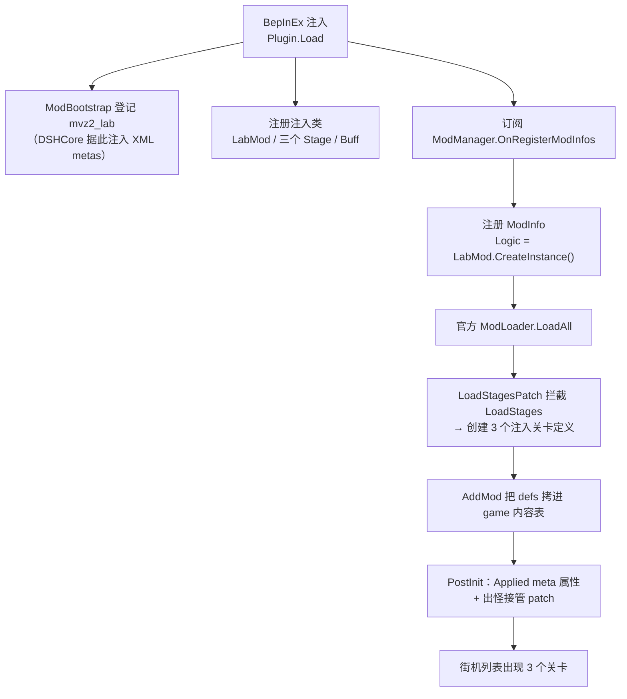

# MVZ2 Laboratory Content（实验室小游戏）

> 《我的世界僵尸 2》（Minecraft VS Zombies 2）0.7.0 的社区内容 mod。
> 把 0.6.4 `laboratory` 分支里的实验小游戏，通过**官方外部 Mod 扩展点**带到 0.7.0，全程不修改游戏原始文件。

- 插件 GUID：`qoznos.mvz2.labmod`
- 游戏内命名空间：`mvz2_lab`
- 当前版本：**0.2.0**
- 前置：**DSHCore**（`qoznos.mvz2.core`，必需）
- 适配：MVZ2 **0.7.0 test-4**（Windows **x86** / IL2CPP / Unity 2022.3.62f3）

> ⚠️ 社区制作的**非官方**内容，与游戏原作者无关。

---

## 包含的关卡

| 关卡 ID | 名字 | 机制 | 状态 |
| ---- | ---- | ---- | ---- |
| `real_prologue` | 真正的序章 | 纯原版行为组合的迷你关卡（冒烟测试目标）。`OnStart` 直接把波次/旗推到最后（`CurrentWave=200` / `CurrentFlag=20`） | ✅ 可玩 |
| `zero_k_space` | 零度空间 | ① 全关卡蓝图**瞬间充能**；② 火药落地 5 帧后爆炸；③ 种子包费用按充能档位**倍率**（`ZeroKSpaceCostBuff`） | ✅ 可玩 |
| `unknow_palace` | 真理伪证殿堂 | ① 逐波**替换卡槽**为玩家选择序列；② **完全接管出怪**：wave 1–9 每波一种（去 mega），wave 10 固定 `mega_mutant_zombie`，wave 11+ 每波种类 +1，末波每 lane 铺满敌怪池；③ UFO 走网格生成 | ✅ 可玩 |

### 街机（Arcade）条目

三个关卡都以 `minigame` 类型注册进街机列表（默认图标复用原版），
条目 `Index` 由 `DSHCore.ArcadeIndexFix` 平移到 vanilla 之后，不会顶掉原版条目。

---

## 构建

```powershell
cd LaboratoryMod
.\build.ps1                 # 构建（含前置 DSHCore）+ 自动部署
.\build.ps1 -Pack           # 额外打包 dist\LaboratoryMod_v0.2.0_0.7.0.zip
.\build.ps1 -Pack -Launch   # 打包后启动游戏冒烟
```

| 参数 | 作用 |
| ---- | ---- |
| `-GameDir <dir>` | 部署目标。默认 `E:\Game\PVZ\MVZ2\MVZ2 0.7.0 test-4`；不存在则**只构建不部署** |
| `-SkipBuild` | 跳过构建，直接用已有产物 |
| `-Clean` | 先删除 `bin/` `obj/` |
| `-KeepGame` | 不结束正在运行的游戏（会锁住 DLL，一般不要用） |
| `-Pack` | 打包 zip 到 `dist\` |
| `-Launch` | 构建/打包后启动游戏 |

工程通过 `ProjectReference` 引用 `DSHCore`，所以构建本 mod 会**一并构建前置**；
本 mod 的包体**不含** BepInEx 运行环境（需先安装 DSHCore 的安装包），但会带上 `DSHCore.dll`。

### 构建产物

| 路径 | 说明 |
| ---- | ---- |
| `bin\Debug\LaboratoryMod.dll` | 插件本体 |
| `<游戏>\BepInEx\plugins\LaboratoryMod.dll` | 自动部署（GameDir 存在时） |
| `<游戏>\...\StreamingAssets\Mods\mvz2_lab\**` | 关卡资源自动部署 |

---

## 资源（`assets/`）

`assets/` 的**内容**直接映射到游戏的
`MinecraftVSZombies2_Data/StreamingAssets/Mods/mvz2_lab/`：

```
assets/
└─ Content/metas/
   ├─ stages.xml    三个关卡的定义（名字/类型/旗数/敌怪池/出怪点数/trophy）
   ├─ arcade.xml    街机条目（minigame × 3）
   └─ buffs.xml     零度空间费用倍率的 buff 词条
```

> 这些 XML 由 `DSHCore.MetaInjection` 在 `ResourceManager.LoadMetaLists` 时**直接从磁盘读入**，
> 不需要重打包 Addressables bundle。
> **注意：metas 的 XML 里不要写注释**（`Comment` 节点会进入官方的子节点遍历并触发 NRE）。

---

## 目录结构

```
LaboratoryMod/
├─ build.ps1                   构建 / 部署 / 打包脚本
├─ README.md                   本文件
├─ LaboratoryMod.csproj        工程文件（ProjectReference → DSHCore）
├─ assets/                     Mod 资源（映射到 StreamingAssets/Mods/mvz2_lab/）
├─ Plugin.cs                   入口：ModBootstrap 登记 + ModInfos.OnRegister 订阅
├─ LabMod.cs                   Mod 逻辑主体（PreInit / OnInit / PostInit / 存档）
├─ LoadStagesPatch.cs          接管官方 LoadStages：创建三个注入关卡定义
├─ ModGetDefinitionsPatch.cs   绕过官方 GetDefinitions 的原生 LINQ
├─ StageMetaApplier.cs         用稳定 ID 把 XML meta 属性套到注入 def
├─ Buffs/
│   └─ ZeroKSpaceCostBuff.cs   零度空间的费用倍率 buff
└─ Stages/
    ├─ RealPrologueStage.cs    真正的序章
    ├─ ZeroKSpaceStage.cs      零度空间
    ├─ UnknowPalaceStage.cs    真理伪证殿堂
    └─ UnknowPalacePatch.cs    出怪接管（Harmony prefix SpawnWaveEnemies）
```

---

## 工作原理

0.7.0 内置了正式的外部 Mod 扩展点，本 mod 全程走官方链路：



### 被迫绕开的官方环节

| 环节 | 绕过方式 | 原因 |
| ---- | ---- | ---- |
| `ModLoader.LoadDefinitionProperties` | 对本 mod **跳过**，改由 `PostInit` 用稳定 ID 手动套 meta | 官方对**注入 def** 做泛型 `SetProperty` 会 `il2cpp_runtime_invoke` AV |
| `Mod.GetDefinitions()` | `ModGetDefinitionsPatch` 直接返回手工跟踪的数组 | 内部 `SelectMany` 对注入 mod 非确定性失败 → `AddMod` 拷不到 defs → 列表为空 |
| `Mod.PostReloadMods()` | 跳过官方实现 | 内部遍历 `definitionGroup.GetDefinitions()`（原生 LINQ） |
| `IStageDefinitionProvider` | 不注册，改在 `LoadStages` 时机直接建 def | `LoadAll` 会对 provider 做 `OrderBy` 原生 LINQ 分派 |

---

## 开发须知（IL2CPP 注入要点）

1. **托管 `new` 出来的 il2cpp 对象，写进注入类字段后会被 GC 回收。**
   必须用 `DSHCore.Il2CppPin.Pin(obj)`（内部 `il2cpp_gchandle_new`）钉住；
   该工具已上移到前置库 `DSHCore`，本 mod 不再自带副本。
   否则 `GetID()` 值比较静默失败 → `game.GetStageDefinition(mvz2_lab:xxx)` 恒为 null →
   **关卡不出现在街机列表**；读该对象的字符串会触发 `Internal CLR error (0x80131506)`。
2. **关卡状态用 `static`。** 注入类实例字段跨托管 wrapper 可能丢失，
   故 `UnknowPalaceStage` 的记录状态是 `static` 并在 `OnStart` 重置。
3. **不要调 `base.OnStart()` 等代理虚方法** —— 会回到本方法 trampoline 无限递归到栈溢出。
4. **崩溃看 `BepInEx/ErrorLog.log`**（`LogOutput.log` 里没有原生 fatal 的托管栈）。

---

## 调试

在游戏调试控制台（debug 帐号）里可直接跳关：

```
/gotolevel mvz2_lab:real_prologue   mvz2:day
/gotolevel mvz2_lab:zero_k_space    mvz2:day
/gotolevel mvz2_lab:unknow_palace   mvz2:day
```

`LabMod.PostGameInit` 里有一组只读的 `[Diag]` 日志（内容表查找 / 街机元数据与缓存），
用于确认关卡是否真的进了游戏内容表。

| 日志 | 位置 |
| ---- | ---- |
| BepInEx | `<游戏>\BepInEx\LogOutput.log`、`<游戏>\BepInEx\ErrorLog.log` |
| 游戏 | `%LOCALAPPDATA%Low\Cuerzor\MinecraftVSZombies2Test\mvz2_log.log` |

---

## 已知限制

- 仅适配 0.7.0 test-4（Windows x86 IL2CPP）
- 存档沿用原版 `mvz2:` 命名空间写入，**卸载本 mod 后**相关关卡记录可能报错
- 关卡图标复用原版资源
- `unknow_palace` 的 UFO 落点简化为「指定 lane 最右列网格」（与官方兜底一致）

---

## 许可证

[GPL-3.0](../LICENSE)。BepInEx 及其组件遵循各自原许可证。

## 致谢

- **Cuerzor** — 《我的世界僵尸 2》作者，以及 0.7.0 的官方 Mod 扩展点设计
- [BepInEx](https://github.com/BepInEx/BepInEx) / [Il2CppInterop](https://github.com/BepInEx/Il2CppInterop) — IL2CPP 注入框架
