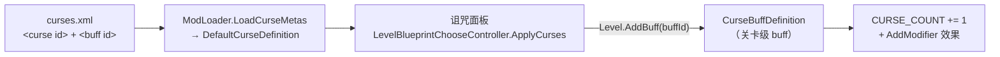

# 模块化诅咒（Modular Curse）

MVZ2 0.7.0 的自定义诅咒扩展 mod，接入**原版诅咒系统**。依赖前置插件 CustomCore。

- 游戏内命名空间：`modular_curse`
- 诅咒 ID / buff ID / `curses.xml` id / `buffs.xml` id 四者同名，形如 `modular_curse:qc_c1`
- 共 25 条诅咒：QC 池 12 条（`qc_c1`–`qc_c12`）+ SC 池 13 条（`sc_c1`–`sc_c13`）
- **名字**：每个池的前 7 条直接用原版那 7 条诅咒的名字（它们复用的正是那 7 个图标），
  第 8 条起用池内编号（`QC-C8` … / `SC-C8` …）
- **图标**：前 7 条复用原版诅咒图标，其余留空；两个**池**各自有一张图标
  （`ModAssets/modular_curse/Content/sprites/curse_qc.png` / `curse_sc.png`，运行时注册进游戏资源库）

---

## 一、诅咒列表

### QC 池

| ID | 效果 | 实现 |
|---|---|---|
| qc_c1 | 器械受到伤害时漏电 3s | Harmony：`VanillaEntityExt.TakeDamage` 后缀 → `VanillaEntityExt.ShortCircuit` |
| qc_c2 | 镐子和星之碎片各自具有 3s 冷却时间 | Harmony：两个 `UseOnEntity` 后缀 + 写关卡工具禁用属性 |
| qc_c3 | 器械被星之碎片激发后凋零 27s（**等大招结束再施加**） | Harmony：`VanillaContraptionExt.Evoke` 入队 → 每帧等到 `entity.IsEvoked()` 变 false 再挂原版 `withered` |
| qc_c4 | 有尸体的敌怪倒下时有 25% 概率从尸体中复活（BOSS 除外） | Harmony：`VanillaEnemyExt.FaintRemove` 前缀返回 false 取消消失 → `Revive()` + 满血 |
| qc_c5 | 怪物和器械死亡时留下火焰 | Harmony：`Entity.Die` 前缀 → `GridFire.Spawn`（敌方阵营） |
| qc_c6 | 怪物有 10% 概率隐形 | 每帧检测新实体 → 挂原版 `dark_matter_invisible` |
| qc_c7 | 很长的冷却时间变为 75s（≥50s 视为很长） | Harmony：`SeedPack.GetUsedMaxRecharge` / `GetStartMaxRecharge` 后缀 |
| qc_c8 | 怪物的出场时间提前 5s | **原生修饰符**：`EngineStageProps.FIRST_WAVE_TIME` − 5s |
| qc_c9 | 器械子弹的速度变为 1/3 | Harmony：`VanillaProjectileExt.ShootProjectile` 前缀改 velocity |
| qc_c10 | 重质量怪物可以阻挡穿透伤害 | Harmony：`ProjectileCommonBehaviour.PostCollision` + `CanPierce` |
| qc_c11 | 每一大波所有器械价格上涨 50 | Harmony：`SeedPack.GetCost` 后缀（档位 = `CurrentWave / wavesPerFlag`） |
| qc_c12 | 关卡开始时在第三列随机一路生成一个不给予星碎的借贷告示牌 | 每帧延迟 3 帧后放置；`LoanSign.Init` 前缀只对诅咒生成的那块清借贷次数 |

### SC 池

| ID | 效果 | 实现 |
|---|---|---|
| sc_c1 | 超出 10 个后，每个器械的存在使对应器械的花费 +5% | Harmony：`SeedPack.GetCost` 后缀（每帧刷新场上数量，加法叠加） |
| sc_c2 | 无可激活或忠诚标签的器械放下时叛变 2s | 每帧检测新器械 → 过滤（`IsTriggerActive` / `IsLoyal` / 御柱·自动兽夹·冲击活塞·闪电之珠豁免）后 `CharmPermanent`，2s 后 `RemoveCharm` |
| sc_c3 | 敌怪的本体（不含防具与 BOSS）每 1s 恢复 1% 生命（每秒最多 20 点） | 每帧计时 → `VanillaEntityExt.Heal`（只回本体） |
| sc_c4 | 有尸体的敌怪在第 10 波后第一次死亡时有 20% 概率完全复活（含防具） | Harmony：`VanillaEnemyExt.FaintRemove` 前缀返回 false → `Revive()` + 满血 + 防具满耐久 |
| sc_c5 | 敌怪的防具获得 25% 免伤（在 C8 之后计算） | Harmony：`VanillaEntityExt.PreTakeDamage` 前缀，仅在伤害确实打在防具上时 ×0.75 |
| sc_c6 | 每使用 3 个碎片使下 1 个碎片无效 | Harmony：星之碎片 `UseOnEntity` 前缀（无效位置 4/7/10…，照样扣碎片） |
| sc_c7 | 所有敌怪重量 +1 | **原生修饰符**：给敌怪挂子 buff（`VanillaEntityProps.MASS` +1） |
| sc_c8 | 敌怪的本体获得 5 的护甲（本体伤害先减少 5 点，**防具伤害不减**） | Harmony：`PreTakeDamage` 前缀 `Add(-5)` + 归零钳制（仅在伤害确实打在本体上时） |
| sc_c9 | 敌怪受到的 debuff 时间变为 1/3 | Harmony：`VanillaEntityExt.InflictSlow/Weakness/Petrified/Wither` 前缀缩放 `time`（**脆弱不缩放**：它没有 timeout 属性） |
| sc_c10 | 自然出场的敌怪出场时无敌 8s（衍生物豁免） | 每帧检测新敌怪 → 只给 `SpawnerReference == null` 的实体挂原版铁幕 buff（`PROP_TIMEOUT = 240`，到点由 buff 自己移除） |
| sc_c11 | 每行不在最前面那一格的敌怪受伤 ×33% | Harmony：`PreTakeDamage` 前缀（每帧缓存每行最前列） |
| sc_c12 | 敌怪生成间隔 ×93%（不影响第一波出怪） | **原生修饰符**：`LogicStageProps.WAVE_MAX_TIME` ×0.93 |
| sc_c13 | 敌怪受到单次**超出本体血量上限**的伤害时不会立刻死，改为无敌并额外行动 2s | Harmony：`PreTakeDamage` + 每帧计时（与减速无关）→ 挂原版铁幕 buff |

### 诅咒池（诅咒弹窗内部的一行条目）

诅咒弹窗（标题「选择诅咒」）的**列表滚动区内部**：最上面是三个池条目，
再往下一条**横线**，横线下面才是真正的诅咒列表。条目就是用诅咒条目本身的样子做的
（同尺寸方框 + 图标 + 选中高亮），当前池高亮，悬停显示池名与作者描述，点击有与原版
诅咒条目相同的点击音效。

| 池 | 图标 | 面板里显示的诅咒 | 作者描述 |
|---|---|---|---|
| 原版池（默认） | 原版诅咒按钮那张图（`ui/level/curse.png`）+ 同样的紫色滤镜 | 只有 `mvz2:*` 的 7 条原生诅咒 | 原版诅咒 |
| QC 池 | `curse_qc.png` + 同样的紫色滤镜 | 只有 `modular_curse:qc_c1..qc_c12` | QoZnoS的诅咒 |
| SC 池 | `curse_sc.png` + 同样的紫色滤镜 | 只有 `modular_curse:sc_c1..sc_c13` | 奇硅箱的诅咒 |

语义：

- 池是**单选且必选**的（没有「全部」这一档）；
- 换池后**诅咒面板只列出该池的诅咒**，并且**其它池已勾选的自动取消**（勾选数会跟着变）；
- 选择**每关单独记**，写在 `userdata/userN/modular_curse/curse_pool.txt`，
  键是关卡的 `StageID`（例如 `mvz2_lab:real_prologue=1`），重开该关仍是上次的池；
  没有记录的关卡默认**原版池**（列表内容等价于未装本 mod 时）。

**加新池**只需改三处（UI 会自动排）：

1. `CursePool` 枚举加一项；
2. `CursePoolRules.Pools` 数组加一项，并在 `Label` / `Name` / `Description` 里补名字与作者；
3. `CurseIds.Qc/Sc` 旁的 ID 列表 + `CursePoolIcons` 的图标（不补也能跑，只是没图标）。

条目行的列数/尺寸/行数按可用宽度自动算（排不下就换行并把预留高度加高），
所以池变多不会撞到诅咒列表。

实现要点（全部走 interop 已公开成员，无反射）：

- 条目行是一个**新节点**，直接挂到滚动区 Content（也就是 `ElementList` 的 listRoot）
  下面的**最前面**，因此它跟着一起滚动、一起被 Viewport 裁剪；
- Content 上的 `GridLayoutGroup` 会把子节点塞进 64×64 格子，所以给我们自己的两个节点
  各挂一个 `LayoutElement.ignoreLayout = true`（游戏自己的 DebugConsoleInputField 也这么干），
  位置由我们给；再给 Grid 设 `padding.top = 池区高度`，把真正的诅咒格子整体压下去 ——
  不重叠、不需要改大小，`ContentSizeFitter` 还会自动把 Content 撑高（滚动范围自然正确）；
- 横线是一个**全新的、只有 `Image`（无 sprite）的节点**：不用原版那些带
  `ImageResolver` 的图，免得它在 OnEnable 时把图又改回去；颜色用原版诅咒按钮的紫色、
  alpha 0.8；
- 条目复制**诅咒列表自己的模板**（`ElementList.getTemplate()`，即 `CurseSelectItem`），
  尺寸也保持**同一个 64×64** —— 诅咒条目是「外框 64（`Background`, `form`）
  + 内框 48（`Slot`, `form_hollow`）」两层，尺寸小于 64 时内外两层会叠在一起、
  看上去就少了一圈边框；同样地，条目**左对齐**（从滚动区左边开始），
  与下方诅咒列表的第一列齐平；
- 图标照原版诅咒按钮的做法上一层紫色 tint
  （按钮那颗图标就是靠 Image 的 `m_Color = (0.635, 0, 1, 1)` 上色的）；
- 点击音效就是原版诅咒条目用的那个 `LogicSoundID.tap`
  （`Main.SoundManager.Play2D(id, 1f)`）；
- 条目的事件（`OnClick` / `OnPointerEnter` / `OnPointerExit`）是**每个实例独立**的 C# 事件，
  游戏只订阅了它自己创建的那些条目（`UpdateCurses` 的 `onCreateOrEnable`），
  我们克隆体上只有我们自己的订阅，两边互不干扰；
- `LevelBlueprintChooseController.choosingCurses` 是诅咒面板的**唯一数据源**
  （列表内容、`GetCurseIDByIndex`、`ApplyCurses` 都读它），所以在
  `ReloadChoosingCurses` 之后就地过滤它，下游全部自动一致；
- 池外的已勾选用「按过滤后的列表重建 `enabledCurses`」清掉
  （只用 `Contains`/`Add` + 公开 setter，避免在 IL2CPP 集合上边遍历边删）。

> 选卡界面右侧**没有**额外的「诅咒池」按钮：早期版本做过一个复制自诅咒入口按钮的入口 +
> 复制自制品弹窗的独立选择框，实测**点不开**（克隆体的父节点是 `SetActive(false)` 的包装对象），
> 详见实现备注 11。

### 控制台指令 `/curse`（调试用）

```
/curse all    强制显示所有诅咒池（不按池过滤，列出全部诅咒）
/curse off    恢复按诅咒池过滤
/curse        查看当前状态
```

- 强制模式只存在于**本次运行**（不落盘），进入选卡界面会立即刷新；
  在弹窗里手动点一个池就会退出强制模式。
- 为了让 `/curse` 这个名字能用（而不是 `/modular_curse:curse`）且不折腾接口数组的跨程序集写入，
  这条指令是**在 `DebugManager.ExecuteCommand` 上加 Harmony 前缀**实现的，
  命令名解析复用官方的 `CommandUtility.SplitCommand`；详见实现备注 13。
- 它不会出现在 `/help` 列表里（那份列表读的是官方命令定义）。

### 边界说明

- **qc_c1 白名单**：金苹果 / 蜡烛被啃食时会先检查 `target.IsAIFrozen()`，而漏电自带的
  `frankenstein_shocked` 会设置 `AI_FROZEN` —— 不豁免的话这两个器械的核心功能会被自己身上的诅咒禁掉。
- **qc_c8**：只改关卡第一波时间（`FIRST_WAVE_TIME`），无尽续波用的
  `CONTINUED_FIRST_WAVE_TIME` 不受影响。修饰符没有下限截断，但原版首波时间普遍 ≥15s。
- **sc_c4「第 10 波后」**：按「第 10 波打完之后」实现，即第 11 波起生效。
- **sc_c5**：只在本次伤害确实会打在防具上时生效（未被 `IGNORE_ARMOR` 忽略、
  没有指定护盾目标、主防具存在且未被忽略）。
- **sc_c13 触发阈值**：只看**本体血量上限**（`GetMaxHealth()`），伤害 ≥ 该值才触发；
  **不看当前血量**，也不算防具。这样就不会出现「200 血上限的敌怪剩 15 血、
  挨 20 点伤害被打死还无敌 2s」这种乱象（小伤害永远不触发）。
- **sc_c10「出场无敌」**：用原版铁幕 buff 实现，因此是「免疫伤害但不免疫状态效果」，
  并且带黑↔红闪烁提示；到点由 buff 自己超时移除（我们只负责挂上去）。
  且**只有自然生成的敌怪**才有无敌，衍生物一律没有（判定见备注 14）。
- **qc_c4 的复活时机**：与 sc_c4 一样在「尸体消失」时判定，因此**只有留下尸体的敌怪**能复活；
  不恢复防具（只把本体拉满血），BOSS 不复活，不触发亡语的死因（地雷、蜡烛等）也不复活。
- **sc_c9 的「脆弱」**：0.7.0 的 `dragon_tooth`（龙牙）buff 没有超时属性，无法缩放时长，
  因此只覆盖了减速 / 中毒 / 虚弱 / 冰冻四种。

---

## 二、与原版诅咒系统的对接

原版 0.7.0（test-4 起）的诅咒链路：



本 mod 完全复用这条链：

1. **`ModInfo`**：`OnRegisterModInfos` 注册 `modular_curse`，
   `Logic = ModularCurseMod.CreateInstance()`，`Assemblies` 为空。
2. **词条**：`ModAssets/modular_curse/Content/metas/curses.xml` + `buffs.xml`，
   构建时部署到 `MinecraftVSZombies2_Data/StreamingAssets/Mods/modular_curse/Content/metas/`，
   运行时由 `CustomCore.MetaInjection` 直读磁盘注入 `ModResource`。
3. **诅咒定义**：官方 `ModLoader.LoadCurseMetas` 用 curses.xml 创建
   `DefaultCurseDefinition`（不需要我们自己建类型）。
4. **诅咒 buff**：25 个注入的 `CurseBuffDefinition` 子类
   （24 条诅咒 + sc_c7 的敌怪子 buff），
   由 `CurseDefinitionPatch` 在官方 `LoadStages` 时机创建并 `AddDefinition`。
   继承原版 `CurseBuffDefinition` 因此自动带上 `CURSE_COUNT += 1`。
5. **效果**：能用原版属性修饰符表达的写在 buff 的 `Setup()` 里（qc_c8 / sc_c7 / sc_c12），
   其余由 `CurseRuntime` + `CurseHooks` 承担，**以「关卡是否挂着对应诅咒 buff」为唯一开关**。

语义变化：诅咒改为**进关卡前在选择面板勾选、仅对当关生效**（原版语义）。
控制台 `/curse` 指令已删除。

---

## 三、实现备注（踩过的坑）

### 1. 托管 mod 无法注册原版触发器

原版 `AddTrigger*` 收 IL2CPP 侧委托（`Il2CppSystem.Action<...>`），而所有关卡回调的参数
结构体都含引用字段（非 blittable）。`DelegateSupport.ConvertDelegate` 直接拒绝：

```
Delegate has parameter of type PVZEngine.Callbacks.EntityCallbackParams
(non-blittable struct) which is not supported
```

因此**触发器路线不可用**，需要回调的效果只能走 Harmony。这也是
qc_c8 / sc_c7 / sc_c12 用原生修饰符、其余用 Harmony 的原因。

### 2. 诅咒定义的属性写入会因「属性键未注册」而丢失

官方 `LoadCurseMetas` 会立刻 `SetCurseName / SetBuffID / SetUnlockConditions`，
但那一刻 **MVZ2.Logic 的属性键可能还没注册**（`PropertyMapper` 按 mod 顺序扫描程序集，
实测 `modular_curse` 的 `LoadStages` 早于 `mvz2`）。未注册的键 `Key == 0`，
写入落到无效键上 —— 表现为诅咒名称为空、BUFF_ID 为 null、unlock 为 null
（于是永远不会出现在诅咒面板里）。

修复：`CurseMetaApplier` 在属性键确定已注册的时机（`PostInit` ，
以及在 `SaveManager.EvaluateUnlocks` 前缀里再兜一次）用 XML 词条重套一遍。
写入的是同一 `Definition` 对象，它已经在 `game.AddMod` 时进入全局内容表，因此立刻生效。

### 3. 代理不复制接口声明

Il2CppInterop 生成的代理**看不到**原生类型实现的接口，因此：

- `LevelEngine` / `Entity` 上不能直接调 `IBuffTarget` 的扩展方法
  （`HasBuff` / `AddBuff` / `RemoveBuffs`）→ 必须 `new IBuffTarget(ptr)` 包一层；
- `XMLConditionList` 不能隐式转成 `IConditionList` → 必须 `new IConditionList(ptr)`；
- `IGlobalGame` 上看不到 `IGameContent` 的扩展方法
  （`GetAllCurseDefinitions`）→ 改用 `IGlobalGame` 自身的泛型 `GetDefinitions<T>`。

### 4. Harmony 传入的定义要按声明类型包装

`Mod.AddDefinition(Definition def)` 的后缀拿到的对象，托管类型是 **`Definition`**
而不是 `DefaultCurseDefinition`，所以 `def is CurseDefinition` 恒为 false。
判别要用 `def.GetDefinitionType()`，再 `def.TryCast<CurseDefinition>()`。

### 5. 注入类的静态字段初始化器不能碰游戏类型

`ClassInjector.RegisterTypeInIl2Cpp<T>()` 会触发 `T` 的静态构造器（发生在插件 `Load` 阶段，
那时触碰 `MVZ2.GameContent.*` 会抛 `SEHException`）。所有依赖游戏类型的静态数据都要**懒初始化**。

### 6. 定义绕开原生 LINQ

`DefinitionGroup.GetDefinitions()`（`SelectMany`）与
`DefinitionList.GetAllDefinitions<T>()`（`OfType<T>`）在 metadata v31 的注入环境下
非确定性抛 `MethodAccessException` 或返回空，而 `GlobalGame.AddMod(mod)` 正好走前者。
`CurseDefinitionPatch` 因此用托管 List 手工跟踪本 nsp 的全部定义，
拦截 `Mod.GetDefinitions()` 直接返回该列表，并跳过 `Mod.PostReloadMods`。

### 7. 修饰符必须在「属性键注册之后」创建（关卡诅咒计数不含模组诅咒）

现象：关卡 UI 的诅咒计数只算原版诅咒，模组诅咒不计数（尽管诅咒效果本身生效）。

根因：`PropertyMeta<T>` 到 `PropertyKey<T>` 是**隐式转换**，会在**创建修饰符的那一刻**
把 `meta.key` 当时指向的对象拷进 `PropertyModifier`；而 `PropertyMapper.SetRegisteredKey`
注册时会**替换** `meta.key` 指向一个全新的 `PropertyKey`。于是先注册前创建的修饰符
永远持有 `Key == 0` 的占位键 —— 修饰符存在、但永远匹配不上任何属性。

`CurseBuffDefinition` 的 ctor 体（`CURSE_COUNT += 1`）恰好也是「先于原版 mod 加载」时执行的，
所以基类 ctor 塞进来的那份同样失效。

修复：`CurseBuffs.ApplyModifiers()`（在本 mod 的 `PostInit` 调用，即所有 mod 的
`PropertyMapper.InitPropertyMaps` 跑完之后）**清空 modifiers 再重建**
（`CURSE_COUNT` + `Setup()` 里的定义级修饰符）。`SaveManager.EvaluateUnlocks` 前缀里再兜一次。
`PostGameInit` 会打印自检：`修饰符缺失 0/25`、`CURSE_COUNT 键失效 0 条`。

### 8. 诅咒面板顺序（模组诅咒会排到原版上方）

官方缓存顺序 = `game.GetAllCurseDefinitions()` = **定义注册顺序**，而本 mod 的
`LoadStages` 早于原版 mod（同上：`PropertyMapper` 按 mod 顺序扫描），于是模组诅咒排在前面。

修复：`SaveManager.GetUnlockedCurses()` 后缀做一次**稳定分组**，
把内置命名空间（`Global.BuiltinNamespace`）的诅咒放到最前，其余保持原有相对顺序。
该方法是面板填充（`LevelBlueprintChooseController.ReloadChoosingCurses`）的唯一数据源，
且存的是 `NamespaceID`，重排不影响选中状态。

### 9. 【间歇性致命】`mod.Namespace` 字段会被 GC 回收 → 整套诅咒注册不上

现象：**有时**启动后诅咒一个都没进游戏（面板为空），日志表现为

```
[ModularCurseMod] PostInit: 共 0 个定义（其中 buff 0 个）
[CurseBuffs] 0/0 个定义的修饰符已展开
[Diag] 诅咒定义 0/7，已解锁 0/7
```

同一份 DLL 重开一次又完全正常 —— 典型的 GC 时序问题。

根因链：

1. `Mod.Namespace` 是自动属性 `<Namespace>k__BackingField`（IL2CPP 侧是 `Il2CppString*`）。
   Il2CppInterop 为它生成的是 **property**（`set__Namespace_k__BackingField` 内部做
   `ManagedStringToIl2Cpp`），我们赋的值是一个**新建的 il2cpp 字符串**；
2. 该字符串唯一的引用就是「**注入类实例**的引用字段」。而注入类的 GC 描述符不含
   继承来的引用字段（与 `Il2CppPin` 注释里那条已知限制同源）→ **不被 GC 扫描**；
3. 若干次 GC 后字符串被回收，`mod.Namespace` 读到空/悬垂值；
4. 游戏自己也用 `mod.Namespace` 找本 mod 的 meta：
   `ModLoader.LoadEntityMetas/LoadStages/LoadBuffMetas/LoadCurseMetas` 全部是
   `var nsp = mod.Namespace;` 再 `res.GetModXxxMetas(nsp)`。读空 ⇒ 所有 meta 都查不到
   ⇒ 诅咒定义、buff 定义、诅咒词条全部不注册 ⇒ **面板里看不到任何模组诅咒**。

修复（`ModularCurseMod.EnsureNamespace()`，幂等）：

- 自建一个 il2cpp 字符串（`IL2CPP.ManagedStringToIl2Cpp(spaceName)`）并用
  `il2cpp_gchandle_new(ptr, false)` **永久钉住**（成为 GC 根，永不被回收）；
- 用 `il2cpp_object_get_class` + `GetIl2CppField(klass, "<Namespace>k__BackingField")`
  + `il2cpp_field_get_offset` 算出字段地址，`Marshal.ReadIntPtr` 读回比较；
  不一致就用 `FieldWriteWbarrierStub`（与 interop 生成的 setter **完全同一条写屏障路径**）写回。
  （注意：原生元数据里的字段名就是 `<Namespace>k__BackingField`，
  `_Namespace_k__BackingField` 只是 Il2CppInterop 的改写名，按后者查不到；
  另外 `GetIl2CppField` 的参数是 **klass 指针**，传实例指针会直接 AV。）
- 只在 `CreateInstance`、`PostInit`、`PostGameInit` 以及每个 Harmony 钩子入口
  （`IsOurs` 内部）调用 —— 保证游戏每次读之前字段必然有效。

配套加固：`IsOurs(mod)` 改为**先比 native 指针**（`mod.Pointer == self.Pointer`），
再比字符串。即使字符串再次失效，我们自己那套补丁也不会静默失灵。

### 10. 复制现成 UI 做扩展（以及 interop 把事件变成属性这件事）

这个 mod 的 UI 全部是**运行时复制现成节点**得来的（没有 prefab 可以改）：

- `LevelUIBlueprintChoose` 上那些 UI 引用全是 `[SerializeField]`，prefab 不是我们的，
  没法加字段；UI prefab 又都在 Addressables bundle 里，mod 侧没有可靠的按名加载入口；
  从零 `new GameObject` 则要自己重建背景九宫格 sprite、TMP 字体材质、LayoutElement、
  CursorAnchor 等一堆引用。
- 可行的做法只有一条：**找到场景里现成的节点，`Instantiate` 一份，改自己需要的那几个字段**。
  例如诅咒弹窗的池条目行就是复制它的标题行 + 复制自己的诅咒条目，见备注 11。
- 复制 UI 节点用 `Instantiate((UnityEngine.Object)go, parent, false)`（第三个参数 false =
  保留本地坐标/锚点），拿到 `Il2CppObjectBase` 后 `TryCast<GameObject>()`。

踩到的坑：`CursePanelEntranceButton.OnClick` 在源码里是 `public event Action? OnClick;`，
但 Il2CppInterop 把它生成成**类型为 `Il2CppSystem.Action` 的属性**（`Il2CppSystem.Action` 是
IL2CPP 委托包装类，不是托管委托），所以 `button.OnClick += handler;` 会直接编译失败：

```
error CS0019: 运算符“+=”无法应用于“Action”和“方法组”类型的操作数
```

正确写法是走生成的访问器 + 转换，并把托管委托自己持有住防止被 GC
（`CurseSelectItem.OnClick` 这种带参事件同理，只是换成 `Il2CppSystem.Action<CurseSelectItem>`）：

```csharp
clickManaged = new System.Action<CurseSelectItem>(OnItemClicked);
clickIl2Cpp = DelegateSupport.ConvertDelegate<Il2CppSystem.Action<CurseSelectItem>>(clickManaged);
item.add_OnClick(clickIl2Cpp);
```


### 11. 扩展原版弹窗：往现有布局里插节点，不要另造弹窗

**失败的路（已删）**：把场景里的原版制品选择框 `ArtifactChoosingDialog`
整个 `Instantiate` 一份当自己的选择框。代码能跑、事件也是自己的，但**永远不可见**：

```
[CursePool] 已创建诅咒池选择框（父节点 SharedCanvas，兄弟序号 1，父链可见 False）
[CursePool] 已打开诅咒池选择框（activeInHierarchy=False）
```

它在 UI 预设里不是独立面板，而是被一个显示时才 `SetActive(true)` 的**包装对象**包着的，
克隆体跟着父链一起隐藏；而且**同场景存在多个 UI 预设实例**，
不限定「父链可见」的递归查找很容易挑到非当前布局的那一份。

**现用的路**：往**活的**诅咒弹窗的滚动区里插节点，让它跟弹窗自己的布局系统一起算位置。
实测结构：

```
SelectCurseDialog                          356x294，关闭时 active=0
  Dialog
    Content   [VerticalLayoutGroup spacing=0 align=MiddleCenter ctrlH=1 forceH=0]
      Top     (50) [LayoutElement pref=-1x50 flex=1x-1]        ← 标题行
      Center (194) [LayoutElement pref=296x-1 flex=-1x1]       ← 滚动区（flex=1，剩余高度归它）
        Scroll View [ScrollRect]
          Viewport [Mask]
            Content [ElementList|Grid(4列 64x64 间距1)|SizeFitter v=PreferredSize]
              CurseSelectItem（模板）… 诅咒条目        ← 就是 listRoot
          Scrollbar Vertical
      Bottom  (50) [LayoutElement pref=-1x50 flex=1x-1]        ← 返回/全选/取消全选
```

要把跨整行的池条目 + 横线放进 `Content`，得解决三件事：

1. **Grid 会把子节点塞进格子** → 给我们自己的节点各挂一个
   `LayoutElement.ignoreLayout = true`（UGUI 的 LayoutGroup 会跳过 `ILayoutIgnorer`；
   游戏自己的 `DebugConsoleInputField` 也是这么干的），位置自己给；
2. **原本的诅咒格子还在最上面，会与池区重叠** → 给 Grid 设 `padding.top = 池区高度`，
   把真正的诅咒格子整体压下去。`ContentSizeFitter(v=PreferredSize)` 会自动把
   Content 撑高，滚动范围也就自然正确了。
   坑：interop 里的 `RectOffset` **没有四参构造函数**，只能改 `grid.padding` 返回的那个
   实例（引用类型，改的就是 native 对象）再赋回去以触发布局重建；
   同时要记住原始的 `padding.top` 避免重复叠加。
3. **横线不能带 `ImageResolver`** → 原版那堆图都挂了这个组件，它在 OnEnable 时会把
   sprite 又设回去，把我们的空 sprite 盖掉。所以横线用 `new GameObject` +
   `AddComponent<RectTransform>/<Image>/<LayoutElement>` 现造一个
   （`AddComponent<T>().ignoreLayout = true` 是游戏自己用过的写法）——
   实测确认它身上只有 `RectTransform,CanvasRenderer,Image,LayoutElement`，没有 ImageResolver。
   无 sprite 的 `Image` 会画成纯色矩形，配上原版按钮那个紫色 + alpha 0.8 就是一条分隔线。

池条目本身还是**复制诅咒列表自己的模板**（`ElementList.getTemplate()`，即 `CurseSelectItem`），
尺寸与对齐也向它看齐：

- 尺寸用**同一个 64**（不是随意的小尺寸）—— 诅咒条目是「外框 64（`Background`, `form`）
  + 内框 48（`Slot`, `form_hollow`）」两层，小于 64 时内外两层会叠在一起、看上去就少了一圈边框；
- **左对齐**（不再居中）：`anchoredPosition.x` 从滚动区左边开始算，
  与下方诅咒列表的第一列齐平；
- 点击音效就是原版诅咒条目用的 `LogicSoundID.tap`。

行内布局（列数 / 尺寸 / 行数）按 Grid 的设计宽度自动算：先用首选 64 试一行放下，
放不下就用最小 40 按列数换行，并相应加高预留高度。

排查 UI 用 `CurseDialogProbe.cs`（把 `Enabled` 改成 `true`）：进入选卡界面会把
整棵弹窗的层级 + RectTransform 几何 + **每个节点的全部组件类型名**打进日志，一次会话只打一遍。
这是定位这类问题的**首选手段** —— 比读 prefab 可靠得多（prefab 里部分节点是嵌套预制体
的 stripped 对象，名字都读不出来），而 interop 运行时也看不到预制体上的隐藏组件。

### 12. 把 mod 自己的图片内嵌进游戏 + interop 代理不声明接口

两件事都得绕一下：

1. **图标**：0.7.0 的图片走 `SpriteManifest`（Addressables 资源），
   磁盘上的 `Mods/<nsp>/Content/...` 只被 CustomCore 用于 XML metas，图片不会自动进资源库。
   所以 mod 自己读 PNG（`File.ReadAllBytes` + `ImageConversion.LoadImage` +
   `Sprite.Create`），再 `ResourceManager.RegisterSprite(SpriteReference, Sprite)` ——
   写进去的正是 `ResourceManager.GetSprite` 查询的那张表（两边都用不带 tags 的
   `SpriteLookupKey`），在游戏侧等同于「内嵌」。原版池那张图**直接从原版诅咒入口按钮上取**
   （`chooseUI.GetCursePanelEntranceButton().transform.Find("Image")` 的 `Image.sprite`
   = `ui/level/curse.png`），连紫色 tint 也是从同一个 Image 的 `color` 上读的 ——
   按钮换皮时池图标跟着变，不会脱节。
2. **接口**：Il2CppInterop 生成的代理**不声明**自己实现了哪些接口，于是
   `ArtifactSelectItem` / `CursePanelEntranceButton` 都**不能**隐式转成 `MVZ2.UI.ITooltipTarget`
   （编译期就报 CS1503），`SimpleTooltipSource` 也转不成 `ITooltipSource`。
   按本项目一贯做法手工包一层指针壳即可（与 `new IBuffTarget(ptr)`、`new IConditionList(ptr)` 同理）：

```csharp
var target = new ITooltipTarget(item.Pointer);
var source = new SimpleTooltipSource(camera, target, content);
main.Scene.ShowTooltip(new ITooltipSource(source.Pointer));   // 接口参数同样要包壳
```

   另外：`ILevelController` 虽然继承 `ILevelUIController`（那里有 `ShowTooltip`/`HideTooltip`），
   但 interop 没把基接口继承下来（编译期报「未包含 ShowTooltip 的定义」），
   因此工具提示统一走 `MVZ2.Managers.MainManager.Instance.Scene.ShowTooltip/HideTooltip`（都是 public）。

### 13. 控制台指令 `/curse`：为什么不走官方 `CommandDefinition`

官方命令是数据驱动的：`Content/metas/commands.xml` → `ModResource.CommandMetaList`
→ `ModLoader.LoadCommandProperties(mod)` 里
`mod.GetCommandDefinition(new NamespaceID(mod.Namespace, meta.ID))`，把 `VARIANTS` 等
属性写到定义上（`ValidateCommand` 要求 variants 非空，否则报「命令格式不正确」）。
两个问题让它不适合我们：

1. 定义必须注册在 **mod 自己的命名空间**下才能被上面那行查找命中；而控制台解析裸命令名
   用的默认命名空间是 `mvz2`（`NamespaceID.TryParse(command, Main.BuiltinNamespace)`），
   于是官方路线下只能写成 `/modular_curse:curse`，拿不到 `/curse`；
2. 要自己把 `ICommandVariantMeta[]`（接口数组）写进属性，在 IL2CPP 下是纯属自找麻烦。

所以 `/curse` 改成在 `DebugManager.ExecuteCommand(string,int)` 上挂 Harmony 前缀：
命令名解析复用官方的 `CommandUtility.SplitCommand`（它会剔掉开头的 `/`），
只拦 `/curse`，其他指令 `return true` 原样放行（实测 `/kill` 能正常透传）。

### 14. SC-C10「出场无敌」只算自然生成的敌怪（衍生物豁免）

现象：泡泡枪生成的泡泡、炮筒生成的炮弹僵尸、死灵法师生成的骨墙、
恐怖之母的寄生虫这类**衍生物**也会吃到 8s 出场无敌，等于给对手白送护盾。

判定依据用实体自带的生成来源，而不是维护类型名单：

```csharp
entity.SpawnerReference == null   // 自然生成
```

- 原版波次出怪走 `LogicLevelExt.SpawnEnemy` → `level.Spawn(entityDef, pos, null)`，
  来源必然为空；
- 所有衍生物都是被别的实体 Spawn 出来的（`entity.Spawn(...)` / `SpawnWithParams(...)`
  → `level.Spawn(def, pos, entity, ...)` → `new EntitySourceReference(entity)`），来源非空。

因此新加的衍生物自动适用，不用维护名单（连 BOSS 召唤的僵尸、刷怪笼、尸体车也算衍生物）。
注意 `SpawnerReference` 的 interop getter 在原生指针为空时返回 `null`（IL 里 `brtrue` +
`Il2CppObjectPool.Get<T>`，否则 `ldnull`），所以直接判空是安全的；
**不要**用 `is EntitySourceReference` 判类型 —— 代理对象是按**声明类型**包装的，恒为假。

顺带修了一个连带缺陷：`Tick` 里取实体列表的开关 `needList` 原本漏了 `IdScC10`，
于是**只勾 SC-C10** 时 `entities == null`，整条诅咒静默失效（必须再勾一条别的诅咒才会生效）。
代价：它不会出现在 `/help` 的命令列表里（那份列表读的是官方命令定义）。

---

## 四、构建与部署

```powershell
.\build-curse.ps1              # 构建 + 自动部署到测试游戏目录（默认 E:\Game\PVZ\MVZ2\MVZ2 0.7.0 test-4）
.\build-curse.ps1 -Pack        # 构建 + 部署 + 打包 dist/MVZ2ModularCurse_v<版本>_0.7.0.zip
.\build-curse.ps1 -Pack -Launch
.\build-curse.ps1 -KeepGame    # 不结束正在运行的游戏（DLL 会被锁，仅建议调试脚本时用）
.\build-curse.ps1 -Clean       # 先 dotnet clean（删 bin/obj）
.\build-curse.ps1 -SkipBuild -Launch
```

| 参数 | 作用 |
| ---- | ---- |
| `-GameDir <dir>` | 部署目标（默认 `E:\Game\PVZ\MVZ2\MVZ2 0.7.0 test-4`） |
| `-SkipBuild` | 跳过编译，只做部署校验 / 打包 / 启动 |
| `-Clean` | 编译前先 `dotnet clean` 并删掉 `bin/`、`obj/` |
| `-KeepGame` | 不结束运行中的游戏进程（**会因 DLL 被占用而部署失败**） |
| `-Pack` | 构建完调 `dist/pack.ps1` 打分发 zip |
| `-Launch` | 全部完成后启动游戏 |

脚本做的事：结束游戏进程 → `dotnet build ModularCurse/ModularCurse.csproj -c Debug`
→ 逐文件哈希校验部署结果（插件 DLL + `ModAssets\modular_curse\**`）→ 可选打包 → 可选启动。
版本号从 `ModularCurse/Plugin.cs` 的 `VERSION` 读取，脚本与 `dist/pack.ps1`、
`dist/verify-package.ps1` 三处共用同一个来源，不会再各写一份。

手工等价命令（脚本只是把它包装起来）：

```powershell
dotnet build ModularCurse/ModularCurse.csproj -c Debug
```

- 引用来自仓库 `runtime/`（BepInEx core + 0.7.0 test-4 的 interop）。
- `GameDir` 默认 `E:\Game\PVZ\MVZ2\MVZ2 0.7.0 test-4\`，
  构建后自动拷贝 `ModularCurse.dll` 到 `BepInEx\plugins\`，
  并把 `ModAssets\modular_curse\**` 部署到 `StreamingAssets\Mods\modular_curse\`。
- ⚠️ 游戏重建后必须重新生成 interop（`BepInEx/config/BepInEx.cfg` 的
  `UpdateInteropAssemblies = true`，启动一次），否则旧 interop 的 metadata token 失配会 native AV。

启动自检（`BepInEx/LogOutput.log`）：

```
[CurseBuffs] 26 个注入类型已注册
[CurseBuffs] 26/26 个定义的修饰符已展开（属性键已注册）
[CurseMetaApplier] 已套用 25 条诅咒词条属性
[Diag] 诅咒定义 25/32，已解锁 25/32，buff 解析失败 0 条，修饰符缺失 0/26 条，CURSE_COUNT 键失效 0 条
[Diag] 解锁列表前 5 项: mvz2:the_creatures_brain mvz2:nightmares_tentacle ...
```

进关卡后还会打印一次（验证「诅咒计数包含模组诅咒」）：

```
[Diag] 关卡诅咒计数 = N（含本 mod 生效 M 条）
```

池条目行的自检（进选卡界面时打印；此时诅咒弹窗还是关的，所以 `弹窗 active=0` 是正常的）：

```
[CursePool] 已读取 1 条关卡池记录
[CursePool] 图标已准备：原版 True / QC True / SC True，紫色滤镜 0.64,0.00,1.00
[CursePool] 已创建分隔横线（宽 259，高 2，距顶 56）
[CursePool] Grid padding.top = 66（原始 0）
[CursePool] 已在滚动区内创建 3 个池条目（3列×1行，条目 64，行高 64，左对齐，可用宽 259，横线 True，padding.top 82，弹窗 active=0）
[CursePool] 池图标已按原版按钮的方式叠加紫色滤镜
[CursePool] 已取消池外勾选：19 → 7      ← 切池时丢弃池外的勾选
[CursePool] 选择 QC 池                  ← 点弹窗里的池条目
[CurseCommand] 收到：/curse all            ← 控制台指令
[CursePool] 强制显示所有诅咒池（不过滤）
```

`修饰符缺失` / `CURSE_COUNT 键失效` 必须为 0，`解锁列表` 前几项必须是 `mvz2:*`。
首次创建 Mod 实例时还会打印一行 `[Namespace] Namespace 字段已重写（… → modular_curse）`，
这是「把 Namespace 字段换成永不被 GC 回收的那一份」的正常提示（见实现备注 9）。

---

## 六、打包分发（给其他玩家）

脚本：`dist/pack.ps1`（生成物与脚本都在 gitignore 的 `dist/` 下，不入库）。
一般不用直接调它，走 `.\build-curse.ps1 -Pack` 即可（构建 → 部署校验 → 打包一条龙）；
要单独重打包就 `.\dist\pack.ps1`，版本号自动取 `Plugin.cs` 的 `VERSION`（可用 `-Version` 覆盖）。

产物：`dist/MVZ2ModularCurse_v0.2.0_0.7.0.zip`（约 44 MB，解压约 118 MB），
内容 = **游戏根目录镜像**：

```
BepInEx/                 ← be.788 x86（core 含 Il2CppInterop 1.5.3、interop 119 个 dll、
                            config / patchers / unity-libs）
  plugins/CustomCore.dll     ← 前置模组
  plugins/ModularCurse.dll   ← 诅咒模组
dotnet/                  ← CoreCLR 运行时（BepInEx IL2CPP 需要）
winhttp.dll              ← Doorstop 载入器
doorstop_config.ini
.doorstop_version
MinecraftVSZombies2_Data/StreamingAssets/Mods/modular_curse/Content/metas/{curses,buffs}.xml
安装说明.txt              ← UTF-8(BOM)，含安装步骤与排错
```

玩家只需**解压到游戏根目录**（与 `MinecraftVSZombies2.exe` 同级）即可，
无需任何编译环境或其他模组。

注意事项：

- 包内 interop 只对应 **0.7.0 test-4**。其他版本需删掉 `BepInEx/interop` 并把
  `BepInEx/config/BepInEx.cfg` 的 `UpdateInteropAssemblies` 置 true 后启动一次重新生成。
- `LaboratoryMod.dll` 不打包（与诅咒无关的测试内容）。
- 打包脚本必须用「拷内容」而不是「拷目录」，否则会出现
  `Mods/modular_curse/modular_curse/...` 这种多套一层、游戏读不到 XML 的包。
  打完包务必核对结构（本仓库用 `_ziptest` 脚本与游戏内实测过的目录逐文件比对哈希）。

---

## 五、资源约定

- `curses.xml` 里**不要写 XML 注释** —— `MetaInjection` 用 `XmlDocument.LoadXml` 解析，
  Comment 节点会进入子节点遍历（官方用 `XmlReaderSettings.IgnoreComments`，行为不同）。
- 图标：QC / SC 池的前 7 条依次复用原版 7 个诅咒图标
  （`mvz2:curses/the_creatures_brain`、`nightmares_tentacle`、`withers_skull`、
  `the_giants_flesh`、`red_dragons_scale`、`locked_chests_chains`、`krakens_backplate`），
  其余 5 条暂不设图标（`<sprite>` 留空）。
- 解锁：全部诅咒写 `<unlock always="true"/>`，进游戏即可选。
  （注意：原版 `SaveManager.EvaluateUnlockedCurses` 对 `unlockConditions == null` 的诅咒
  直接跳过 —— 即「不写 unlock」等于「永不出现」，必须给一个恒真条件。）
