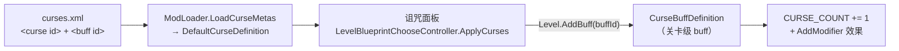

# 模块化诅咒（Modular Curse）

MVZ2 0.7.0 的自定义诅咒扩展 mod，接入**原版诅咒系统**。依赖前置库 DSHCore。

- 游戏内命名空间：`modular_curse`
- 诅咒 ID / buff ID / `curses.xml` id / `buffs.xml` id 四者同名，形如 `modular_curse:qc_c1`
- 共 44 条诅咒：癫狂之触 12 条（`qc_c1`–`qc_c12`）+ SC 池 16 条（`sc_c1`–`sc_c16`）
  + 咒鷲兼程 16 条（`zy_c1`–`zy_c16`）
- **名字**：SC / ZY 池的前 7 条沿用原版那 7 条诅咒的名字（复用的正是那 7 个图标），
  第 8 条起用池内编号（`SC-C8` … / `ZY-C8` …）；**癫狂之触**（QC）每条的名字都是
  单独取的（Slay the Spire 的诅咒名，见下表）。
- **图标**：SC / ZY 池的前 7 条复用原版诅咒图标、其余留空；**癫狂之触**每条都有
  自己的图标（`assets/Content/sprites/curse/QC/*.png`）。四个**池**各自也有一张图标
  （`curse_qc.png` / `curse_sc.png` / `curse_3q4a.png`）。
- **贴图载入规则**（唯一一条）：`Content/sprites/` 下的**相对路径就是 sprite id 的路径**。
  例如 `Content/sprites/curse/QC/INJURY.png` → `modular_curse:curse/QC/INJURY`，
  于是 curses.xml 里直接写 `<sprite id="modular_curse:curse/QC/INJURY" />`。
  `CurseSprites.RegisterAll()` 在 `PostInit` 递归扫描整个目录并逐张注册进
  `ResourceManager`，以后加图只需把 PNG 丢进去、不用改代码。

---

## 一、诅咒列表

### 癫狂之触

| ID | 名称 | 效果 | 实现 |
|---|---|---|---|
| qc_c1 | 受伤 | 器械受到伤害时漏电 3s | Harmony：`VanillaEntityExt.TakeDamage` 后缀 → `VanillaEntityExt.ShortCircuit` |
| qc_c2 | 凡庸 | 镐子和星之碎片各自具有 3s 冷却时间 | Harmony：两个 `UseOnEntity` 后缀 + 写关卡工具禁用属性 |
| qc_c3 | 凋萎 | 器械被星之碎片激发后凋零 27s（**等大招结束再施加**） | Harmony：`VanillaContraptionExt.Evoke` 入队 → 每帧等到 `entity.IsEvoked()` 变 false 再挂原版 `withered` |
| qc_c4 | 霉运 | 有尸体的敌怪倒下时有 25% 概率从尸体中复活（BOSS 除外） | Harmony：`VanillaEnemyExt.FaintRemove` 前缀返回 false 取消消失 → `Revive()` + 满血 |
| qc_c5 | 灼伤 | 怪物和器械死亡时留下火焰 | Harmony：`Entity.Die` 前缀 → `GridFire.Spawn`（敌方阵营） |
| qc_c6 | 偏差认知 | 怪物有 10% 概率隐形 | 每帧检测新实体 → 挂原版 `dark_matter_invisible` |
| qc_c7 | 睡眠不佳 | 很长的冷却时间变为 75s（≥50s 视为很长） | Harmony：`SeedPack.GetUsedMaxRecharge` / `GetStartMaxRecharge` 后缀 |
| qc_c8 | 呼唤 | 怪物的出场时间提前 5s | **原生修饰符**：`EngineStageProps.FIRST_WAVE_TIME` − 5s |
| qc_c9 | 黏液 | 器械子弹的速度变为 1/3 | Harmony：`VanillaProjectileExt.ShootProjectile` 前缀改 velocity |
| qc_c10 | 愚行 | 重质量怪物可以阻挡穿透伤害 | Harmony：`ProjectileCommonBehaviour.PostCollision` + `CanPierce` |
| qc_c11 | 贪婪 | 每一大波所有器械价格上涨 50 | Harmony：`SeedPack.GetCost` 后缀（档位 = `CurrentWave / wavesPerFlag`） |
| qc_c12 | 进阶之灾 | 关卡开始时在第三列随机一路生成一个不给予星碎的借贷告示牌 | 每帧延迟 3 帧后放置；`LoanSign.Init` 前缀只对诅咒生成的那块清借贷次数 |

### SC 池（奇硅箱的诅咒，16 条；C13~C16 为「额外」部分，游戏内名称带红）

| ID | 名称 | 效果 | 实现 |
|---|---|---|---|
| sc_c1 | 怪人的肋骨 | 第 10 个同种器械后，每多 3 个使该种器械花费 +20%（13 个 → 120%，16 个 → 140%） | Harmony：`SeedPack.GetCost` 后缀（每帧刷新场上数量，`extra = (N-10)/3` → ×(1 + 20%×extra)） |
| sc_c2 | 梦魇碎片 | 无可激活或忠诚标签的器械放下时叛变 2s（**御柱 / 冲击活塞** 无视此诅咒） | 每帧检测新器械 → 过滤（`IsTriggerActive` / `IsLoyal` / 御柱·冲击活塞豁免）后 `CharmPermanent`，2s 后 `RemoveCharm` |
| sc_c3 | 恶咒之星 | 第 10 波后，每个敌人死亡时使所有非免控器械（`CanDeactive()`）眩晕 0.1s（可叠加） | Harmony：`Entity.Die` 前缀（视为亡语）→ `entity.Stun(3)`，并用 `StunBuff.MaxStunTime` 前缀把「取最大值」改成「在剩余时长上累加」 |
| sc_c4 | 血肉核心 | 敌人的本体（不含防具与 BOSS）每 4s 恢复 5% 生命（每次最多 100 点） | 每帧计时 → `VanillaEntityExt.Heal`（只回本体） |
| sc_c5 | 龙头骨 | 敌人的防具耐久 ×1.3 | 每帧给新出现的防具**直接把上限与当前耐久都乘 1.3**（不做免伤计算，因此不与其它减伤叠加） |
| sc_c6 | 折断的钥匙 | 每使用 3 个碎片使下 1 个碎片无效 | Harmony：星之碎片 `UseOnEntity` 前缀（无效位置 4/7/10…，照样扣碎片） |
| sc_c7 | 钢铁吸盘 | 敌人受到的击退量减半；接触地面的敌人重量至少为 HEAVY | Harmony：`VanillaEntityProps.GetKnockbackMultiplier` 后缀按 `mass = max(GetMass(), HEAVY)`（落地时）重算原公式再 ×0.5。**不再动木风扇**（吹飞 / 击退完整保留） |
| sc_c8 | 再生藤蔓 | 第 10 波后，非无来源的敌人首次死亡时复活至本体 15% 血量（不含防具、不触发亡语、不消除尸体） | Harmony：`Entity.Die` 前缀返回 false 取消死亡 + 把本体血写回 15% |
| sc_c9 | 古代历石 | debuff 累积时长（持有种类 × 经过秒数）> 36s → 12s 内无视所有 debuff（清除已有并拒绝再获取） | 每帧按「当前持有的状态种类数 / 30」累加；到阈值后清掉 `StatusTable` 里的状态并写 12s 抗性；`PreApplyStatusEffect` 前缀负责拦截 |
| sc_c10 | 灾厄链甲 | 非无来源的敌人出场后 10s 内不会死亡，血量至少保留 1 点 | 每帧检测新敌怪（`SpawnerReference == null`）→ 记 10s 窗口；`Entity.Die` 前缀在窗口内取消死亡并把血量顶回 1 |
| sc_c11 | 权衡之杖 | 每行不在最前面那一格的敌人受伤 ×40% | Harmony：`PreTakeDamage` 前缀（每帧缓存每行最前列） |
| sc_c12 | 黄铜齿轮 | 敌人生成间隔 ×90%（不影响第一波出怪） | **原生修饰符**：`LogicStageProps.WAVE_MAX_TIME` ×0.90 |
| sc_c13 | 永恒之心 | 第 10 波后，非无来源的敌人受到单次超出（本体血量上限 + **当前**防具耐久）的伤害时不会立刻死，改为无敌并额外行动 3s | Harmony：`PreTakeDamage` + 每帧计时（与减速无关）→ 挂原版铁幕 buff；同一只敌怪只触发一次；排在 C15 之后（只算最终受伤结果） |
| sc_c14 | 命运之瓶 | 每 10 波时禁用所有器械放置、镐子、星之碎片 15s（不影响驱动器） | Harmony：`LogicGridExt.CanPlaceBlueprint` 后缀拒绝放置；镐子/碎片走关卡禁用属性（与 QC-C2 同一套） |
| sc_c15 | 强固补丁 | 敌人每秒受到的伤害被限制为当前血量/耐久的 40% 或 600（取最大值）；防具吃不完的溢出伤害结算到本体 | Harmony：`PreTakeDamage` 前缀按「本秒已受伤量」削减输入；溢出转移用反射给 `DamageInput.Effects` 补上 `DAMAGE_BODY_AFTER_ARMOR_BROKEN` |
| sc_c16 | 超缓冲胶 | 敌人获得 5 的护甲（本体与防具的伤害都先减 5，然后再计算其它减伤），但最终至少保留 1 点伤害 | Harmony：`PreTakeDamage` 前缀 `Add(-5)` + 「原始伤害 > 0 时钳到 ≥1」（**最先**结算，僵尸互啃也至少 1 点） |
### ZY 池（咒鵺兼程 / 3q4a 的诅咒，16 条）

| ID | 名称 | 效果 | 实现 |
|---|---|---|---|
| zy_c1 | 趋光性（红） | 排除日光影响后，非夜行性器械在光照范围外 8s 后睡着（无法被美梦丝入眠的器械不受影响） | 每帧：`entity.IsLightSource() \|\| entity.IsIlluminated()` 为真则刷新；否则累计 8s 后挂原版 `NocturnalBuff`（必须先过 `DreamSilk.CanSleep`）。只摘我们自己挂的那份 |
| zy_c2 | 夜长梦多（红） | 每小波开始时，器械蓝图冷却 +2.5%（上限 50%） | Harmony：`SeedPack.GetUsedMaxRecharge` 后缀 ×(1 + min(0.025×波数, 0.5))（**不动**初始冷却） |
| zy_c3 | 地狱残响（红） | 矿场的生产间隔改为 30s | Harmony：`Miner.Update` 前缀**整段接管** —— 原版把 `PRODUCE_TIME = 300` 写死在方法里，没有属性可改 |
| zy_c4 | 排异反应（红） | 拾取星之碎片会阻止使用星之碎片 12s，可叠加、无上限 | Harmony：`CollectBehaviour_Starshard.PostCollect` 后缀 → 累加禁用 tick（与 QC-C2 同一个禁用位） |
| zy_c5 | 斋禁（绿） | 每大波开始时失去所有机械能，并失去 1 个星之碎片 | 每帧检测大波开始 → `SetEnergy(0)` + `AddStarshardCount(-1)`，播 `VanillaSoundID.fatigue` |
| zy_c6 | 磨灭（绿） | 每大波开始时从右往左永久禁用 1 张器械蓝图 | 每帧检测大波开始 → 从最后一个槽位往左写 `EngineSeedProps.DISABLE_ID = decrepify` |
| zy_c7 | 室上性心动过速（绿） | 第一大波开始前，波长最短为 16s | Harmony：`LogicStageProps.GetWaveMaxSeconds` 后缀 `Max(v, 16)` |
| zy_c8 | 我们不去幻想乡（绿） | 倒数第二大波开始后，出怪量 +200%（单格关卡不生效） | Harmony：`LogicLevelExt.CalculateSpawnPoints` 后缀 ×3；`totalFlags <= 1` 直接跳过（无尽按轮重置） |
| zy_c9 | 它回来了（蓝） | 被消除亡语 / 坠空 / 落水而死的敌人重生为携带成真的恶魂（被地雷击杀的敌人除外） | Harmony：`Entity.Die` 前缀 → 命中 `NO_DEATH_EFFECTS`/`FALL_OFF`/`DROWN` 时 `SpawnWithParams(ghast)` + `NightmareComeTrueBuff`；用 `IGNORE_ARMOR + REMOVE_ON_DEATH + NO_DEATH_EFFECTS` 这一组标记识别地雷 |
| zy_c10 | 病毒式传播（蓝） | 第 x 大波开始后，出怪点数**低于** x 的敌人生成时额外在其他行生成 1 个不占点数的复制 | Harmony：`LogicLevelExt.SpawnEnemy(spawnDef, lane, x)` 后缀 + 重入保护 |
| zy_c11 | 衰变（蓝） | 所有友方爆炸不分敌我 | Harmony：`VanillaLevelExt.Explode` 前缀，`faction == GetLeftFaction()` 时改成 `VanillaFactions.NEUTRAL(8)` |
| zy_c12 | 久经沙场（蓝） | 敌人单次受到超过 80 的伤害而未死 → 其之后单次受到的伤害不超过 20（永久） | Harmony：`TakeDamage` 后缀记标记 + `PreTakeDamage` 前缀钳制 |
| zy_c13 | 纯粹（白） | 不能携带任何制品（飞碟玩具 / 智能手机 / 槐树树枝 / 贪婪吸尘器除外） | Harmony：`CanChooseArtifact` 后缀拒绝选择 + `ApplyCurses` 后缀清掉已带进来的（含继承） |
| zy_c14 | 恶意（白） | 第一大波开始前，器械的攻击间隔与生产间隔取最大值 | Harmony：`VanillaEntityProps.GetAttackSpeed` / `GetProduceSpeed` 后缀取二者 min（间隔与速度成反比），带重入保护 |
| zy_c15 | 晚安（白） | 除荧石外的发光器械 ×50% 光照范围 | 每帧给非荧石光源挂 `zy_c15_dim` 子 buff（`LIGHT_RANGE ×0.5`） |
| zy_c16 | 抗拒（白） | 使用鼠标点击器械时，其失去 10 点耐久 | Harmony：`VanillaContraptionExt.EmptyHandClick` 后缀 → `TakeDamage(10, MUTE)`（点击本身照常生效） |
### 诅咒池（诅咒弹窗内部的一行条目）

诅咒弹窗（标题「选择诅咒」）的**列表滚动区内部**：最上面是四个池条目，
再往下一条**横线**，横线下面才是真正的诅咒列表。条目就是用诅咒条目本身的样子做的
（同尺寸方框 + 图标 + 选中高亮），当前池高亮，悬停显示池名与作者描述，点击有与原版
诅咒条目相同的点击音效。

| 池 | 图标 | 面板里显示的诅咒 | 作者描述 |
|---|---|---|---|
| 原版池（默认） | 原版诅咒按钮那张图（`ui/level/curse.png`）+ 同样的紫色滤镜 | 只有 `mvz2:*` 的 7 条原生诅咒 | 原版诅咒 |
| 癫狂之触 | `curse_qc.png` + 同样的紫色滤镜 | 只有 `modular_curse:qc_c1..qc_c12` | QoZnoS的诅咒 |
| SC 池 | `curse_sc.png` + 同样的紫色滤镜 | 只有 `modular_curse:sc_c1..sc_c16` | 奇硅箱的诅咒 |
| 咒鵺兼程 | `curse_3q4a.png` + 同样的紫色滤镜 | 只有 `modular_curse:zy_c1..zy_c16` | 3q4a的诅咒 |

语义：

- 池是**单选且必选**的（没有「全部」这一档）；
- 换池后**诅咒面板只列出该池的诅咒**，并且**其它池已勾选的自动取消**（勾选数会跟着变）；
- 选择**每关单独记**，写在 `userdata/userN/modular_curse/curse_pool.txt`，
  键是关卡的 `StageID`（例如 `mvz2_lab:real_prologue=1`），重开该关仍是上次的池；
  没有记录的关卡默认**原版池**（列表内容等价于未装本 mod 时）。

**加新池**只需改三处（UI 会自动排）：

1. `CursePool` 枚举加一项；
2. `CursePoolRules.Pools` 数组加一项，并在 `Label` / `Name` / `Description` 里补名字与作者；
3. `CurseIds.Qc/Sc` 旁的 ID 列表 + `CursePoolIcons` 的图标（不补也能跑，只是没图标）。

条目行的列数/尺寸/行数按可用宽度自动算（排不下就换行并把预留高度加高），
所以池变多不会撞到诅咒列表。

实现要点（全部走 interop 已公开成员，无反射）：

- 条目行是一个**新节点**，直接挂到滚动区 Content（也就是 `ElementList` 的 listRoot）
  下面的**最前面**，因此它跟着一起滚动、一起被 Viewport 裁剪；
- Content 上的 `GridLayoutGroup` 会把子节点塞进 64×64 格子，所以给我们自己的两个节点
  各挂一个 `LayoutElement.ignoreLayout = true`（游戏自己的 DebugConsoleInputField 也这么干），
  位置由我们给；再给 Grid 设 `padding.top = 池区高度`，把真正的诅咒格子整体压下去 ——
  不重叠、不需要改大小，`ContentSizeFitter` 还会自动把 Content 撑高（滚动范围自然正确）；
- 横线是一个**全新的、只有 `Image`（无 sprite）的节点**：不用原版那些带
  `ImageResolver` 的图，免得它在 OnEnable 时把图又改回去；颜色用原版诅咒按钮的紫色、
  alpha 0.8；
- 条目复制**诅咒列表自己的模板**（`ElementList.getTemplate()`，即 `CurseSelectItem`），
  尺寸也保持**同一个 64×64** —— 诅咒条目是「外框 64（`Background`, `form`）
  + 内框 48（`Slot`, `form_hollow`）」两层，尺寸小于 64 时内外两层会叠在一起、
  看上去就少了一圈边框；同样地，条目**左对齐**（从滚动区左边开始），
  与下方诅咒列表的第一列齐平；
- 图标照原版诅咒按钮的做法上一层紫色 tint
  （按钮那颗图标就是靠 Image 的 `m_Color = (0.635, 0, 1, 1)` 上色的）；
- 点击音效就是原版诅咒条目用的那个 `LogicSoundID.tap`
  （`Main.SoundManager.Play2D(id, 1f)`）；
- 条目的事件（`OnClick` / `OnPointerEnter` / `OnPointerExit`）是**每个实例独立**的 C# 事件，
  游戏只订阅了它自己创建的那些条目（`UpdateCurses` 的 `onCreateOrEnable`），
  我们克隆体上只有我们自己的订阅，两边互不干扰；
- `LevelBlueprintChooseController.choosingCurses` 是诅咒面板的**唯一数据源**
  （列表内容、`GetCurseIDByIndex`、`ApplyCurses` 都读它），所以在
  `ReloadChoosingCurses` 之后就地过滤它，下游全部自动一致；
- 池外的已勾选用「按过滤后的列表重建 `enabledCurses`」清掉
  （只用 `Contains`/`Add` + 公开 setter，避免在 IL2CPP 集合上边遍历边删）。

> 选卡界面右侧**没有**额外的「诅咒池」按钮：早期版本做过一个复制自诅咒入口按钮的入口 +
> 复制自制品弹窗的独立选择框，实测**点不开**（克隆体的父节点是 `SetActive(false)` 的包装对象），
> 详见实现备注 11。

### 控制台指令 `/curse`（调试用）

```
/curse all    强制显示所有诅咒池（不按池过滤，列出全部诅咒）
/curse off    恢复按诅咒池过滤
/curse        查看当前状态
```

- 强制模式只存在于**本次运行**（不落盘），进入选卡界面会立即刷新；
  在弹窗里手动点一个池就会退出强制模式。
- 为了让 `/curse` 这个名字能用（而不是 `/modular_curse:curse`）且不折腾接口数组的跨程序集写入，
  这条指令是**在 `DebugManager.ExecuteCommand` 上加 Harmony 前缀**实现的，
  命令名解析复用官方的 `CommandUtility.SplitCommand`；详见实现备注 13。
- 它不会出现在 `/help` 列表里（那份列表读的是官方命令定义）。

### 边界说明

- **qc_c1 白名单**：金苹果 / 蜡烛被啃食时会先检查 `target.IsAIFrozen()`，而漏电自带的
  `frankenstein_shocked` 会设置 `AI_FROZEN` —— 不豁免的话这两个器械的核心功能会被自己身上的诅咒禁掉。
- **qc_c8**：只改关卡第一波时间（`FIRST_WAVE_TIME`），无尽续波用的
  `CONTINUED_FIRST_WAVE_TIME` 不受影响。修饰符没有下限截断，但原版首波时间普遍 ≥15s。
- **sc_c1 公式**：`N > 10` 时价格 = 基础价 × (1 + 10% × (N - 10))，加法叠加（不是每次乘方）。
- **sc_c2 豁免**：带「可激活」（`triggerActive`）或「忠诚」（`loyal`）标签的器械不叛变，
  另加一份写死的名单：御柱 `onbashira` / 夹子 `autotrap` / 冲击活塞 `punchton`
  （闪电之珠 `lightningOrb` 也在名单里 —— 它本来就因可激活标签而免疫，留着只是双保险）。
- **sc_c3 / sc_c8 的「第 10 波后」**：按「第 10 波打完之后」实现，即第 11 波起生效。
- **sc_c3 视为亡语**：只有会触发亡语的死因才会引发全场无敌
  （地雷 / 蜡烛 / 核弹 / 石砖加农炮这类 `NO_DEATH_EFFECTS` 的死因不引发）。
- **sc_c5**：只在本次伤害确实会打在防具上时生效（未被 `IGNORE_ARMOR` 忽略、
  没有指定护盾目标、主防具存在且未被忽略），且在 **sc_c16 的固定减伤之后**计算。
- **sc_c8 的复活**：在 `Entity.Die` 前缀里直接取消死亡，因此**尸体被销毁的死因也拦得住**
  （需求：去除亡语的行为不影响本次复活）；`NO_REVIVAL`（溺水 / 坠楼）仍然会阻止它。
  只复活一次，不恢复防具，属性沿用原值。
- **sc_c10 / sc_c8 的「自然出场」**：`Entity.SpawnerReference == null` 为自然出场
  （波次出怪走 `level.Spawn(entityDef, pos, null)`）；所有被实体 Spawn 出来的衍生物
  （泡泡枪的泡泡、炮筒的炮弹僵尸、死灵法师的骨墙、恐怖之母的寄生虫……）一律不算。
- **sc_c10「出场无敌」**：用原版铁幕 buff 实现，因此是「免疫伤害但不免疫状态效果」，
  并且带黑↔红闪烁提示；到点由 buff 自己超时移除（我们只负责挂上去）。
- **sc_c13 触发阈值**：只看**上限**（本体血量上限 + 防具血量上限），伤害 ≥ 该值才触发；
  **不看当前血量**，所以不会出现「200 血上限的敌怪剩 15 血、挨 20 点伤害
  被打死还无敌 3s」这种乱象。比较用的数值是 **C16 / C5 减免之后**的伤害。
- **sc_c14 的判定点**：`CurrentWave` 首次变成 10 / 20 / 30… 的那一帧开始计时 20s；
  驱动器 `drivenser` 不受封禁影响（需求：「不影响驱动」）。
- **sc_c15**：上限 = `max(当前血量或耐久 × 40%, 400)`；因为是在游戏把伤害拆给
  防具/本体**之前**削减输入量，被砍掉的部分不会溢到本体。
- **qc_c4 的复活时机**：在「尸体消失」时判定，因此**只有留下尸体的敌怪**能复活；
  不恢复防具（只把本体拉满血），BOSS 不复活，不触发亡语的死因（地雷、蜡烛等）也不复活。
- **sc_c9 的「脆弱」**：0.7.0 的 `dragon_tooth`（龙牙）buff 没有超时属性，无法缩放时长，
  因此只覆盖了减速 / 中毒 / 虚弱 / 冰冻四种。
- **sc_c13~c16 的红名**：`curses.xml` 的 `<texts name>` 里写了 TMP 富文本
  `<color=#FF4040>…</color>`（XML 里需转义成 `&lt;color=…&gt;`）。
  诅咒名最终落到 `Tooltip` 的 `TextMeshProUGUI nameText.text`，因此只要有富文本支持就会变红。

---

## 二、与原版诅咒系统的对接

原版 0.7.0（早期内测版起）的诅咒链路：



本 mod 完全复用这条链：

1. **`ModInfo`**：`OnRegisterModInfos` 注册 `modular_curse`，
   `Logic = ModularCurseMod.CreateInstance()`，`Assemblies` 为空。
2. **词条**：`ModularCurse/assets/Content/metas/curses.xml` + `buffs.xml`，
   构建时部署到 `MinecraftVSZombies2_Data/StreamingAssets/Mods/modular_curse/Content/metas/`，
   运行时由 `DSHCore.MetaInjection` 直读磁盘注入 `ModResource`。
3. **诅咒定义**：官方 `ModLoader.LoadCurseMetas` 用 curses.xml 创建
   `DefaultCurseDefinition`（不需要我们自己建类型）。
4. **诅咒 buff**：29 个注入的 `CurseBuffDefinition` 子类
   （24 条诅咒 + sc_c7 的敌怪子 buff），
   由 `CurseDefinitionPatch` 在官方 `LoadStages` 时机创建并 `AddDefinition`。
   继承原版 `CurseBuffDefinition` 因此自动带上 `CURSE_COUNT += 1`。
5. **效果**：能用原版属性修饰符表达的写在 buff 的 `Setup()` 里（qc_c8 / sc_c7 / sc_c12），
   其余由 `CurseRuntime` + `CurseHooks` 承担，**以「关卡是否挂着对应诅咒 buff」为唯一开关**。

语义变化：诅咒改为**进关卡前在选择面板勾选、仅对当关生效**（原版语义）。
控制台 `/curse` 指令已删除。

---

## 三、实现备注（踩过的坑）

### 1. 托管 mod 无法注册原版触发器

原版 `AddTrigger*` 收 IL2CPP 侧委托（`Il2CppSystem.Action<...>`），而所有关卡回调的参数
结构体都含引用字段（非 blittable）。`DelegateSupport.ConvertDelegate` 直接拒绝：

```
Delegate has parameter of type PVZEngine.Callbacks.EntityCallbackParams
(non-blittable struct) which is not supported
```

因此**触发器路线不可用**，需要回调的效果只能走 Harmony。这也是
qc_c8 / sc_c7 / sc_c12 用原生修饰符、其余用 Harmony 的原因。

### 2. 诅咒定义的属性写入会因「属性键未注册」而丢失

官方 `LoadCurseMetas` 会立刻 `SetCurseName / SetBuffID / SetUnlockConditions`，
但那一刻 **MVZ2.Logic 的属性键可能还没注册**（`PropertyMapper` 按 mod 顺序扫描程序集，
实测 `modular_curse` 的 `LoadStages` 早于 `mvz2`）。未注册的键 `Key == 0`，
写入落到无效键上 —— 表现为诅咒名称为空、BUFF_ID 为 null、unlock 为 null
（于是永远不会出现在诅咒面板里）。

修复：`CurseMetaApplier` 在属性键确定已注册的时机（`PostInit` ，
以及在 `SaveManager.EvaluateUnlocks` 前缀里再兜一次）用 XML 词条重套一遍。
写入的是同一 `Definition` 对象，它已经在 `game.AddMod` 时进入全局内容表，因此立刻生效。

### 3. 代理不复制接口声明

Il2CppInterop 生成的代理**看不到**原生类型实现的接口，因此：

- `LevelEngine` / `Entity` 上不能直接调 `IBuffTarget` 的扩展方法
  （`HasBuff` / `AddBuff` / `RemoveBuffs`）→ 必须 `new IBuffTarget(ptr)` 包一层；
- `XMLConditionList` 不能隐式转成 `IConditionList` → 必须 `new IConditionList(ptr)`；
- `IGlobalGame` 上看不到 `IGameContent` 的扩展方法
  （`GetAllCurseDefinitions`）→ 改用 `IGlobalGame` 自身的泛型 `GetDefinitions<T>`。

### 4. Harmony 传入的定义要按声明类型包装

`Mod.AddDefinition(Definition def)` 的后缀拿到的对象，托管类型是 **`Definition`**
而不是 `DefaultCurseDefinition`，所以 `def is CurseDefinition` 恒为 false。
判别要用 `def.GetDefinitionType()`，再 `def.TryCast<CurseDefinition>()`。

### 5. 注入类的静态字段初始化器不能碰游戏类型

`ClassInjector.RegisterTypeInIl2Cpp<T>()` 会触发 `T` 的静态构造器（发生在插件 `Load` 阶段，
那时触碰 `MVZ2.GameContent.*` 会抛 `SEHException`）。所有依赖游戏类型的静态数据都要**懒初始化**。

### 6. 定义绕开原生 LINQ

`DefinitionGroup.GetDefinitions()`（`SelectMany`）与
`DefinitionList.GetAllDefinitions<T>()`（`OfType<T>`）在 metadata v31 的注入环境下
非确定性抛 `MethodAccessException` 或返回空，而 `GlobalGame.AddMod(mod)` 正好走前者。
`CurseDefinitionPatch` 因此用托管 List 手工跟踪本 nsp 的全部定义，
拦截 `Mod.GetDefinitions()` 直接返回该列表，并跳过 `Mod.PostReloadMods`。

### 7. 修饰符必须在「属性键注册之后」创建（关卡诅咒计数不含模组诅咒）

现象：关卡 UI 的诅咒计数只算原版诅咒，模组诅咒不计数（尽管诅咒效果本身生效）。

根因：`PropertyMeta<T>` 到 `PropertyKey<T>` 是**隐式转换**，会在**创建修饰符的那一刻**
把 `meta.key` 当时指向的对象拷进 `PropertyModifier`；而 `PropertyMapper.SetRegisteredKey`
注册时会**替换** `meta.key` 指向一个全新的 `PropertyKey`。于是先注册前创建的修饰符
永远持有 `Key == 0` 的占位键 —— 修饰符存在、但永远匹配不上任何属性。

`CurseBuffDefinition` 的 ctor 体（`CURSE_COUNT += 1`）恰好也是「先于原版 mod 加载」时执行的，
所以基类 ctor 塞进来的那份同样失效。

修复：`CurseBuffs.ApplyModifiers()`（在本 mod 的 `PostInit` 调用，即所有 mod 的
`PropertyMapper.InitPropertyMaps` 跑完之后）**清空 modifiers 再重建**
（`CURSE_COUNT` + `Setup()` 里的定义级修饰符）。`SaveManager.EvaluateUnlocks` 前缀里再兜一次。
`PostGameInit` 会打印自检：`修饰符缺失 0/25`、`CURSE_COUNT 键失效 0 条`。

### 8. 诅咒面板顺序（模组诅咒会排到原版上方）

官方缓存顺序 = `game.GetAllCurseDefinitions()` = **定义注册顺序**，而本 mod 的
`LoadStages` 早于原版 mod（同上：`PropertyMapper` 按 mod 顺序扫描），于是模组诅咒排在前面。

修复：`SaveManager.GetUnlockedCurses()` 后缀做一次**稳定分组**，
把内置命名空间（`Global.BuiltinNamespace`）的诅咒放到最前，其余保持原有相对顺序。
该方法是面板填充（`LevelBlueprintChooseController.ReloadChoosingCurses`）的唯一数据源，
且存的是 `NamespaceID`，重排不影响选中状态。

### 9. 【间歇性致命】`mod.Namespace` 字段会被 GC 回收 → 整套诅咒注册不上

现象：**有时**启动后诅咒一个都没进游戏（面板为空），日志表现为

```
[ModularCurseMod] PostInit: 共 0 个定义（其中 buff 0 个）
[CurseBuffs] 0/0 个定义的修饰符已展开
[Diag] 诅咒定义 0/7，已解锁 0/7
```

同一份 DLL 重开一次又完全正常 —— 典型的 GC 时序问题。

根因链：

1. `Mod.Namespace` 是自动属性 `<Namespace>k__BackingField`（IL2CPP 侧是 `Il2CppString*`）。
   Il2CppInterop 为它生成的是 **property**（`set__Namespace_k__BackingField` 内部做
   `ManagedStringToIl2Cpp`），我们赋的值是一个**新建的 il2cpp 字符串**；
2. 该字符串唯一的引用就是「**注入类实例**的引用字段」。而注入类的 GC 描述符不含
   继承来的引用字段（与 `DSHCore.Il2CppPin` 注释里那条已知限制同源）→ **不被 GC 扫描**；
3. 若干次 GC 后字符串被回收，`mod.Namespace` 读到空/悬垂值；
4. 游戏自己也用 `mod.Namespace` 找本 mod 的 meta：
   `ModLoader.LoadEntityMetas/LoadStages/LoadBuffMetas/LoadCurseMetas` 全部是
   `var nsp = mod.Namespace;` 再 `res.GetModXxxMetas(nsp)`。读空 ⇒ 所有 meta 都查不到
   ⇒ 诅咒定义、buff 定义、诅咒词条全部不注册 ⇒ **面板里看不到任何模组诅咒**。

修复（`ModularCurseMod.EnsureNamespace()`，幂等）：

- 自建一个 il2cpp 字符串（`IL2CPP.ManagedStringToIl2Cpp(spaceName)`）并用
  `il2cpp_gchandle_new(ptr, false)` **永久钉住**（成为 GC 根，永不被回收）；
- 用 `il2cpp_object_get_class` + `GetIl2CppField(klass, "<Namespace>k__BackingField")`
  + `il2cpp_field_get_offset` 算出字段地址，`Marshal.ReadIntPtr` 读回比较；
  不一致就用 `FieldWriteWbarrierStub`（与 interop 生成的 setter **完全同一条写屏障路径**）写回。
  （注意：原生元数据里的字段名就是 `<Namespace>k__BackingField`，
  `_Namespace_k__BackingField` 只是 Il2CppInterop 的改写名，按后者查不到；
  另外 `GetIl2CppField` 的参数是 **klass 指针**，传实例指针会直接 AV。）
- 只在 `CreateInstance`、`PostInit`、`PostGameInit` 以及每个 Harmony 钩子入口
  （`IsOurs` 内部）调用 —— 保证游戏每次读之前字段必然有效。

配套加固：`IsOurs(mod)` 改为**先比 native 指针**（`mod.Pointer == self.Pointer`），
再比字符串。即使字符串再次失效，我们自己那套补丁也不会静默失灵。

### 10. 复制现成 UI 做扩展（以及 interop 把事件变成属性这件事）

这个 mod 的 UI 全部是**运行时复制现成节点**得来的（没有 prefab 可以改）：

- `LevelUIBlueprintChoose` 上那些 UI 引用全是 `[SerializeField]`，prefab 不是我们的，
  没法加字段；UI prefab 又都在 Addressables bundle 里，mod 侧没有可靠的按名加载入口；
  从零 `new GameObject` 则要自己重建背景九宫格 sprite、TMP 字体材质、LayoutElement、
  CursorAnchor 等一堆引用。
- 可行的做法只有一条：**找到场景里现成的节点，`Instantiate` 一份，改自己需要的那几个字段**。
  例如诅咒弹窗的池条目行就是复制它的标题行 + 复制自己的诅咒条目，见备注 11。
- 复制 UI 节点用 `Instantiate((UnityEngine.Object)go, parent, false)`（第三个参数 false =
  保留本地坐标/锚点），拿到 `Il2CppObjectBase` 后 `TryCast<GameObject>()`。

踩到的坑：`CursePanelEntranceButton.OnClick` 在源码里是 `public event Action? OnClick;`，
但 Il2CppInterop 把它生成成**类型为 `Il2CppSystem.Action` 的属性**（`Il2CppSystem.Action` 是
IL2CPP 委托包装类，不是托管委托），所以 `button.OnClick += handler;` 会直接编译失败：

```
error CS0019: 运算符“+=”无法应用于“Action”和“方法组”类型的操作数
```

正确写法是走生成的访问器 + 转换，并把托管委托自己持有住防止被 GC
（`CurseSelectItem.OnClick` 这种带参事件同理，只是换成 `Il2CppSystem.Action<CurseSelectItem>`）：

```csharp
clickManaged = new System.Action<CurseSelectItem>(OnItemClicked);
clickIl2Cpp = DelegateSupport.ConvertDelegate<Il2CppSystem.Action<CurseSelectItem>>(clickManaged);
item.add_OnClick(clickIl2Cpp);
```


### 11. 扩展原版弹窗：往现有布局里插节点，不要另造弹窗

**失败的路（已删）**：把场景里的原版制品选择框 `ArtifactChoosingDialog`
整个 `Instantiate` 一份当自己的选择框。代码能跑、事件也是自己的，但**永远不可见**：

```
[CursePool] 已创建诅咒池选择框（父节点 SharedCanvas，兄弟序号 1，父链可见 False）
[CursePool] 已打开诅咒池选择框（activeInHierarchy=False）
```

它在 UI 预设里不是独立面板，而是被一个显示时才 `SetActive(true)` 的**包装对象**包着的，
克隆体跟着父链一起隐藏；而且**同场景存在多个 UI 预设实例**，
不限定「父链可见」的递归查找很容易挑到非当前布局的那一份。

**现用的路**：往**活的**诅咒弹窗的滚动区里插节点，让它跟弹窗自己的布局系统一起算位置。
实测结构：

```
SelectCurseDialog                          356x294，关闭时 active=0
  Dialog
    Content   [VerticalLayoutGroup spacing=0 align=MiddleCenter ctrlH=1 forceH=0]
      Top     (50) [LayoutElement pref=-1x50 flex=1x-1]        ← 标题行
      Center (194) [LayoutElement pref=296x-1 flex=-1x1]       ← 滚动区（flex=1，剩余高度归它）
        Scroll View [ScrollRect]
          Viewport [Mask]
            Content [ElementList|Grid(4列 64x64 间距1)|SizeFitter v=PreferredSize]
              CurseSelectItem（模板）… 诅咒条目        ← 就是 listRoot
          Scrollbar Vertical
      Bottom  (50) [LayoutElement pref=-1x50 flex=1x-1]        ← 返回/全选/取消全选
```

要把跨整行的池条目 + 横线放进 `Content`，得解决三件事：

1. **Grid 会把子节点塞进格子** → 给我们自己的节点各挂一个
   `LayoutElement.ignoreLayout = true`（UGUI 的 LayoutGroup 会跳过 `ILayoutIgnorer`；
   游戏自己的 `DebugConsoleInputField` 也是这么干的），位置自己给；
2. **原本的诅咒格子还在最上面，会与池区重叠** → 给 Grid 设 `padding.top = 池区高度`，
   把真正的诅咒格子整体压下去。`ContentSizeFitter(v=PreferredSize)` 会自动把
   Content 撑高，滚动范围也就自然正确了。
   坑：interop 里的 `RectOffset` **没有四参构造函数**，只能改 `grid.padding` 返回的那个
   实例（引用类型，改的就是 native 对象）再赋回去以触发布局重建；
   同时要记住原始的 `padding.top` 避免重复叠加。
3. **横线不能带 `ImageResolver`** → 原版那堆图都挂了这个组件，它在 OnEnable 时会把
   sprite 又设回去，把我们的空 sprite 盖掉。所以横线用 `new GameObject` +
   `AddComponent<RectTransform>/<Image>/<LayoutElement>` 现造一个
   （`AddComponent<T>().ignoreLayout = true` 是游戏自己用过的写法）——
   实测确认它身上只有 `RectTransform,CanvasRenderer,Image,LayoutElement`，没有 ImageResolver。
   无 sprite 的 `Image` 会画成纯色矩形，配上原版按钮那个紫色 + alpha 0.8 就是一条分隔线。

池条目本身还是**复制诅咒列表自己的模板**（`ElementList.getTemplate()`，即 `CurseSelectItem`），
尺寸与对齐也向它看齐：

- 尺寸用**同一个 64**（不是随意的小尺寸）—— 诅咒条目是「外框 64（`Background`, `form`）
  + 内框 48（`Slot`, `form_hollow`）」两层，小于 64 时内外两层会叠在一起、看上去就少了一圈边框；
- **左对齐**（不再居中）：`anchoredPosition.x` 从滚动区左边开始算，
  与下方诅咒列表的第一列齐平；
- 点击音效就是原版诅咒条目用的 `LogicSoundID.tap`。

行内布局（列数 / 尺寸 / 行数）按 Grid 的设计宽度自动算：先用首选 64 试一行放下，
放不下就用最小 40 按列数换行，并相应加高预留高度。

排查 UI 用 `CurseDialogProbe.cs`（把 `Enabled` 改成 `true`）：进入选卡界面会把
整棵弹窗的层级 + RectTransform 几何 + **每个节点的全部组件类型名**打进日志，一次会话只打一遍。
这是定位这类问题的**首选手段** —— 比读 prefab 可靠得多（prefab 里部分节点是嵌套预制体
的 stripped 对象，名字都读不出来），而 interop 运行时也看不到预制体上的隐藏组件。

### 12. 把 mod 自己的图片内嵌进游戏 + interop 代理不声明接口

两件事都得绕一下：

1. **图标**：0.7.0 的图片走 `SpriteManifest`（Addressables 资源），
   磁盘上的 `Mods/<nsp>/Content/...` 只被 DSHCore 用于 XML metas，图片不会自动进资源库。
   所以 mod 自己读 PNG（`File.ReadAllBytes` + `ImageConversion.LoadImage` +
   `Sprite.Create`），再 `ResourceManager.RegisterSprite(SpriteReference, Sprite)` ——
   写进去的正是 `ResourceManager.GetSprite` 查询的那张表（两边都用不带 tags 的
   `SpriteLookupKey`），在游戏侧等同于「内嵌」。原版池那张图**直接从原版诅咒入口按钮上取**
   （`chooseUI.GetCursePanelEntranceButton().transform.Find("Image")` 的 `Image.sprite`
   = `ui/level/curse.png`），连紫色 tint 也是从同一个 Image 的 `color` 上读的 ——
   按钮换皮时池图标跟着变，不会脱节。
2. **接口**：Il2CppInterop 生成的代理**不声明**自己实现了哪些接口，于是
   `ArtifactSelectItem` / `CursePanelEntranceButton` 都**不能**隐式转成 `MVZ2.UI.ITooltipTarget`
   （编译期就报 CS1503），`SimpleTooltipSource` 也转不成 `ITooltipSource`。
   按本项目一贯做法手工包一层指针壳即可（与 `new IBuffTarget(ptr)`、`new IConditionList(ptr)` 同理）：

```csharp
var target = new ITooltipTarget(item.Pointer);
var source = new SimpleTooltipSource(camera, target, content);
main.Scene.ShowTooltip(new ITooltipSource(source.Pointer));   // 接口参数同样要包壳
```

   另外：`ILevelController` 虽然继承 `ILevelUIController`（那里有 `ShowTooltip`/`HideTooltip`），
   但 interop 没把基接口继承下来（编译期报「未包含 ShowTooltip 的定义」），
   因此工具提示统一走 `MVZ2.Managers.MainManager.Instance.Scene.ShowTooltip/HideTooltip`（都是 public）。

### 13. 控制台指令 `/curse`：为什么不走官方 `CommandDefinition`

官方命令是数据驱动的：`Content/metas/commands.xml` → `ModResource.CommandMetaList`
→ `ModLoader.LoadCommandProperties(mod)` 里
`mod.GetCommandDefinition(new NamespaceID(mod.Namespace, meta.ID))`，把 `VARIANTS` 等
属性写到定义上（`ValidateCommand` 要求 variants 非空，否则报「命令格式不正确」）。
两个问题让它不适合我们：

1. 定义必须注册在 **mod 自己的命名空间**下才能被上面那行查找命中；而控制台解析裸命令名
   用的默认命名空间是 `mvz2`（`NamespaceID.TryParse(command, Main.BuiltinNamespace)`），
   于是官方路线下只能写成 `/modular_curse:curse`，拿不到 `/curse`；
2. 要自己把 `ICommandVariantMeta[]`（接口数组）写进属性，在 IL2CPP 下是纯属自找麻烦。

所以 `/curse` 改成在 `DebugManager.ExecuteCommand(string,int)` 上挂 Harmony 前缀：
命令名解析复用官方的 `CommandUtility.SplitCommand`（它会剔掉开头的 `/`），
只拦 `/curse`，其他指令 `return true` 原样放行（实测 `/kill` 能正常透传）。

### 14. SC-C10「出场保护」只算自然生成的敌怪（衍生物豁免）

现象：泡泡枪生成的泡泡、炮筒生成的炮弹僵尸、死灵法师生成的骨墙、
恐怖之母的寄生虫这类**衍生物**也会吃到出场保护，等于给对手白送护盾。

判定依据用实体自带的生成来源，而不是维护类型名单：

```csharp
entity.SpawnerReference == null   // 自然生成
```

- 原版波次出怪走 `LogicLevelExt.SpawnEnemy` → `level.Spawn(entityDef, pos, null)`，
  来源必然为空；
- 所有衍生物都是被别的实体 Spawn 出来的（`entity.Spawn(...)` / `SpawnWithParams(...)`
  → `level.Spawn(def, pos, entity, ...)` → `new EntitySourceReference(entity)`），来源非空。

因此新加的衍生物自动适用，不用维护名单（连 BOSS 召唤的僵尸、刷怪笼、尸体车也算衍生物）。
注意 `SpawnerReference` 的 interop getter 在原生指针为空时返回 `null`（IL 里 `brtrue` +
`Il2CppObjectPool.Get<T>`，否则 `ldnull`），所以直接判空是安全的；
**不要**用 `is EntitySourceReference` 判类型 —— 代理对象是按**声明类型**包装的，恒为假。

顺带修了一个连带缺陷：`Tick` 里取实体列表的开关 `needList` 原本漏了 `IdScC10`，
于是**只勾 SC-C10** 时 `entities == null`，整条诅咒静默失效（必须再勾一条别的诅咒才会生效）。
代价：它不会出现在 `/help` 的命令列表里（那份列表读的是官方命令定义）。

### 15. SC 池（16 条）的机制要点

- **sc_c8「首次死亡改成复活」在 `Entity.Die` 前缀里做**，不是像 QC-C4 那样等
  `FaintRemove`。原因：需求要求「地雷 / 蜡烛 / 核弹 / 石砖加农炮」这类销毁尸体的行为
  **不能**阻止本次复活 —— 而这些死因会把尸体直接移除，根本走不到 `FaintRemove`。
  在 `Die(DeathInfo)` 前缀里 `return false` 就是游戏自己 `PRE_ENTITY_DEATH` 回调
  那条路（`Die` 里 `if (!PreDeath(info)) return;`），把血量写回 15% 即可。
  代价：`NO_REVIVAL`（溺水 / 坠楼）我们仍然尊重；亡语则天然不触发（`PostDeath` 不会跑）。
- **sc_c3（恶咒之星）的「可叠加」是自己记账**：原版 `StunBuff.MaxStunTime` 只在
  「新的比旧的长」时才写时间，而且 **早期内测版起的 interop 里根本找不到这个方法**
  （`AccessTools.Method` 返回 null，日志会打 `patch target not found`）。
  所以改成自己维护「器械指针 → 剩余眩晕 tick」的账（`CurseState.ScStun`）：
  每次叠加 `remaining += 0.1s` 后把**累计值**交给 `entity.Stun(remaining)`
  （原版只会把时长换成更大的那个 ⇒ 拿到的就是我们想要的累计值），
  自己再每帧递减同一份计数，两边同步。
- **sc_c7 换成了动「击退系数」**：原版吹飞 / 击退只有木风扇一条路，而需求要求
  「不再禁止木风扇的吹飞效果与击退，也不是简单的加重量」。因此：
  ① 删掉旧的 `BlownByWoodenFanBuff.GetBlowMass` 后缀（它把质量顶到 999 = 完全吹不动）；
  ② 删掉 `MASS +1` 的原生修饰符；
  ③ 改成在 `VanillaEntityProps.GetKnockbackMultiplier(entity, massMultiplier)` 后缀里，
  以 `mass = (落地 ? max(GetMass(), HEAVY) : GetMass())` 重算原公式
  （`max(0, 2 - 2^(mass×massMultiplier))`）再 ×0.5。
  这样「落地至少重质量」「击退减半」都落到了最终击退量上，而风扇的
  `GetBlowMass` 完全不受影响（吹飞 / 击退都还在）。
- **sc_c5 直接改防具血量**：给防具写 `EngineArmorProps.MAX_HEALTH ×1.3` 并把
  `armor.Health ×1.3`（`Armor.Update` 每帧会 `Health = min(Health, GetMaxHealth())`，
  所以两者必须一起改）。按防具指针去重，只加一次 —— 比"受伤 ×0.77"可靠，
  不会与 C15 的每秒上限 / C16 的护甲叠加。
- **sc_c9 是「累积量」而不是「时长缩放」**：每帧把「当前持有的状态种类数 ÷ 30」累加，
  到 36 就进入 12s 抗性：先清掉 `StatusTable` 里的状态（寒冰/发光/虚弱/凋零/石化/燃烧/
  冰冻/沙砾），再由 `VanillaEntityExt.PreApplyStatusEffect` 前缀在抗性期间拒绝新的。
  同时不再需要旧的 `InflictSlow/Weakness/Petrified/Wither` 时长缩放补丁。
- **sc_c10 用「取消死亡」而不是无敌**：需求是"不会死亡、血量至少保留 1 点"，
  所以改成记一个 10s 窗口（`CurseState.ScGrace`），窗口内 `Entity.Die` 前缀返回 false
  并把血量顶回 1。这样伤害照常结算（血条会动），只是杀不死。
  另外考虑到「无敌不能免疫小推车」，`VanillaEntityExt.TakeDamage` 前缀会在
  伤害带 `INSTA_KILL`（小推车 / 核弹）时先把 SC-C13 挂的铁幕 buff 摘掉，
  让碾压能正常生效。
- **sc_c14 拦的是 `LogicGridExt.CanPlaceBlueprint(LawnGrid, SeedDefinition, out error)`**：
  两个手持物品行为都走它（`NamespaceID` 重载内部也是转发给它），
  后缀把 `__result` 置 false 并把 `error` 写成 `VanillaBlueprintErrors.decrepify`
  （复用原版"衰老"的提示，不用自造蓝图错误 meta）。
  需注意 Harmony 对 `out` 参数要声明成 `ref`。
  驱动器 `drivenser` 按种子对应的**实体 ID** 放行。
- **sc_c15 的每秒上限在游戏拆分伤害之前削减输入量**（`PreTakeDamage` 前缀），
  本体与防具各一张"本秒已受伤量表"，每 30 帧清空。
  需求另外要求「防具吃不完的溢出伤害结算到本体」：原版
  `ArmoredTakeDamage` 只在伤害带 `DAMAGE_BODY_AFTER_ARMOR_BROKEN` 时转移溢出，
  而 `DamageInput.Effects` 是只读自动属性 —— 只能用反射拿到它的 setter，
  换成一个「原效果 + 该标记」的新 `DamageEffectList`（拿不到 setter 时静默放弃）。
- **sc_c16 / sc_c13 / sc_c11 / sc_c15 的顺序**是
  `−5（C16）→ ×40%（C11 后排）→ 每秒上限（C15）→ 不屈阈值判定（C13）`。
  需求「C13 与 C15 同时开启时只计算最终受伤结果」，所以 C13 挪到了最后。
  C16 还负责「最终至少保留 1 点伤害」：原始伤害 > 0 时结果被钳到 ≥ 1（僵尸互啃也生效）。
- **C13~C16 的红名走 XML 富文本**：`<texts name="&lt;color=#FF4040&gt;永恒之心&lt;/color&gt;">`。
  诅咒名最终直接赋给 `Tooltip` 的 `TextMeshProUGUI nameText.text`（不经翻译表），
  所以 TMP 富文本如果有开就会生效；若实机看不到红色，改用 Harmony 包一层
  `ResourceManager.GetCurseName` 即可（不必改 XML）。
### 16. ZY 池（咒鵺兼程）的实现要点

- **编号重排过（2026-09）**：`zy_c1..zy_c16` 的语义按需求重新排了序
  （红 4 条 / 绿 4 条 / 蓝 4 条 / 白 4 条），历史注释里的 zy_cN 不一定是现在的意思；
  **一切以 `ZyRuntime` 的类注释与 `curses.xml` 为准**。名字颜色同样是 XML 富文本
  （红 `#FF4040` / 绿 `#00FF00` / 蓝 `#00B0FF` / 白 = 不加标签）。
- **加一个池只需要改四处**：`CursePool` 枚举 + `CursePoolRules.Pools`/`Label`/`Name`/
  `Description`/`Matches` + `CurseIds` 的 ID 表 + `CursePoolIcons` 的图。
  条目行是**按可用宽度自动排版**的，第 4 个池（4×64 + 3×1 = 259）正好占满一整行，
  不会换行、也不会把滚动区压窄。
- **睡着就是原版 `<c>NocturnalBuff</c>`**（Zzz 提示 + `AI_FROZEN` + 不爆炸）。
  注意两件事：① 原版自己也会在「白天 + 夜行性器械」时挂同一个 buff，
  所以**只摘我们自己挂的那份**（`CurseState.ZySleeping` 按指针记账），
  否则会把原版的蘑菇睡眠一起解掉；② 需求 c1 的「器械自身的光照也算」必须显式写
  `entity.IsLightSource() || entity.IsIlluminated()` —— 光源（如荧石）没有 `lit_mask`，
  不会照到自己，只查 `IsIlluminated` 会让荧石自己在黑暗中睡着。
  2026-09 调整：窗口由 4s 改成 8s，并加上「无法被美梦丝入眠的器械不受影响」——
  直接用原版 `DreamSilk.CanSleep(entity)` 做前置判定。
- **出怪量（zy_c8 我们不去幻想乡）按「倒数第二大波」算**：
  `totalFlags <= 1` 直接不生效（否则 1 格关会在唯一的大波上生效，这就是修掉的 bug），
  否则 `本轮大波序号 >= totalFlags - 1` 时 ×3（无尽模式每轮重置）。
- **「大波开始」用 `CurrentWave % wavesPerFlag == 0` 判定**，并用
  `CurrentFlag*1000 + 波数` 做去重标记（`CurrentFlag` 是大波**打完后**才自增，
  所以「第几大波」= `CurrentFlag + 1`）。
- **衰变拦的是 `VanillaLevelExt.Explode`**（`faction == GetLeftFaction()` → `NEUTRAL(8)`）。
  中立对左右两方都算敌对，因此一发打所有人；信标/猫大招、核弹大招都走这条路。
  一个坑：interop 里这个方法的最后一个参数是 **`Il2CppSystem.Predicate<T>`**，
  不是 `System.Predicate<T>` —— 按后者的签名去 `AccessTools.Method` 会「找不到目标」。
- **状态效果的唯一入口**：`VanillaEntityExt.PreApplyStatusEffect`
  （`InflictBurning/Wither/Weakness/Glowing/Gravel/Petrified/Frozen/Slow` 全部经过它），
  前缀返回 false 就等于「免疫该状态效果」，不需要逐个去 hook Inflict。
  SC-C9 的 12s 状态抗性就是靠它拦截的。
  另一个坑：前缀里 `ref bool __result` 与 `bool` 返回值并存时，
  参数**必须按原名匹配**（`buff` 而不是 `definition`），否则 Harmony 会抛
  `IL Compile Error (unknown location)`。
- **病毒式传播拦的是 `LogicLevelExt.SpawnEnemy(spawnDef, lane, x)`**：它同时是
  「波次出怪」与「随机行出怪」的汇聚点，因此在这里再生成就是「不占出怪点数」。
  递归（复制自己也会经过这个方法）用 `CurseState.ZyViralBusy` 挡住。
- **它回来了**：吹飞致死（木风扇、吹空中的敌人）内部走的是
  `RemoveDie` = `REMOVE_ON_DEATH | NO_DEATH_EFFECTS`，所以「被消除亡语」这一类
  已经覆盖了所有吹飞情形，不必单独判 `IsEnemyOutside*`。
  排除恶魂自己，否则会无限套娃。
- **纯粹**：`CanChooseArtifact` 后缀拒绝新选择，`ApplyCurses` 后缀把**已经带进来的**
  非例外制品清掉（大波之间会继承上一波的制品，所以两个都要有）。固有制品不动。
- **晚安（zy_c15）**：`LIGHT_RANGE` 是 `Vector3`，用常量 `Vector3Modifier` 乘 0.5 即可
  （与「破灯笼」的 ×50% 同一种写法）；荧石不在子 buff 覆盖范围内。
- **地狱残响（zy_c3）是整段接管 `Miner.Update`**：矿场（原版效果类 `Miner`，
  女皇事件生成的那个）把生产间隔 `PRODUCE_TIME = 300` **写死在方法体里**，
  既没有属性也没有修饰符可用，所以只能前缀返回 false 后照原样重写一遍
  （`timer.Run(1f)` → `Expired` → `Produce(redstone)` + `ResetTime(900)`）。
  动画 `SetAnimationBool` 在 interop 里要包一层 `new IHasModel(entity.Pointer)` 才调得到。
- **恶意（zy_c14）改的是取值函数而不是移速**：需求变成「攻击间隔与生产间隔取最大值」，
  而间隔与速度成反比，所以就是在 `VanillaEntityProps.GetAttackSpeed` /
  `GetProduceSpeed` 两个后缀里取二者的 min。两个补丁会互相调用对方的取值函数，
  用一个 `inSpeedClamp` 静态标志做重入保护。
- **抗拒（zy_c16）不再阻止点击**：`VanillaContraptionExt.CanEmptyHandClick` 的后缀删掉，
  改成在 `VanillaContraptionExt.EmptyHandClick` 后缀里扣 10 点耐久
  （`TakeDamage(10, MUTE)`）—— 点击本身照常生效。

### 17. 诅咒图标：mod 自带 PNG 怎么进游戏资源库

游戏自己的图片走 Addressables 的 `SpriteManifest`（`ResourceManager_Sprites` 按
label `Init` / `Main` 加载，键是**带 tags** 的 `SpriteLookupKey`）。
磁盘上的 mod 资源目录只被 DSHCore 用于读 XML metas，**PNG 不会被自动加载**，
所以自己 `File.ReadAllBytes` → `Texture2D` + `ImageConversion.LoadImage` →
`Sprite.Create` → `ResourceManager.RegisterSprite(SpriteReference, Sprite)`。

- **键对得上**：`RegisterSprite(SpriteReference, Sprite)` 与
  `ResourceManager.GetSprite(SpriteReference)` 内部都用
  `new SpriteLookupKey(spriteRef)`（**不带 tags**），所以"注册进去"与
  "诅咒面板取图"用的是同一个键，不需要额外处理。
- **注册一次就够**：`ResourceManager.Init()` 一个进程只跑一次，
  内部的 `ClearResources()` 也只在 `Init` 里调 → 中途不会把注册清掉。
  所以放在 `ModularCurseMod.PostInit`（`MainManager.Instance` 此时已可用）。
- **必须 `hideFlags = DontUnloadUnusedAsset`**，否则场景切换会把贴图卸掉。
- **命名约定（唯一一条）**：`Content/sprites/` 下的相对路径 = sprite id 的路径，
  索引恒为 0。`curse/QC/INJURY.png` ↔ `modular_curse:curse/QC/INJURY`。
  `NamespaceID.ValidatePath` 允许字母 / 数字 / `_` / `-` / `.` / `/`（**大小写不限**），
  所以带大写和斜杠的路径是合法的。`CurseSprites.RegisterAll()` 递归扫描整个目录，
  以后加图不用改代码 —— 但 curses.xml 里的 id 要与磁盘路径**逐字符一致**。
- **不要忘了 `Content/sprites/` 里的图会全部注册**（含四个池的图标
  `curse_qc.png` / `curse_sc.png` / `curse_3q4a.png`），池图标就是从同一个入口拿的。
- **自检**：`CurseMetaApplier` 会打两行 `图标解析 N/M` ——
  `PostInit` 那次 M 只含本 mod 已注册的（原版贴图此刻还没加载，不算数），
  进选卡界面时（`CursePoolIcons.Prepare`）那次才是"玩家真正会看到几张图"。
  本 mod 的图缺失会逐条 `图标缺失: <curse> -> <sprite id>` 告警。

---

## 四、构建与部署

```powershell
.\build.ps1                    # 构建 + 自动部署到测试游戏目录（默认 E:\Game\PVZ\MVZ2\MVZ2 0.7.0）
.\build.ps1 -Pack              # 构建 + 部署 + 打包 dist\ModularCurse_v0.2.1_0.7.0.zip
.\build.ps1 -Pack -Launch
.\build.ps1 -KeepGame          # 不结束正在运行的游戏（DLL 会被锁，仅建议调试脚本时用）
.\build.ps1 -Clean             # 先删 bin/obj 再构建
.\build.ps1 -SkipBuild -Launch
```

（上面是 `ModularCurse\build.ps1`。在仓库根目录也可以用 `.\build.ps1 -Mod curse -Pack`，
或者直接 `.\build.ps1 -Pack` 一次构建三个 mod。）

| 参数 | 作用 |
| ---- | ---- |
| `-GameDir <dir>` | 部署目标（默认 `E:\Game\PVZ\MVZ2\MVZ2 0.7.0`） |
| `-SkipBuild` | 跳过编译，只做部署校验 / 打包 / 启动 |
| `-Clean` | 编译前先删掉 `bin/`、`obj/` |
| `-KeepGame` | 不结束运行中的游戏进程（**会因 DLL 被占用而部署失败**） |
| `-Pack` | 构建完打分发 zip 到 `dist\`（走共享函数 `tools\build-common.ps1` 的 `New-ModPackage`） |
| `-Launch` | 全部完成后启动游戏 |

脚本做的事：结束游戏进程 → `dotnet build ModularCurse/ModularCurse.csproj -c Debug`
→ 逐文件哈希校验部署结果（插件 DLL + `ModularCurse\assets\**`）→ 可选打包 → 可选启动。
版本号只有一处来源：`ModularCurse/Plugin.cs` 的 `VERSION`，脚本读它生成包名。

手工等价命令（脚本只是把它包装起来）：

```powershell
dotnet build ModularCurse/ModularCurse.csproj -c Debug
```

- 引用来自仓库 `runtime/`（BepInEx core + 0.7.0 的 interop）。
- `GameDir` 默认 `E:\Game\PVZ\MVZ2\MVZ2 0.7.0\`，
  构建后自动拷贝 `ModularCurse.dll` 到 `BepInEx\plugins\`，
  并把 `ModularCurse\assets\**` 部署到 `StreamingAssets\Mods\modular_curse\`。
- ⚠️ 游戏重建后必须重新生成 interop（`BepInEx/config/BepInEx.cfg` 的
  `UpdateInteropAssemblies = true`，启动一次），否则旧 interop 的 metadata token 失配会 native AV。

启动自检（`BepInEx/LogOutput.log`）：

```
[CurseBuffs] 29 个注入类型已注册
[CurseBuffs] 29/29 个定义的修饰符已展开（属性键已注册）
[CurseMetaApplier] 已套用 28 条诅咒词条属性
[Diag] 诅咒定义 28/35，已解锁 28/35，buff 解析失败 0 条，修饰符缺失 0/29 条，CURSE_COUNT 键失效 0 条
[Diag] 解锁列表前 5 项: mvz2:the_creatures_brain mvz2:nightmares_tentacle ...
```

进关卡后还会打印一次（验证「诅咒计数包含模组诅咒」）：

```
[Diag] 关卡诅咒计数 = N（含本 mod 生效 M 条）
```

池条目行的自检（进选卡界面时打印；此时诅咒弹窗还是关的，所以 `弹窗 active=0` 是正常的）：

```
[CursePool] 已读取 1 条关卡池记录
[CursePool] 图标已准备：原版 True / QC True / SC True，紫色滤镜 0.64,0.00,1.00
[CursePool] 已创建分隔横线（宽 259，高 2，距顶 56）
[CursePool] Grid padding.top = 66（原始 0）
[CursePool] 已在滚动区内创建 3 个池条目（3列×1行，条目 64，行高 64，左对齐，可用宽 259，横线 True，padding.top 82，弹窗 active=0）
[CursePool] 池图标已按原版按钮的方式叠加紫色滤镜
[CursePool] 已取消池外勾选：19 → 7      ← 切池时丢弃池外的勾选
[CursePool] 选择 癫狂之触                  ← 点弹窗里的池条目
[CurseCommand] 收到：/curse all            ← 控制台指令
[CursePool] 强制显示所有诅咒池（不过滤）
```

`修饰符缺失` / `CURSE_COUNT 键失效` 必须为 0，`解锁列表` 前几项必须是 `mvz2:*`。
首次创建 Mod 实例时还会打印一行 `[Namespace] Namespace 字段已重写（… → modular_curse）`，
这是「把 Namespace 字段换成永不被 GC 回收的那一份」的正常提示（见实现备注 9）。

---

## 五、打包分发（给其他玩家）

打包逻辑在共享函数 `tools/build-common.ps1` 的 `New-ModPackage` 里，
输出到 gitignore 的 `dist/`（不入库）。一般不用单独调它：
走 `.\build.ps1 -Pack` 即可（构建 → 部署校验 → 打包一条龙）；
只想重新打包就 `.\build.ps1 -SkipBuild -Pack`，包名里的版本号自动取 `Plugin.cs` 的 `VERSION`。

产物：`dist\ModularCurse_v0.2.1_0.7.0.zip`（`-Pack` 默认**含** BepInEx 运行环境，约 44 MB；
加 `-NoRuntime` 只留插件+资源，约 0.05 MB），
内容 = **插件 + Mod 资源**（运行时环境不重复携带）：

```
BepInEx/plugins/DSHCore.dll        ← 前置库
BepInEx/plugins/ModularCurse.dll   ← 诅咒模组
MinecraftVSZombies2_Data/StreamingAssets/Mods/modular_curse/Content/metas/{curses,buffs}.xml
MinecraftVSZombies2_Data/StreamingAssets/Mods/modular_curse/Content/sprites/{curse_qc,curse_sc}.png
安装说明.txt              ← UTF-8(BOM)，含安装步骤与排错
```

安装：把 zip **解压到游戏根目录**（与 `MinecraftVSZombies2.exe` 同级）覆盖即可。

注意事项：

- **包体是自包含的**（约 44 MB）：里面已含 BepInEx 6 运行环境（be.788 x86：
  `winhttp.dll` / `dotnet/` / `BepInEx\{core,interop,unity-libs,patchers,config}`）、
  `DSHCore.dll` 与本 mod 的插件+资源 —— 解压到游戏根目录即可，不需要先装前置包。
  只要插件本体（不给新环境）时用 `-NoRuntime` 打包，体积降到几十 KB。
- 运行时里的 interop 只对应 **0.7.0**。其他版本需删掉 `BepInEx/interop` 并把
  `BepInEx/config/BepInEx.cfg` 的 `UpdateInteropAssemblies` 置 true 后启动一次重新生成。
- `LaboratoryMod.dll` 不打包（与诅咒无关的测试内容）。
- 打包必须用「拷内容」而不是「拷目录」（`Copy-Item <assets>\* <dst>`），否则会出现
  `Mods/modular_curse/modular_curse/...` 这种多套一层、游戏读不到 XML 的包。
- 排障看日志：游戏内按 `/` 输入 `/dshlog` 开启网页日志查看器（DSHCore 提供）。

---

## 六、资源约定

- `curses.xml` 里**不要写 XML 注释** —— `MetaInjection` 用 `XmlDocument.LoadXml` 解析，
  Comment 节点会进入子节点遍历（官方用 `XmlReaderSettings.IgnoreComments`，行为不同）。
- 图标：SC / ZY 池的前 7 条依次复用原版 7 个诅咒图标
  （`mvz2:curses/the_creatures_brain`、`nightmares_tentacle`、`withers_skull`、
  `the_giants_flesh`、`red_dragons_scale`、`locked_chests_chains`、`krakens_backplate`），
  其余 9 条暂不设图标（`<sprite>` 留空）；**癫狂之触** 12 条全部用自带图标
  （`curse/QC/*.png`，64×64，命名对应各自的英文名 —— 见上表与
  `assets/Content/sprites/` 下的目录结构）。
- 贴图 id 就是 `Content/sprites/` 下的相对路径（大小写也算），索引恒为 0：
  `modular_curse:curse/QC/INJURY` ↔ `Content/sprites/curse/QC/INJURY.png`。
  注册时机是 `PostInit`（`CurseSprites.RegisterAll()`）；
  因为 `ResourceManager.Init()` 一个进程只跑一次、中途不会 `ClearResources()`，
  所以注册一次就能撑到关游戏。
- 解锁：全部诅咒写 `<unlock always="true"/>`，进游戏即可选。
  （注意：原版 `SaveManager.EvaluateUnlockedCurses` 对 `unlockConditions == null` 的诅咒
  直接跳过 —— 即「不写 unlock」等于「永不出现」，必须给一个恒真条件。）
