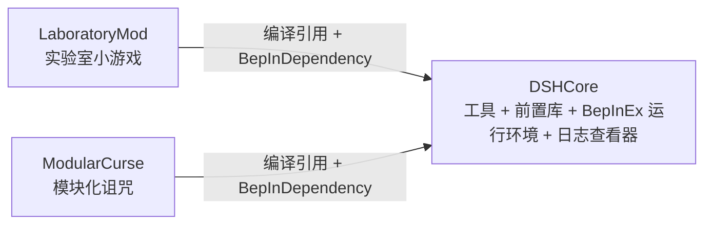

# MVZ2 Mod 工作区

> 《Minecraft vs Zombies 2》（Minecraft VS Zombies 2）0.7.0 的社区 mod 集合。
> 三个相互独立的 mod 共用一个 BepInEx / IL2CPP 构建环境与工具链。

> ⚠️ 本项目为社区制作的**非官方**内容，与游戏原作者无关。
> ⚠️ 全部仅适配 **0.7.0 test-4**（Windows **x86** / IL2CPP / Unity 2022.3.62f3）。

---

## Mod 一览

| 目录 | 名称 | 游戏内命名空间 | 说明 | 前置 |
| ---- | ---- | ---- | ---- | ---- |
| [`DSHCore/`](DSHCore/README.md) | **DSHCore**（工具 + 前置库） | — | IL2CPP 注入基建：ClassInjector 缺陷修复、注入类 vtable 重绑、磁盘 XML metas 注入、存档兜底、街机 Index 平移；并提供 `Il2CppPin` / `InjectedMod` / `ModBootstrap` / `ModInfos` 等公共 API。**同时提供 BepInEx 运行环境**（只有它的包体包含）与**本地网页日志查看器** | — |
| [`LaboratoryMod/`](LaboratoryMod/README.md) | **MVZ2 Laboratory Content**（实验室小游戏） | `mvz2_lab` | 三个实验小游戏：真正的序章 / 零度空间 / 真理伪证殿堂 | DSHCore |
| [`ModularCurse/`](ModularCurse/README.md) | **MVZ2 Modular Curse**（模块化诅咒） | `modular_curse` | 25 条自定义诅咒接入**原版诅咒系统**，按 QC / SC 两个诅咒池组织与切换 | DSHCore |

> 📖 **想写新 mod？先读 [`DSHCore/AI_GUIDE.md`](DSHCore/AI_GUIDE.md)** ——
> 面向 AI 与后来者的开发参考：AI 协作工作流、公共 API 速查、最小 mod 骨架、
> 0.7 官方集成链时序图，以及 16 条「症状 → 根因 → 对策」陷阱清单。



---

## 快速开始

```powershell
.\build.ps1                             # 构建全部（游戏目录存在时自动部署）
.\build.ps1 -Mod curse -Pack -Launch    # 只构建诅咒 mod：打包 + 启动冒烟
.\build.ps1 -Clean -Pack                # 全部：先清理再构建，并打包
```

只想构建单个 mod 时，也可以直接运行该目录下的 `build.ps1`（参数一致）。

| 参数 | 作用 |
| ---- | ---- |
| `-Mod all\|dsh\|lab\|curse` | 选择构建目标（默认 `all`） |
| `-GameDir <dir>` | 部署目标（默认取 `MVZ2_GAME_DIR` 或 `Directory.Build.local.props`；都没有时**只构建不部署**） |
| `-Clean` | 先删除 `bin/` `obj/` |
| `-SkipBuild` | 跳过 `dotnet build`，直接用已有产物 |
| `-KeepGame` | 不结束正在运行的游戏（**游戏会锁住插件 DLL**，一般不要用） |
| `-Pack` | 打包可分发 zip 到 `dist\`（默认**含** BepInEx 运行环境） |
| `-PackDevKit` | 额外打「不含 DSHCore 源码」的便携开发环境包（只对 `dsh` 有效） |
| `-NoRuntime` | 打包时**不带** BepInEx（包体从 ~44MB 降到几十 KB） |
| `-Launch` | 构建/打包后启动游戏 |

VS Code 里这套命令已注册为任务（`Ctrl+Shift+P` → `Tasks: Run Task`）：
构建全部 / 构建全部 + 打包 / 三个 mod 单独构建 / 打包 DevKit / 同步 runtime /
清理构建产物 / 查看 BepInEx 日志（含 `ErrorLog.log`）。
（多根工作区里用 `MVZ2Mod.code-workspace` 自带的那份任务。）

---

## 看日志 / 那个黑色日志窗口

装了 DSHCore 之后，可以在游戏里当场把日志开到网页上看。**默认不开**
（不占端口、不弹浏览器），需要时：

```
进游戏 → 按 / 打开调试控制台 → 输入 /dshlog
```

会起一个**只监听 `127.0.0.1`** 的本地网页并自动用浏览器打开，实时显示**所有插件**的日志。
日志是从**游戏启动**就开始记的，所以一开就能看到之前的完整历史。

指令名支持 **Tab 补全**：输个 `/ds` 按 Tab 就会补成 `/dshlog`，再接着输 `o` 能补出
`off` / `open` 等子指令，不用背。

| 指令 | 作用 |
| ---- | ---- |
| `/dshlog` | 开启（已开启则显示状态） |
| `/dshlog off` | 关闭并释放端口（内存历史保留） |
| `/dshlog open` | 用默认浏览器打开 |
| `/dshlog url` | 只打印带令牌的地址 |
| `/dshlog status` | 显示状态 |
| `/dshlog console` | 显示 / 隐藏 BepInEx 控制台窗口 |
| `/dshlog clear` | 清空内存里的历史 |
| `/dshlog help` | 帮助 |

> 调试控制台需要存档用户名是 `debug` —— 这是游戏自身的限制。
> URL 里的令牌只在本会话有效，`/api/status` 不会把它回吐出去。

网页是**三栏**：左边筛选（等级 / 来源 / 关键词）、中间日志、右边点开的详情。
两条分隔条都能拖动调宽度，双击分隔条或点「重置分栏宽度」恢复默认，
宽度会记住（存在浏览器本地）。没选中行时右栏收起，日志区自动变宽。

配置在 `BepInEx/config/qoznos.mvz2.core.cfg` 的 `[LogViewer]` 段
（端口、是否开机自动开启、内存历史条数、局域网访问等）。

**控制台黑窗口**：本仓库的 `runtime/BepInEx/config/BepInEx.cfg` 已经把
`[Logging.Console] Enabled` 设为 `false`，所以黑窗不会再出现（日志照旧写磁盘）。
想要它回来：改回 `true`，或游戏内 `/dshlog console` 临时显示。

> 如果游戏是从已有终端启动的，BepInEx 是**附着**到那个终端的窗口，
> 此时隐藏会被**主动拒绝**（藏了会连你自己的终端一起没），网页里表现为
> `not-our-window` —— 这是保护，不是故障。

---

## 环境要求

| 项 | 要求 |
| ---- | ---- |
| 操作系统 | Windows |
| 脚本环境 | PowerShell 5.1+ |
| 构建 | [.NET 6 SDK](https://dotnet.microsoft.com/download/dotnet/6.0) |
| 游戏 | MVZ2 **0.7.0 test-4**，Windows x86 版 |
| 编译引用 | `runtime\`（可选）**或游戏目录本身**，见下 |

### 告诉构建你的游戏装在哪

仓库里**不含任何人的本机路径**。二选一：

```powershell
# 方式 A：复制模板，填一次就长期有效（该文件不入库）
Copy-Item Directory.Build.local.props.example Directory.Build.local.props
notepad Directory.Build.local.props        # 把 <GameDir> 改成你的游戏目录

# 方式 B：环境变量
setx MVZ2_GAME_DIR "E:\Game\PVZ\MVZ2\MVZ2 0.7.0 test-4\"
```

> 结尾的反斜杠不能少。没配置也能构建，只是**不会自动部署**到游戏。

### 编译引用从哪来（`runtime\` 可以不要）

游戏目录本身就（`winhttp.dll` + `BepInEx\core` + `BepInEx\interop`）就是一套
合法的 BepInEx 环境，可以直接当编译引用 —— **装了游戏就不必再同步一份 `runtime\`**。

解析顺序（`Directory.Build.props` 与 `tools\build-common.ps1` 共用同一套规则）：

1. `-p:RuntimeDir=` / `MVZ2_RUNTIME_DIR` 环境变量
2. `Directory.Build.local.props` 里的 `<RuntimeDir>`
3. 仓库内 `runtime\`
4. 工作区根本身就是一套 BepInEx 安装（DevKit 包）
5. `GameDir`（← 装了游戏的人走这条，什么额外步骤都不用）

只有想**打包分发**时才必须有 `runtime\`（包体要从它取 BepInEx）：

```powershell
.\tools\sync-runtime.ps1 -GameDir "<游戏目录>"
```

若游戏目录里还**没有**可用的 BepInEx 环境：

1. 下载 **BepInEx `be.788` x86 IL2CPP** 构建，解压到游戏根目录；
2. 确认 `BepInEx/config/BepInEx.cfg` 里 `[IL2CPP] UpdateInteropAssemblies = true`，
   启动一次游戏，让它按当前游戏自动生成 `BepInEx/interop`（约 20 秒，需联网下载 Unity 基础库）；
3. 再运行 `tools\sync-runtime.ps1`。

> **为什么必须是 `be.788`**：本游戏的 IL2CPP metadata 是 **v31.1**。
> 旧版 BepInEx（≤ `be.697`）自带的 Cpp2IL 只支持到 metadata v29，会直接报
> `Unsupported metadata version found! We support 23-29, got 31`，无法为它生成 interop。

---

## 目录结构

```
MVZ2Mod/
├─ build.ps1                    总构建脚本（编排三个 mod）
├─ Directory.Build.props        共享编译环境解析（RuntimeDir / GameDir / DSHCore 引用）
├─ Directory.Build.local.props.example  本机配置模板（复制成 .props 后生效，不入库）
├─ MVZ2Mod.code-workspace       多根工作区（想单开一个 mod 时用）
├─ readme.md                    本文件
├─ DSHCore/                     工具 + 前置库（基建）
│   ├─ Directory.Build.props    接入共享解析（转发到仓库根）
│   ├─ build.ps1  README.md  AI_GUIDE.md  devkit-readme.txt  DSHCore.csproj  *.cs
├─ LaboratoryMod/               实验室小游戏
│   ├─ Directory.Build.props    接入共享解析（新 mod 照抄这一份）
│   ├─ build.ps1  README.md  LaboratoryMod.csproj  *.cs
│   ├─ assets/                  资源（映射到 StreamingAssets/Mods/mvz2_lab/）
│   └─ Stages/                  三个关卡定义
├─ ModularCurse/                模块化诅咒
│   ├─ Directory.Build.props    接入共享解析
│   ├─ build.ps1  README.md  CURSES.md  ModularCurse.csproj  *.cs
│   ├─ assets/                  资源（映射到 StreamingAssets/Mods/modular_curse/）
│   └─ CurseBuffs/              诅咒 buff 实现
├─ _refs/DSHCore/               编译引用：DSHCore.dll（入库，构建时自动同步）
├─ tools/
│   ├─ build-common.ps1         三个 mod 共用的构建/部署/打包函数
│   ├─ sync-runtime.ps1         从游戏目录刷新 runtime/
│   ├─ show-log.ps1             看测试游戏目录的 BepInEx 日志
│   ├─ InteropGen/              interop 预生成工具（备用方案）
│   └─ Il2CppDumper/            IL2CPP 分析工具（按需下载，不入库）
├─ runtime/                     自包含 BepInEx 环境（不入库，可选）
└─ dist/                        打包输出（不入库）
```

**资源放置约定**：每个 mod 的资源都在自己目录下的 `assets/`，
其**内容**直接映射到 `<游戏>\MinecraftVSZombies2_Data\StreamingAssets\Mods\<命名空间>\`。
构建时由 csproj 的 `DeployModAssets` 目标自动部署。

---

## DSHCore 前置：两种引用方式

`LaboratoryMod` / `ModularCurse` 都依赖 DSHCore。引用方式由 `Directory.Build.props`
自动决定，**不需要改 csproj**：

| 模式 | 触发条件 | 引用 |
| ---- | ---- | ---- |
| 源码 | 仓库里存在 `DSHCore\DSHCore.csproj` | `ProjectReference`，一并构建 |
| 二进制 | 源码不存在（或 `-p:DshCoreFromSource=false`） | `_refs\DSHCore\DSHCore.dll` |

`_refs\DSHCore\DSHCore.dll` 由 **DSHCore 每次构建时自动同步**（`SyncDshCoreRefs` 目标），
所以不会过期；它**入库**，让只拿到 mod 源码的人也能直接编译。

### 在 VS Code 里打开

| 打开方式 | 结果 |
| ---- | ---- |
| 打开**仓库根**目录 | ✅ 推荐。三个工程都在工作区内，一切正常 |
| 打开 `MVZ2Mod.code-workspace` | ✅ 侧边栏只显示单个 mod 时用这个（多根工作区） |
| 直接打开 `LaboratoryMod\` 子目录 | ❌ DSHCore 落在工作区之外，语言服务器会满屏报「未能找到类型或命名空间名 DSHCore」 |

> 最后一种**只是编辑器的问题** —— `dotnet build` 其实能过。要单开一个 mod，
> 请用多根工作区，而不是直接打开子目录。

### 便携开发环境（DevKit）

给「不想碰 DSHCore 源码、只想写自己的 mod」的人：

```powershell
.\build.ps1 -Mod dsh -PackDevKit            # 带 runtime\
.\build.ps1 -Mod dsh -PackDevKit -NoRuntime # 精简版（使用者靠自己的游戏目录）
```

产出 `dist\DSHCore-DevKit_v<版本>_0.7.0.zip`，解压后就是一个自洽的工作区根：

```
MVZ2-Mod-DevKit/
├─ Directory.Build.props        编译环境解析（唯一真源）
├─ README-DevKit.txt            上手说明
├─ MVZ2Mod.code-workspace
├─ _refs\DSHCore\               ← 编译前置，**不含 DSHCore 源码**
├─ runtime\                     编译引用（-NoRuntime 时没有）
├─ tools\  .vscode\
├─ DSHCore\                     仅文档（AI_GUIDE.md 等）
└─ LaboratoryMod\  ModularCurse\  两个可运行的范例 mod
```

> DevKit 里的 mod 目录都自带 `Directory.Build.props` 转发文件，
> 所以**单个 mod 目录拎出去也能构建**。

新 mod 想接入这套共享解析，把任意一个 mod 目录下的 `Directory.Build.props`
复制过去即可；不想接入（例如工具类工程）就别放。

---

## 打包规则

| 包 | 包含 | 说明 |
| ---- | ---- | ---- |
| `DSHCore_v*_0.7.0.zip` | **BepInEx 运行环境** + 插件 | 完整独立安装包，解压到游戏根目录即可用 |
| `DSHCore-DevKit_v*_0.7.0.zip` | 运行环境 + 开发工具 + **两个范例 mod 源码** + `_refs\` | 便携开发环境，**不含 DSHCore 源码** |
| `LaboratoryMod_v*_0.7.0.zip` | **BepInEx 运行环境** + 插件 + 资源 + `DSHCore.dll` | 完整独立安装包（不需先装前置） |
| `ModularCurse_v*_0.7.0.zip` | **BepInEx 运行环境** + 插件 + 资源 + `DSHCore.dll` | 同上 |

> 即：**每个包都是自包含的**，玩家装一个 zip 就能用（每个 ~44 MB）。
> 只要插件本体（比如给已装好的游戏换个 DLL）时加 `-NoRuntime`，包体就降到几十 KB。

---

## 开发须知（IL2CPP 注入三大坑）

这三条是踩了几轮崩溃后总结的硬约束，写任何注入类 mod 都适用：

1. **托管 `new` 出来的 il2cpp 对象，写进注入类实例字段后会被 GC 回收。**
   注入类的字段不被 il2cpp GC 追踪，几秒后字段变悬垂指针 —— 表现为
   `GetID()` 值比较静默失败（关卡不出现在列表）、读字符串触发
   `Fatal error. Internal CLR error (0x80131506)`。
   → 必须用 GC 句柄钉住：见 `LaboratoryMod/Il2CppPin.cs`。

2. **游戏二进制更新后，`BepInEx/interop` 必须重新生成。**
   类型代理按 metadata token 解析，token 一重排就失配，表现为**随机 `0xC0000005` AV**
   （崩点漂移、无托管栈）。`UpdateInteropAssemblies = true` 时 BepInEx 会自动重生成。

3. **原生崩溃的托管栈只在 `BepInEx/ErrorLog.log` 里**，`LogOutput.log` 里没有。
   另外：不要在 `PostInit` / `PostReloadMods` 里调用官方的 `DefinitionGroup.GetDefinitions()`
   等 LINQ 链路 —— 注入 def 参与原生 LINQ 枚举时会非确定性失败。

更完整的注入注意事项见 [`DSHCore/AI_GUIDE.md`](DSHCore/AI_GUIDE.md)。

---

## 免责声明

本仓库**仅包含** mod 自身代码与自建资源，不包含任何游戏反编译产物或游戏源码 ——
`runtime/`、`_Scripts/`、`tools/Il2CppDumper/` 等派生内容均已被 `.gitignore` 排除，
仅用于本地开发。请勿向本仓库提交此类文件。

本 mod 非官方出品；请尊重游戏原作者的权利，勿用于商业用途。

## 许可证

本项目以 [GPL-3.0](LICENSE) 开源。BepInEx 与其相关组件遵循各自的原许可证。

## 致谢

- **Cuerzor** — 《Minecraft vs Zombies 2》作者，以及 0.7.0 的官方 Mod 扩展点与原生诅咒系统设计
- [BepInEx](https://github.com/BepInEx/BepInEx) / [Il2CppInterop](https://github.com/BepInEx/Il2CppInterop) — IL2CPP 游戏注入框架
- [Cpp2IL](https://github.com/SamboyCoding/Cpp2IL) / [Il2CppDumper](https://github.com/Perfare/Il2CppDumper) — IL2CPP 分析工具
