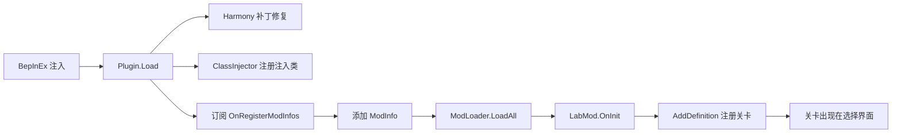

# MVZ2LabMod — MVZ2 实验室内容 Mod

> 《我的世界大战僵尸2》（Minecraft VS Zombies 2）的社区 Mod：把我制作的 0.6.4 `laboratory` 分支里的实验小游戏，以外部 Mod 的形式带到 **0.7.0 test-1** 测试版。

- 利用游戏 0.7.0 内置的**官方外部 Mod 扩展点**（`OnRegisterModInfos`）注册内容，全程不修改任何游戏原始文件
- 基于 BepInEx 6 IL2CPP（Windows x86）+ 少量 Harmony 补丁绕过 IL2CPP 注入的坑
- 一键构建、一键打包、一键部署（PowerShell 脚本）

> ⚠️ 本 Mod 为社区制作的**非官方**内容，与游戏原作者无关。
> ⚠️ 仅适配 **0.7.0 test-1（Windows x86 / IL2CPP）**，其他版本不保证可用。

## 包含内容

| 关卡 | 说明 | 状态 |
| ---- | ---- | ---- |
| `real_prologue` 真正的序章 | 纯原版行为组合的迷你关卡（冒烟测试目标） | ✅ 可玩 |
| `zero_k_space` 零度空间 | 配合「瞬间充能 + 火药爆炸」自定义关卡行为 | 🚧 开发中 |
| `unknow_palace` 真理伪证殿堂 | 配合「选卡记录/替换」自定义关卡行为，最复杂 | 🚧 开发中 |

## 安装（玩家向）

1. 你需要 `MVZ2LabMod_v*_0.7.0.zip` 和 `MinecraftVSZombies2-0.7.0测试1-Windows.zip`
2. 解压到游戏根目录（`winhttp.dll`、`doorstop_config.ini` 与 `MinecraftVSZombies2.exe` 同级）
3. 启动游戏，进入关卡选择界面即可看到新条目

卸载：删除解压出来的 `winhttp.dll`、`dotnet/`、`BepInEx/plugins/MVZ2LabMod.dll`、`MinecraftVSZombies2_Data/StreamingAssets/Mods/mvz2_lab/` 即可。

## 从源码构建（开发者向）

### 前置要求

- Windows + PowerShell 5.1+
- [.NET 6 SDK](https://dotnet.microsoft.com/download/dotnet/6.0)（构建插件与工具）
- 游戏本体（0.7.0 test-1，用于生成 interop 与本地测试）

### 首次环境准备（interop 代理）

本游戏 IL2CPP metadata 为 **v31**，BepInEx 6 pre.2 内置的 Cpp2IL 只支持到 v29，因此 interop 代理必须预生成：

1. 下载 **`BepInEx-Unity.IL2CPP-win-x86-6.0.0-pre.2.zip`**（官方发布页），解压到游戏根目录
2. 用 [Il2CppDumper](https://github.com/Perfare/Il2CppDumper) 对 `GameAssembly.dll` + metadata 跑一次，得到 `DummyDll/`（92 个假程序集）
3. 生成 interop 代理：`cd tools\InteropGen; dotnet run -c Release`
4. 把 `BepInEx/config/BepInEx.cfg` 中 `UpdateInteropAssemblies` 设为 `false`，并把工具输出的 `assembly-hash.txt` 放进 `BepInEx/interop/`
5. 验证：`dotnet run -c Release -- check <dll> <类型名>` 可查询代理构造器

### 构建与打包

```powershell
.\build.ps1                  # 构建插件 + 打包 zip 到 dist\
```

| 参数 | 作用 |
| ---- | ---- |
| `-OutDir <dir>` | 输出目录（默认 `dist\`） |
| `-SkipRuntime` | 打包时排除 `dotnet/` 运行时（接收方需自备 BepInEx 环境） |
| `-SkipBuild` | 跳过编译，直接用已有产物打包 |
| `-GameDir <dir>` | 同时部署到测试游戏目录（检测到 `MinecraftVSZombies2.exe` 才生效） |
| `-Launch` | 打包/部署后启动游戏冒烟（需 `-GameDir`） |
| `-SyncRuntime` | 维护模式：把游戏目录的 BepInEx 环境刷新回仓库 `runtime/` |

### 开发热部署

```powershell
.\deploy.ps1 -GameDir "<游戏目录>"    # 部署 XML 资源 → 构建 → 停游戏 → 拷 DLL → 启动
.\deploy.ps1 -SkipLaunch             # 只部署，不启动游戏
```

> 运行中的游戏会锁定插件 DLL，部署脚本会先结束游戏进程。

### 日志排查

| 日志 | 位置 |
| ---- | ---- |
| BepInEx | `<游戏目录>\BepInEx\LogOutput.log` |
| 游戏日志 | `%LOCALAPPDATA%Low\Cuerzor\MinecraftVSZombies2Test\mvz2_log.log` |

## 工作原理



### 注册流程

0.7.0 内置了正式的外部 Mod 扩展点：订阅 `ModManager.add_OnRegisterModInfos(...)` → 在回调里向列表添加 `ModInfo` → 游戏管线自动完成加载。`LabMod` 继承自 `Mod` 抽象类，在 `OnInit` 中调用 `AddDefinition` 注册关卡定义。**无需反射、无需改动游戏文件。**

### Harmony 补丁一览

| 文件 | 作用 |
| ---- | ---- |
| `ClassInjectorFix.cs` | 修复 ClassInjector 无法处理基类泛型虚方法 vtable 与 `System.String` 重写的问题 |
| `ModLogicFix.cs` | 修复 0.7.0 `LoadMods` 重建 Logic 导致抽象方法槽崩溃 |
| `SaveManagerPatch.cs` | 读档时兜底直写 Logic 字段 |
| `MetaValidation.cs` | 接管 `LoadMetaLists`，从磁盘直接解析 XML metas（绕过 Addressables，无需改 bundle） |
| `ModFileProvider.cs` / `ModFileResources.cs` | 磁盘文件资源 Provider 与 `ResourceLocator` 构建 |
| `StageMetaApplier.cs` | 把 XML 关卡 meta 的属性应用到 `StageDefinition` |
| `VTableDiag.cs` / `VTableRebind.cs` / `ModCallTracer.cs` | IL2CPP vtable 诊断辅助（排查注入问题用） |

## 项目结构

```
MVZ2LabMod/                插件源码（C# / net6.0）
  Plugin.cs                入口：补丁注册 + OnRegisterModInfos 订阅
  LabMod.cs                Mod 逻辑主体：OnInit 注册关卡定义
  Stages/                  关卡定义（RealPrologueStage 等）
  *.cs                     Harmony 补丁与诊断
ModAssets/mvz2_lab/        Mod 资源
  Content/metas/*.xml      stages.xml + arcade.xml（关卡 meta，随构建自动部署）
runtime/                   自包含 BepInEx 6 运行环境（编译引用 + 打包源）
tools/InteropGen/          interop 代理预生成工具（Cpp2IL 不支持 metadata v31 的替代方案）
build.ps1                  一键构建 + 打包 zip
deploy.ps1                 开发热部署（部署资源 → 构建 → 停游戏 → 拷 DLL → 启动）
```

## 已知限制

- 仅适配 0.7.0 test-1（Windows x86 IL2CPP）
- 存档沿用原版 `mvz2:` 命名空间写入，**卸载 Mod 后**存档里相关关卡记录可能报错
- 新关卡图标暂复用原版资源（arcade 界面）
- IL2CPP 注入环境限制：托管侧 `is LabMod` 判断恒为 `false`（需用 `Pointer` 比较）；托管侧不应通过 `Mod` 代理调用抽象方法（详见源码注释）

## Roadmap

- [x] `real_prologue` 关卡定义 + XML 载入链路（已实测，游戏可进主菜单）
- [ ] `zero_k_space` + 瞬间充能 / 火药爆炸关卡行为（`ZeroKSpaceStageBehaviour`）
- [ ] `unknow_palace` + 选卡记录/替换逻辑（`UnknowPalaceStageBehaviour`）
- [ ] 零度空间费用倍率 Buff（`ZeroKSpaceCostBuff`）
- [ ] 关卡专属图标与资源（精灵/音乐走 Provider 链路加载）
- [ ] 清理 `Plugin.Load` 中的 SelfTest 诊断日志
- [ ] 后续会考虑将自制关卡和xml注册功能拆分两个mod，后者作为前置

## 免责声明

本仓库**仅包含** Mod 自身代码与自建资源，不包含任何游戏反编译产物或游戏源码——这些仅用于本地开发，且已被 `.gitignore` 排除。请勿向本仓库提交此类文件。

本 Mod 非官方出品；请尊重游戏原作者的权利，勿将本 Mod 用于商业用途。

## 许可证

本项目以 [GPL-3.0](LICENSE) 许可证开源。BepInEx 与其相关组件遵循各自的原许可证。

## 致谢

- Cuerzor — 《我的世界大战僵尸2》作者，以及 0.7.0 出色的官方 Mod 扩展点设计
- [BepInEx](https://github.com/BepInEx/BepInEx) / [Il2CppInterop](https://github.com/BepInEx/Il2CppInterop) — IL2CPP 游戏注入框架
- [Il2CppDumper](https://github.com/Perfare/Il2CppDumper) — 分析工具
